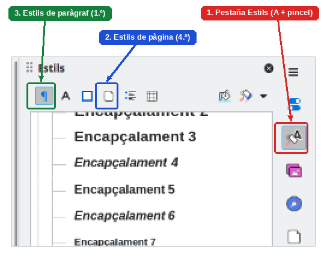
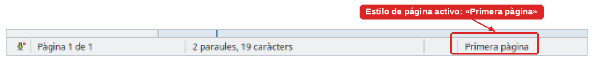
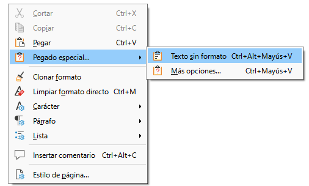
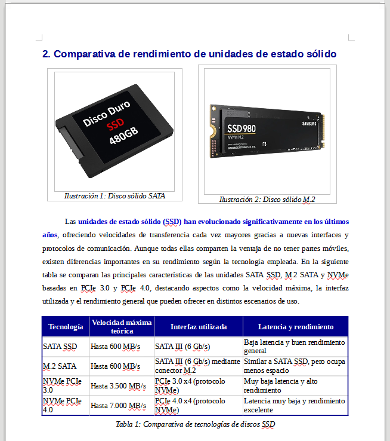
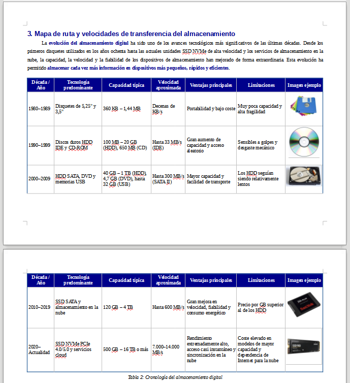

# 📝 Actividad 1 – Creación de documentos con LibreOffice Writer

## Objetivo
Dominar de forma avanzada las herramientas de maquetación y diseño de **LibreOffice Writer**. A través de esta actividad, aprenderás a trabajar con **estilos de página** (portada vs. contenido), aplicarás formatos avanzados de **carácter** (colores, resaltados, efectos) y **párrafo** (sangrías, letras capitulares, bordes con sombra), utilizarás **secciones** con fondos personalizados, insertarás imágenes con **leyendas automatizadas**, y estructurarás tablas con **estilos y alineaciones celdas personalizadas**.

---

## Pasos de la actividad

> ⚠️ **¡Atención!** Trabaja de forma ordenada. Recuerda guardar tu documento dentro de tu carpeta del curso: `Digitalizacion_4ESO/Tema_2/Actividad_1/`.
{: .alert-warning}

> ℹ️ **Idioma de los menús:** En los ordenadores del aula LibreOffice Writer suele aparecer en catalán. A lo largo de esta actividad verás cada opción en **castellano** seguida de su nombre en **catalán** entre paréntesis, por ejemplo: *Formato -> Estilo de página...* (*Format -> Estil de pàgina...*).
{: .alert-info}

### 1. Portada y Estilos de Página
Una portada académica nunca debe llevar encabezado ni pie de página. Para lograr esto, utilizaremos los **Estilos de Página** (*Estils de pàgina*) de Writer.

1. Abre **LibreOffice Writer**.
2. Ve al panel lateral derecho, abre la pestaña de **Estilos** (*Estils*) {: .no-border style="height: 1.25em; vertical-align: middle;"} (icono de la `A` con un pincel) y haz clic en el icono de **Estilos de página** (*Estils de pàgina*) {: .no-border style="height: 1.25em; vertical-align: middle;"} (el cuarto icono).

{: .img .img-250}

3. Haz doble clic sobre el estilo **Primera página** (*Primera pàgina*). Verás que en la barra de estado de abajo ahora pone «Primera página» (*«Primera pàgina»*).
{:start="3"}

{: .img}

4. **Configuración de márgenes, borde y espaciado de la Portada:** 
   * Ve a *Formato -> Estilo de página...* (*Format -> Estil de pàgina...*).
   * En la pestaña **Página** (*Pàgina*), cambia los márgenes a `2,0 cm` en todos los lados (superior, inferior, izquierdo, derecho).
   * En la pestaña **Bordes** (*Vores*), añade un borde completo de color azul oscuro con un grosor de `1,50 pt`. En la sección **Separación** (*Separació*, el espaciado de seguridad para separar el borde del texto), configúralo a `1,0 cm` en todos los lados.
   * En la pestaña **Área** (*Àrea*), pon un color de fondo muy claro (por ejemplo, azul pastel o gris claro) solo para esta primera hoja de portada.
{:start="4"}

5. Vuelve a **Estilos de párrafo** (*Estils de paràgraf*) {: .no-border style="height: 1.25em; vertical-align: middle;"} (el primer icono de la pestaña de estilos lateral, marcado con el **3** en la primera captura).
{:start="5"}

6. Diseña tu portada utilizando **Estilos de Párrafo** (*Estils de paràgraf*):
   * Escribe el título: **«Informe Tecnológico: La evolución del almacenamiento digital»**.
     * Con el cursor en esa línea, selecciona el estilo **Título** (*Títol*) de la lista de estilos (dentro de **Encabezado** / *Encapçalament*).
     * Modifica el formato manualmente: fuente **Liberation Sans**, tamaño **38 pt**, negrita (*Negreta*), centrado (*Centrat*) y color **Azul oscuro** similar al del borde de la página.
     * **Actualizar el estilo:** Con el texto seleccionado, haz clic en el botón directo **Actualizar estilo seleccionado** (*Actualitza l'estil seleccionat*) {: .no-border style="height: 1.25em; vertical-align: middle;"} de la barra superior (justo a la derecha del selector de estilos) o bien ve al panel lateral **Estilos** (*Estils*), despliega las opciones del botón de arriba a la derecha (icono con flecha) y haz clic en **Actualizar estilo seleccionado** (*Actualitza l'estil seleccionat*). Esto hará que el estilo «Título» (*«Títol»*) asuma de forma definitiva esta configuración.
   * Escribe el subtítulo: *«Análisis de soportes físicos, de estado sólido y sistemas en la nube»*.
     * Aplícale el estilo **Subtítulo** (*Subtítol*).
     * Modifícalo a: fuente **Liberation Sans**, tamaño **18 pt**, cursiva (*Cursiva*), centrado (*Centrat*), color gris oscuro y actualiza el estilo con la opción **Actualizar estilo seleccionado** (*Actualitza l'estil seleccionat*) {: .no-border style="height: 1.25em; vertical-align: middle;"}.
   * Deja varios espacios vacíos para desplazar los datos del autor hacia la parte inferior.
   * Escribe tu nombre, apellidos y fecha. Aplícales el estilo **Estilo de párrafo predeterminado** (*Estil de paràgraf per defecte*) o **Cuerpo de texto** (*Cos del text*). Aplica a estos datos la fuente **Liberation Sans**, tamaño de **11 pt**, y **alínealos a la derecha** (*Alinea a la dreta*).
{:start="6"}

{: .img}

7. Inserta un salto de página manual que cambie el estilo de la siguiente hoja a normal:
   * Ve a *Insertar -> Más saltos -> Salto manual...* (*Insereix -> Més salts -> Salt manual...*).
   * En **Tipo** (*Tipus*), elige **Salto de página** (*Salt de pàgina*) y en **Estilo de página** (*Estil de pàgina*) selecciona **Estilo de página predeterminado** (*Estil de pàgina per defecte*). Haz clic en *Aceptar* (*D'acord*).
{:start="7"}

**Ejemplo de resultado esperado (Portada):**
{: .centrado}

{: .no-border .img .img-450}

> **Importante**: Sube a Aules el documento con el **ejercicio 1 finalizado** y con el nombre: `actividad1_writer_tuapellido_tunombre_ej1.odt`
{: .alert-success}

---

### 2. Formato de carácter y párrafo
En esta segunda página (que ahora tiene el *Estilo de página predeterminado* / *Estil de pàgina per defecte*), redactaremos la introducción aplicando formatos detallados y estructurando los encabezados mediante estilos para poder generar un índice automático en el futuro.

> **Nota:** Utiliza el **pegado especial de texto sin formato** (*Pegado especial -> Texto sin formato* / *Enganxament especial -> Text sense format*) para evitar copiar estilos del navegador:

{: .img}
{: .alert-info}

1. Escribe el título: **«1. Introducción al almacenamiento digital»**.
   * Selecciónalo y asígnale el estilo **Título 1** (*Encapçalament 1*).
   * Modifícalo a: fuente **Liberation Sans**, tamaño **16 pt**, negrita (*Negreta*), color **Azul oscuro**, alineado a la izquierda (*Alinea a l'esquerra*).
   * Ve a *Formato -> Párrafo...* (*Format -> Paràgraf...*), pestaña **Sangrías y espaciado** (*Sagnats i espaiat*), y añade un espaciado **Bajo el párrafo** (*Sota el paràgraf*) de **0,50 cm**.
   * Por último, actualiza el estilo pulsando en **Actualizar estilo seleccionado** (*Actualitza l'estil seleccionat*) {: .no-border style="height: 1.25em; vertical-align: middle;"}.
2. **Redacta dos párrafos de introducción** (de unas 5-6 líneas cada uno) sobre la evolución del almacenamiento desde los disquetes hasta el almacenamiento moderno. Puedes utilizar internet o alguna I.A. tipo ChatGPT para que te ayude. **Asegúrate de que entre ambos párrafos no haya espacios (líneas) en blanco**.
3. Aplica los siguientes formatos a los párrafos que has redactado:
   * **Párrafo general:**
      - *Formato -> Carácter...* (*Format -> Caràcter...*): Fuente *Liberation Serif*, 12 pt, **Justificado** (*Justificat*).
      - *Formato -> Párrafo...* (*Format -> Paràgraf...*): **Interlineado** (*Interlineat*) de `1,5 líneas` (*1,5 línies*), con un espaciado de `0,35 cm` **Bajo el párrafo** (*Sota el paràgraf*).
      - Asegúrate de que tienen seleccionado el estilo **Estilo de párrafo predeterminado** (*Estil de paràgraf per defecte*).
   * **Letra Capitular:** Selecciona el primer párrafo, ve a *Formato -> Párrafo... -> pestaña Letras capitulares* (*Format -> Paràgraf... -> pestaña Caplletres*). Activa **«Mostrar letras capitulares»** (*«Mostra les caplletres»*), que ocupe `3 líneas` (*3 línies*) de alto y tenga una distancia al texto (*Espacio hasta el texto* / *Espai per al text*) de `0,2 cm`.
   * **Sangría de primera línea:** En el segundo párrafo, añade una sangría de **Primera línea** (*Primera línia*) de `1,25 cm` (*Formato -> Párrafo... -> pestaña Sangrías y espaciado* / *Format -> Paràgraf... -> pestaña Sagnats i espaiat*).
   * Actualiza el estilo pulsando en **Actualizar estilo seleccionado** (*Actualitza l'estil seleccionat*) {: .no-border style="height: 1.25em; vertical-align: middle;"}.
   * **Efectos de carácter:** Destaca al menos 3 palabras clave del texto usando negrita (*Negreta*) y **color de letra azul** (*Color de la lletra*). Busca un término en inglés (ej. *cloud computing*), aplícale cursiva (*Cursiva*) y un **color de resalte de caracteres (resaltado) amarillo suave** (*Color de realçament dels caràcters*).

{: .img}

4. **Párrafo destacado:** Inserta un tercer párrafo corto con una frase célebre o dato curioso. Selecciónalo y aplícale (*Formato -> Párrafo...* / *Format -> Paràgraf...*):
   * En la pestaña **Sangrías y espaciado** (*Sagnats i espaiat*): sangría izquierda (*Antes del texto* / *Abans del text*) y derecha (*Después del texto* / *Després del text*) de `1,5 cm` y sin sangría de primera línea (`0,0 cm`).
   * En la pestaña **Bordes** (*Vores*): un borde izquierdo grueso (de `3,0 pt` en color azul) y ningún borde en los otros lados, con una **Separación** (*Separació*) al texto por izquierda y derecha de `0,5 cm` y por arriba y abajo de `0,1 cm`, y un **Estilo de sombra** (*Estil de l'ombra*) gris.
   * En la pestaña **Área** (*Àrea*): un color de fondo gris muy claro.
{:start="4"}

**Ejemplo de resultado esperado (Formato de carácter y párrafo):**
{: .centrado}

{: .no-border .img .img-450}

> **Importante**: Sube a Aules el documento con el **ejercicio 2 finalizado** y con el nombre: `actividad1_writer_tuapellido_tunombre_ej2.odt`
{: .alert-success}

---

### 3. Secciones y columnas con personalización
1. Sal del párrafo destacado e inserta un salto de página (*Insertar -> Salto de página* / *Insereix -> Salt de pàgina*) {: .no-border style="height: 1.25em; vertical-align: middle;"}.
2. Añade un título de nivel 2: **«1.1. Comparación de soportes magnéticos y ópticos»**.
   * Selecciónalo y asígnale el estilo **Título 2** (*Encapçalament 2*).
   * Modifícalo a: fuente **Liberation Sans**, tamaño **14 pt**, negrita (*Negreta*), color **Azul oscuro**, alineado a la izquierda (*Alinea a l'esquerra*), añade un espaciado **Bajo el párrafo** (*Sota el paràgraf*) de **0,50 cm** y pulsa en **Actualizar estilo seleccionado** (*Actualitza l'estil seleccionat*) {: .no-border style="height: 1.25em; vertical-align: middle;"}.
3. Inserta una sección de dos columnas con fondo personalizado:
   * Ve a *Insertar -> Sección...* (*Insereix -> Secció...*).
   * En la pestaña **Columnas** (*Columnes*), selecciona `2` columnas, ponles una anchura de `8,25 cm` cada una y deja un **Espaciado** (*Espaiat*) de `0,5 cm` entre ellas. Añade también una **Línea de separación** (*Línia de separació*) entre ellas, sólida de color negro y de `0,5 pt`.
   * En la pestaña **Área** (*Àrea*), selecciona un color de fondo muy suave (por ejemplo, verde pastel claro o amarillo pastel claro).
   * En la pestaña **Sangrías** (*Sagnats*), aplica una **sangría de sección** de `0,5 cm` a la izquierda (*Antes de la sección* / *Abans de la secció*) y derecha (*Después de la sección* / *Després de la secció*) para que el color de fondo de la sección no quede pegado a los márgenes generales del papel (también puedes modificarlo después desde *Formato -> Secciones... -> Opciones...* / *Format -> Seccions... -> Opcions...*).
   * Haz clic en *Insertar* (*Insereix*).
4. Escribe en la columna de la izquierda el funcionamiento básico de un disco duro mecánico (HDD) y en la de la derecha el de un disco óptico (CD/DVD).

**Ejemplo de resultado esperado (Secciones y columnas con personalización):**
{: .centrado}

{: .no-border .img .img-450}

> **Importante**: Sube a Aules el documento con el **ejercicio 3 finalizado** y con el nombre: `actividad1_writer_tuapellido_tunombre_ej3.odt`
{: .alert-success}

---

### 4. Inserción de imágenes con leyendas y tablas
1. Sal de la sección haciendo doble clic abajo, añade un salto de página (*Insertar -> Salto de página* / *Insereix -> Salt de pàgina*) {: .no-border style="height: 1.25em; vertical-align: middle;"} y escribe el título: **«2. Comparativa de rendimiento de unidades de estado sólido»**.
   * Selecciónalo y asígnale el estilo **Título 1** (*Encapçalament 1*). Verás que automáticamente adopta el formato (16 pt, negrita, azul oscuro) que definiste previamente al actualizar este estilo.
2. Busca e inserta **dos imágenes** de discos de estado sólido (un **disco SSD SATA** de 2,5" y un **disco SSD M.2**):
   * Asegúrate de que ambas imágenes tengan **fondo transparente** o bien utiliza la web [remove.bg](https://www.remove.bg){:target="_blank"} para eliminar el fondo.
   * Coloca ambas imágenes una al lado de la otra debajo del título de la sección.
   * **Leyenda en cada imagen:** Haz clic derecho sobre cada imagen y selecciona **Insertar leyenda...** (*Insereix una llegenda...*):
     * En la primera imagen añade como texto: `Disco sólido SATA` (categoría **Ilustración** / *Il·lustració*).
     * En la segunda imagen añade como texto: `Disco sólido M.2` (categoría **Ilustración** / *Il·lustració*).
   * Ajusta ambos marcos para que tengan un ajuste adecuado y una separación inferior (`0,75 cm`) para no quedar pegados al texto que irá debajo.
3. Escribe un **párrafo introductorio** explicando brevemente la evolución y ventajas de las unidades de estado sólido (SSD) respecto a interfaces y protocolos (SATA, M.2, NVMe PCIe 3.0 y 4.0). Utiliza el estilo **Cuerpo de texto** (*Cos del text*).
4. **Tabla con formato avanzado y leyenda:** Inserta una tabla de **4 columnas y 5 filas** (*Tabla -> Insertar tabla...* / *Taula -> Insereix una taula...*) {: .no-border style="height: 1.25em; vertical-align: middle;"} para comparar tecnologías:
   * **Contenido:** Puedes consultar o pedir a ChatGPT/IA una tabla comparativa entre SATA SSD, M.2 SATA, NVMe PCIe 3.0 y NVMe PCIe 4.0 con datos de velocidad máxima teórica, interfaz utilizada, y latencia/rendimiento.
   * **Formato de la tabla:**
     * **Fila de cabecera:** Aplica un color de fondo azul oscuro, texto en blanco, negrita (*Negreta*) y centrado (*Centrat*).
     * **Alineación vertical:** Selecciona toda la tabla, haz clic derecho y en *Propiedades de la tabla... -> pestaña Flujo del texto* (*Propietats de la taula... -> pestaña Flux del text*), asegúrate de que la **Alineación vertical** (*Alineació vertical*) de todas las celdas esté en **Centrado** (*Centrat*).
     * **Bordes personalizados:** Configura los bordes internos de la tabla (clic derecho -> *Propiedades de la tabla... -> pestaña Borde* / *Propietats de la taula... -> pestaña Vores*) en color gris claro (`0,5 pt`) y el borde exterior en un color azul más grueso (`1,5 pt`).
   * **Leyenda automática en la tabla:** Haz clic derecho sobre la tabla, selecciona **Insertar leyenda...** (*Insereix una llegenda...*), escoge como categoría **Tabla** (*Taula*) y añade el texto: `Comparativa de tecnologías de discos SSD`. Colócala debajo de la tabla y céntrala. Verás que aparece debajo como *"Tabla 1: Comparativa..."* (*"Taula 1: Comparativa..."*).

**Ejemplo de resultado esperado (Imágenes con leyenda, párrafo y tabla con formato):**
{: .centrado}

{: .no-border .img .img-450}

> **Importante**: Sube a Aules el documento con el **ejercicio 4 finalizado** y con el nombre: `actividad1_writer_tuapellido_tunombre_ej4.odt`
{: .alert-success}

---

### 5. Secciones horizontales y saltos de página
1. Al final del documento, introduce un salto de página manual para cambiar la orientación de la hoja:
   * Ve a *Insertar -> Más saltos -> Salto manual...* (*Insereix -> Més salts -> Salt manual...*).
   * Escoge en **Tipo** (*Tipus*): *Salto de página* (*Salt de pàgina*).
   * En **Estilo de página** (*Estil de pàgina*), selecciona **Horizontal** (*Horitzontal*). Haz clic en *Aceptar* (*D'acord*).
2. En esta hoja horizontal, añade el título: **«3. Mapa de ruta y velocidades de transferencia del almacenamiento»**.
   * Selecciónalo y asígnale el estilo **Título 1** (*Encapçalament 1*).
3. Inserta una tabla ancha de 6 columnas (*Tabla -> Insertar tabla...* / *Taula -> Insereix una taula...*) donde detalles una cronología del almacenamiento digital (desde 1980 hasta la actualidad) e inserta imágenes representativas de cada tecnología en una columna adicional.
   * Al estar en página horizontal, aprovecha el espacio para hacer las columnas anchas.
   * Utiliza el mismo estilo de tabla que en el ejercicio anterior.
   * Inserta una leyenda debajo de la tabla (**Insertar leyenda...** / *Insereix una llegenda...*) con el texto: `Cronología del almacenamiento digital`.
   * Añade un párrafo introductorio antes de la tabla.
   * Si la tabla no cabe en una página, deja que fluya hasta la siguiente.
4. Regresa al formato vertical: introduce otro **salto de página manual** (*Insertar -> Más saltos -> Salto manual...* / *Insereix -> Més salts -> Salt manual...*) y selecciona en **Estilo de página** (*Estil de pàgina*): **Estilo de página predeterminado** (*Estil de pàgina per defecte*).

**Ejemplo de resultado esperado (Secciones horizontales y saltos de página):**
{: .centrado}

{: .no-border .img .img-450}

> **Importante**: Sube a Aules el documento con el **ejercicio 5 finalizado** y con el nombre: `actividad1_writer_tuapellido_tunombre_ej5.odt`
{: .alert-success}

---

### 6. Encabezados y pies de página con campos dinámicos
1. Haz clic en la parte superior de la página 2 (*Estilo de página predeterminado* / *Estil de pàgina per defecte*) y añade un **Encabezado / Cabecera** (*Capçalera*).
2. Escribe a la izquierda: **«Tema 2: Documentos Digitales»**.
3. Pulsa el tabulador para ir a la derecha e inserta un campo automático: *Insertar -> Campo -> Fecha* (*Insereix -> Camp -> Data*). Verás que se inserta la fecha de hoy de manera automática.
4. Selecciona todo el texto de la cabecera y ponlo en tamaño **10 pt**.
5. Ve a *Formato -> Estilo de página... -> pestaña Cabecera -> Más... -> Bordes* (*Format -> Estil de pàgina... -> pestaña Capçalera -> Més... -> Vores*) y añade un borde inferior de color azul y **0,5 pt**.
6. En la parte inferior de la hoja, añade un **Pie de página** (*Peu de pàgina*).
7. Escribe a la izquierda tu nombre completo, y a la derecha introduce la numeración en formato dinámico:
   * Escribe la palabra `Página ` e inserta el campo **Número de página** (*Insertar -> Campo -> Número de página* / *Insereix -> Camp -> Número de pàgina*).
   * Escribe ` de ` e inserta el campo **Recuento de páginas / Total de páginas** (*Insertar -> Campo -> Recuento de páginas* / *Insereix -> Camp -> Recompte de pàgines*).
   * Debe quedar visualmente como: `Página 2 de 4` (y se actualizará solo).
8. Añade el mismo pie y cabecera a las **páginas horizontales** (*Horitzontal*) si no lo tienen.
9. **Verificación:** Comprueba que la página de la Portada (página 1, *Primera pàgina*) **no tiene** ni encabezado ni pie de página, gracias al uso de estilos de página independientes.

**Ejemplo de resultado esperado (Encabezados y pies de página):**
{: .centrado}

{: .no-border .img .img-450}

> **Importante**: Sube a Aules el documento con el **ejercicio 6 finalizado** y con el nombre: `actividad1_writer_tuapellido_tunombre_ej6.odt`
{: .alert-success}

---

## Entregables en Aules

Sube a la tarea de Aules los siguientes **dos archivos**:
* **`actividad1_writer_tuapellido_tunombre_final.odt`** (archivo editable de LibreOffice Writer)
* **`actividad1_writer_tuapellido_tunombre_final.pdf`** (versión exportada en formato PDF)

> 💡 **¿Cómo exportar a PDF en LibreOffice Writer?**
> 1. Ve al menú superior: *Archivo -> Exportar a -> Exportar a PDF...* (*Fitxer -> Exporta com a -> Exporta com a PDF...*), o haz clic en el botón directo **Exportar directamente a PDF** (*Exporta directament a PDF*) {: .no-border style="height: 1.25em; vertical-align: middle;"} de la barra de herramientas superior.
> 2. En la ventana emergente de opciones de PDF, haz clic en **Exportar** (*Exporta*).
> 3. Selecciona la carpeta de la actividad, asegúrate de nombrarlo como `actividad1_writer_tuapellido_tunombre_final.pdf` y haz clic en **Guardar** (*Desa*).
>
> 
> {: .img}
{: .alert-info}

---

## Rúbrica de Evaluación (máx. 10 puntos)

| Criterio | 0 pts | 0.5 pts | 1 pt | 2 pts |
|----------|-------|---------|------|-------|
| **1. Portada y Estilos de página** (máx. 2 pts) | No aplica estilos de página diferenciados. La portada incluye encabezado/pie de las demás páginas. | Aplica el estilo "Primera página" pero la portada carece de formatos visuales (borde, área) o datos del alumno. | Configura la portada sin encabezado/pie, pero comete errores en bordes (1,5 pt con 1,0 cm separación), fondo de área o personalización de Título/Subtítulo. | Portada impecable con estilo "Primera página" (sin cabecera/pie), borde azul de 1,5 pt con separación de 1,0 cm, área de fondo suave, estilos Título (38 pt) y Subtítulo (18 pt) actualizados y datos a la derecha. |
| **2. Formato de carácter y párrafo avanzado** (máx. 2 pts) | No aplica sangrías, letras capitulares ni formatos avanzados de párrafo o carácter. | Aplica algún formato pero omite la letra capitular, la sangría de primera línea o el párrafo destacado. | Configura el texto principal (Justificado, 1,5 líneas, espaciado 0,35 cm) pero la letra capitular (3 líneas, 0,2 cm) o sangría (1,25 cm) son incorrectas. | Formato de párrafo impecable: Título 1 actualizado (16 pt azul), letra capitular exacta en 1er párrafo, sangría de 1,25 cm en 2º, efectos de carácter (negrita azul y resaltado amarillo) y estilo callout destacado perfecto. |
| **3. Secciones y columnas con personalización** (máx. 1 pt) | No crea secciones ni divide el texto en columnas. | Divide en columnas pero no utiliza una sección con fondo personalizado ni línea de separación (0,35 pts). | Crea la sección de 2 columnas con fondo pastel, pero descuida la sangría de sección o línea de separación (0,7 pts). | Sección de dos columnas (8,25 cm ancho, 0,5 cm espaciado) perfectamente estructurada con línea de separación de 0,5 pt, fondo pastel y sangrías de sección laterales de 0,5 cm. |
| **4. Imágenes con leyendas y tablas comparativas** (máx. 2 pts) | Inserta imágenes y tabla sin formato ni leyendas. | Inserta imágenes pero sin fondo transparente o sin leyendas automáticas de ilustración. | Tabla comparativa 4x5 insertada pero carece de centrado vertical de celdas, bordes personalizados o leyenda automática de tabla. | Dos imágenes transparentes con leyendas automáticas. Tabla 4x5 con cabecera azul/blanco centrada, texto centrado verticalmente, bordes personalizados y leyenda automática de tabla. |
| **5. Secciones horizontales y tabla cronológica** (máx. 2 pts) | No alterna la orientación de página a horizontal ni crea la tabla cronológica. | Cambia la orientación pero sin utilizar saltos de página manuales con cambio de estilo de página. | Página horizontal correcta con la tabla, pero omite las imágenes representativas en la columna adicional, el párrafo introductorio o la leyenda automática. | Alternancia perfecta a página horizontal mediante saltos manuales ("Horizontal" y retorno a "Predeterminado"), tabla ancha de 6 columnas con imágenes, párrafo introductorio y leyenda automática. |
| **6. Encabezados y pies de página dinámicos** (máx. 1 pt) | No añade encabezado ni pie de página, o escribe el texto manualmente sin campos. | Inserta encabezado y pie pero sin utilizar campos automáticos (0,35 pts). | Encabezado y pie dinámico aplicados pero con omisiones de formato o numeración (0,7 pts). | Encabezado (10pt, borde inferior azul 0,5pt con Fecha) y pie dinámico (`Página X de Y`) aplicados en todas las páginas (verticales y horizontales) manteniendo la Portada limpia. |
| **7. Entrega en plazo** (máx. 0 pts) | **-2 pts:** No entrega o entrega con un retraso de más de una semana. | **-1.5 pts:** Entrega con un retraso importante de hasta una semana. | **-1 pt:** Entrega con un pequeño retraso de máximo 2 días. | **0 pts:** Entrega la actividad a tiempo dentro del plazo establecido. |

> ⚠️ **Nota sobre la entrega en plazo:** La entrega dentro del plazo establecido no resta puntuación (0 pts). Las entregas con retraso supondrán una penalización de hasta 2 puntos sobre la calificación de la actividad.
{: .alert-error}

**Criterios de evaluación de la programación:**
* **CE2 – 2.2.** Organizar la información y los archivos en el entorno personal de aprendizaje.
* **CE2 – 2.3.** Crear y editar contenidos digitales con sentido estético, respetando los derechos de autor.
* **CE2 – 2.1.** Buscar y seleccionar información contrastando fuentes y comprobando su validez.
