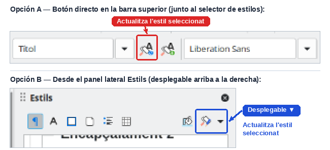
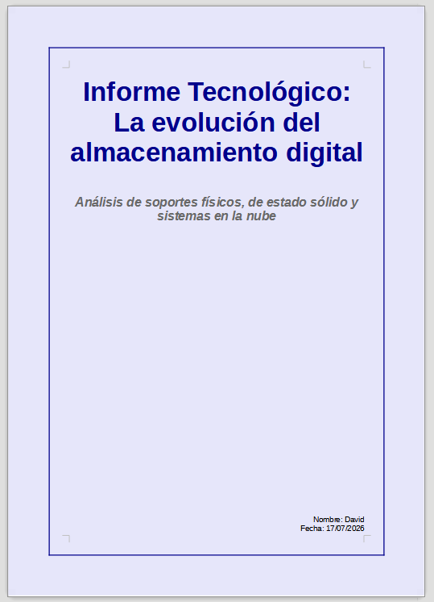
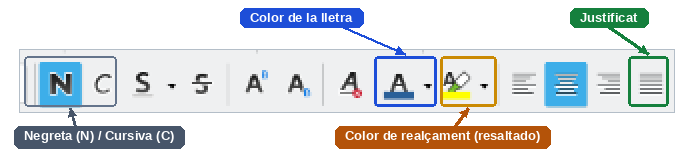
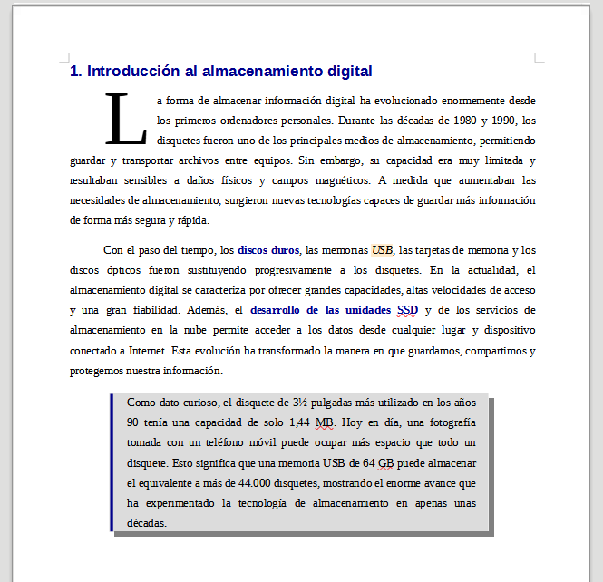
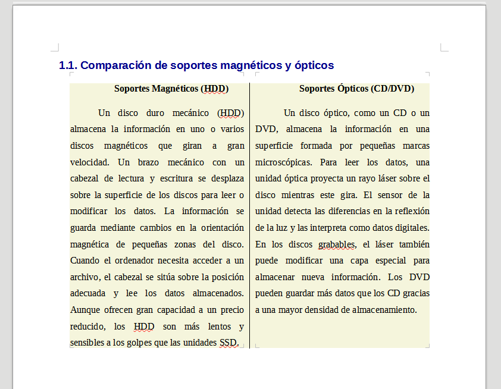
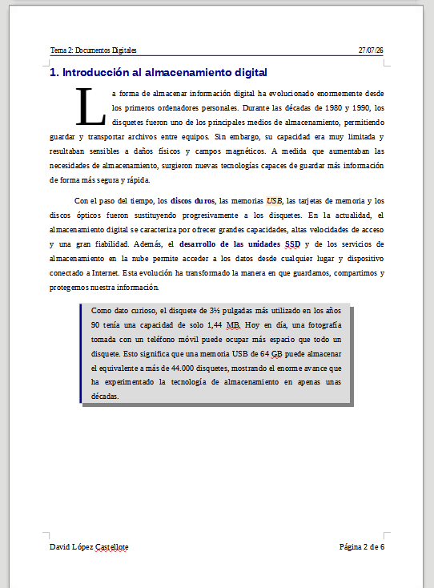
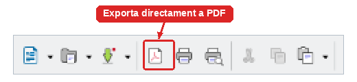

# 📝 Actividad 1 – Creación de documentos con LibreOffice Writer

## Objetivo
Dominar de forma avanzada las herramientas de maquetación y diseño de **LibreOffice Writer**. A través de esta actividad, aprenderás a trabajar con **estilos de página** (portada vs. contenido), aplicarás formatos avanzados de **carácter** (colores, resaltados, efectos) y **párrafo** (sangrías, letras capitulares, bordes con sombra), utilizarás **secciones** con fondos personalizados, insertarás imágenes con **leyendas automatizadas**, y estructurarás tablas con **estilos y alineaciones celdas personalizadas**.

---

## Pasos de la actividad

> ⚠️ **¡Atención!** Trabaja de forma ordenada. Recuerda guardar tu documento dentro de tu carpeta del curso: `Digitalizacion_4ESO/Tema_2/Actividad_1/`.
{: .alert-warning}

> ℹ️ **Idioma de los menús:** En los ordenadores del aula LibreOffice Writer suele aparecer en catalán. A lo largo de esta actividad verás cada opción en **castellano** seguida de su nombre en **catalán** entre paréntesis, por ejemplo: *Formato -> Estilo de página...* (*Format -> Estil de pàgina...*).
{: .alert-info}

### 1. Portada y Estilos de Página
Una portada académica nunca debe llevar encabezado ni pie de página. Para lograr esto, utilizaremos los **Estilos de Página** (*Estils de pàgina*) de Writer.

1. Abre **LibreOffice Writer**.
2. Ve al panel lateral derecho, abre la pestaña de **Estilos** (*Estils*) {: .no-border style="height: 1.25em; vertical-align: middle;"} (icono de la `A` con un pincel) y haz clic en el icono de **Estilos de página** (*Estils de pàgina*) {: .no-border style="height: 1.25em; vertical-align: middle;"} (el cuarto icono).

{: .img .img-250}

3. Haz doble clic sobre el estilo **Primera página** (*Primera pàgina*). Verás que en la barra de estado de abajo ahora pone «Primera página» (*«Primera pàgina»*).
{:start="3"}

{: .img}

4. **Configuración de márgenes, borde y espaciado de la Portada:** ve a *Formato -> Estilo de página...* (*Format -> Estil de pàgina...*) y aplica:
   * Pestaña **Página** (*Pàgina*):
     - Márgenes (superior, inferior, izquierdo y derecho): `2,0 cm`.
   * Pestaña **Bordes** (*Vores*):
     - Disposición: borde completo en los 4 lados.
     - Color: azul oscuro.
     - Grosor: `1,50 pt`.
     - **Separación** (*Separació*, espacio entre el borde y el texto): `1,0 cm` en todos los lados.
   * Pestaña **Área** (*Àrea*):
     - Color de fondo: muy claro (por ejemplo, azul pastel o gris claro) solo para esta primera hoja de portada.
{:start="4"}

5. Vuelve a **Estilos de párrafo** (*Estils de paràgraf*) {: .no-border style="height: 1.25em; vertical-align: middle;"} (el primer icono de la pestaña de estilos lateral, marcado con el **3** en la primera captura).
{:start="5"}

6. Diseña tu portada utilizando **Estilos de Párrafo** (*Estils de paràgraf*):
   * **Título:** escribe **«Informe Tecnológico: La evolución del almacenamiento digital»** y configúralo así:
     - Estilo base: **Título** (*Títol*, dentro de **Encabezado** / *Encapçalament*).
     - Fuente: **Liberation Sans**.
     - Tamaño: **38 pt**.
     - Estilo de letra: negrita (*Negreta*).
     - Alineación: centrado (*Centrat*).
     - Color: **Azul oscuro** (similar al del borde de la página).
     - **Actualizar el estilo:** con el texto seleccionado, haz clic en **Actualizar estilo seleccionado** (*Actualitza l'estil seleccionat*) {: .no-border style="height: 1.25em; vertical-align: middle;"} en la barra superior (justo a la derecha del selector de estilos) o desde el botón desplegable arriba a la derecha del panel lateral **Estilos** (*Estils*).
   * **Subtítulo:** escribe *«Análisis de soportes físicos, de estado sólido y sistemas en la nube»* y configúralo así:
     - Estilo base: **Subtítulo** (*Subtítol*).
     - Fuente: **Liberation Sans**.
     - Tamaño: **18 pt**.
     - Estilo de letra: cursiva (*Cursiva*).
     - Alineación: centrado (*Centrat*).
     - Color: gris oscuro.
     - **Actualizar el estilo:** pulsa **Actualizar estilo seleccionado** (*Actualitza l'estil seleccionat*) {: .no-border style="height: 1.25em; vertical-align: middle;"}.
   * **Datos del autor:** deja varios espacios vacíos hacia la parte inferior, escribe tu nombre, apellidos y fecha y configúralos así:
     - Estilo: **Estilo de párrafo predeterminado** (*Estil de paràgraf per defecte*) o **Cuerpo de texto** (*Cos del text*).
     - Fuente: **Liberation Sans**.
     - Tamaño: **11 pt**.
     - Alineación: **derecha** (*Alinea a la dreta*).
{:start="6"}

{: .img}

7. Inserta un salto de página manual que cambie el estilo de la siguiente hoja a normal: ve a *Insertar -> Más saltos -> Salto manual...* (*Insereix -> Més salts -> Salt manual...*) y configura:
   * **Tipo** (*Tipus*): **Salto de página** (*Salt de pàgina*).
   * **Estilo de página** (*Estil de pàgina*): **Estilo de página predeterminado** (*Estil de pàgina per defecte*).
   * Pulsa *Aceptar* (*D'acord*).
{:start="7"}

**Ejemplo de resultado esperado (Portada):**
{: .centrado}

{: .no-border .img .img-450}

> **Importante**: Sube a Aules el documento con el **ejercicio 1 finalizado** y con el nombre: `actividad1_writer_tuapellido_tunombre_ej1.odt`
{: .alert-success}

---

### 2. Formato de carácter y párrafo
En esta segunda página (que ahora tiene el *Estilo de página predeterminado* / *Estil de pàgina per defecte*), redactaremos la introducción aplicando formatos detallados y estructurando los encabezados mediante estilos para poder generar un índice automático en el futuro.

> **Nota:** Utiliza el **pegado especial de texto sin formato** (*Pegado especial -> Texto sin formato* / *Enganxament especial -> Text sense format*) para evitar copiar estilos del navegador:

{: .img}
{: .alert-info}

1. Escribe el título **«1. Introducción al almacenamiento digital»** y configúralo así:
   * Estilo base: **Título 1** (*Encapçalament 1*).
   * Fuente y aspecto:
     - Fuente: **Liberation Sans**.
     - Tamaño: **16 pt**.
     - Estilo de letra: negrita (*Negreta*).
     - Color: **Azul oscuro**.
     - Alineación: izquierda (*Alinea a l'esquerra*).
   * *Formato -> Párrafo...* (*Format -> Paràgraf...*) -> pestaña **Sangrías y espaciado** (*Sagnats i espaiat*):
     - **Bajo el párrafo** (*Sota el paràgraf*): **`0,50 cm`**.
   * **Actualizar el estilo:** pulsa **Actualizar estilo seleccionado** (*Actualitza l'estil seleccionat*) {: .no-border style="height: 1.25em; vertical-align: middle;"}.
2. **Redacta dos párrafos de introducción** (de unas 5-6 líneas cada uno) sobre la evolución del almacenamiento desde los disquetes hasta el almacenamiento moderno. Puedes utilizar internet o alguna I.A. tipo ChatGPT para que te ayude. **Asegúrate de que entre ambos párrafos no haya espacios (líneas) en blanco**.
3. Aplica los siguientes formatos a los párrafos que has redactado:
   * **Párrafo general (ambos párrafos):**
     - Estilo: asegúrate de que tienen seleccionado **Estilo de párrafo predeterminado** (*Estil de paràgraf per defecte*).
     - *Formato -> Carácter...* (*Format -> Caràcter...*):
       * Fuente: **Liberation Serif**.
       * Tamaño: **`12 pt`**.
     - *Formato -> Párrafo...* (*Format -> Paràgraf...*):
       * Pestaña **Alineación** (*Alineació*): **Justificado** (*Justificat*, también disponible en la barra superior).
       * Pestaña **Sangrías y espaciado** (*Sagnats i espaiat*) -> **Interlineado** (*Interlineat*): `1,5 líneas` (*1,5 línies*).
       * Pestaña **Sangrías y espaciado** (*Sagnats i espaiat*) -> **Bajo el párrafo** (*Sota el paràgraf*): `0,35 cm`.
   * **Letra Capitular (solo primer párrafo):** selecciona el primer párrafo y ve a *Formato -> Párrafo...* (*Format -> Paràgraf...*) -> pestaña **Letras capitulares** (*Caplletres*):
     - Activa **«Mostrar letras capitulares»** (*«Mostra les caplletres»*).
     - **Líneas** (*Línies*): `3`.
     - **Espacio hasta el texto** (*Espai per al text*): `0,2 cm`.
   * **Sangría de primera línea (solo segundo párrafo):** selecciona el segundo párrafo y ve a *Formato -> Párrafo...* (*Format -> Paràgraf...*) -> pestaña **Sangrías y espaciado** (*Sagnats i espaiat*):
     - **Primera línea** (*Primera línia*): `1,25 cm`.
     - Actualiza el estilo pulsando en **Actualizar estilo seleccionado** (*Actualitza l'estil seleccionat*) {: .no-border style="height: 1.25em; vertical-align: middle;"}.
   * **Efectos de carácter:**
     - Al menos **3 palabras clave**: negrita (*Negreta*) + **color de letra azul** (*Color de la lletra*).
     - Un **término en inglés** (ej. *cloud computing*): cursiva (*Cursiva*) + **color de resalte de caracteres** (*Color de realçament dels caràcters*) amarillo suave.

{: .img}

4. **Párrafo destacado:** inserta un tercer párrafo corto con una frase célebre o dato curioso, selecciónalo y ve a *Formato -> Párrafo...* (*Format -> Paràgraf...*):
   * Pestaña **Sangrías y espaciado** (*Sagnats i espaiat*):
     - **Antes del texto** (*Abans del text*, sangría izquierda): `1,5 cm`.
     - **Después del texto** (*Després del text*, sangría derecha): `1,5 cm`.
     - **Primera línea** (*Primera línia*): `0,0 cm` (sin sangría).
   * Pestaña **Bordes** (*Vores*):
     - Disposición: borde **izquierdo** únicamente (ningún borde en los otros lados).
     - Grosor y color: `3,0 pt` en color azul.
     - **Separación** (*Separació*): `0,5 cm` a izquierda y derecha; `0,1 cm` arriba y abajo.
     - **Estilo de sombra** (*Estil de l'ombra*): gris.
   * Pestaña **Área** (*Àrea*):
     - Color de fondo: gris muy claro.
{:start="4"}

**Ejemplo de resultado esperado (Formato de carácter y párrafo):**
{: .centrado}

{: .no-border .img .img-450}

> **Importante**: Sube a Aules el documento con el **ejercicio 2 finalizado** y con el nombre: `actividad1_writer_tuapellido_tunombre_ej2.odt`
{: .alert-success}

---

### 3. Secciones y columnas con personalización
1. Sal del párrafo destacado e inserta un salto de página (*Insertar -> Salto de página* / *Insereix -> Salt de pàgina*) {: .no-border style="height: 1.25em; vertical-align: middle;"}.
2. Añade un título de nivel 2: **«1.1. Comparación de soportes magnéticos y ópticos»** y configúralo así:
   * Estilo base: **Título 2** (*Encapçalament 2*).
   * Fuente y aspecto:
     - Fuente: **Liberation Sans**.
     - Tamaño: **14 pt**.
     - Estilo de letra: negrita (*Negreta*).
     - Color: **Azul oscuro**.
     - Alineación: izquierda (*Alinea a l'esquerra*).
   * *Formato -> Párrafo...* (*Format -> Paràgraf...*) -> pestaña **Sangrías y espaciado** (*Sagnats i espaiat*):
     - **Bajo el párrafo** (*Sota el paràgraf*): **`0,50 cm`**.
   * **Actualizar el estilo:** pulsa **Actualizar estilo seleccionado** (*Actualitza l'estil seleccionat*) {: .no-border style="height: 1.25em; vertical-align: middle;"}.
3. Inserta una sección de dos columnas con fondo personalizado: ve a *Insertar -> Sección...* (*Insereix -> Secció...*) y configura:
   * Pestaña **Columnas** (*Columnes*):
     - Número de columnas: `2`.
     - Anchura de cada columna: `8,25 cm`.
     - **Espaciado** (*Espaiat*) entre columnas: `0,5 cm`.
     - **Línea de separación** (*Línia de separació*): sólida, color negro, grosor `0,5 pt`.
   * Pestaña **Área** (*Àrea*):
     - Color de fondo: muy suave (por ejemplo, verde pastel claro o amarillo pastel claro).
   * Pestaña **Sangrías** (*Sagnats*):
     - **Antes de la sección** (*Abans de la secció*): `0,5 cm`.
     - **Después de la sección** (*Després de la secció*): `0,5 cm` *(para que el color de fondo no quede pegado a los márgenes del papel; también puedes modificarlo después desde Format -> Seccions... -> Opcions...)*.
   * Haz clic en *Insertar* (*Insereix*).
4. Escribe en la columna de la izquierda el funcionamiento básico de un disco duro mecánico (HDD) y en la de la derecha el de un disco óptico (CD/DVD).

**Ejemplo de resultado esperado (Secciones y columnas con personalización):**
{: .centrado}

{: .no-border .img .img-450}

> **Importante**: Sube a Aules el documento con el **ejercicio 3 finalizado** y con el nombre: `actividad1_writer_tuapellido_tunombre_ej3.odt`
{: .alert-success}

---

### 4. Inserción de imágenes con leyendas y tablas
1. Sal de la sección haciendo doble clic abajo, añade un salto de página (*Insertar -> Salto de página* / *Insereix -> Salt de pàgina*) {: .no-border style="height: 1.25em; vertical-align: middle;"} y escribe el título: **«2. Comparativa de rendimiento de unidades de estado sólido»**.
   * Selecciónalo y asígnale el estilo **Título 1** (*Encapçalament 1*). Verás que automáticamente adopta el formato (16 pt, negrita, azul oscuro) que definiste previamente al actualizar este estilo.
2. Busca e inserta **dos imágenes** de discos de estado sólido (un **disco SSD SATA** de 2,5" y un **disco SSD M.2**):
   * Fondo transparente: asegúrate de que no tengan fondo o elimínalo con [remove.bg](https://www.remove.bg){:target="_blank"}.
   * Posición: colócalas una al lado de la otra debajo del título de la sección.
   * **Leyenda en cada imagen** (clic derecho sobre cada imagen -> **Insertar leyenda...** / *Insereix una llegenda...*):
     - Categoría: **Ilustración** (*Il·lustració*).
     - Primera imagen: `Disco sólido SATA`.
     - Segunda imagen: `Disco sólido M.2`.
   * Separación: ajusta ambos marcos con una separación inferior de `0,75 cm` para que no queden pegados al texto inferior.
3. Escribe un **párrafo introductorio** explicando brevemente la evolución y ventajas de las unidades de estado sólido (SSD) respecto a interfaces y protocolos (SATA, M.2, NVMe PCIe 3.0 y 4.0). Utiliza el estilo **Cuerpo de texto** (*Cos del text*).
4. **Tabla con formato avanzado y leyenda:** inserta una tabla de **4 columnas y 5 filas** (*Tabla -> Insertar tabla...* / *Taula -> Insereix una taula...*) {: .no-border style="height: 1.25em; vertical-align: middle;"} para comparar tecnologías:
   * **Contenido:** puedes consultar o pedir a ChatGPT/IA una tabla comparativa entre SATA SSD, M.2 SATA, NVMe PCIe 3.0 y NVMe PCIe 4.0 con datos de velocidad máxima teórica, interfaz utilizada, y latencia/rendimiento.
   * **Formato de la fila de cabecera:**
     - Color de fondo: azul oscuro.
     - Texto: blanco, negrita (*Negreta*) y centrado (*Centrat*).
   * **Propiedades de toda la tabla** (selecciona la tabla -> clic derecho -> *Propiedades de la tabla...* / *Propietats de la taula...*):
     - Pestaña **Flujo del texto** (*Flux del text*) -> **Alineación vertical** (*Alineació vertical*): **Centrado** (*Centrat*).
     - Pestaña **Borde** (*Vores*) -> bordes internos: gris claro de `0,5 pt`.
     - Pestaña **Borde** (*Vores*) -> borde exterior: azul de `1,5 pt`.
   * **Leyenda automática en la tabla** (clic derecho sobre la tabla -> **Insertar leyenda...** / *Insereix una llegenda...*):
     - Categoría: **Tabla** (*Taula*).
     - Texto: `Comparativa de tecnologías de discos SSD`.
     - Posición: debajo de la tabla y centrada (verás *"Tabla 1: Comparativa..."* / *"Taula 1: Comparativa..."*).

**Ejemplo de resultado esperado (Imágenes con leyenda, párrafo y tabla con formato):**
{: .centrado}

{: .no-border .img .img-450}

> **Importante**: Sube a Aules el documento con el **ejercicio 4 finalizado** y con el nombre: `actividad1_writer_tuapellido_tunombre_ej4.odt`
{: .alert-success}

---

### 5. Secciones horizontales y saltos de página
1. Al final del documento, introduce un salto de página manual para cambiar la orientación de la hoja: ve a *Insertar -> Más saltos -> Salto manual...* (*Insereix -> Més salts -> Salt manual...*) y configura:
   * **Tipo** (*Tipus*): **Salto de página** (*Salt de pàgina*).
   * **Estilo de página** (*Estil de pàgina*): **Horizontal** (*Horitzontal*).
   * Pulsa *Aceptar* (*D'acord*).
2. En esta hoja horizontal, añade el título: **«3. Mapa de ruta y velocidades de transferencia del almacenamiento»**.
   * Selecciónalo y asígnale el estilo **Título 1** (*Encapçalament 1*).
3. Inserta una tabla ancha de 6 columnas (*Tabla -> Insertar tabla...* / *Taula -> Insereix una taula...*) donde detalles una cronología del almacenamiento digital (desde 1980 hasta la actualidad) e inserta imágenes representativas de cada tecnología en una columna adicional:
   * Aprovecha el espacio de la página horizontal para hacer las columnas anchas.
   * Aplica el mismo estilo de tabla que en el ejercicio anterior.
   * Añade un párrafo introductorio antes de la tabla.
   * Inserta una leyenda debajo de la tabla (**Insertar leyenda...** / *Insereix una llegenda...*) con el texto: `Cronología del almacenamiento digital`.
   * Si la tabla no cabe en una página, deja que fluya hasta la siguiente.
4. Regresa al formato vertical: introduce otro salto de página manual (*Insertar -> Más saltos -> Salto manual...* / *Insereix -> Més salts -> Salt manual...*) y selecciona:
   * **Tipo** (*Tipus*): **Salto de página** (*Salt de pàgina*).
   * **Estilo de página** (*Estil de pàgina*): **Estilo de página predeterminado** (*Estil de pàgina per defecte*).

**Ejemplo de resultado esperado (Secciones horizontales y saltos de página):**
{: .centrado}

{: .no-border .img .img-450}

> **Importante**: Sube a Aules el documento con el **ejercicio 5 finalizado** y con el nombre: `actividad1_writer_tuapellido_tunombre_ej5.odt`
{: .alert-success}

---

### 6. Encabezados y pies de página con campos dinámicos
1. **Encabezado / Cabecera** (*Capçalera*) en la página 2 (*Estilo de página predeterminado* / *Estil de pàgina per defecte*):
   * Haz clic en la parte superior de la página 2 para añadir la **Cabecera** (*Capçalera*).
   * Izquierda: escribe **«Tema 2: Documentos Digitales»**.
   * Derecha (pulsa el tabulador): inserta el campo automático *Insertar -> Campo -> Fecha* (*Insereix -> Camp -> Data*).
   * Tamaño del texto de la cabecera: **`10 pt`**.
   * Borde inferior (*Formato -> Estilo de página... -> pestaña Cabecera -> Más... -> Bordes* / *Format -> Estil de pàgina... -> pestaña Capçalera -> Més... -> Vores*):
     - Disposición: borde inferior.
     - Color: azul.
     - Grosor: **`0,5 pt`**.
2. **Pie de página** (*Peu de pàgina*):
   * Haz clic en la parte inferior de la hoja para añadir el **Pie de página** (*Peu de pàgina*).
   * Izquierda: escribe tu nombre completo.
   * Derecha (pulsa el tabulador): introduce la numeración dinámica:
     - Escribe `Página ` e inserta *Insertar -> Campo -> Número de página* (*Insereix -> Camp -> Número de pàgina*).
     - Escribe ` de ` e inserta *Insertar -> Campo -> Recuento de páginas* (*Insereix -> Camp -> Recompte de pàgines*).
     - Resultado visual esperado: `Página 2 de 4` (se actualizará automáticamente).
3. **Páginas horizontales:** añade el mismo pie y cabecera a las páginas con estilo **Horizontal** (*Horitzontal*) si no lo tienen.
4. **Verificación:** comprueba que la Portada (página 1, *Primera pàgina*) **no tiene** ni encabezado ni pie de página, gracias al uso de estilos de página independientes.

**Ejemplo de resultado esperado (Encabezados y pies de página):**
{: .centrado}

{: .no-border .img .img-450}

> **Importante**: Sube a Aules el documento con el **ejercicio 6 finalizado** y con el nombre: `actividad1_writer_tuapellido_tunombre_ej6.odt`
{: .alert-success}

---

## Entregables en Aules

Sube a la tarea de Aules los siguientes **dos archivos**:
* **`actividad1_writer_tuapellido_tunombre_final.odt`** (archivo editable de LibreOffice Writer)
* **`actividad1_writer_tuapellido_tunombre_final.pdf`** (versión exportada en formato PDF)

> 💡 **¿Cómo exportar a PDF en LibreOffice Writer?**
> 1. Ve al menú superior: *Archivo -> Exportar a -> Exportar a PDF...* (*Fitxer -> Exporta com a -> Exporta com a PDF...*), o haz clic en el botón directo **Exportar directamente a PDF** (*Exporta directament a PDF*) {: .no-border style="height: 1.25em; vertical-align: middle;"} de la barra de herramientas superior.
> 2. En la ventana emergente de opciones de PDF, haz clic en **Exportar** (*Exporta*).
> 3. Selecciona la carpeta de la actividad, asegúrate de nombrarlo como `actividad1_writer_tuapellido_tunombre_final.pdf` y haz clic en **Guardar** (*Desa*).
>
> 
> {: .img}
{: .alert-info}

---

## Rúbrica de Evaluación (máx. 10 puntos)

| Criterio | 0 pts | 0.5 pts | 1 pt | 1.5 pts | 2 pts |
|----------|-------|---------|------|---------|-------|
| **1. Portada y Estilos de página** (máx. 2 pts) | No aplica estilos de página diferenciados. La portada incluye encabezado/pie de las demás páginas. | Aplica el estilo "Primera página" pero la portada carece de la mayoría de formatos visuales (borde, área) o datos del alumno. | Configura la portada sin encabezado/pie, pero comete varios errores en bordes (1,5 pt con 1,0 cm separación), fondo de área o estilos Título/Subtítulo. | Portada bien estructurada con estilo "Primera página" (sin cabecera/pie), borde, fondo y textos, pero con algún desajuste menor de medidas, tamaños (38/18 pt) o actualización de estilo. | Portada impecable con estilo "Primera página" (sin cabecera/pie), márgenes de 2,0 cm, borde azul de 1,5 pt con separación de 1,0 cm, área de fondo suave, estilos Título (38 pt) y Subtítulo (18 pt) actualizados y datos a la derecha. |
| **2. Formato de carácter y párrafo avanzado** (máx. 2 pts) | No aplica sangrías, letras capitulares ni formatos avanzados de párrafo o carácter. | Aplica algún formato básico pero omite la letra capitular, la sangría de primera línea y el párrafo destacado. | Configura el texto principal (Justificado, 1,5 líneas, espaciado 0,35 cm) pero omite o configura mal varios elementos (capitular, sangría, efectos o párrafo destacado). | Aplica Título 1, párrafos con letra capitular y sangría de 1,25 cm, efectos de carácter y párrafo destacado, pero con algún fallo menor de medida, borde, sombra o espaciado. | Formato de párrafo impecable: Título 1 actualizado (16 pt azul), letra capitular exacta (3 líneas, 0,2 cm) en 1er párrafo, sangría de 1,25 cm en 2º, efectos de carácter (negrita azul y resaltado amarillo) y párrafo destacado completo. |
| **3. Secciones y columnas con personalización** (máx. 1 pt) | No crea secciones ni divide el texto en columnas. | Divide en columnas pero no utiliza una sección con fondo personalizado ni sangrías laterales (0,25 pts). | Crea la sección de 2 columnas con fondo pastel, pero omite las sangrías laterales (0,5 cm) y la línea de separación o el espaciado (0,5 pts). | Crea la sección de 2 columnas (espaciado 0,5 cm) con fondo pastel y sangrías laterales de 0,5 cm, pero descuida algún detalle como la línea de separación de 0,5 pt o el Título 2 (0,75 pts). | Sección de dos columnas (8,25 cm ancho, 0,5 cm espaciado) perfectamente estructurada con Título 2 (14 pt azul), línea de separación de 0,5 pt, fondo pastel y sangrías laterales de 0,5 cm (1 pt). |
| **4. Imágenes con leyendas y tablas comparativas** (máx. 2 pts) | No inserta las imágenes ni la tabla comparativa, o las inserta sin formato ni leyendas. | Inserta imágenes o tabla de forma muy incompleta, sin fondo transparente, sin leyendas automáticas y sin formato de tabla. | Inserta las dos imágenes y la tabla comparativa 4x5, pero faltan las leyendas automáticas, el fondo transparente o gran parte del formato de la tabla. | Inserta las dos imágenes transparentes con leyendas, el párrafo y la tabla 4x5 con cabecera azul y leyenda, pero con algún fallo menor (separación 0,75 cm, centrado vertical o bordes). | Dos imágenes transparentes con leyendas automáticas y separación de 0,75 cm, párrafo introductorio y tabla 4x5 con cabecera azul/blanco centrada, texto centrado verticalmente, bordes personalizados y leyenda automática. |
| **5. Secciones horizontales y tabla cronológica** (máx. 2 pts) | No alterna la orientación de página a horizontal ni crea la tabla cronológica. | Crea la tabla cronológica pero sin cambiar la orientación a horizontal mediante saltos/estilos de página o la tabla está muy incompleta. | Página horizontal con la tabla cronológica, pero omite las imágenes representativas en las filas, el párrafo introductorio o la leyenda automática. | Alternancia a página horizontal con Título 1, párrafo introductorio, tabla ancha con imágenes y leyenda automática, pero con algún detalle menor de formato de tabla o salto de retorno. | Alternancia perfecta a página horizontal mediante saltos manuales ("Horizontal" y retorno a "Predeterminado"), Título 1, párrafo introductorio, tabla ancha con imágenes en cada fila y leyenda automática. |
| **6. Encabezados y pies de página dinámicos** (máx. 1 pt) | No añade encabezado ni pie de página, o los incluye también en la portada. | Inserta encabezado o pie pero escribe la fecha o numeración manualmente sin campos automáticos (0,25 pts). | Utiliza algunos campos dinámicos pero omite el formato del encabezado (10 pt, borde inferior azul 0,5 pt) y no los aplica en las páginas horizontales (0,5 pts). | Encabezado (con Fecha) y pie dinámico (`Página X de Y`) en páginas verticales y horizontales con portada limpia, pero con algún descuido menor de borde o tamaño 10 pt (0,75 pts). | Encabezado (10 pt, borde inferior azul 0,5 pt con Fecha) y pie dinámico (`Página X de Y`) aplicados en todas las páginas (verticales y horizontales) manteniendo la Portada limpia (1 pt). |
| **7. Entrega en plazo** (máx. 0 pts) | **-2 pts:** No entrega o entrega con un retraso de más de una semana. | **-1.5 pts:** Entrega con un retraso importante de hasta una semana. | **-1 pt:** Entrega con un pequeño retraso de máximo 2 días. | | **0 pts:** Entrega la actividad a tiempo dentro del plazo establecido. |

> ⚠️ **Nota sobre la entrega en plazo:** La entrega dentro del plazo establecido no resta puntuación (0 pts). Las entregas con retraso supondrán una penalización de hasta 2 puntos sobre la calificación de la actividad.
{: .alert-error}

**Criterios de evaluación de la programación:**
* **CE2 – 2.2.** Organizar la información y los archivos en el entorno personal de aprendizaje.
* **CE2 – 2.3.** Crear y editar contenidos digitales con sentido estético, respetando los derechos de autor.
* **CE2 – 2.1.** Buscar y seleccionar información contrastando fuentes y comprobando su validez.
