# 📊 Actividad 2 – Gestión de datos y presupuestos con LibreOffice Calc

## Objetivo
Dominar las herramientas esenciales de cálculo, análisis de datos y representación gráfica en **LibreOffice Calc**. A lo largo de esta actividad, aprenderás a estructurar una hoja de cálculo profesional aplicando **formatos de celda** (moneda, porcentajes, bordes), utilizarás **autorrelleno y series**, dominarás el uso de **referencias relativas y absolutas ($)**, crearás **listas desplegables mediante validez de datos**, construirás **tablas dinámicas**, aplicarás **funciones matemáticas, estadísticas y lógicas** (`SUMA`, `PROMEDIO`, `MAX`, `MIN`, `SI`, `CONTAR.SI`, `SUMAR.SI`), destacarás información mediante **formato condicional** y crearás **gráficos dinámicos y personalizados** aptos para informes profesionales.

---

## Pasos de la actividad

> ⚠️ **¡Atención!** Trabaja de forma organizada. Guarda tu documento de Calc en tu carpeta personal del curso: `Digitalizacion_4ESO/Tema_2/Actividad_2/actividad2_calc_tuapellido_tunombre.ods`.
{: .alert-warning}

> ℹ️ **Idioma de los menús y funciones:** En los ordenadores del aula LibreOffice Calc suele aparecer en catalán. A lo largo de esta actividad verás cada opción en **castellano** seguida de su nombre en **catalán** entre paréntesis, por ejemplo: *Formato -> Celdas...* (*Format -> Cel·les...*). Cuando el nombre de una función cambie en catalán (como `PROMEDIO` -> `MITJANA`), te indicaremos ambas formas.
{: .alert-info}

### 1. Configuración del Libro, Estructura y Formato de Celdas
Comenzaremos creando la tabla de costes de componentes informáticos y aplicando los formatos de celda principales.

1. Abre **LibreOffice Calc** y renombra la pestaña inferior «Hoja1» (*«Full1»*) a **`Presupuesto_Hardware`** (doble clic sobre la pestaña).

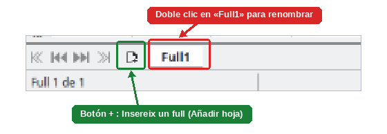
{: .img}

2. **Cuadro de Parámetros (`A2:B3`):**
   * Escribe en `A2`: `Tipo de IVA aplicable:` y en `B2`: `21%`.
   * Escribe en `A3`: `Descuento Proveedor (VIP):` y en `B3`: `5%`.
   * *Formato:* Aplica fondo gris claro (*Color de fons*) y negrita (*Negreta*) a `A2:A3`. Selecciona `B2:B3` y aplica el formato **Porcentaje (`%`)** (*Formata com a percentatge*) {: .no-border style="height: 1.25em; vertical-align: middle;"} con el botón de la barra superior (o *Formato -> Celdas... -> pestaña Números* / *Format -> Cel·les... -> pestaña Nombres*).
{:start="2"}

3. **Cabecera de la Tabla (`A5:G5`):**
   * Escribe las cabeceras: `ID Producto`, `Componente / Servicio`, `Categoría`, `Cantidad`, `Precio Unitario (€)`, `Subtotal (€)` y `Precio con IVA (€)`.
   * *Estilo:* Aplica fondo azul oscuro (*Color de fons*), texto blanco (*Color de la lletra*), negrita (*Negreta*) y alineación centrada horizontal (*Centra horitzontalment*) {: .no-border style="height: 1.25em; vertical-align: middle;"} y vertical (*Centra verticalment*) {: .no-border style="height: 1.25em; vertical-align: middle;"}.
4. **Serie de IDs (`A6:A15`):**
   * Escribe `COMP-001` en `A6` y arrastra el tirador de relleno (cuadradito negro de la esquina de la celda) hacia abajo hasta `A15` para generar los códigos (`COMP-001` a `COMP-010`).
5. **Relleno de datos y Formato Moneda (€):**
   * Rellena las filas `B6:E15` con 10 componentes y/o servicios informáticos (procesadores, SSDs, memorias RAM, fuentes de alimentación, cajas, servicio de montaje, etc.), sus cantidades y precios unitarios. Puedes utilizar una IA para que te ayude en esta tarea. **No rellenes la categoría (la seleccionaremos con una lista desplegable en el Ejercicio 3), ni el subtotal ni el precio con IVA ya que se calcularán de forma automática.**{: .rojo}.
   * Selecciona las columnas de precios (`E6:G15`) y haz clic en el icono de **Moneda (€)** (*Formata com a moneda*) {: .no-border style="height: 1.25em; vertical-align: middle;"} en la barra de herramientas superior.
6. **Bordes y Ancho de columna:**
   * Selecciona toda la tabla (`A5:G15`) y añade **Bordes completos** (*Vores*) {: .no-border style="height: 1.25em; vertical-align: middle;"} desde la barra de herramientas.
   * Ajusta el ancho de las columnas (*Formato -> Columnas -> Anchura óptima...* / *Format -> Columnes -> Amplada òptima...*).

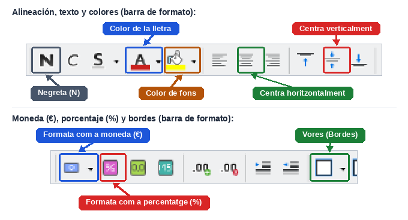
{: .img}

**Ejemplo de resultado esperado (Estructura y formato de celdas):**
{: .centrado}

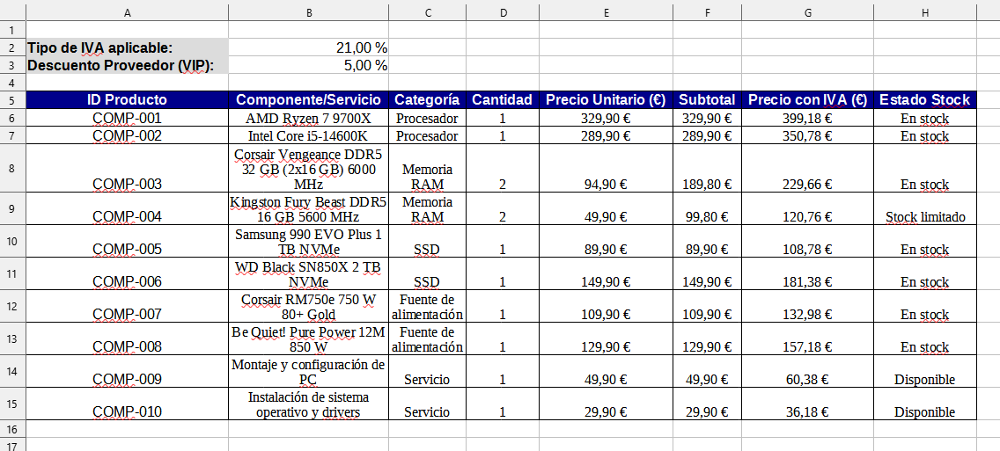
{: .no-border .img .img-450}

> **Importante**: Sube a Aules el documento con el **ejercicio 1 finalizado** y con el nombre: `actividad2_calc_tuapellido_tunombre_ej1.ods`
{: .alert-success}

---

### 2. Fórmulas básicas y Referencias Relativas y Absolutas ($)
Para realizar cálculos automáticos que se actualicen si cambian las condiciones (como el % de IVA), utilizaremos referencias fijas o absolutas.

1. **Cálculo del Subtotal (Referencia Relativa):**
   * En la celda `F6`, escribe la fórmula para calcular el subtotal de la primera fila: `=D6*E6` (Cantidad * Precio Unitario).
   * Copia la fórmula arrastrando el tirador de relleno hacia abajo hasta `F15`.
2. **Cálculo del Precio con IVA (Referencia Absoluta `$B$2`):**

   * En la celda `G6`, calcula el importe final aplicando el IVA.
   
 > **Nota:** Para calcular el precio con IVA de un producto, suma al subtotal el resultado de multiplicar el subtotal por el tipo de IVA. Es decir, la fórmula quedaría: `=F6+F6*$B$2`, ya que la celda `B2` es la celda donde tenemos anotado el IVA que se debe aplicar.
 {: .alert-info}

> 💡 **¿Por qué usamos `$B$2`?** El signo `$` puesto delante de la letra fija la columna y puesto delante del número fija la fila para que al arrastrar la fórmula hacia abajo, la celda del IVA no cambie a B3, B4, etc.
{: .alert-warning}
   * Copia la fórmula desde `G6` hasta `G15`. Comprueba que todas las filas calculan el IVA correctamente sobre la celda `B2`.

3. **Cálculo del Precio con Descuento (Referencia Absoluta `$B$3`):**
   * Añade una nueva columna a la tabla en la celda `H5` con la cabecera **«Precio con Descuento (€)»**. Puedes aplicar fácilmente el estilo y formato del resto de columnas seleccionando una celda ya formateada y haciendo clic en **Clonar formato** (*Clona la formatació*) {: .no-border style="height: 1.25em; vertical-align: middle;"} (icono de la brocha de la barra de herramientas).
   * En la celda `H6`, **calcula el importe final aplicando el descuento del proveedor.**
{:start="3"}

{: .img}

 > **Nota:** Para calcular el precio con descuento de un producto, debes escribir una fórmula que reste al precio con IVA (en la columna G) el resultado de multiplicar el precio con IVA por el porcentaje de descuento (en la celda `B3`).
 {: .alert-info}

> 💡 **Recordatorio:** Al igual que con el IVA, usamos la referencia absoluta `$B$3` para fijar la celda del descuento al arrastrar la fórmula hacia abajo.
{: .alert-warning}

   * Copia la fórmula desde `H6` hasta `H15`. Comprueba que todas las filas calculan el descuento correctamente sobre la celda `B3`.

**Ejemplo de resultado esperado (Fórmulas básicas y referencias relativas y absolutas):**
{: .centrado}

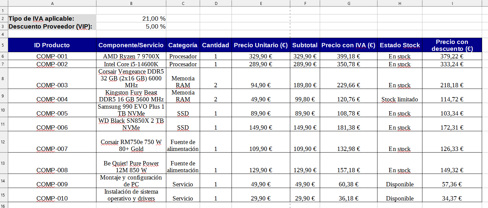
{: .no-border .img .img-450}

> **Importante**: Sube a Aules el documento con el **ejercicio 2 finalizado** y con el nombre: `actividad2_calc_tuapellido_tunombre_ej2.ods`
{: .alert-success}

---

### 3. Lista Desplegable (Validez de datos), Funciones Estadísticas y Lógicas
Crearemos una pestaña auxiliar de listas, aplicaremos validación de datos para la columna Categoría y utilizaremos funciones condicionales y estadísticas para analizar el presupuesto.

1. **Creación de Pestaña Auxiliar y Lista Desplegable (`C6:C15`):**
   * Añade una nueva pestaña al libro haciendo clic en el botón **`+`** (*Insereix un full*, marcado en verde en la guía del Ejercicio 1, junto a la pestaña inferior `Presupuesto_Hardware`) y renómbrala a **`Listas`** (doble clic sobre el nombre de la pestaña).
   * En la pestaña `Listas`, escribe en la columna `A` (rango `A1:A8`) las categorías válidas de componentes: `Procesador`, `Memoria RAM`, `Almacenamiento / SSD`, `Placa base`, `Tarjeta gráfica`, `Fuente de alimentación`, `Caja / Torre` y `Servicio`.
   * Vuelve a la pestaña **`Presupuesto_Hardware`**, selecciona las celdas de la columna Categoría (`C6:C15`) y ve al menú superior: *Datos -> Validez...* (*Dades -> Validesa...*).
   * En la pestaña **Criterios** (*Criteris*), selecciona en *Permitir:* (*Permet:*) **Intervalo de celdas** (*Interval de cel·les*).
   * En el campo **Origen** (*Origen* / *Font*), escribe o selecciona el rango de la otra pestaña: `$Listas.$A$1:$A$8` y pulsa **Aceptar** (*D'acord*).
   * Comprueba que al hacer clic en cualquiera de las celdas `C6:C15` aparece un desplegable y asigna la categoría adecuada a cada uno de los 10 productos/servicios de tu presupuesto.

> ⚠️ **¡Muy importante! Nombres de funciones en catalán:** Si tu LibreOffice Calc está en catalán, algunas funciones cambian de nombre (si escribes el nombre en castellano te saldrá error `#NOM?`):
> * `PROMEDIO` -> **`MITJANA`**
> * `CONTAR.SI` -> **`COMPTASI`** *(sin punto)*
> * `SUMAR.SI` -> **`SUMASI`** *(sin punto)*
> * `SUMA`, `MAX`, `MIN` y `SI` se escriben exactamente igual en ambos idiomas.
{: .alert-warning}

2. **Fila de Totales y Resumen Estadístico (Filas 17 a 22):**
   * En `F17` escribe `Total:` y en `G17` aplica la función sumatorio: `=SUMA(G6:G15)`.
   * En `F18` escribe `Precio Medio Componente:` y en `G18` usa la función `=PROMEDIO(E6:E15)` (en catalán: `=MITJANA(E6:E15)`).
   * En `F19` escribe `Componente Más Caro:` y en `G19` usa `=MAX(E6:E15)`.
   * En `F20` escribe `Componente Más Barato:` y en `G20` usa `=MIN(E6:E15)`.
   * En `F21` escribe `Nº de Servicios Presupuestados:` y en `G21` usa `=CONTAR.SI(C6:C15; "Servicio")` (en catalán: `=COMPTASI(C6:C15; "Servicio")`).
   * En `F22` escribe `Gasto Total en Servicios (€):` y en `G22` usa `=SUMAR.SI(C6:C15; "Servicio"; G6:G15)` (en catalán: `=SUMASI(C6:C15; "Servicio"; G6:G15)`).
   * *Estilo y formato del resumen (`F17:G22`):* Pon las celdas con el texto/etiquetas (`F17:F22`) en **negrita** (*Negreta*) y **fondo gris claro** (*Color de fons*), y las celdas de los cálculos (`G17:G22`) en **fondo naranja claro**. Aplica **alineación centrada** (*Centra horitzontalment* y *Centra verticalment*) a todo el bloque de celdas (`F17:G22`) y bordes (*Vores*) {: .no-border style="height: 1.25em; vertical-align: middle;"} a todas ellas.
{:start="2"}

3. **Uso de la Función Lógica `SI` (Gastos de Envío según Categoría):**
   * Añade una nueva columna a la tabla en la celda `I5` con la cabecera **«Gastos de Envío (€)»**.
   * En la celda `I6`, escribe una fórmula condicional que compruebe si la categoría es un servicio. Si es igual a `"Servicio"`, los gastos de envío son `0 €`; si es cualquier otra categoría (producto físico), son `10 €`:
     `=SI(C6="Servicio"; 0; 10)` *(se escribe igual en castellano y en catalán)*.
   * Arrastra la fórmula desde `I6` hasta `I15`. Aplica el formato **Moneda (€)** (*Formata com a moneda*) {: .no-border style="height: 1.25em; vertical-align: middle;"} a las celdas `I6:I15`.
   * Acuérdate de **aplicar el mismo estilo** que tienen el resto de columnas a esta columna nueva (puedes usar **Clonar formato** / *Clona la formatació* {: .no-border style="height: 1.25em; vertical-align: middle;"}).

**Ejemplo de resultado esperado (Funciones matemáticas, estadísticas, lógicas y validación de datos):**
{: .centrado}

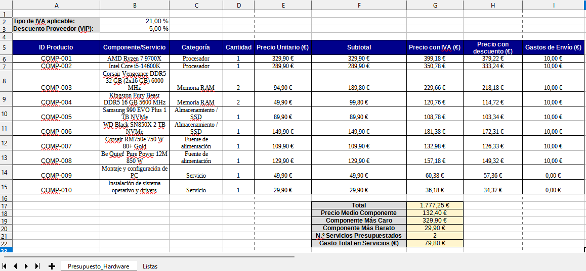
{: .no-border .img .img-450}

> **Importante**: Sube a Aules el documento con el **ejercicio 3 finalizado** y con el nombre: `actividad2_calc_tuapellido_tunombre_ej3.ods`
{: .alert-success}

---

### 4. Formato Condicional y Código de Colores
Utilizaremos el formato condicional para destacar visualmente las categorías y los importes de los subtotales de forma automática.

1. Selecciona las celdas de la columna Categoría (`C6:C15`).
2. Ve al menú superior: *Formato -> Condicional -> Condición...* (*Format -> Condicional -> Condició...*), o despliega el icono **Condicional** (*Condicional*) {: .no-border style="height: 1.25em; vertical-align: middle;"} de la barra de formato.
3. **Regla 1 (Servicios):** Si *El valor de la celda* (*El valor de la cel·la*) *es igual a* (*és igual a*) `"Servicio"` (debes poner las comillas), aplica un estilo con fondo verde claro y texto en verde oscuro/negrita (en *Aplicar estilo* / *Aplica l'estil*, escoge **Estilo nuevo...** / *Estil nou...* y busca entre las pestañas los estilos que te permitan aplicar el formato que te piden).
4. **Regla 2 (Procesadores):** Añade una segunda condición: si *El valor de la celda* (*El valor de la cel·la*) *es igual a* (*és igual a*) `"Procesador"`, aplica un estilo con fondo azul claro y texto en azul oscuro. Para ello, vuelve a seleccionar las celdas (`C6:C15`), ve a *Formato -> Condicional -> Condición...* (*Format -> Condicional -> Condició...*) y añade una nueva condición.
5. **Escala de Color / Barras de datos en Subtotales:** Selecciona el rango de Subtotales (`F6:F15`), ve a *Formato -> Condicional -> Barra de datos...* (*Format -> Condicional -> Barra de dades...*) para añadir una barra visual proporcional al coste subtotal de cada producto. En **Más opciones...** (*Més opcions...*) elige en **Positivo** (*Positiu*) un color distinto al azul y en **Relleno** (*Emplenament*) elige **Color** (*Color*).

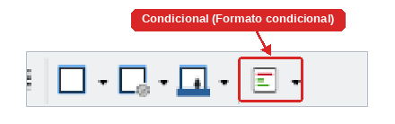
{: .img}

**Ejemplo de resultado esperado (Formato condicional y código de colores):**
{: .centrado}

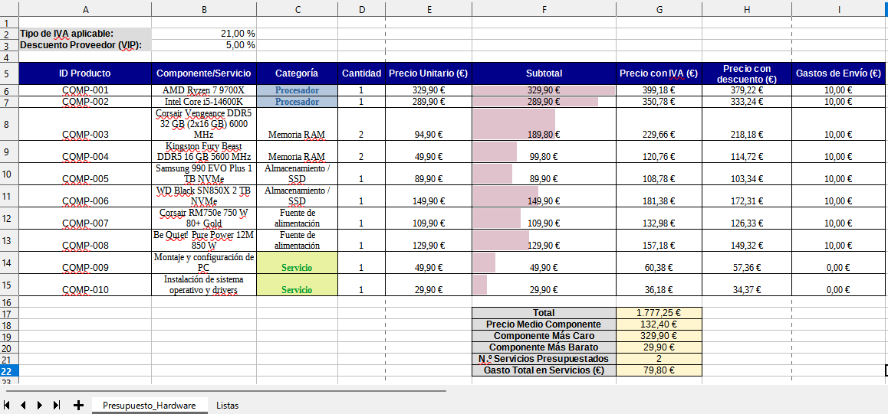
{: .no-border .img .img-450}

> **Importante**: Sube a Aules el documento con el **ejercicio 4 finalizado** y con el nombre: `actividad2_calc_tuapellido_tunombre_ej4.ods`
{: .alert-success}

---

### 5. Creación de Tablas Dinámicas y Personalización de Gráficos
Para resumir y representar visualmente los datos de forma agrupada, crearemos tablas dinámicas (*Taules dinàmiques* / Pivot Tables) y generaremos los gráficos (*Diagrames*) a partir de ellas.

1. **Tabla Dinámica 1 y Gráfico 1: Comparativa de Precios por Componente (Gráfico de Columnas)**
   * Selecciona toda la tabla principal (`A5:I15`).
   * Ve al menú superior: *Insertar -> Tabla dinámica...* (*Insereix -> Taula dinàmica...*) {: .no-border style="height: 1.25em; vertical-align: middle;"} y pulsa **Aceptar** (*D'acord*).
   * En el diseñador de la tabla dinámica:
     * Arrastra **`Componente / Servicio`** a **Campos de fila** (*Camps de fila*).
     * Arrastra **`Precio Unitario (€)`** y **`Precio con IVA (€)`** a **Campos de datos** (*Camps de dades*).
     * Pulsa **Aceptar** (*D'acord*) para generar la tabla dinámica.
   * **Crear el gráfico:** Selecciona los datos de la tabla dinámica generada (menos la fila de totales), ve a *Insertar -> Gráfico...* (*Insereix -> Diagrama...*) {: .no-border style="height: 1.25em; vertical-align: middle;"} y elige el tipo **Columna** (*Columna*, barra vertical).
   * Ponle como Título (*Títol*): `Comparativa de Costes por Componente`.
   * En la tabla dinámica, en la columna de *Componente / Servicio*, **quita de la selección la instalación y el montaje**, para que solo aparezcan en la tabla y el gráfico los componentes de hardware.

2. **Tabla Dinámica 2 y Gráfico 2: Distribución por Categorías (Gráfico Circular / Tarta)**
   * Vuelve a la pestaña principal y selecciona toda la tabla (`A5:I15`).
   * Ve a *Insertar -> Tabla dinámica...* (*Insereix -> Taula dinàmica...*) {: .no-border style="height: 1.25em; vertical-align: middle;"}, escoge **Selección actual** (*Selecció actual*) y pulsa **Aceptar** (*D'acord*).
   * En el diseñador de la tabla dinámica:
     * Arrastra **`Categoría`** a **Campos de fila** (*Camps de fila*).
     * Arrastra **`Subtotal (€)`** a **Campos de datos** (*Camps de dades*, comprueba que realice la *Suma*).
     * Pulsa **Aceptar** (*D'acord*) (esto agrupará automáticamente los subtotales por cada categoría única).
   * **Crear el gráfico:** Selecciona la tabla dinámica agrupada por categorías (excepto la fila de totales), ve a *Insertar -> Gráfico...* (*Insereix -> Diagrama...*) {: .no-border style="height: 1.25em; vertical-align: middle;"} y elige el tipo **Círculo / Circular** (*Diagrames de sectors*).
   * Elige **Aspecto 3D** (*Aparença 3D*) **Realista** (*Realista*) y estilo **Gráfico de anillos esparcido** (*Diagrama toroïdal explotat*).
   * Título (*Títol*): `Distribución del Subtotal por Categoría`.
   * Muestra las **etiquetas de datos** (*Etiquetes de dades*) en porcentaje (`%`) sobre cada porción del gráfico:
     * Haz doble clic en el gráfico para entrar en modo de edición (aparece un borde gris).
     * Haz clic derecho sobre la tarta/anillo y selecciona **Insertar etiquetas de datos** (*Insereix les etiquetes de dades*).
     * Haz clic derecho sobre los números que han aparecido y selecciona **Formato de etiquetas de datos...** (*Formata les etiquetes de dades...*).
     * En la pestaña **Etiquetas de datos** (*Etiquetes de dades*), marca **Mostrar valor como porcentaje** (*Valor com a percentatge*) y desmarca **Mostrar valor como número** (*Valor com a nombre*).
     * Mueve algún número manualmente si no se visualiza de forma adecuada.

{: .img}

**Ejemplo de resultado esperado (Tablas dinámicas y gráficos):**
{: .centrado}

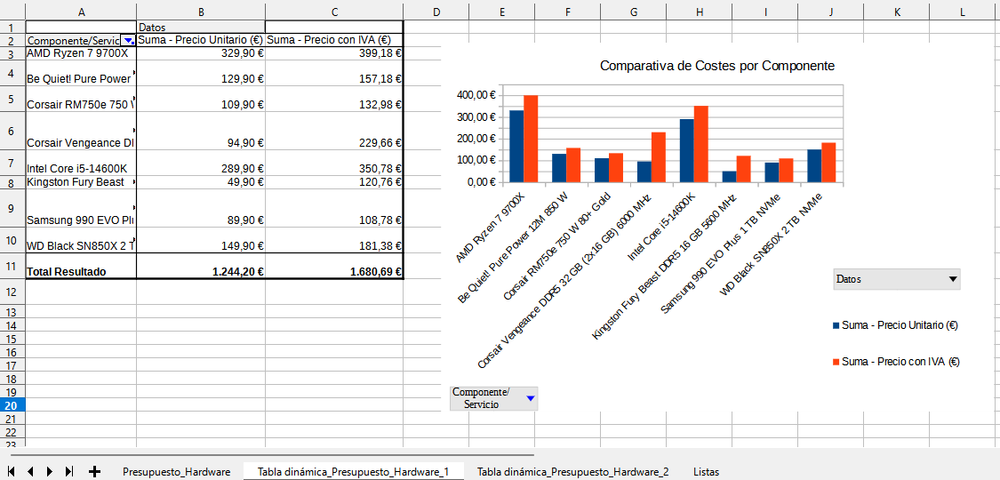
{: .no-border .img .img-450}

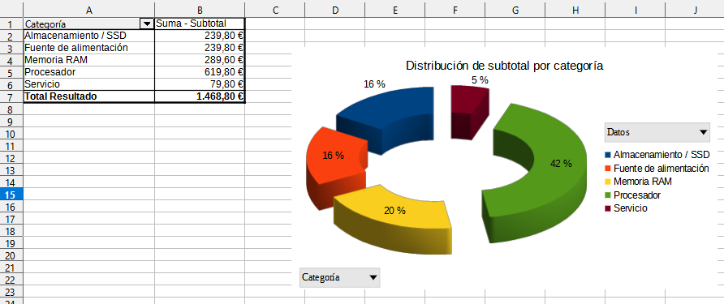
{: .no-border .img .img-450}

> **Importante**: Sube a Aules el documento con el **ejercicio 5 finalizado** y con el nombre: `actividad2_calc_tuapellido_tunombre_ej5.ods`
{: .alert-success}

---

### 6. Maquetación, Encabezado/Pie y Exportación
1. En la pestaña **`Presupuesto_Hardware`** (y en las pestañas creadas con las tablas dinámicas y gráficos), ve al menú superior: *Formato -> Estilo de página...* (*Format -> Estil de pàgina...*).
2. En la pestaña **Página** (*Pàgina*), pon la orientación en **Horizontal** (*Horitzontal*) para que la tabla de presupuesto, las tablas dinámicas y los gráficos quepan perfectamente a lo ancho sin cortarse.
3. En la pestaña **Cabecera** (*Capçalera*), activa el encabezado y haciendo clic en **Editar** (*Edita*) añade a la izquierda: `Tema 2: LibreOffice Calc` y a la derecha el campo **Fecha** (*Data*).
4. En la pestaña **Pie de página** (*Peu de pàgina* / *Peu*), activa el pie, pulsa **Editar** (*Edita*) y añade a la izquierda tu nombre completo y a la derecha el campo **Página X de Y** (*Pàgina X de Y*).
5. Para ajustar el contenido a 1 sola página: en la ventana de *Formato -> Estilo de página...* (*Format -> Estil de pàgina...*), ve a la pestaña **Hoja** (*Full*), en la sección **Modo de escala** (*Mode d'escala*) elige la opción **«Restringe / Ajustar zonas de impresión a un número de páginas»** (*«Encongeix els intervals al nombre de pàgines»*) y pon **N.º de páginas** (*Nombre de pàgines*) en `1`. Revisa cómo queda el resultado desde *Archivo -> Previsualización de impresión* (*Fitxer -> Previsualització d'impressió*) {: .no-border style="height: 1.25em; vertical-align: middle;"}.

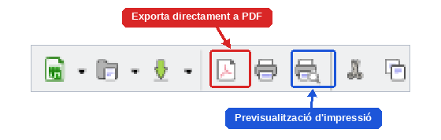
{: .img}

**Ejemplo de resultado esperado (Maquetación, encabezado/pie y previsualización):**
{: .centrado}

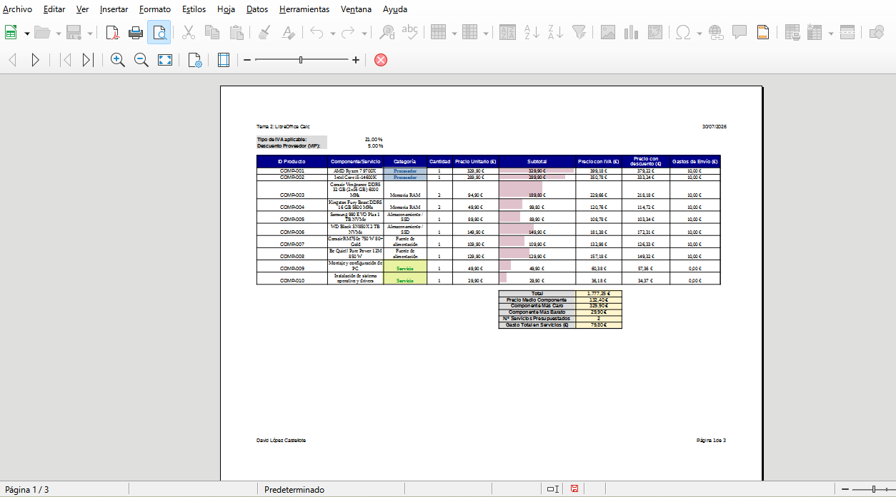
{: .no-border .img .img-450}

> **Importante**: Sube a Aules el documento con el **ejercicio 6 finalizado** y con el nombre: `actividad2_calc_tuapellido_tunombre_ej6.ods`
{: .alert-success}

---

## Entregables en Aules

Sube a la tarea de Aules los siguientes **dos archivos**:
* **`actividad2_calc_tuapellido_tunombre_final.ods`** (Libro editable de LibreOffice Calc con fórmulas funcionales)
* **`actividad2_calc_tuapellido_tunombre_final.pdf`** (versión exportada en formato PDF con marca de agua)

> 💡 **¿Cómo exportar las hojas seleccionadas a PDF con marca de agua en LibreOffice Calc?**
> 1. Selecciona las pestañas de `Presupuesto_Hardware` y las dos pestañas de Tablas Dinámicas manteniendo pulsada la tecla **`Ctrl`**.
> 2. Ve al menú superior: *Archivo -> Exportar a -> Exportar a PDF...* (*Fitxer -> Exporta com a -> Exporta com a PDF...*) — *(usa el menú en lugar del botón directo {: .no-border style="height: 1.25em; vertical-align: middle;"} para poder configurar las opciones)*.
> 3. Marca la opción **Selección/hojas seleccionadas** (*Selecció o fulles seleccionades*).
> 4. Marca **Firmar con marca de agua** (*Signa amb una marca d'aigua*) y escribe tu **Nombre y Apellidos** en el campo **Marca de agua** (*Marca d'aigua*).
> 5. Haz clic en **Exportar** (*Exporta*), asegúrate de nombrarlo como `actividad2_calc_tuapellido_tunombre_final.pdf` y pulsa **Guardar** (*Desa*).
{: .alert-info}

---

## Rúbrica de Evaluación (máx. 10 puntos)

| Criterio | 0 pts | Nivel intermedio bajo | Nivel intermedio alto | Nivel excelente |
|----------|-------|-----------------------|-----------------------|-----------------|
| **1. Estructura y formato de celda** (máx. 1 pt) | No aplica formatos de celda ni estructura adecuada. | Diseña la tabla pero no aplica formatos de moneda (€), porcentaje (%), series completas o alineaciones (0,3 pts). | Aplica formatos de celda correctos y autorrelleno, pero comete errores en la cabecera fija o estética (0,6 pts). | Estructura perfecta: parámetros fijos (IVA/Dto), serie `COMP-001` a `010`, formatos de moneda (€) y porcentaje (%), cabecera azul y anchos óptimos (1 pt). |
| **2. Referencias Relativas y Absolutas ($)** (máx. 2 pts) | Escribe valores numéricos a mano sin usar fórmulas. | Usa fórmulas pero no aplica referencias absolutas (`$`), provocando errores al arrastrar (0,5 pts). | Calcula subtotales e IVA con fórmulas, pero comete algún fallo menor en la sintaxis de fijación (`$B$2` / `$B$3`) (1 pt). | Domina las referencias relativas y absolutas fijando correctamente las celdas `$B$2` (IVA) y `$B$3` (Descuento) sin errores al copiar (2 pts). |
| **3. Listas Desplegables, Funciones Matemáticas y Lógicas** (máx. 3 pts) | No utiliza funciones automáticas ni listas desplegables. | Usa solo la función SUMA pero omite las funciones estadísticas (`PROMEDIO`, `MAX`, `MIN`), la lista desplegable o la función `SI` (1 pt). | Configura la lista desplegable y usa funciones pero comete errores en la sintaxis de `CONTAR.SI`, `SUMAR.SI` o en la condición de `SI` (2 pts). | Configura correctamente la lista desplegable desde la pestaña `Listas` y aplica `=SUMA`, `=PROMEDIO` (`=MITJANA`), `=MAX`, `=MIN`, `=CONTAR.SI` (`=COMPTASI`), `=SUMAR.SI` (`=SUMASI`) y `=SI(...)` impecablemente (3 pts). |
| **4. Formato Condicional y Alertas** (máx. 1 pt) | No aplica formato condicional. | Aplica color manual a las celdas en lugar de usar reglas de formato condicional automático (0,3 pts). | Configura formato condicional pero solo con 1 regla o sin códigos de color bien contrastados (0,6 pts). | Reglas de formato condicional automáticas perfectamente aplicadas por categorías ("Servicio", "Procesador") y barras de datos en subtotales (1 pt). |
| **5. Representación Gráfica y Tablas Dinámicas** (máx. 2 pts) | No genera gráficos ni tablas dinámicas o son ilegibles. | Genera 1 solo gráfico sin tabla dinámica o sin títulos/leyendas (0,5 pts). | Crea gráficos pero omite la generación previa de las tablas dinámicas o las etiquetas de porcentaje (1 pt). | Construye 2 tablas dinámicas agrupadas y genera sus 2 gráficos correspondientes (Columnas y Tarta en %) impecablemente (2 pts). |
| **6. Encabezado, Pie e Impresión PDF** (máx. 1 pt) | No configura la página ni exporta a PDF. | Exporta a PDF pero las tablas/gráficos quedan cortados en varias páginas o carecen de encabezado/pie (0,3 pts). | Configuración aceptable pero con algún detalle menor en encabezados o márgenes (0,6 pts). | Configuración de página horizontal impecable, encabezado/pie dinámicos, marca de agua con su nombre y exportación PDF ajustada a 1 página por pestaña (1 pt). |
| **7. Entrega en plazo** (máx. 0 pts) | **-2 pts:** No entrega o entrega con un retraso de más de una semana. | **-1.5 pts:** Entrega con un retraso importante de hasta una semana. | **-1 pt:** Entrega con un pequeño retraso de máximo 2 días. | **0 pts:** Entrega la actividad a tiempo dentro del plazo establecido. |

> ⚠️ **Nota sobre la entrega en plazo:** La entrega dentro del plazo establecido no resta puntuación (0 pts). Las entregas con retraso supondrán una penalización de hasta 2 puntos sobre la calificación de la actividad.
{: .alert-error}

**Criterios de evaluación de la programación:**
* **CE2 – 2.2.** Organizar la información y los archivos en el entorno personal de aprendizaje.
* **CE2 – 2.3.** Crear y editar contenidos digitales con sentido estético, respetando los derechos de autor.
