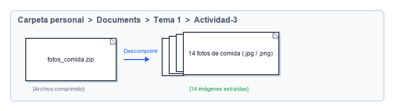
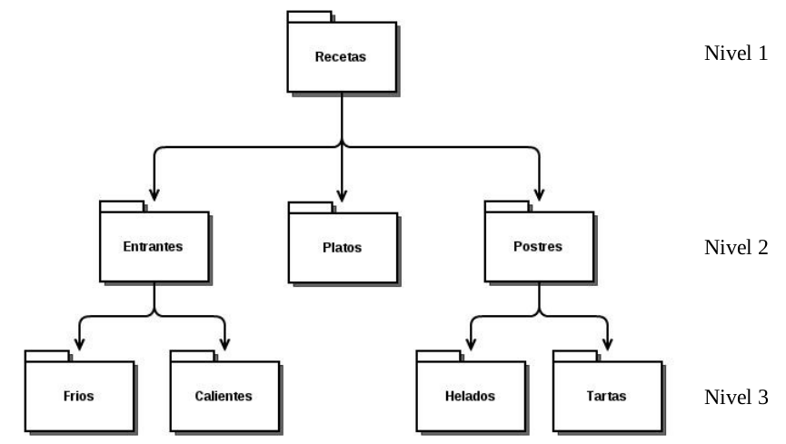
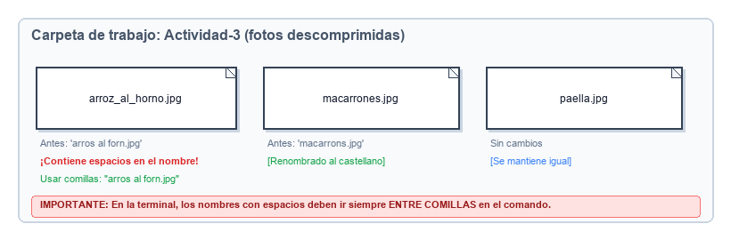
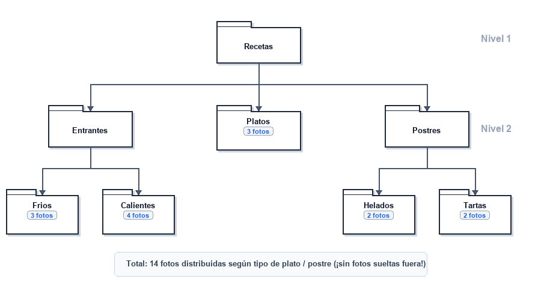
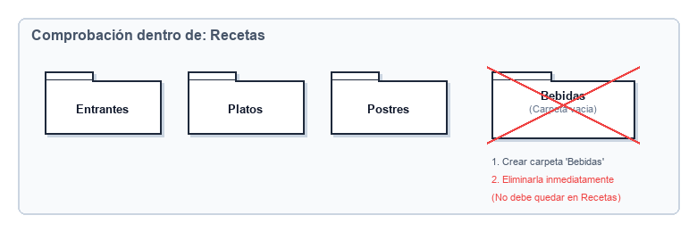
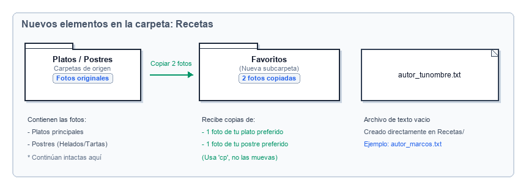
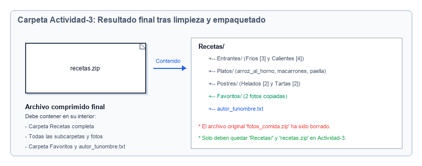

# Actividad 3 – Uso básico de la terminal en Linux (bash)

Antes de realizar las tareas, **lee atentamente**:

> [**APUNTES DE COMANDOS LINUX**](../apuntes_comandos)

---

## Instrucciones generales

* Realiza todas las tareas **HACIENDO USO EXCLUSIVO DE LA TERMINAL**{: .rojo}.
* **CONSULTA LOS APUNTES**{: .verde}: En esta actividad no se indican los comandos concretos que debes utilizar. Debes revisar los apuntes de comandos para averiguar cuál es el comando adecuado en cada caso y cómo se escribe.
* **HAZ CAPTURAS DE PANTALLA DE LOS COMANDOS QUE VAS EJECUTANDO**{: .rojo}: A lo largo de la actividad debes ir haciendo capturas de pantalla de la terminal en cada paso donde se vean claramente los comandos que vas introduciendo y **tu nombre de usuario**.

---

## Tareas

### Paso 1 – Preparación del espacio de trabajo y descarga

1. Dentro de tu **carpeta personal**, y dentro de **Documents/Tema 1**, crea una carpeta llamada **Actividad-3**.
2. Entra en la carpeta **Actividad-3**.
3. Descarga el archivo comprimido del siguiente enlace:  
   **dlopezcastellote.dev/informatica-eso-bat/asignaturas/digitalizacion/sistemas-operativos/actividad3/fotos_comida.zip**{: .verde}
4. Descomprime el archivo descargado para extraer todas las fotos en la carpeta.
5. Comprueba el contenido para asegurarte de que ves las 14 fotos extraídas.

> 📸 **Captura obligatoria del Paso 1:** Haz una captura de pantalla de la terminal donde se vean claramente los comandos ejecutados para crear la carpeta, entrar en ella, descargar y descomprimir el archivo y comprobar las fotos extraídas, asegurándote de que sea visible tu **nombre de usuario**.
{: .alert-error}

{: .img}

**Descarga y extracción inicial en Actividad-3**
{: .centrado}

---

### Paso 2 – Creación de la estructura base de carpetas

Partiendo desde **Actividad-3**, crea toda la estructura de carpetas que se muestra en el siguiente árbol:

> 📸 **Captura obligatoria del Paso 2:** Haz una captura de pantalla de la terminal con los comandos utilizados para crear el árbol de carpetas y el comando para verificar la estructura creada, donde se aprecie claramente tu **nombre de usuario**.
{: .alert-error}

{: .img .img-400}

**Estructura inicial de carpetas**
{: .centrado}

---

### Paso 3 – Renombrar archivos

Antes de clasificar las fotos en sus carpetas definitivas, debes normalizar el nombre de dos de los platos que has descomprimido en **Actividad-3**:

1. El archivo `arros al forn.jpg` debe pasar a llamarse **`arroz_al_horno.jpg`**.
   > 💡 **Atención a los nombres con espacios en bash:** Dado que el nombre original contiene espacios (`arros al forn.jpg`), en la terminal debes escribirlo **obligatoriamente entre comillas** en el comando (por ejemplo: `"arros al forn.jpg"`). Si no utilizas comillas, la terminal interpretará cada palabra como un archivo o argumento diferente y dará un error.
2. El archivo `macarrons.jpg` debe pasar a llamarse **`macarrones.jpg`**.
3. Comprueba el contenido para verificar que ambos archivos tienen ahora su nombre corregido y normalizado.

> 📸 **Captura obligatoria del Paso 3:** Haz una captura de pantalla de la terminal donde se aprecien claramente los comandos de renombrado ejecutados (utilizando las comillas obligatorias para el nombre con espacios), la comprobación de los nuevos nombres y tu **nombre de usuario**.
{: .alert-error}

{: .img}

**Archivos normalizados en Actividad-3**
{: .centrado}

---

### Paso 4 – Organización y clasificación de las fotos

1. Ahora que los nombres están normalizados, **mueve las fotos a su carpeta correspondiente** dentro de **Recetas** según el tipo de plato o postre:
   * **Entrantes fríos** (3 fotos)
   * **Entrantes calientes** (4 fotos)
   * **Platos principales** (3 fotos: `arroz_al_horno.jpg`, `macarrones.jpg`, `paella.jpg`)
   * **Helados** (2 fotos)
   * **Tartas** (2 fotos)
   > 💡 **Recuerda:** Muchas de las fotos a mover también tienen espacios en sus nombres (por ejemplo, `"Helado de pistacho.jpg"`, `"helado chocolate.jpg"`, etc.). Recuerda escribirlas siempre entre comillas en tu comando `mv` (o utilizar la tecla tabulador para autocompletar el nombre con escapes).
2. Al terminar, comprueba que **ninguna foto ha quedado suelta** fuera de su carpeta en **Actividad-3**.

> 📸 **Captura obligatoria del Paso 4:** Haz una captura de pantalla de la terminal con los comandos utilizados para mover y clasificar las fotos en sus carpetas y la comprobación de que no queda ninguna foto suelta, mostrando claramente tu **nombre de usuario**.
{: .alert-error}

{: .img .img-450}

**Distribución de las fotos por categorías**
{: .centrado}

---

### Paso 5 – Creación y borrado de una carpeta de prueba

1. Dentro de **Recetas**, crea una carpeta llamada **Bebidas**.
2. Comprueba que la carpeta se ha creado correctamente.
3. A continuación, **elimina la carpeta Bebidas** (recuerda que existe un comando específico de terminal para borrar carpetas que se encuentran totalmente vacías).

> 📸 **Captura obligatoria del Paso 5:** Haz una captura de pantalla de la terminal donde se vea la creación de la carpeta `Bebidas`, su comprobación y el comando específico para eliminar carpetas vacías, asegurándote de que aparezca tu **nombre de usuario**.
{: .alert-error}

{: .img}

**Creación y eliminación de la carpeta Bebidas**
{: .centrado}

---

### Paso 6 – Copiar recetas destacadas y crear archivo de autoría

1. Dentro de **Recetas**, crea una nueva carpeta llamada **Favoritos**.
2. **Copia** (¡sin mover!) a la carpeta **Favoritos**:
   * La foto de tu plato principal preferido (desde la carpeta de platos).
   * La foto de tu postre preferido (desde la carpeta de postres).
   * *Asegúrate de que las fotos están en Favoritos y que al mismo tiempo continúan existiendo en sus carpetas originales.*
3. Dentro de la carpeta **Recetas**, crea un **archivo de texto vacío** llamado **`autor_tunombre.txt`** (sustituyendo `tunombre` por tu nombre de pila, por ejemplo: `autor_marcos.txt`).

> 📸 **Captura obligatoria del Paso 6:** Haz una captura de pantalla de la terminal con los comandos para crear `Favoritos`, copiar las recetas seleccionadas, crear el archivo `autor_tunombre.txt` y comprobar el resultado en la carpeta, viéndose claramente tu **nombre de usuario**.
{: .alert-error}

{: .img}

**Elementos añadidos en Recetas**
{: .centrado}

---

### Paso 7 – Limpieza y empaquetado final

1. **Borra** el archivo comprimido que descargaste al principio de Internet (`fotos_comida.zip`).
2. **Comprime toda la carpeta Recetas** en un archivo llamado **`recetas.zip`**.
3. Asegúrate de que el archivo `recetas.zip` contiene todas las carpetas, subcarpetas, fotos clasificadas, fotos de favoritos y el archivo de autoría.

> 📸 **Captura obligatoria del Paso 7:** Haz una captura de pantalla de la terminal donde se observe el comando para borrar el zip original, el comando para comprimir la carpeta `Recetas` en `recetas.zip` y la comprobación final, mostrando tu **nombre de usuario**.
{: .alert-error}

{: .img}

**Resultado final tras limpieza y compresión**
{: .centrado}

---

## Entrega

Sube en esta tarea de **Aules**:

* **El archivo comprimido resultante (`recetas.zip`)**.
* **Las capturas de pantalla de los comandos que has ido ejecutando en la terminal en cada paso.**  
  Se deben ver todos los comandos utilizados para hacer cada paso y, también, tu **nombre de usuario**.

---

## Rúbrica – Actividad: Uso básico de la terminal en Linux (máx. 10 puntos)

| Criterio | 0 pts | Nivel intermedio bajo | Nivel intermedio alto | Nivel excelente |
|----------|-------|-----------------------|-----------------------|-----------------|
| **Paso 1 – Preparación y descarga** (máx. 1 pt) | No realiza la preparación o no entrega captura con usuario. | Crea la carpeta pero no descarga por terminal o la extracción es incompleta (0,25 pts). | Descarga y descomprime las fotos en terminal, pero hay algún fallo menor en la ruta o falta comprobar las 14 fotos (0,5 pts). | Crea la carpeta `Actividad-3`, descarga por terminal, extrae las 14 fotos correctamente y aporta captura clara con usuario visible (1 pt). |
| **Paso 2 – Estructura base de carpetas** (máx. 2 pts) | No crea la estructura de carpetas en terminal o no entrega captura. | Crea menos de la mitad de las carpetas o con nombres y ubicaciones erróneas (0,5 pts). | Crea casi todas las carpetas en terminal, pero falta alguna subcarpeta o hay errores menores en la jerarquía (1 pt). | Crea la jerarquía completa de las 8 carpetas en 3 niveles de forma limpia en terminal y aporta captura con usuario visible (2 pts). |
| **Paso 3 – Renombrar archivos** (máx. 1 pt) | No renombra los archivos en terminal o no aporta captura con usuario. | Solo renombra uno de los dos archivos o genera errores de sintaxis por no usar comillas con espacios (0,25 pts). | Renombra ambos archivos en terminal, pero comete algún error tipográfico menor o no realiza la comprobación (0,5 pts). | Renombra correctamente `arros al forn.jpg` (usando comillas por los espacios) y `macarrons.jpg` a sus nombres en castellano, verificando el resultado con captura y usuario (1 pt). |
| **Paso 4 – Organización de fotos** (máx. 2,5 pts) | No organiza las fotos en las carpetas correspondientes o no entrega capturas. | Mueve menos de la mitad de las fotos, comete errores de destino o quedan muchas fotos sueltas fuera (0,75 pts). | Mueve y clasifica la mayoría de las fotos (usando comillas para nombres con espacios), pero alguna foto queda suelta o mal ubicada (1,5 pts). | Mueve y clasifica las 14 fotos en sus 5 categorías correspondientes mediante terminal (usando comillas en nombres con espacios), sin fotos sueltas y con captura clara con usuario (2,5 pts). |
| **Paso 5 – Carpeta de prueba** (máx. 0,5 pts) | No crea ni borra la carpeta o no aporta captura del comando. | Intenta crear o borrar la carpeta pero usa comandos erróneos o la carpeta no se elimina (0,15 pts). | Crea la carpeta `Bebidas` y la elimina, pero no utiliza el comando específico para carpetas vacías o no muestra la comprobación (0,3 pts). | Crea `Bebidas` en `Recetas`, comprueba su existencia y la elimina correctamente con el comando específico de carpetas vacías (`rmdir`), con captura y usuario (0,5 pts). |
| **Paso 6 – Favoritos y autoría** (máx. 1,5 pts) | No crea la carpeta Favoritos, no copia recetas o no crea el archivo de autoría. | Crea la carpeta pero mueve las fotos en lugar de copiarlas, o no crea el archivo de autoría (0,5 pts). | Copia las recetas y crea el archivo de autoría, pero hay algún fallo menor (foto errónea o nombre del archivo de texto incorrecto) (1 pt). | Crea la carpeta `Favoritos`, copia 1 plato y 1 postre manteniendo intactos los originales, crea `autor_tunombre.txt` vacío en `Recetas` y aporta captura con usuario (1,5 pts). |
| **Paso 7 – Limpieza y empaquetado** (máx. 1,5 pts) | No borra el zip original, no comprime o el archivo `recetas.zip` está vacío o corrupto. | Comprime la carpeta pero no borra el archivo original, o el zip generado no incluye toda la estructura (0,5 pts). | Elimina el zip original y genera `recetas.zip` por terminal, pero olvida alguna subcarpeta en la compresión recursiva (1 pt). | Elimina `fotos_comida.zip` por terminal, comprime recursivamente toda la carpeta `Recetas` en `recetas.zip` con todo su contenido y aporta captura con usuario (1,5 pts). |
| **Entrega en plazo** (máx. 0 pts) | **-2 pts:** No entrega o entrega con retraso de más de una semana. | **-1,5 pts:** Entrega con un retraso importante (hasta 1 semana). | **-1 pt:** Entrega con un ligero retraso (máx. 2 días). | **0 pts:** Entrega en plazo `recetas.zip` y las capturas de pantalla son claras y completas en cada paso (se ven comandos y usuario). |

> ⚠️ **Nota sobre la entrega en plazo:** La entrega dentro del plazo establecido no resta puntuación (0 pts). Las entregas con retraso supondrán una penalización de hasta 2 puntos sobre la calificación de la actividad.
{: .alert-error}

**Criterios de evaluación de la programación:**
* **CE1 – 1.4.** Instalar, utilizar y mantener sistemas operativos y aplicaciones, configurando sus características en función de las necesidades personales (administración y operaciones de archivos y directorios mediante terminal bash).
* **CE2 – 2.2.** Organizar y gestionar el entorno personal de aprendizaje mediante la integración de recursos digitales de manera autónoma (gestión y organización avanzada del sistema de archivos, renombrado, copia y compresión).
* **CE5 – 5.1.** Gestionar situaciones de incertidumbre en entornos digitales con una actitud positiva, y afrontarlas utilizando el conocimiento adquirido y sintiéndose competente (resolución práctica en entorno de consola con rutas y espacios).
