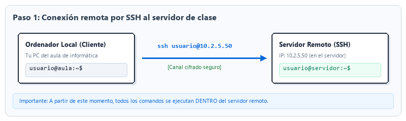
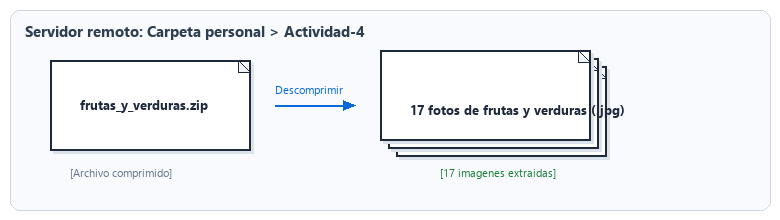
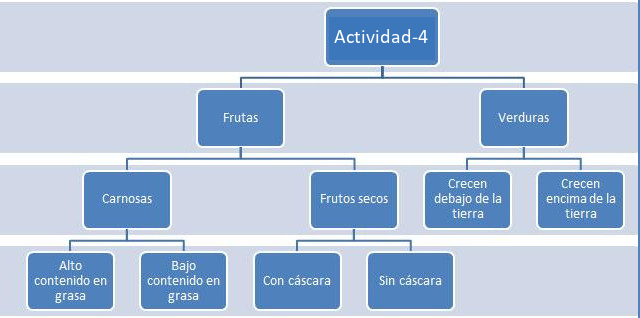
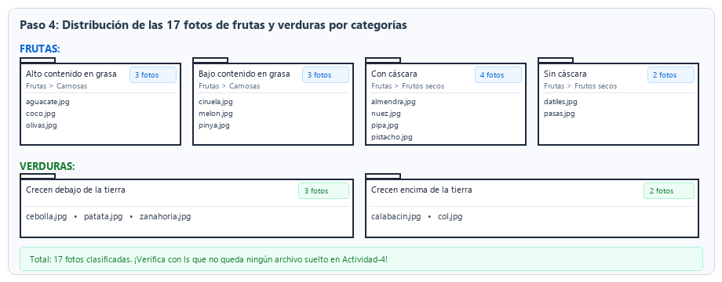
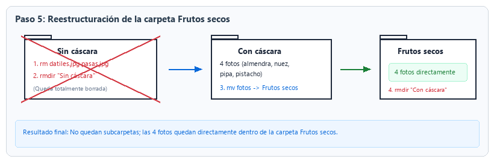
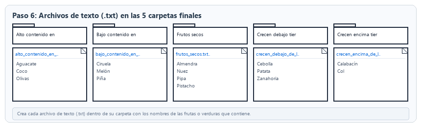
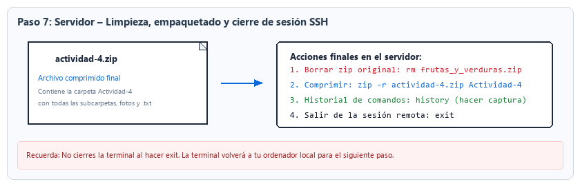
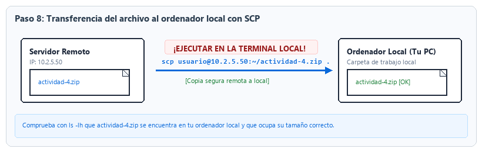

# Actividad 4 – Uso de SSH y SCP en Linux

Antes de realizar las tareas, **lee atentamente**:

> [**APUNTES DE COMANDOS LINUX**](../apuntes_comandos) <br> [**APUNTES DE SSH Y SCP**](../apuntes_ssh_scp)

---

## Instrucciones generales

* Realiza todas las tareas **HACIENDO USO EXCLUSIVO DE LA TERMINAL**{: .rojo}.
* **DIFERENCIA ENTRE SERVIDOR Y LOCAL**{: .verde}: Presta mucha atención a en qué máquina estás ejecutando cada comando. Los pasos del 1 al 7 se ejecutan **DENTRO DEL SERVIDOR REMOTO** tras haberte conectado por SSH. El paso final de descarga con SCP se ejecuta **EN TU TERMINAL LOCAL** (en tu ordenador de clase).
* **CONSULTA LOS APUNTES**{: .verde}: Revisa los apuntes de comandos y los apuntes de SSH y SCP para recordar la sintaxis, parámetros y funcionamiento de cada herramienta.
* **ATENCIÓN A LOS NOMBRES CON ESPACIOS**{: .rojo}: En la terminal bash, cualquier carpeta o archivo cuyo nombre contenga espacios (como `"Alto contenido en grasa"`, `"Frutos secos"`, `"Sin cáscara"` o `"Crecen debajo de la tierra"`) debe escribirse **obligatoriamente entre comillas**.
* **HAZ CAPTURAS DE PANTALLA DE LOS COMANDOS QUE VAS EJECUTANDO**{: .rojo}: A lo largo de la actividad debes ir haciendo las capturas de pantalla solicitadas donde se vean claramente los comandos introducidos y **tu nombre de usuario** (tanto en el servidor remoto como en local).

---

## Tareas

### Paso 1 – Conexión remota por SSH al servidor

1. Abre la terminal en tu ordenador de clase.
2. **Conéctate por SSH** al servidor de la clase utilizando tus credenciales:
   - **IP del servidor**: `10.2.5.50`
   - **Usuario**: tu usuario asignado de inicio de sesión en la clase
   - **Contraseña**: tu contraseña de inicio de sesión en la clase
   - Sintaxis del comando:  
     ```bash
     ssh usuario@10.2.5.50
     ```
     *(Sustituye `usuario` por tu nombre de usuario real).*
3. **Recordatorios importantes sobre SSH**:
   - Si es la primera vez que te conectas, SSH te mostrará un mensaje de verificación de la huella digital (*fingerprint*). Escribe `yes` y pulsa `Enter`.
   - Al introducir la contraseña, no aparecerán caracteres ni asteriscos en pantalla por motivos de seguridad; escríbela con calma y pulsa `Enter`.
   - Una vez iniciada la sesión con éxito, el indicador de la terminal (*prompt*) cambiará para mostrar que estás dentro del servidor (por ejemplo: `usuario@servidor:~$`). A partir de este momento, **todos los comandos se ejecutan en el servidor**.

> 📸 **Captura obligatoria del Paso 1:** Haz una captura de pantalla de la terminal donde se vea claramente el comando `ssh` ejecutado con éxito y el nuevo indicador del sistema mostrando que estás dentro del servidor con tu **nombre de usuario**.
{: .alert-error}


{: .img}

**Conexión SSH al servidor de clase**
{: .centrado}

---

### Paso 2 – Preparación del espacio de trabajo y descarga en el servidor

1. Dentro del servidor, en tu carpeta personal (`~`), crea una carpeta llamada **Actividad-4**.
2. Entra en la carpeta **Actividad-4**.
3. Descarga mediante el comando `wget` el archivo comprimido del siguiente enlace:  
   **dlopezcastellote.dev/informatica-eso-bat/asignaturas/digitalizacion/sistemas-operativos/actividad4/frutas_y_verduras.zip**{: .verde}
4. Descomprime el archivo descargado utilizando el comando `unzip` para extraer todas las fotos.
5. Comprueba con el comando `ls` que se han extraído las **17 fotos** correctamente.

> 📸 **Captura obligatoria del Paso 2:** Haz una captura de pantalla de la terminal dentro del servidor donde se aprecien los comandos ejecutados para crear `Actividad-4`, acceder a ella, descargar con `wget`, descomprimir con `unzip` y verificar las 17 fotos extraídas, con tu **nombre de usuario** visible.
{: .alert-error}


{: .img}

**Descarga y extracción inicial en Actividad-4**
{: .centrado}

---

### Paso 3 – Creación de la estructura base de carpetas

Partiendo desde **Actividad-4**, crea toda la jerarquía de carpetas que se muestra en el siguiente árbol:

> 💡 **Atención a las comillas en nombres con espacios:** En los nombres compuestos como `"Alto contenido en grasa"`, `"Frutos secos"`, `"Con cáscara"`, `"Sin cáscara"`, `"Crecen debajo de la tierra"` y `"Crecen encima de la tierra"`, debes usar **siempre comillas** en el comando `mkdir` (o la opción `-p` para crear rutas anidadas de golpe, por ejemplo: `mkdir -p "Frutas/Carnosas/Alto contenido en grasa"`).

> 📸 **Captura obligatoria del Paso 3:** Haz una captura de pantalla de la terminal con los comandos utilizados para crear el árbol de carpetas y el comando para verificar la estructura creada (`tree` o `ls -R`), donde se aprecie claramente tu **nombre de usuario**.
{: .alert-error}


{: .img}

**Estructura inicial de carpetas**
{: .centrado}

---

### Paso 4 – Organización y clasificación de las fotos

1. Mueve las 17 fotos que descomprimiste a sus carpetas correspondientes con el comando `mv`, siguiendo estrictamente esta clasificación:

   * **Frutas → Carnosas → Alto contenido en grasa** (3 fotos):  
     `aguacate.jpg`, `coco.jpg`, `olivas.jpg`
   * **Frutas → Carnosas → Bajo contenido en grasa** (3 fotos):  
     `ciruela.jpg`, `melon.jpg`, `pinya.jpg`
   * **Frutas → Frutos secos → Con cáscara** (4 fotos):  
     `almendra.jpg`, `nuez.jpg`, `pipa.jpg`, `pistacho.jpg`
   * **Frutas → Frutos secos → Sin cáscara** (2 fotos):  
     `datiles.jpg`, `pasas.jpg`
   * **Verduras → Crecen debajo de la tierra** (3 fotos):  
     `cebolla.jpg`, `patata.jpg`, `zanahoria.jpg`
   * **Verduras → Crecen encima de la tierra** (2 fotos):  
     `calabacin.jpg`, `col.jpg`

2. Al terminar la clasificación, ejecuta `ls` en la carpeta **Actividad-4** y comprueba que **ninguna foto ha quedado suelta fuera** de su carpeta.

> 📸 **Captura obligatoria del Paso 4:** Haz una captura de pantalla de la terminal con los comandos utilizados para mover y clasificar las fotos en sus carpetas y la comprobación de que no queda ninguna foto suelta en `Actividad-4`, mostrando claramente tu **nombre de usuario**.
{: .alert-error}


{: .img}

**Distribución de las 17 fotos por categorías**
{: .centrado}

---

### Paso 5 – Modificación y reestructuración de Frutos secos

Para simplificar la estructura, vamos a eliminar la división entre frutos secos con y sin cáscara, reuniendo todos los que se conservan en una única carpeta:

1. **Elimina los archivos** dentro de **Frutas → Frutos secos → Sin cáscara** (`datiles.jpg` y `pasas.jpg`) mediante el comando `rm`. *No borres todavía la carpeta*.
2. **Elimina la carpeta Sin cáscara** ahora que está completamente vacía (utiliza el comando específico para carpetas vacías: `rmdir`).
3. **Mueve las imágenes** de **Con cáscara** (`almendra.jpg`, `nuez.jpg`, `pipa.jpg`, `pistacho.jpg`) a la carpeta superior **Frutos secos**.
4. **Elimina la carpeta Con cáscara** ahora que ha quedado vacía (con `rmdir`).
5. 👉 **Comprobación:** Si lo has hecho bien, todas las imágenes de frutos secos con cáscara habrán quedado reunidas en una sola carpeta (**Frutos secos**), y las subcarpetas *Con cáscara* y *Sin cáscara* habrán desaparecido.

> 📸 **Captura obligatoria del Paso 5:** Haz una captura de pantalla de la terminal donde se vean claramente los comandos de borrado de archivos, eliminación de carpetas vacías con `rmdir`, el traslado de las imágenes a `Frutos secos` y la verificación final, con tu **nombre de usuario**.
{: .alert-error}


{: .img}

**Reestructuración de la carpeta Frutos secos**
{: .centrado}

---

### Paso 6 – Creación de archivos de texto con listas de contenido

En cada una de las 5 carpetas finales donde se encuentran las imágenes, debes crear un archivo de texto `.txt` cuyo nombre coincida con el de la carpeta (utilizando guiones bajos en lugar de espacios), y que contenga los nombres de las frutas o verduras clasificadas en su interior:

1. En **Frutas/Carnosas/"Alto contenido en grasa"**: crea `alto_contenido_en_grasa.txt` con:
   ```text
   Aguacate
   Coco
   Olivas
   ```
2. En **Frutas/Carnosas/"Bajo contenido en grasa"**: crea `bajo_contenido_en_grasa.txt` con:
   ```text
   Ciruela
   Melón
   Piña
   ```
3. En **Frutas/"Frutos secos"**: crea `frutos_secos.txt` con:
   ```text
   Almendra
   Nuez
   Pipa
   Pistacho
   ```
4. En **Verduras/"Crecen debajo de la tierra"**: crea `crecen_debajo_de_la_tierra.txt` con:
   ```text
   Cebolla
   Patata
   Zanahoria
   ```
5. En **Verduras/"Crecen encima de la tierra"**: crea `crecen_encima_de_la_tierra.txt` con:
   ```text
   Calabacín
   Col
   ```

> 💡 **Cómo escribir texto en la terminal:** Puedes crear y rellenar estos archivos mediante redirección con `echo` (por ejemplo: `echo -e "Aguacate\nCoco\nOlivas" > alto_contenido_en_grasa.txt`) o editándolos con el editor de terminal `nano`. Comprueba después el contenido con el comando `cat`.

> 📸 **Captura obligatoria del Paso 6:** Haz una captura de pantalla de la terminal mostrando la creación de los archivos de texto y la visualización de su contenido con `cat`, asegurándote de que sea visible tu **nombre de usuario**.
{: .alert-error}


{: .img}

**Archivos de texto creados en cada carpeta final**
{: .centrado}

---

### Paso 7 – Limpieza, empaquetado en el servidor y salida de SSH

1. **Borra** el archivo comprimido que descargaste al principio de Internet (`frutas_y_verduras.zip`) mediante `rm`.
2. Sal de la carpeta `Actividad-4` a tu carpeta personal ejecutando `cd ..` (o `cd ~`).
3. **Comprime toda la carpeta Actividad-4** en un archivo llamado **`actividad-4.zip`** ejecutando:
   ```bash
   zip -r actividad-4.zip Actividad-4
   ```
   *(Recuerda que la opción `-r` es obligatoria para incluir recursivamente todas las subcarpetas, fotos y archivos de texto).*
4. Comprueba con `ls -lh actividad-4.zip` que el archivo existe y tiene un tamaño adecuado.
5. Ejecuta el comando **`history`** para mostrar todos los comandos que has ejecutado en la terminal del servidor durante la sesión.
6. **Sal de la sesión SSH** ejecutando el comando **`exit`**. La sesión en el servidor terminará y la terminal volverá al prompt de tu ordenador local.

> 📸 **Captura obligatoria del Paso 7:** Haz una captura de pantalla del resultado del comando `history` en el servidor (mostrando los comandos realizados y tu usuario) y de la ejecución de `exit` cerrando la sesión remota.
{: .alert-error}


{: .img}

**Limpieza, compresión y desconexión en el servidor**
{: .centrado}

---

### Paso 8 – Transferencia del archivo al ordenador local con SCP

> ⚠️ **¡ATENCIÓN!** Este comando se ejecuta **EN LA TERMINAL DE TU ORDENADOR LOCAL** (la consola a la que has regresado tras ejecutar `exit`), **NO** dentro del servidor remoto.
{: .alert-warning}

1. En tu ordenador local, sitúate en la carpeta donde desees guardar la actividad (por ejemplo: `~/Documentos/Tema 1/` o tu carpeta personal).
2. Descarga el archivo `actividad-4.zip` desde tu carpeta en el servidor remoto a tu equipo utilizando el comando **`scp`**:
   ```bash
   scp usuario@10.2.5.50:~/actividad-4.zip .
   ```
   *(Sustituye `usuario` por tu nombre de usuario en el servidor. El punto `.` al final indica que el archivo se guardará en la carpeta local actual).*
3. Introduce tu contraseña cuando el sistema la solicite (recuerda que tampoco se verán caracteres mientras escribes).
4. **Comprueba** en tu terminal local con `ls -lh actividad-4.zip` que el archivo se ha transferido íntegramente a tu ordenador.

> 📸 **Captura obligatoria del Paso 8:** Haz una captura de pantalla de la terminal de tu ordenador local donde se observe la ejecución del comando `scp` con la transferencia completada al 100%, la comprobación con `ls -lh` y tu **nombre de usuario local**.
{: .alert-error}


{: .img}

**Descarga segura del archivo con SCP al equipo local**
{: .centrado}

---

## Entrega

Sube en esta tarea de **Aules**:

* **El archivo comprimido resultante (`actividad-4.zip`)**, descargado en tu ordenador local mediante SCP.  
  *(El profesor comprobará que dicho archivo existe tanto en tu entrega de Aules como en tu espacio personal dentro del servidor remoto).*
* **Las capturas de pantalla de los comandos que has ido ejecutando en la terminal en cada paso** (o la recopilación de capturas en un único documento PDF o archivo comprimido).  
  Se deben ver claramente todos los comandos utilizados para hacer cada paso y tu **nombre de usuario** visible en cada captura (tanto en el servidor remoto como en la terminal local).

---

## Rúbrica – Actividad 4: Uso de SSH y SCP en Linux (máx. 10 puntos)

| Criterio | 0 pts | Nivel intermedio bajo | Nivel intermedio alto | Nivel excelente |
|----------|-------|-----------------------|-----------------------|-----------------|
| **Paso 1 – Conexión SSH al servidor** (máx. 1 pt) | No se conecta por SSH o no aporta captura. | Intenta conectarse pero comete errores de usuario/IP o no logra acceder (0,25 pts). | Se conecta por SSH pero la captura no muestra claramente el usuario o el prompt del servidor (0,5 pts). | Conexión correcta por SSH al servidor (`10.2.5.50`) con el usuario asignado y captura donde se aprecia el prompt del servidor y el usuario (1 pt). |
| **Paso 2 – Preparación y descarga** (máx. 1 pt) | No crea la carpeta ni descarga el archivo en el servidor. | Crea la carpeta pero no descarga por terminal o la extracción es incompleta (0,25 pts). | Descarga y descomprime las 17 fotos, pero comete algún fallo menor en la ruta o falta la comprobación (0,5 pts). | Crea la carpeta `Actividad-4` en el servidor, descarga `frutas_y_verduras.zip` por terminal con `wget`, extrae las 17 fotos y aporta captura clara con usuario visible (1 pt). |
| **Paso 3 – Estructura base de carpetas** (máx. 1,5 pts) | No crea la jerarquía de carpetas en el servidor o no entrega captura. | Crea menos de la mitad de las carpetas o con nombres y ubicaciones erróneas (0,4 pts). | Crea casi todas las carpetas, pero falta alguna subcarpeta o hay errores con los espacios o mayúsculas (0,8 pts). | Crea la jerarquía completa de carpetas según el esquema en el servidor de forma limpia (usando comillas para espacios) y aporta captura de comprobación con usuario (1,5 pts). |
| **Paso 4 – Organización de fotos** (máx. 2 pts) | No clasifica las imágenes o no entrega captura. | Mueve menos de la mitad de las fotos, comete errores de categoría o quedan fotos sueltas fuera (0,5 pts). | Clasifica la mayoría de las 17 fotos en sus carpetas correctas, pero alguna foto queda suelta o mal ubicada (1 pt). | Mueve y clasifica correctamente las 17 imágenes en sus carpetas correspondientes mediante comandos `mv`, sin dejar ninguna foto suelta en la raíz, con captura clara (2 pts). |
| **Paso 5 – Reestructuración de Frutos secos** (máx. 1 pt) | No modifica la estructura de frutos secos. | Borra carpetas con archivos dentro sin seguir los pasos o no mueve las fotos adecuadamente (0,25 pts). | Elimina los archivos de `Sin cáscara` y mueve las fotos de `Con cáscara`, pero no elimina las carpetas vacías con `rmdir` o comete fallos menores (0,5 pts). | Elimina los archivos de `Sin cáscara`, borra la carpeta vacía con `rmdir`, traslada las fotos de `Con cáscara` a `Frutos secos`, elimina la carpeta vacía con `rmdir` y aporta captura (1 pt). |
| **Paso 6 – Archivos de texto** (máx. 1 pt) | No crea los archivos de texto en las carpetas. | Crea solo 1 o 2 archivos de texto o los deja en blanco (0,25 pts). | Crea los 5 archivos con los nombres correspondientes pero con nombres incorrectos o listas de contenido incompletas (0,5 pts). | Crea en cada una de las 5 carpetas finales el archivo `.txt` correspondiente (`alto_contenido_en_grasa.txt`, etc.) con la lista completa de frutas/verduras que contiene, con captura verificada (1 pt). |
| **Paso 7 – Limpieza y empaquetado** (máx. 1 pt) | No borra el zip original, no comprime la actividad en el servidor o no entrega historial. | Comprime la carpeta pero no elimina el zip original, o el archivo `actividad-4.zip` está incompleto (0,25 pts). | Borra el zip original y comprime la carpeta `Actividad-4` en el servidor, pero falta el historial o comete algún fallo de compresión (0,5 pts). | Elimina `frutas_y_verduras.zip`, comprime recursivamente `Actividad-4` en `actividad-4.zip` en el servidor, muestra el comando `history` completo con su usuario y sale con `exit` (1 pt). |
| **Paso 8 – Transferencia con SCP** (máx. 1,5 pts) | No realiza la transferencia con SCP o no descarga el archivo. | Intenta ejecutar SCP dentro del servidor SSH en vez de en su máquina local o con sintaxis errónea (0,4 pts). | Ejecuta el comando SCP en local pero comete fallos en la ruta de origen o destino, o la captura no muestra la comprobación del archivo en local (0,8 pts). | Ejecuta correctamente el comando `scp` desde la terminal local descargando `actividad-4.zip` del servidor a su ordenador, comprueba el archivo descargado y aporta captura clara con usuario (1,5 pts). |
| **Entrega en plazo** (máx. 0 pts) | **-2 pts:** No entrega o entrega con retraso de más de una semana. | **-1,5 pts:** Entrega con un retraso importante (hasta 1 semana). | **-1 pt:** Entrega con un ligero retraso (máx. 2 días). | **0 pts:** Entrega en plazo `actividad-4.zip` descargado con SCP y las capturas de pantalla son claras y completas en cada paso (se ven comandos y usuario). |

> ⚠️ **Nota sobre la entrega en plazo:** La entrega dentro del plazo establecido no resta puntuación (0 pts). Las entregas con retraso supondrán una penalización de hasta 2 puntos sobre la calificación de la actividad.
{: .alert-error}

**Criterios de evaluación de la programación:**
* **CE1 – 1.4.** Instalar, utilizar y mantener sistemas operativos y aplicaciones, configurando sus características en función de las necesidades personales (administración, organización de directorios y operaciones de archivos en servidor remoto).
* **CE1 – 1.5.** Administrar dispositivos y redes de manera segura y sostenible, según el uso al que están destinados (conexión remota cifrada por SSH y transferencia segura de archivos con SCP entre cliente y servidor).
* **CE5 – 5.1.** Gestionar situaciones de incertidumbre en entornos digitales con una actitud positiva, y afrontarlas utilizando el conocimiento adquirido y sintiéndose competente (gestión remota cliente-servidor mediante consola bash, tratamiento de espacios y rutas).
