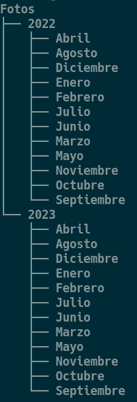

# Actividad 5 – Creación de scripts en Bash

Antes de realizar las tareas, **lee atentamente**:

> [**APUNTES DE COMANDOS LINUX**](../apuntes_comandos) <br> [**APUNTES DE SSH Y SCP**](../apuntes_ssh_scp) <br> [**APUNTES DE SCRIPTS EN LINUX**](../apuntes_scripts) (apartados [**1. ¿Qué es y para qué sirve un script?**](../apuntes_scripts#-1-qué-es-y-para-qué-sirve-un-script), [**2. Ejecutar un script**](../apuntes_scripts#%EF%B8%8F-2-ejecutar-un-script) y [**4. Mostrando información en Konsole**](../apuntes_scripts#-4-mostrando-información-en-konsole))

---

## Instrucciones generales

* Cada tarea que realices debe estar organizada dentro de la carpeta **Actividad-5**.
* **CABECERA OBLIGATORIA (`#!/bin/bash`)**{: .rojo}: Recuerda que todo script en Bash debe comenzar en su primera línea con `#!/bin/bash` y necesita permisos de ejecución (`chmod +x nombre_script.sh`) antes de poder lanzarse con `./nombre_script.sh`.
* **PERSONALIZACIÓN DE LOS SCRIPTS**{: .verde}: Todos tus scripts deben definir variables con tu nombre completo y NIA e imprimir mensajes informativos por pantalla mediante `echo` que muestren tus datos y el usuario del sistema (`$USER`).
* **EJECUCIÓN EN LOCAL Y EN EL SERVIDOR**{: .verde}: Primero debes crear y probar cada script en **tu ordenador de clase** y, una vez funcione correctamente, copiarlo con **`scp`** al **servidor de clase (`10.2.5.166`)** y ejecutarlo también allí conectado por **SSH**.
* **COMPRUEBA LA ESTRUCTURA CON `tree`**{: .verde}: Utiliza el comando **`tree`** en la terminal para mostrar de forma visual la estructura de carpetas creada o borrada en tus capturas.
* **HAZ CAPTURAS DE PANTALLA DE LAS EJECUCIONES**{: .rojo}: En todas las capturas solicitadas deben apreciarse claramente los comandos ejecutados, los mensajes personalizados mostrados por el script, la comprobación de carpetas y **tu nombre de usuario** (tanto en local como en el servidor).

---

## 🧩 Tarea 1 – Crear estructura básica

Lee los apartados [**1. ¿Qué es y para qué sirve un script?**](../apuntes_scripts#-1-qué-es-y-para-qué-sirve-un-script), [**2. Ejecutar un script**](../apuntes_scripts#%EF%B8%8F-2-ejecutar-un-script) y [**4. Mostrando información en Konsole**](../apuntes_scripts#-4-mostrando-información-en-konsole) de los apuntes.

> ⚠️ **Restricción:** Para esta tarea **solo puedes utilizar** los métodos explicados en los apartados 1, 2 y 4 de los apuntes (comandos secuenciales básicos sin bucles).
{: .alert-error}

### Paso 1 – Creación del script `tarea1.sh` en local

1. En tu ordenador de clase, crea la carpeta **Actividad-5** y, dentro de ella, otra carpeta llamada **Tarea-1**.
2. Dentro de **Tarea-1**, crea un script llamado **`tarea1.sh`** (utilizando el editor de texto **Kate** o `nano`) que genere la estructura completa de carpetas que se muestra en la siguiente imagen (`Fotos`, con las subcarpetas `2022` y `2023`, y dentro de cada año los 12 meses):


{: .img}

**Estructura de carpetas a generar con `tarea1.sh`**
{: .centrado}

3. Añade al principio del script (justo debajo de `#!/bin/bash`) tu nombre y apellidos y tu NIA en variables, y muestra mensajes con `echo` indicando el inicio y fin de la creación de carpetas. Por ejemplo:
   ```bash
   #!/bin/bash
   NOMBRE="Tu Nombre y Apellidos"
   NIA="12345678"
   echo "Script ejecutado por $NOMBRE ($NIA) en el usuario $USER"
   echo "Creando estructura de carpetas de Fotos..."
   ```

### Paso 2 – Ejecución y comprobación en tu ordenador local

1. Abre la terminal, sitúate dentro de **Actividad-5/Tarea-1** y dale permisos de ejecución al script:
   ```bash
   chmod +x tarea1.sh
   ```
2. Ejecuta el script en tu ordenador:
   ```bash
   ./tarea1.sh
   ```
3. Verifica con el comando **`tree`** que se ha creado toda la estructura de carpetas correspondiente (`Fotos/2022/...` y `Fotos/2023/...`).

> 📸 **Captura obligatoria 1 (Tarea 1 en local):** Haz una captura de pantalla de la terminal de tu ordenador donde se vea la ejecución de `./tarea1.sh` (con tus mensajes personalizados) y la comprobación de la estructura de carpetas con `tree`, mostrando claramente tu **nombre de usuario local**.
{: .alert-error}

### Paso 3 – Copia con SCP y ejecución en el servidor

1. Desde la terminal de tu ordenador local, copia el script `tarea1.sh` a tu carpeta personal del servidor de clase (`10.2.5.166`) mediante el comando **`scp`** (**revisa y pon bien tu usuario y la ruta**):
   ```bash
   scp tarea1.sh usuario@10.2.5.166:~/
   ```
   *(Sustituye `usuario` por tu nombre de usuario asignado en clase).*
2. Conéctate al servidor por **SSH**:
   ```bash
   ssh usuario@10.2.5.166
   ```
3. Dentro del servidor, organiza el script dentro de `Actividad-5/Tarea-1` (o en tu espacio de trabajo), asegúrate de que tiene permisos de ejecución (`chmod +x tarea1.sh`), ejecútalo con `./tarea1.sh` y comprueba con **`tree`** que se ha generado la estructura de carpetas.

> 📸 **Captura obligatoria 2 (Tarea 1 en el servidor):** Haz una captura de pantalla donde se aprecie la transferencia con `scp`, la ejecución de `./tarea1.sh` dentro del servidor por SSH (mostrando tus datos personalizados) y el árbol de carpetas creado con `tree`, con tu **nombre de usuario en el servidor** visible.
{: .alert-error}

---

## 🧹 Tarea 2 – Borrar la estructura anterior

> ⚠️ **Restricción:** Para esta tarea **solo puedes utilizar** los métodos explicados en los apartados 1, 2 y 4 de los apuntes.
{: .alert-error}

### Paso 1 – Creación del script `tarea2.sh` en local

1. Dentro de **Actividad-5**, crea la carpeta **Tarea-2** (o sitúa el script de modo que actúe sobre la estructura creada en la Tarea 1).
2. Crea un script llamado **`tarea2.sh`** que **borre todas las carpetas creadas en la Tarea 1** (`Fotos`, `2022`, `2023` y los meses correspondientes).
3. El script debe:
   - Comenzar con `#!/bin/bash` e incluir tus variables `NOMBRE` y `NIA` en un mensaje inicial con `echo` que muestre también el usuario (`$USER`).
   - Mostrar un mensaje con **`echo` antes y después de cada acción** de borrado para informar del progreso en la consola.

### Paso 2 – Ejecución y comprobación en tu ordenador local

1. Dale permisos de ejecución al script (`chmod +x tarea2.sh`).
2. Ejecuta `./tarea2.sh` en tu ordenador y verifica (con `ls` o `tree`) que se ha borrado por completo la estructura de carpetas de `Fotos`.

> 📸 **Captura obligatoria 3 (Tarea 2 en local):** Haz una captura de pantalla de la terminal de tu ordenador local mostrando la ejecución de `./tarea2.sh` (con los mensajes `echo` antes y después de cada acción y tus datos personales) y la comprobación de que la estructura de carpetas ha sido eliminada, con tu **nombre de usuario local**.
{: .alert-error}

### Paso 3 – Copia con SCP y ejecución en el servidor

1. Copia el script `tarea2.sh` desde tu ordenador local al servidor (`10.2.5.166`) a través del comando **`scp`**:
   ```bash
   scp tarea2.sh usuario@10.2.5.166:~/
   ```
2. Conéctate al servidor con **SSH** (`ssh usuario@10.2.5.166`), ejecuta `./tarea2.sh` en el directorio donde creaste la estructura de la Tarea 1 y comprueba que se ha borrado correctamente.

> 📸 **Captura obligatoria 4 (Tarea 2 en el servidor):** Haz una captura de pantalla donde se vea la copia con `scp`, la ejecución de `./tarea2.sh` en el servidor remoto por SSH y la verificación de que las carpetas se han borrado, mostrando claramente tu **nombre de usuario en el servidor**.
{: .alert-error}

---

## Entrega

Sube en esta tarea de **Aules**:

* Los dos scripts creados: **`tarea1.sh`** y **`tarea2.sh`**.
* **Las capturas de pantalla solicitadas** con las ejecuciones y comprobaciones de las Tareas 1 y 2, tanto en tu **ordenador local** como en el **servidor remoto** (deben verse claramente los mensajes personalizados con tu nombre y NIA, los comandos utilizados y tu nombre de usuario en la terminal).
