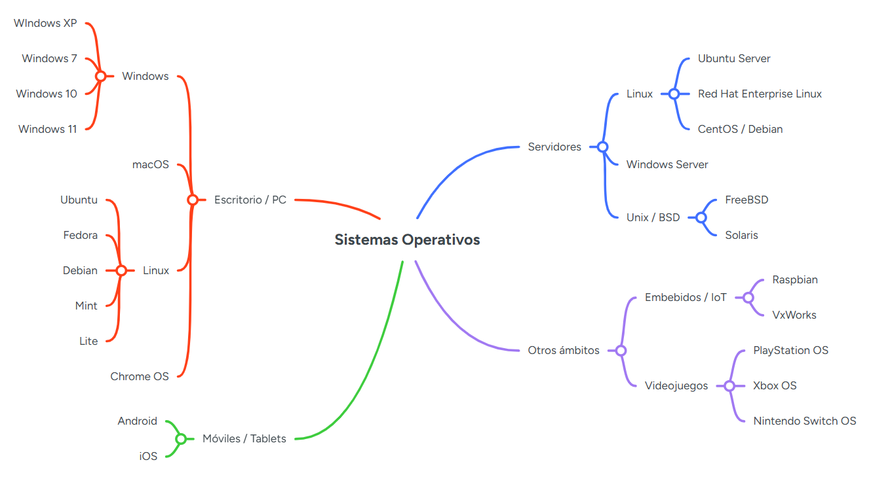

# Tema 1: Sistemas Operativos

**Definición**:
> Un **sistema operativo** es el software principal de un ordenador o dispositivo que gestiona el hardware y permite que se ejecuten los programas, actuando como intermediario entre la máquina y el usuario.

## Apuntes y recursos

- [Apuntes de Comandos Linux](./apuntes_comandos)
- Descarga directa con `wget`:  
  **dlopezcastellote.dev/informatica-eso-bat/asignaturas/digitalizacion/sistemas-operativos/fotos_animales.zip**{: .verde}
  
<!--
- [Apuntes SSH y SCP](./apuntes_ssh_scp)
- [Apuntes Scripts Linux](./apuntes_scripts)
-->

## Actividades

- [Actividad 1 – Explorando LliureX y el Sistema de Archivos](./actividad1/)
- [Actividad 2 – Máquinas virtuales en VirtualBox](./actividad2/)
- [Actividad 3 – Uso básico de la terminal en Linux (bash)](./actividad3/)
- [Actividad 4 – Uso de SSH y SCP en Linux](./actividad4/)
- [Actividad 5 – Scripts que leen ficheros](./actividad5/)
- [Actividad 6 – Scripts avanzados](./actividad6/)
