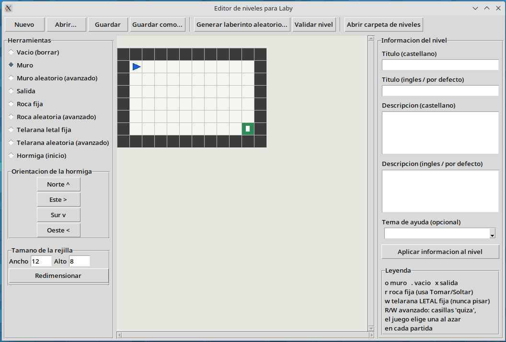

# Actividad 7. Diseña tu propio nivel con Laby Level Editor

> 🚀 **ANTES DE HACER LA ACTIVIDAD DEBES LEER**: 👉 [Funcionamiento de Laby](../funcionamiento-de-laby) y [Bucles y condicionales en Laby](../bucles-y-condicionales-en-laby) 👈
{: .alert-warning}

Una vez que has aprendido a resolver problemas utilizando bucles y condicionales en Laby, ahora te convertirás en diseñador/a de niveles.

Para ello utilizaremos la aplicación [**Laby Level Editor**](https://github.com/Dellos7/laby-levels/releases/download/v1.1.0/laby-level-editor-x86_64.AppImage) (puedes consultar el código fuente y la documentación del proyecto en su [repositorio de GitHub](https://github.com/Dellos7/laby-levels)).

---

## 📥 ¿Dónde guardar y cómo abrir el editor?

Para utilizar el editor sigue estos pasos:

1. **Descárgalo**: haz clic en el enlace para descargar el archivo [`laby-level-editor-x86_64.AppImage`](https://github.com/Dellos7/laby-levels/releases/download/v1.1.0/laby-level-editor-x86_64.AppImage).
2. **Guárdalo**: muévelo o guárdalo directamente dentro de la **carpeta del Tema 1** que ya tienes creada.
3. **Ábrelo**: haz **doble clic** sobre el archivo `laby-level-editor-x86_64.AppImage` para ejecutar el programa.

---

## 🛠️ ¿Cómo funciona el editor?

El editor te permite crear tableros personalizados para Laby de forma visual:

{: .img}

- **Rejilla interactiva (centro)**: haz clic o arrastra con el ratón sobre las casillas para pintar los elementos del laberinto.
- **Panel de herramientas (izquierda)**:
  - `.` **Vacío (borrar)**: suelo libre por el que puede caminar la hormiga.
  - `o` **Muro**: muro fijo intransitable.
  - `x` **Salida**: puerta de salida del laberinto (meta).
  - `r` **Roca fija**: bloquea el paso hasta que la hormiga la recoge con `tomar()` / `take()`.
  - `w` **Telaraña letal fija**: trampa letal si se pisa sin antes haber soltado una roca sobre ella.
  - `R` / `W` **Roca y telaraña aleatoria (avanzado)**: casillas «quizá» en las que el juego elige al azar en cada partida cuál es real o segura, obligando a inspeccionar con `mirar()` / `look()`.
  - **Hormiga (`↑`, `→`, `↓`, `←`)**: define la posición inicial de la hormiga y su orientación (**Norte `^`**, **Este `>`**, **Sur `v`**, **Oeste `<`**).
  - **Tamaño de la rejilla**: permite ajustar el **Ancho** y **Alto** del mapa y pulsar **«Redimensionar»**.
- **Panel de Información del nivel (derecha)**:
  - **Título (castellano)** y **Título (inglés / por defecto)**: el nombre de tu nivel que aparecerá en Laby.
  - **Descripción (castellano)** y **Descripción (inglés / por defecto)**: la explicación o pista que verá quien juegue tu nivel en el panel de mensajes de Laby.
  - **Tema de ayuda (opcional)**: etiqueta de ayuda asociada al nivel (`basic`, `rocks`, `loop`, `function`, `conditional`).
  - Botón **«Aplicar información al nivel»**: registra los textos introducidos en el nivel actual.

---

## 💾 ¿Cómo guardar un nivel y abrirlo en Laby?

Para que el juego **Laby** reconozca tu nivel automáticamente, el editor gestiona por ti la carpeta de niveles del usuario (`~/.config/laby/levels`):

1. **Completa la información del nivel**: rellena los campos del panel de la derecha (**Título** y **Descripción**) y pulsa **«Aplicar información al nivel»**.
2. **Valida tu diseño**: pulsa el botón **«Validar nivel»** de la barra superior para comprobar que hay una salida (`x`) y que existe un camino posible desde la hormiga hasta la meta.
3. **Guarda el archivo `.laby`**:
   - Pulsa **«Guardar»** o **«Guardar como...»** en la barra superior.
   - Por defecto, el editor abrirá directamente la carpeta `~/.config/laby/levels` (la primera vez que uses el editor, este habrá copiado ahí los niveles originales de Laby para que sigan apareciendo todos juntos).
   - Escribe el nombre **`apellido_nombre_nivel.laby`** y guárdalo en esa misma carpeta sin cambiar de ruta.
4. **Ábrelo en Laby**:
   - Abre el juego **Laby** (si ya lo tenías abierto, ciérralo y vuélvelo a abrir para que actualice la lista de niveles).
   - Despliega el menú **«Nivell»** (o **«Nivel»**) y verás tu nivel en la lista con el título que le hayas puesto.
5. **Localizar el archivo `.laby` para entregarlo**:
   - Como la carpeta `.config` está oculta por defecto en el sistema, el editor incluye en la barra superior el botón **«Abrir carpeta de niveles»**. Al pulsarlo, se abrirá una ventana del gestor de archivos directamente en `~/.config/laby/levels`, desde donde podrás copiar o subir tu archivo `apellido_nombre_nivel.laby` a Aules.

---

## 📝 Tarea a realizar

En esta actividad debes **diseñar un nuevo nivel original de Laby** utilizando el editor **Laby Level Editor**, **guardarlo**, **abrirlo dentro del juego Laby** y **resolverlo programando su solución en Python**.

El flujo completo de trabajo que debes seguir es:
1. **Diseñar el laberinto** en la rejilla del editor colocando muros, caminos, rocas y/o telarañas, además de la posición de inicio de la hormiga y la puerta de salida.
2. **Completar los datos del panel derecho** (**Información del nivel**: título y descripción tanto en castellano como por defecto) para que tu nivel esté documentado al abrirse en el juego.
3. **Validar y guardar el nivel** como `apellido_nombre_nivel.laby` en la carpeta de niveles para que Laby lo detecte.
4. **Abrir tu nivel en el juego Laby y resolverlo**: escribe el programa en Python que lleve a la hormiga hasta la salida superando los obstáculos que hayas diseñado y comprueba que funciona correctamente.

### ⚠️ Requisitos obligatorios de tu nivel:

1. **Información del nivel completa (panel derecho)**: Debes rellenar obligatoriamente los campos de **Título** y **Descripción** en el panel de la derecha (explicando de qué trata el reto o qué objetivo tiene) y aplicar los cambios antes de guardar.
2. **Obligatoriedad de `while` e `if`**: El diseño de tu nivel debe requerir para su resolución el uso de **al menos un bucle (`while`) y un condicional (`if`) con una función justificada** (por ejemplo, avanzar con un bucle y tomar decisiones con `mirar()` / `look()` ante paredes, rocas o telarañas). No basta con añadir bloques de código que no influyan en el recorrido real de la hormiga.
3. **Validado y solucionable**: El nivel debe superar la comprobación del botón **«Validar nivel»** y tener una solución clara y sin errores al jugarlo en Laby.
4. **Guardado del archivo**: Guarda tu nivel desde el editor con el formato `.laby` y nómbralo con tus apellidos y nombre: `apellido_nombre_nivel.laby`.
5. **Código de solución probado en Laby**: Debes programar y verificar en el juego **Laby** la solución completa en Python que supera tu nivel y guardarla en un archivo llamado `solucion_nivel.py`.

---

## 📤 Entrega en Aules

Debes entregar en la tarea correspondiente de Aules los siguientes elementos:

1. El archivo del nivel creado: `apellido_nombre_nivel.laby` (con el mapa y los datos de título y descripción guardados).
2. Una **captura de pantalla de tu nivel abierto en el editor** `laby-levels` (`captura_editor.png`), donde se vean el diseño y los datos de la derecha, con tu **nombre y apellidos rotulado**.
3. Un archivo de texto o script Python `solucion_nivel.py` con el **código probado en Laby que resuelve con éxito tu propio nivel**, demostrando el uso obligatorio de `while` e `if`.

---

## 📊 Rúbrica – Actividad 7: Diseña tu propio nivel con Laby Level Editor (máx. 10 puntos)

| Criterio | Insuficiente | Básico | Adecuado | Excelente |
|---|---|---|---|---|
| **Diseño del nivel e información en laby-levels** (máx. 3 puntos) | **0 puntos:** No entrega nivel o el archivo `.laby` no es válido. | **1 punto:** Nivel muy simple que no cumple las pautas de diseño, no es solucionable o carece de título y descripción. | **2 puntos:** Nivel funcional y solucionable, pero con diseño básico/poco retador o con los datos del panel derecho (título y descripción) incompletos. | **3 puntos:** Nivel funcional, original, sin errores, bien estructurado en la rejilla y con la información del panel derecho (título y descripción) completa. |
| **Requisito algorítmico (While + If)** (máx. 3 puntos) | **0 puntos:** El nivel y la solución entregada no utilizan bucle ni condicional. | **1 punto:** La solución utiliza solo una estructura (`while` o `if`), o alguna no cumple una función real en el nivel. | **2 puntos:** Utiliza ambas estructuras, pero su justificación o integración en el diseño del nivel es parcial o forzada. | **3 puntos:** El nivel está diseñado para que la solución combine `while` e `if` de manera útil, justificada y relevante. |
| **Apertura y código de solución en Laby** (máx. 2 puntos) | **0 puntos:** Sin código o el código no resuelve el nivel en Laby. | **0,5 puntos:** Código muy incompleto, con errores de sintaxis o que no logra llevar a la hormiga a la salida. | **1 punto:** Código funcional que resuelve el nivel en Laby, pero desordenado o con instrucciones redundantes. | **2 puntos:** Código en Python correcto, limpio, probado en Laby y que resuelve el nivel propio con éxito. |
| **Presentación y formato de entrega** (máx. 2 puntos) | **0 puntos:** Nombres incorrectos, capturas ilegibles o entrega vacía. | **0,5 puntos:** Aporta solo parte de los archivos solicitados o con fallos de nomenclatura. | **1 punto:** Archivos legibles y funcionales pero falta rotular el nombre en la captura o algún formato es incorrecto. | **2 puntos:** Entrega completa y bien organizada con todos los archivos requeridos (`apellido_nombre_nivel.laby`, `captura_editor.png` rotulada y `solucion_nivel.py`). |
| **Entrega en plazo** (máx. 0 puntos) | **-2 puntos:** No entrega o realiza una entrega vacía o fuera de plazo sin justificación. | **-1,5 puntos:** Entrega con retraso importante de más de dos días. | **-1 punto:** Entrega con pequeño retraso (hasta 2 días). | **0 puntos:** Entrega puntual dentro del plazo establecido. |

> ⚠️ **Nota sobre la entrega en plazo:** La entrega dentro del plazo establecido no resta puntuación (0 pts). Las entregas con retraso supondrán una penalización de hasta 2 puntos sobre la calificación de la actividad.
{: .alert-error}

---

## 📌 Criterios de evaluación asociados

- **CE2.1**: Analizar problemas elementales significativos para el alumnado, mediante la abstracción y modelización de la realidad.
- **CE2.3**: Resolver de forma guiada problemas elementales utilizando los algoritmos y las estructuras de datos necesarias.
- **CE2.4**: Programar aplicaciones sencillas de forma guiada para resolver problemas elementales.
- **CE4.1**: Participar activamente en el diseño y desarrollo de soluciones digitales colaborativas y creativas.
- **CE4.3**: Describir y valorar la adecuación de las tecnologías, entornos de desarrollo, dispositivos y componentes para resolver los retos planteados.