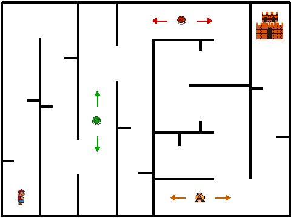
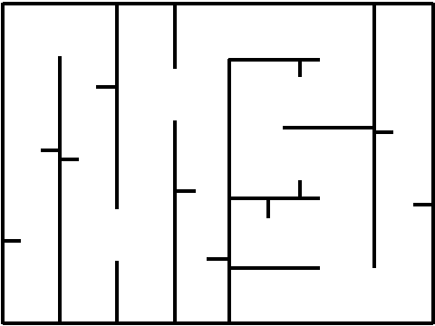

# Actividad 9. Creando nuestro primer videojuego en Scratch: El Laberinto de Mario

¡Ha llegado el momento de poner en práctica todo lo aprendido a lo largo del tema! Durante las actividades anteriores has trabajado con secuencias de instrucciones, algoritmos, recorridos en laberintos, bucles (`while`) y condicionales (`if`). 

Ahora utilizaremos **Scratch**, una plataforma visual de programación por bloques creada por el MIT, para diseñar y programar un videojuego completo de laberintos inspirado en **Super Mario Bros**.

> 👉 **Acceso a Scratch**: Puedes utilizar la versión online directamente desde tu navegador en [https://scratch.mit.edu/](https://scratch.mit.edu/) (pulsando en **Crear**) o abrir la aplicación de escritorio **Scratch** desde el menú de aplicaciones de LliureX.
{: .alert-info}


{: .img}

---

## 🧭 ¿Cómo funciona Scratch?

En Scratch programamos encajando bloques de colores como si fueran piezas de puzle:

1. **El Escenario**: Es el espacio donde ocurre la acción del juego ($480 \times 360$ píxeles). Funciona con un eje de coordenadas cartesiano ($X$ horizontal de $-240$ a $+240$, e $Y$ vertical de $-180$ a $+180$).
2. **Los Objetos (*Sprites*)**: Son los personajes y elementos interactivos del juego (Mario, el castillo, los caparazones...). Cada objeto tiene sus propios programas, disfraces (*costumes*) y sonidos.
3. **La Paleta de Bloques**:
   - 🔵 **Movimiento**: mover, girar y posicionar objetos en la pantalla (`ir a x: y:`, `sumar a x`, `sumar a y`).
   - 🟣 **Apariencia**: cambiar disfraces, cambiar fondos y `mostrar` / `ocultar` objetos.
   - 🟡 **Eventos**: activadores como `al presionar bandera verde`, `al presionar tecla` o el envío de mensajes (`enviar [fin_juego]`).
   - 🟠 **Control**: bucles (`por siempre`, `repetir`) y condicionales (`si ... entonces`).
   - 🩵 **Sensores**: detectar colisiones con colores (`¿tocando el color (...)?`) o con otros objetos (`¿tocando (objeto)?`).
   - 🟢 **Operadores**: operaciones matemáticas (`*`, `+`, `-`, `=`) y lógicas (`o`, `y`).
   - 🟧 **Variables**: almacenar datos que cambian durante la partida, como la velocidad de rebote, las vidas o el tiempo.

---

## 📥 Descarga de recursos del juego

Antes de empezar a programar, descarga y guarda en tu **carpeta del Tema 1** las imágenes que necesitarás para construir el juego (haz **clic derecho → Guardar enlace como...** o **Guardar imagen como...** sobre cada enlace):

### 1. Recursos para el juego base (Parte 1)
* 🏃 **Disfraces de Mario**:
  * [`mario1.png`](./mario1.png) (Disfraz 1)
  * [`mario2.png`](./mario2.png) (Disfraz 2)
  * [`mario3.png`](./mario3.png) (Disfraz 3)
  * [`mario4.png`](./mario4.png) (Disfraz 4)
* 🏰 **Meta del laberinto**:
  * [`castillo.png`](./castillo.png) (Castillo final)
* 🐢 **Enemigos patrulleros**:
  * [`caparazon_verde.png`](./caparazon_verde.png) (Caparazón verde)
  * [`caparazon_rojo.png`](./caparazon_rojo.png) (Caparazón rojo)
* 🖼️ **Fondos de pantalla**:
  * [`GAME_OVER.png`](./GAME_OVER.png) (Fondo de derrota)
  * [`VICTORIA.png`](./VICTORIA.png) (Fondo de victoria)
  * [`laberinto_1.png`](./laberinto_1.png) (Imagen de referencia para dibujar tu laberinto) / [`laberinto_1.svg`](./laberinto_1.svg)

### 2. Recursos extra para el Reto Individual (Parte 2)
* 👾 **Nuevos enemigos y objetos coleccionables (listos para usar)**:
  * [`goomba.png`](./goomba.png) (Enemigo Goomba)
  * [`planta_pirana.png`](./planta_pirana.png) (Planta Piraña trampa)
  * [`koopa.png`](./koopa.png) (Tortuga Koopa Troopa)
  * [`champinon.png`](./champinon.png) (Champiñón de vida extra)
  * [`moneda.png`](./moneda.png) (Moneda coleccionable)
* 🎨 **Hoja completa de sprites y tipografía (por si quieres recortar o diseñar tus propios gráficos en GIMP)**:
  * [`144-1447400_super-mario-bros-all-stars-sprite-sheets.png`](./144-1447400_super-mario-bros-all-stars-sprite-sheets.png) (Hoja completa de sprites de Super Mario)
  * [`SuperMario256.ttf`](./SuperMario256.ttf) (Fuente tipográfica clásica de Super Mario)

---

## 🛠️ Parte 1: Construcción guiada del juego base "El Laberinto de Mario"

Sigue estos pasos en orden para construir y programar la mecánica principal del juego:

### Paso 1: Crear el Escenario (`laberinto_1`, `GAME_OVER` y `VICTORIA`)

1. Elimina el objeto del gato que aparece por defecto haciendo clic en el icono de la papelera.
2. Haz clic en **Escenario** (abajo a la derecha) y entra en la pestaña **Fondos** (arriba a la izquierda).
3. Ponle al primer fondo el nombre **`laberinto_1`**.
4. **Dibuja las paredes del laberinto**:
   - Asegúrate de estar en el editor en modo **Vectorial**.
   - Selecciona la herramienta **Rectángulo**, configura el **Relleno** como *Sin relleno* y el **Borde** en color **Negro puro (`#000000`)** con grosor **`4`**. Dibuja el marco exterior rodeando todo el escenario.
   - Selecciona la herramienta **Línea** (color negro `#000000` y grosor **`4`**) y dibuja los pasillos, recovecos y algún callejón sin salida siguiendo el modelo de referencia:
   - 💡 **Truco**: Si mantienes pulsada la tecla **`Shift` (Mayús)** mientras dibujas una línea, te saldrá perfectamente recta (vertical u horizontal). Deja pasillos suficientemente anchos para que Mario pueda pasar y deja al menos un pasillo vertical despejado (para el caparazón verde) y uno horizontal despejado (para el caparazón rojo).


{: .img}

5. En el botón **Elige un fondo** (abajo a la derecha), selecciona la opción **Subir fondo** (icono de la flecha hacia arriba) e importa los archivos [`GAME_OVER.png`](./GAME_OVER.png) y [`VICTORIA.png`](./VICTORIA.png). Comprueba que sus nombres sean exactamente `GAME_OVER` y `VICTORIA`.

---

### Paso 2: Crear a Mario, su movimiento y su animación

1. Ve al panel de **Objetos** (abajo a la derecha), pulsa en **Subir objeto** y selecciona [`mario1.png`](./mario1.png).
2. Con el objeto `mario1` seleccionado, entra en su pestaña **Disfraces** (arriba a la izquierda) y usa **Subir disfraz** para añadir en orden [`mario2.png`](./mario2.png), [`mario3.png`](./mario3.png) y [`mario4.png`](./mario4.png).
3. En el panel de propiedades del objeto (debajo del escenario), ajusta:
   - **Tamaño**: `50`
   - **Posición inicial**: `x: -205`, `y: -145` (esquina inferior izquierda del laberinto).
   - **Dirección**: haz clic en el número `90` y selecciona el icono central de rotación **Izquierda-Derecha (`↔`)** para que Mario no se ponga cabeza abajo al caminar hacia la izquierda.
4. Ve a la pestaña **Código** de `mario1` y programa el movimiento en las 4 direcciones con las flechas del teclado:

```plaintext
al presionar tecla [flecha derecha v]
apuntar en dirección (90)
mover (10) pasos

al presionar tecla [flecha izquierda v]
apuntar en dirección (-90)
mover (10) pasos

al presionar tecla [flecha arriba v]
sumar a y (10)

al presionar tecla [flecha abajo v]
sumar a y (-10)
```

---

### Paso 3: Animación de Mario y muerte al chocar con las paredes negras

Queremos que al pulsar la bandera verde (`⚑`) Mario se coloque en la salida con el fondo `laberinto_1`, vaya cambiando de disfraz para simular que camina y, si toca cualquier pared de **color negro**, se acabe la partida.

Añade este programa en el código de **`mario1`**:

```plaintext
al presionar ⚑
mostrar
fijar estilo de rotación a [izquierda-derecha v]
cambiar fondo a [laberinto_1 v]
ir a x: (-205) y: (-145)
apuntar en dirección (90)
por siempre
    esperar (0.08) segundos
    siguiente disfraz
    si <¿tocando el color (#000000)?> entonces
        enviar [fin_juego v]
    fin
fin
```

> 👉 **¿Cómo seleccionar el color negro exacto?**: Haz clic en el cuadro de color dentro del bloque `¿tocando el color (...)?`, pulsa el icono del **cuentagotas** que aparece abajo y haz clic directamente sobre una de las paredes negras de tu laberinto.
{: .alert-info}

A continuación, programa en **`mario1`** qué debe ocurrir cuando se recibe el mensaje **`fin_juego`**:

```plaintext
al recibir [fin_juego v]
cambiar fondo a [GAME_OVER v]
ocultar
detener [todos v]
```

---

### Paso 4: Añadir el Castillo (`castillo`) y ganar la partida

1. Pulsa en **Subir objeto** y selecciona el archivo [`castillo.png`](./castillo.png).
2. Cambia su **Tamaño** a `95` y colócalo al final del laberinto (esquina superior derecha): `x: 205`, `y: 138`.
3. En la pestaña **Código** de **`castillo`**, programa que aparezca al empezar y se esconda cuando termine el juego:

```plaintext
al presionar ⚑
mostrar
ir a x: (205) y: (138)

al recibir [fin_juego v]
ocultar

al recibir [victoria v]
ocultar
```

4. Vuelve al código de **`mario1`**:
   - Añade dentro de su bucle `por siempre` la condición para ganar al tocar el castillo:
   - Y añade el bloque `al recibir [victoria]` para mostrar el fondo `VICTORIA`:

```plaintext
// Añadir dentro del bucle "por siempre" de mario1:
si <¿tocando (castillo v)?> entonces
    enviar [victoria v]
fin
```

```plaintext
// Añadir en mario1 para gestionar la victoria:
al recibir [victoria v]
cambiar fondo a [VICTORIA v]
ocultar
detener [todos v]
```

---

### Paso 5: Programar los enemigos patrulleros (`caparazon_verde` y `caparazon_rojo`)

Por el camino hacia el castillo deben patrullar enemigos que se mueven solos y rebotan al chocar contra las paredes negras del laberinto:

#### 1. Caparazón Verde (movimiento vertical arriba y abajo)
1. Pulsa en **Subir objeto** y selecciona [`caparazon_verde.png`](./caparazon_verde.png). Ponle **Tamaño** `50` y sitúalo en el tercer pasillo vertical (`x: -80`, `y: -140`).
2. Ve a la categoría **Variables**, pulsa en **Crear una variable** y llámala **`y`**. *(Puedes desmarcar su casilla en la lista de variables para que no se vea el recuadro en el escenario).*
3. Programa en **`caparazon_verde`** su movimiento y rebote:

```plaintext
al presionar ⚑
mostrar
dar a [y v] el valor (5)
ir a x: (-80) y: (-140)
por siempre
    sumar a y (y)
    si <¿tocando el color (#000000)?> entonces
        dar a [y v] el valor ((y) * (-1))
    fin
fin

al recibir [fin_juego v]
ocultar

al recibir [victoria v]
ocultar
```

> 🧠 **Explicación algorítmica del rebote**: Al empezar, la variable `y` vale `5`, por lo que `sumar a y (y)` hace que el caparazón suba de 5 en 5 píxeles. Cuando choca contra la pared negra superior, multiplicamos `y` por `-1` ($5 \times -1 = -5$), invirtiendo el sentido para que baje. Al tocar la pared inferior, $(-5) \times (-1) = +5$, ¡volviendo a subir!
{: .alert-info}

#### 2. Caparazón Rojo (movimiento horizontal izquierda y derecha)
1. Pulsa en **Subir objeto** y selecciona [`caparazon_rojo.png`](./caparazon_rojo.png). Ponle **Tamaño** `50` y sitúalo en el pasillo horizontal superior (`x: 60`, `y: 146`).
2. En **Variables**, crea una nueva variable llamada **`x`** (y desmarca su casilla para ocultarla del escenario).
3. Programa en **`caparazon_rojo`** el mismo algoritmo de rebote, pero usando `sumar a x (x)` para que se mueva en horizontal:

```plaintext
al presionar ⚑
mostrar
dar a [x v] el valor (5)
ir a x: (60) y: (146)
por siempre
    sumar a x (x)
    si <¿tocando el color (#000000)?> entonces
        dar a [x v] el valor ((x) * (-1))
    fin
fin

al recibir [fin_juego v]
ocultar

al recibir [victoria v]
ocultar
```

#### 3. Detectar el choque de Mario con los caparazones
Vuelve al código de **`mario1`** y, dentro de su bucle `por siempre`, añade las condiciones para que Mario también pierda si toca cualquiera de los dos caparazones:

```plaintext
// Añadir dentro del bucle "por siempre" de mario1:
si <¿tocando (caparazon_verde v)?> entonces
    enviar [fin_juego v]
fin
si <¿tocando (caparazon_rojo v)?> entonces
    enviar [fin_juego v]
fin
```

¡Prueba tu juego pulsando la bandera verde `⚑`! Comprueba que Mario camina por el laberinto, que los caparazones rebotan en sus pasillos y que funcionan tanto el *GAME OVER* como la pantalla de *VICTORIA*.

---

## 🚀 Parte 2: Reto Individual (Amplía el juego: nuevos personajes, vidas y más dificultad)

Una vez que tu juego base funcione correctamente, debes demostrar lo que has aprendido superando **obligatoriamente las 3 misiones de este reto**:

### 👾 Misión 1: Añadir nuevos personajes en el camino
El laberinto necesita más vida. Debes incorporar **al menos un nuevo enemigo** (y opcionalmente objetos coleccionables) utilizando los sprites de la sección de descargas o extrayéndolos tú mismo/a de la hoja de sprites con GIMP:
- **Opción A (Nuevo enemigo patrullero)**: Añade a **Goomba** ([`goomba.png`](./goomba.png)) o a **Koopa** ([`koopa.png`](./koopa.png)) patrullando el último pasillo horizontal antes de subir al castillo (creando su propia variable de velocidad, por ejemplo `x_goomba`).
- **Opción B (Planta Piraña trampa)**: Añade una **Planta Piraña** ([`planta_pirana.png`](./planta_pirana.png)) en una intersección del laberinto que aparezca (`mostrar`) durante 2 segundos y desaparezca (`ocultar`) durante 2 segundos dentro de un bucle `por siempre`, obligando a Mario a calcular el momento exacto para cruzar.
- **Opción C (Objetos de bonificación)**: Coloca **Monedas** ([`moneda.png`](./moneda.png)) o un **Champiñón** ([`champinon.png`](./champinon.png)) en los callejones sin salida del laberinto para premiar al jugador que los recoja.

### ❤️ Misión 2: Implementar un Sistema de Vidas (`vidas`)
Morir al primer roce es demasiado duro. Modifica el programa de Mario para que el jugador disponga de **3 vidas**:
1. Crea una variable llamada **`vidas`** y deja marcada su casilla para que el marcador se vea en una esquina del escenario.
2. Al presionar la bandera verde (`⚑`), inicializa la variable con `dar a [vidas v] el valor (3)`.
3. Modifica los condicionales de choque de Mario (pared negra y enemigos) para que, al chocar:
   - Se reste 1 vida: `sumar a [vidas v] (-1)`.
   - Mario regrese inmediatamente a la posición de salida: `ir a x: (-205) y: (-145)`.
   - **Solo si las vidas llegan a 0** (`si <(vidas) = (0)> entonces`), se envíe el mensaje `enviar [fin_juego v]`.
4. *(Idea extra)*: Si has añadido el **Champiñón** ([`champinon.png`](./champinon.png)), haz que al tocarlo Mario gane 1 vida extra (`sumar a [vidas v] (1)`) y el champiñón se oculte.

### ⚡ Misión 3: Aumentar la dificultad del juego
Elige e implementa **al menos una** de estas mecánicas para hacer la partida más emocionante:
1. ⏱️ **Cuenta atrás contrarreloj**: Crea una variable visible llamada **`tiempo`** que empiece en `45` (o `60`) segundos al pulsar la bandera verde y baje de 1 en 1 cada segundo (`esperar (1) segundos` → `sumar a [tiempo v] (-1)`). Si `tiempo` llega a `0` antes de alcanzar el castillo, se envía `fin_juego`.
2. 🔑 **Objeto obligatorio para abrir el castillo**: Coloca una moneda o llave en uno de los recovecos difíciles; Mario solo podrá ganar al tocar el castillo si antes ha recogido ese objeto (usando una variable `llave` que pase de `0` a `1`).
3. 🔥 **Velocidad y sonidos**: Añade efectos de sonido al perder una vida, recoger objetos o ganar, y ajusta las velocidades de los enemigos en los últimos tramos para que el final del laberinto sea un verdadero reto.

---

## 🤝 Prueba, autoría y reutilización

Trabajad por parejas para probar los juegos: cada persona conserva su proyecto individual y asume alternativamente los papeles de **autor/a** y **revisor/a**. Anota una observación recibida al probar tu laberinto (por ejemplo, un pasillo demasiado estrecho o un enemigo mal colocado), la comprobación que haces y la mejora o decisión resultante.

Añade a la explicación de entrega un apartado **«Créditos y reutilización»**: identifica qué has creado tú (diseño del laberinto, programación de bloques, mejoras del reto), de dónde proceden los recursos gráficos o fragmentos reutilizados, su autoría y su licencia o condiciones de uso. Explica brevemente qué permiten esas condiciones. Compara también **Scratch con Laby**: qué facilita cada entorno para diseñar y resolver un reto de laberinto.

---

## 📤 Entrega en Aules

Debes enviar a través de la tarea correspondiente en Aules:

1. **El archivo de tu proyecto de Scratch (`.sb3`)**: En Scratch haz clic en **Archivo → Guardar en tu ordenador** para descargar el archivo y nómbralo como **`apellido_nombre_laberinto_mario.sb3`**.
2. **Una captura de pantalla** (`captura_juego.png`) de tu juego en plena acción donde se vea tu laberinto completo, los personajes, el marcador de `vidas` (y `tiempo` o `puntos`) y tu **nombre y apellidos rotulados**.
3. **Un breve documento de texto** (`explicacion.odt` o `.pdf`) explicando:
   - ¿Cómo has diseñado tu laberinto y qué enemigos u objetos has añadido en el **Reto Individual**?
   - ¿Cómo has programado el **sistema de vidas** y el **aumento de dificultad**?
   - El registro de la **prueba por parejas** (observación recibida y mejora aplicada) y el apartado de **Créditos, licencias y comparación entre Scratch y Laby**.

---

## 📊 Rúbrica – Actividad 9: El Laberinto de Mario en Scratch (máx. 10 puntos)

| Criterio | 0 puntos | 1 punto | 2 puntos | 3 puntos |
|---|---|---|---|---|
| **Diseño del laberinto y control de Mario** | El laberinto está incompleto o Mario no responde a las 4 flechas del teclado. | Mario se mueve pero sin animación de disfraces, con rotación incorrecta o pasillos impracticables. | Laberinto completo con paredes, recovecos y callejones; Mario se mueve con fluidez en las 4 direcciones y anima sus disfraces. | – |
| **Enemigos patrulleros (`caparazon_verde` y `caparazon_rojo`)** | No hay enemigos en movimiento o no rebotan en las paredes. | Solo funciona uno de los enemigos o el rebote falla al tocar el color negro. | Ambos caparazones patrullan (vertical y horizontalmente) usando variables y rebotando con precisión en las paredes negras. | – |
| **Colisiones, Castillo y pantallas de Fin de Partida** | No detecta choques con paredes/enemigos ni la llegada al castillo. | Detecta algunas colisiones pero los mensajes `fin_juego` / `victoria` o el cambio de fondos fallan. | Detecta perfectamente paredes negras, enemigos y llegada al `castillo`, mostrando los fondos `GAME_OVER` y `VICTORIA` y ocultando los objetos. | – |
| **Reto individual (Nuevos personajes + Sistema de Vidas + Dificultad)** | No implementa las misiones del reto individual. | Implementa solo 1 de las 3 misiones del reto (ej. solo un personaje nuevo sin vidas ni dificultad extra). | Implementa 2 de las 3 misiones del reto de forma funcional. | Implementa las **3 misiones del reto** (nuevo personaje/enemigo, sistema de 3 vidas con reinicio a la salida y mecánica extra de dificultad como temporizador o llave). |
| **Diseño visual, prueba por parejas, créditos y entrega** | Entrega incompleta, sin identificar o sin documento explicativo. | Proyecto limpio y bien presentado, con captura rotulada y documento completo (explicación del reto, revisión por parejas, créditos/licencias y comparación con Laby). | – | – |

---

## 📌 Criterios de evaluación asociados

- **CE2.1**: Analizar problemas elementales significativos para el alumnado, mediante la abstracción y modelización de la realidad.
- **CE2.2**: Analizar y validar el funcionamiento de aplicaciones sencillas.
- **CE2.3**: Resolver de forma guiada problemas elementales utilizando los algoritmos y las estructuras de datos necesarias.
- **CE2.4**: Programar aplicaciones sencillas de forma guiada para resolver problemas elementales.
- **CE2.5**: Describir y valorar los derechos de autor y las licencias de los recursos y del software.
- **CE4.1**: Participar activamente en el diseño y desarrollo de soluciones digitales colaborativas y creativas.
- **CE4.3**: Valorar la adecuación de los entornos utilizados al reto.
- **CE4.4**: Resolver problemas técnicos sencillos, revisando el procedimiento cuando sea necesario.
