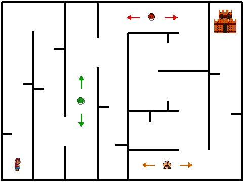
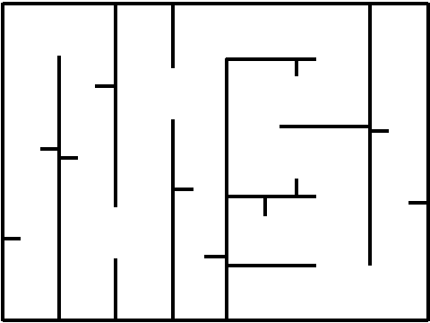

# 👨‍🏫 Guía Docente: El Laberinto de Mario en Scratch (Actividad 9)

Esta guía contiene las instrucciones detalladas paso a paso para que el profesorado pueda dirigir en el aula la creación del videojuego **"El Laberinto de Mario"**, desde la preparación opcional de los gráficos en GIMP hasta la programación completa del juego base y las soluciones del reto de ampliación.

> 📦 **Proyecto completo resuelto (`.sb3`)**: Puedes descargar e importar directamente en Scratch el proyecto terminado haciendo clic aquí: [**Descargar `Laberinto-Mario.sb3`**](./Laberinto-Mario.sb3).
{: .alert-info}


{: .img}

---

## 📋 1. Resumen de la arquitectura del proyecto

El juego consta de **1 escenario con 3 fondos**, **5 objetos (sprites)**, **3 variables de velocidad** y **2 mensajes (eventos de difusión)**:

| Elemento | Tipo | Nombre en Scratch | Posición inicial $(x, y)$ | Tamaño | Función principal |
|---|---|---|---|---|---|
| **Escenario** | Fondo 1 | `laberinto_1` | $(0, 0)$ | $480 \times 360$ | Laberinto vectorial con paredes negras (`#000000`, grosor `4`). |
| **Escenario** | Fondo 2 | `GAME_OVER` | $(0, 0)$ | $480 \times 360$ | Pantalla de derrota cuando Mario pierde. |
| **Escenario** | Fondo 3 | `VICTORIA` | $(0, 0)$ | $480 \times 360$ | Pantalla de victoria cuando Mario llega al castillo. |
| **Jugador** | Objeto | `mario1` | $(-205, -145)$ | `50` | Controlado con las 4 flechas; 4 disfraces (`mario1` a `mario4`). |
| **Meta** | Objeto | `castillo` | $(205, 138)$ | `95` | Meta en la esquina superior derecha; al tocarlo se gana. |
| **Enemigo 1** | Objeto | `caparazon_verde` | $(-80, -140)$ | `50` | Patrulla **verticalmente** en el pasillo 3 usando la variable `y`. |
| **Enemigo 2** | Objeto | `caparazon_rojo` | $(60, 146)$ | `50` | Patrulla **horizontalmente** en el pasillo superior usando la variable `x`. |
| **Enemigo 3** | Objeto | `goomba` | $(90, -146)$ | `55` | Patrulla **horizontalmente** en el pasillo inferior usando `x_goomba`. |

---

## 🎨 2. Preparación de los recursos gráficos en GIMP (Referencia para el profesor)

*(Nota: En la página de la actividad del alumnado ya están todos los recursos recortados y listos para descargar, pero puedes explicar o realizar esta parte en GIMP si deseas mostrar de dónde salen los sprites y los carteles).*

### 2.1. Extraer los disfraces de Mario y los enemigos desde la hoja de sprites
Archivo base: [`144-1447400_super-mario-bros-all-stars-sprite-sheets.png`](./144-1447400_super-mario-bros-all-stars-sprite-sheets.png)

1. Abrir la hoja de sprites en **GIMP**.
2. Con la herramienta de **Selección rectangular**, hacer la selección del disfraz lo más ajustada posible, luego **Edita → Copiar** y después **Edita → Apega com a → Imatge nova** (*Pegar como → Imagen nueva*).
3. Como en la hoja de sprites original Mario mira hacia la izquierda y en Scratch la dirección por defecto ($90^\circ$) apunta hacia la derecha, debemos voltear la imagen horizontalmente con la herramienta **Volteo / Eina Capgira** (en modo Horizontal).
4. Exportar cada fotograma como PNG (`mario1.png`, `mario2.png`, `mario3.png`). El cuarto disfraz (`mario4.png`) es una copia de `mario2.png` para que el ciclo de caminar sea fluido (`parado → paso → zancada → paso`).
5. Del mismo modo se extraen de la parte inferior de la hoja: [`caparazon_verde.png`](./caparazon_verde.png), [`caparazon_rojo.png`](./caparazon_rojo.png), [`goomba.png`](./goomba.png), [`planta_pirana.png`](./planta_pirana.png), [`koopa.png`](./koopa.png), [`champinon.png`](./champinon.png) y [`moneda.png`](./moneda.png).

> ⚠️ **Detalle técnico clave sobre el color negro (`#000000`)**: En los sprites recortados de esta carpeta, los bordes oscuros de los personajes y los ladrillos oscuros de `castillo.png` tienen un tono marrón muy oscuro (`#261610`) y **no negro puro (`#000000`)**. Así garantizamos que el bloque `¿tocando el color (#000000)?` detecte **únicamente las paredes del laberinto** y nunca provoque falsos choques al tocar el castillo.
{: .alert-warning}

### 2.2. Crear los fondos "GAME OVER" y "VICTORIA" en GIMP
Fuente utilizada: [`SuperMario256.ttf`](./SuperMario256.ttf) (tamaño de lienzo: $480 \times 360$ píxeles).

1. Instalar la fuente `SuperMario256.ttf` y abrir un lienzo de $480 \times 360$ px en GIMP.
2. Escribir el texto en **MAYÚSCULAS** con un tamaño grande.

#### Paso 1: Crear el degradado interno de las letras
El logo original no usa colores planos, sino un degradado sutil que va de un tono oscuro (abajo) a uno claro (arriba).
1. En el panel de capas (a la derecha), haz clic derecho sobre tu capa de texto y selecciona **Texto a selección**. Verás una línea punteada en movimiento alrededor de tus letras.
2. En la caja de herramientas (a la izquierda), haz doble clic sobre el **Color de frente** y cámbialo a un rojo vivo (`#e60012` para *GAME OVER*) o verde vivo (`#28dc3c` para *VICTORIA*). Haz clic en el **Color de fondo** y cámbialo a un tono más oscuro (`#990000` o `#0a8219`).
3. Selecciona la **Herramienta de degradado** (tecla `L`). En las opciones de la herramienta, asegúrate de que la forma esté en **Lineal**.
4. Haz clic en la parte inferior de tus letras, arrastra verticalmente hacia arriba manteniendo presionada la tecla `Shift` (para que la línea quede perfectamente recta) y suelta el clic en la parte superior.
5. Ve al menú superior y haz clic en **Seleccionar → Ninguno** (`Ctrl + Shift + A`) para quitar las líneas punteadas.

#### Paso 2: Crear el contorno negro grueso (Trazo)
El secreto del estilo de Mario es un borde negro muy marcado que separa las letras.
1. Haz clic derecho otra vez sobre la capa de texto original y selecciona de nuevo **Texto a selección**.
2. Ve al menú superior y selecciona **Seleccionar → Agrandar...**
3. Introduce un valor de entre `6` y `10` píxeles y haz clic en **Aceptar**.
4. En el panel de capas, haz clic en **Crear una capa nueva**, nómbrala `"Borde Negro"` y asegúrate de que sea **Transparente**.
5. Arrastra esta nueva capa justo debajo de la capa de tu texto.
6. Cambia tu color de frente a **Negro absoluto (`#000000`)**.
7. Selecciona la **Herramienta de relleno** (`Shift + B`) y haz clic dentro de la selección en el lienzo.
8. Ve a **Seleccionar → Ninguno**.

#### Paso 3: Crear el efecto 3D / Sombra desplazada
1. En el panel de capas, haz clic derecho sobre la capa `"Borde Negro"` y selecciona **Duplicar la capa**. Nómbrala `"Sombra 3D"`.
2. Arrastra la capa `"Sombra 3D"` al fondo de todo (debajo de la capa del borde negro).
3. Con `"Sombra 3D"` seleccionada, puedes dejarla oscura o ir a **Colores → Colorear...** y elegir un azul rey intenso (`#0000d8`).
4. Selecciona la **Herramienta de mover** (tecla `M`) y desplázala usando las flechas del teclado: presiona la flecha **Abajo** unas 10-15 veces y la flecha **Derecha** otras 10-15 veces.

#### Paso 4: El toque final (Bisel / Brillo sutil)
1. Selecciona la capa superior (donde está el texto con el degradado).
2. Ve a **Filtros → Distorsiones → Repujado (Emboss)...** o **Filtros → Luces y sombras → Bisel...**
3. Ajusta la Elevación y la Profundidad a valores muy bajos (`2` a `4`) para marcar un pequeño brillo blanco en los bordes superiores.

---

## 🗺️ 3. Paso a paso en el aula: Construcción del Juego Base

### Paso 1: Configurar el Escenario y dibujar el Laberinto (`laberinto_1`)
1. Al abrir un proyecto nuevo en Scratch, eliminar el objeto del Gato por defecto.
2. Hacer clic en **Escenario** (abajo a la derecha) e ir a la pestaña **Fondos** (arriba a la izquierda).
3. Llamar al primer fondo **`laberinto_1`**.
4. **Cómo guiar al alumnado para dibujar el laberinto**:
   - Asegurarse de estar en modo **Vectorial**.
   - Seleccionar la herramienta **Rectángulo**, quitar el relleno (**Sin relleno**) y poner el **Borde** en color **Negro puro** (Brillo `0`, Saturación `0`, Color `0` → `#000000`) con grosor **`4`**.
   - Dibujar el marco exterior ajustado a los bordes del lienzo blanco ($480 \times 360$).
   - Seleccionar la herramienta **Línea** (borde negro `#000000`, grosor `4`).
   - Explicar el **truco de la tecla `Shift` (Mayús)**: si mantienen pulsado `Shift` mientras arrastran con la herramienta Línea, las paredes salen **perfectamente verticales u horizontales**.
   - Pueden guiarse por la siguiente imagen (o importar directamente [`laberinto_1.svg`](./laberinto_1.svg)):


{: .img}

   - **Estructura pedagógica del laberinto diseñado**:
     - **Columna 1 (izquierda)**: Salida de Mario abajo a la izquierda; sube esquivando dos pequeños recovecos horizontales.
     - **Columna 2**: Baja esquivando dos recovecos; al final hay un **callejón sin salida** abajo del todo y una puerta lateral antes de llegar al fondo.
     - **Columna 3 (pasillo del Caparazón Verde)**: Pasillo vertical despejado de arriba abajo para que `caparazon_verde` rebote sin atascarse entre el techo y el suelo.
     - **Columna 4 (bifurcación trampa)**: Si bajas por el pasillo 4 entras en un callejón sin salida largo con recovecos; el camino correcto es subir al pasillo superior.
     - **Pasillo Superior Horizontal (pasillo del Caparazón Rojo)**: Va de izquierda a derecha en la parte alta; por él patrulla `caparazon_rojo`.
     - **Zona Central en "S" y callejón inferior**: Zigzag central con recovecos que desemboca en el pasillo inferior horizontal (donde patrulla `goomba`).
     - **Columna Final (derecha)**: Subida con dos recovecos hasta el **Castillo** situado arriba a la derecha.

5. Desde el botón **Subir fondo**, importar [`GAME_OVER.png`](./GAME_OVER.png) (asegurarse de que se llame `GAME_OVER`) y [`VICTORIA.png`](./VICTORIA.png) (asegurarse de que se llame `VICTORIA`).

---

### Paso 2: Crear y programar a Mario (`mario1`)
1. Hacer clic en **Subir objeto** y seleccionar [`mario1.png`](./mario1.png).
2. Entrar en su pestaña **Disfraces** y usar **Subir disfraz** para añadir [`mario2.png`](./mario2.png), [`mario3.png`](./mario3.png) y [`mario4.png`](./mario4.png).
3. En las propiedades del objeto (bajo el escenario):
   - **Tamaño**: `50`
   - **Dirección**: `90` (y pulsar el icono de rotación **Izquierda-Derecha** `↔` para que Mario no se ponga boca abajo al ir a la izquierda).
   - **Posición inicial**: `x: -205`, `y: -145`.
4. **Programar los 4 eventos de teclado para mover a Mario**:

```plaintext
al presionar tecla [flecha derecha v]
apuntar en dirección (90)
mover (10) pasos

al presionar tecla [flecha izquierda v]
apuntar en dirección (-90)
mover (10) pasos

al presionar tecla [flecha arriba v]
sumar a y (10)

al presionar tecla [flecha abajo v]
sumar a y (-10)
```

5. **Programar el inicio, la animación y el choque con las paredes negras**:
   - Explicar en clase por qué necesitamos un bucle `por siempre`: el ordenador debe comprobar continuamente si Mario ha pisado el color negro de una pared.
   - Para elegir el color exacto en `¿tocando el color (...)?`, usar el icono del **cuentagotas** y hacer clic sobre una línea negra del laberinto.

```plaintext
al presionar ⚑
mostrar
fijar estilo de rotación a [izquierda-derecha v]
cambiar fondo a [laberinto_1 v]
ir a x: (-205) y: (-145)
apuntar en dirección (90)
por siempre
    esperar (0.08) segundos
    siguiente disfraz
    si <¿tocando el color (#000000)?> entonces
        enviar [fin_juego v]
    fin
fin
```

---

### Paso 3: Añadir el Castillo (`castillo`) y la condición de Victoria
1. Hacer clic en **Subir objeto** y elegir [`castillo.png`](./castillo.png).
2. Ajustar su **Tamaño** a `95` y colocarlo en la esquina superior derecha del laberinto: `x: 205`, `y: 138`.
3. En el código de **`castillo`**, asegurarnos de que se muestre al empezar y se oculte al terminar la partida (para que no tape los carteles de *GAME OVER* o *VICTORIA*):

```plaintext
al presionar ⚑
mostrar
ir a x: (205) y: (138)

al recibir [fin_juego v]
ocultar

al recibir [victoria v]
ocultar
```

4. Volver al código de **`mario1`** y añadir dentro del bucle `por siempre` la comprobación de si ha llegado al castillo, además de los receptores de `fin_juego` y `victoria`:

```plaintext
// Añadir dentro del bucle "por siempre" de mario1:
si <¿tocando (castillo v)?> entonces
    enviar [victoria v]
fin
```

```plaintext
// Receptores en mario1:
al recibir [fin_juego v]
cambiar fondo a [GAME_OVER v]
ocultar
detener [todos v]

al recibir [victoria v]
cambiar fondo a [VICTORIA v]
ocultar
detener [todos v]
```

---

### Paso 4: Programar los enemigos patrulleros (`caparazon_verde`, `caparazon_rojo` y `goomba`)

> 💡 **Concepto algorítmico clave para explicar en la pizarra**:
> ¿Cómo conseguimos que un enemigo suba y baje rebotando contra las paredes negras usando una sola instrucción de movimiento?
> - Guardamos su velocidad en una variable llamada **`y`** (por ejemplo, `y = 5`).
> - En cada vuelta del bucle `por siempre`, ejecutamos `sumar a y (y)`. Mientras `y` valga `5`, el caparazón sube.
> - Cuando toca una pared negra (`#000000`), multiplicamos la variable por `-1`: `dar a [y] el valor ((y) * (-1))`.
> - Como $5 \times (-1) = -5$, ¡ahora pasa a bajar! Y cuando toca la pared inferior, $(-5) \times (-1) = +5$, ¡volviendo a subir!
{: .alert-info}

#### 1. Objeto `caparazon_verde` (Patrulla vertical en el Pasillo 3)
- Subir [`caparazon_verde.png`](./caparazon_verde.png), poner **Tamaño** `50` y posición `x: -80`, `y: -140`.
- Ir a **Variables → Crear una variable** llamada **`y`** (desmarcar su casilla para que no estorbe en la pantalla).
- Programar en `caparazon_verde`:

```plaintext
al presionar ⚑
mostrar
dar a [y v] el valor (5)
ir a x: (-80) y: (-140)
por siempre
    sumar a y (y)
    si <¿tocando el color (#000000)?> entonces
        dar a [y v] el valor ((y) * (-1))
    fin
fin

al recibir [fin_juego v]
ocultar

al recibir [victoria v]
ocultar
```

#### 2. Objeto `caparazon_rojo` (Patrulla horizontal en el Pasillo Superior)
- Subir [`caparazon_rojo.png`](./caparazon_rojo.png), poner **Tamaño** `50` y posición `x: 60`, `y: 146`.
- Crear una variable llamada **`x`** (y desmarcar su casilla en el escenario).
- Programar en `caparazon_rojo` (idéntico al verde, pero cambiando `sumar a y` por **`sumar a x`**):

```plaintext
al presionar ⚑
mostrar
dar a [x v] el valor (5)
ir a x: (60) y: (146)
por siempre
    sumar a x (x)
    si <¿tocando el color (#000000)?> entonces
        dar a [x v] el valor ((x) * (-1))
    fin
fin

al recibir [fin_juego v]
ocultar

al recibir [victoria v]
ocultar
```

#### 3. Objeto `goomba` (Patrulla horizontal en el Pasillo Inferior)
- Subir [`goomba.png`](./goomba.png), poner **Tamaño** `55` y posición `x: 90`, `y: -146`.
- Crear una variable llamada **`x_goomba`** y programar el mismo rebote horizontal con velocidad inicial `4`.

#### 4. Conectar las colisiones de los enemigos en `mario1`
- En el bucle `por siempre` de **`mario1`**, añadir un bloque `si <¿tocando [enemigo]?> entonces enviar [fin_juego]` para cada enemigo:

```plaintext
// Resumen del bucle "por siempre" completo de mario1 en el juego base:
por siempre
    esperar (0.08) segundos
    siguiente disfraz
    si <¿tocando el color (#000000)?> entonces
        enviar [fin_juego v]
    fin
    si <¿tocando (caparazon_verde v)?> entonces
        enviar [fin_juego v]
    fin
    si <¿tocando (caparazon_rojo v)?> entonces
        enviar [fin_juego v]
    fin
    si <¿tocando (goomba v)?> entonces
        enviar [fin_juego v]
    fin
    si <¿tocando (castillo v)?> entonces
        enviar [victoria v]
    fin
fin
```

---

## 🚀 4. Solucionario Docente para la Parte 2 (Reto Individual del Alumnado)

En la segunda parte de la actividad se pide al alumnado que amplíe el juego añadiendo:
1. **Un sistema de vidas (`vidas`)**
2. **Nuevos personajes o elementos interactivos** (Planta Piraña trampa, Champiñón de vida extra, Monedas...)
3. **Más dificultad** (Cuenta atrás con temporizador, enemigos más rápidos o llave/moneda obligatoria).

A continuación tienes las soluciones de referencia para guiar o corregir al alumnado:

### Solución Reto A: Sistema de 3 Vidas (`vidas`)
1. Crear una variable **`vidas`** (dejando marcada su casilla para que se vea el marcador en el escenario).
2. En **`mario1`**, al presionar la bandera verde, inicializar `dar a [vidas v] el valor (3)`.
3. Cuando Mario toca el color negro o un enemigo, en lugar de enviar `fin_juego` directamente:
   - Restamos 1 vida: `sumar a [vidas v] (-1)`
   - Devolvemos a Mario a la casilla de salida: `ir a x: (-205) y: (-145)`
   - Comprobamos si ya no le quedan vidas: `si <(vidas) = (0)> entonces enviar [fin_juego v]`

```plaintext
// Ejemplo de cómo queda cada bloque de choque con sistema de vidas en mario1:
si <<¿tocando el color (#000000)?> o <<¿tocando (caparazon_verde v)?> o <¿tocando (caparazon_rojo v)?>>> entonces
    sumar a [vidas v] (-1)
    ir a x: (-205) y: (-145)
    si <(vidas) = (0)> entonces
        enviar [fin_juego v]
    fin
fin
```
*(Nota didáctica: Puedes enseñarles tanto la versión con varios bloques `si` separados como la versión combinada con el operador lógico `o` de color verde).*

### Solución Reto B: Añadir una Planta Piraña que aparece y desaparece (`planta_pirana`)
1. Subir [`planta_pirana.png`](./planta_pirana.png), darle **Tamaño** `45` y colocarla en un paso estrecho del laberinto (por ejemplo, en `x: 42`, `y: -5`).
2. **Curiosidad genial de Scratch**: cuando un objeto ejecuta el bloque `ocultar`, **deja de detectar colisiones** con `¿tocando (planta_pirana)?`. Por tanto, Mario solo puede pasar por encima cuando la planta está oculta:

```plaintext
// Código en planta_pirana:
al presionar ⚑
ir a x: (42) y: (-5)
por siempre
    mostrar
    esperar (2) segundos
    ocultar
    esperar (2) segundos
fin

al recibir [fin_juego v]
ocultar

al recibir [victoria v]
ocultar
```

### Solución Reto C: Añadir un Champiñón de Vida Extra (`champinon`) o Monedas (`moneda`)
1. Subir [`champinon.png`](./champinon.png) (tamaño `45`) y colocarlo dentro de uno de los **callejones sin salida** del laberinto (por ejemplo, en `x: -165`, `y: -145` o en `x: 60`, `y: -80`) para premiar al jugador que se arriesgue a entrar:

```plaintext
// Código en champinon:
al presionar ⚑
mostrar
ir a x: (60) y: (-80)
por siempre
    si <¿tocando (mario1 v)?> entonces
        sumar a [vidas v] (1)
        iniciar sonido [pop v]
        ocultar
    fin
fin
```

### Solución Reto D: Temporizador de cuenta atrás (`tiempo`)
1. Crear una variable **`tiempo`** visible en el escenario.
2. En el **Escenario** (o en `mario1` en un bloque `al presionar ⚑` aparte para que el `esperar 1 segundos` no frene la animación de Mario):

```plaintext
al presionar ⚑
dar a [tiempo v] el valor (45)
por siempre
    esperar (1) segundos
    sumar a [tiempo v] (-1)
    si <(tiempo) = (0)> entonces
        enviar [fin_juego v]
    fin
fin
```
