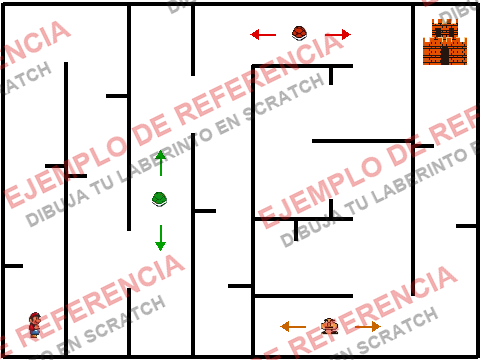
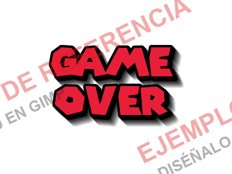
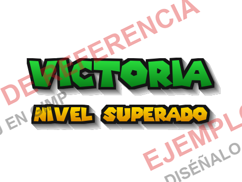
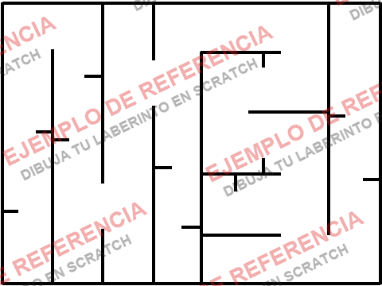

# Actividad 1. Creando nuestro primer videojuego en Scratch: El Laberinto de Mario

¡Ha llegado el momento de poner en práctica todo lo aprendido en el tema anterior! Durante el Tema 1 has trabajado con secuencias de instrucciones, algoritmos, recorridos en laberintos, bucles (`while`) y condicionales (`if`). 

Ahora utilizaremos **GIMP** (para recortar y diseñar nuestros propios *sprites*, objetos y pantallas de fin de juego) y **Scratch** (una plataforma visual de programación por bloques creada por el MIT) para diseñar y programar un videojuego completo de laberintos inspirado en **Super Mario Bros**.


{: .img}

---

## 🌐 Paso previo: Acceso y registro en Scratch

Antes de comenzar, vamos a crearnos una cuenta en la plataforma online de Scratch para que todos nuestros avances se guarden en la nube:

1. Abre el navegador web y accede a [**https://scratch.mit.edu/**](https://scratch.mit.edu/).
2. Haz clic en el botón **«Únete a Scratch»** (*Join Scratch*), situado en la esquina superior derecha.
3. Completa los pasos del formulario de registro:
   - **Nombre de usuario**: Elige un nombre de usuario (no uses tu nombre real completo) y **anótalo**.
   - **Contraseña**: Crea una contraseña segura y **apúntala**.
   - **Datos solicitados**: Selecciona tu país, mes/año de nacimiento y género.
   - **Correo electrónico**: Debes **registrarte utilizando tu correo electrónico de Outlook del instituto (`@alu.edu.gva.es`)**.
4. Abre tu correo de **Outlook** ([https://outlook.office.com/](https://outlook.office.com/)), abre el mensaje enviado por Scratch y pulsa en el botón de confirmación para **activar tu cuenta**.
5. Una vez dentro de tu cuenta en Scratch, pulsa en el botón **«Crear»** (en la barra superior izquierda) para abrir el editor de proyectos.
   - 💡 *Nota*: Si los bloques aparecen en inglés, haz clic en el icono de la **bola del mundo 🌐 / rueda dentada ⚙️** (arriba a la izquierda, junto al logo de Scratch) y selecciona **Español** o **Valencià**.

> 👉 **¡¡RECUERDA APUNTARTE TU USUARIO Y CONTRASEÑA DE SCRATCH!!** 👈
{: .alert .alert-error}

---

## 🧭 ¿Cómo funciona Scratch?

En Scratch programamos encajando bloques de colores como si fueran piezas de puzle:

1. **El Escenario**: Es el espacio donde ocurre la acción del juego ($480 \times 360$ píxeles). Funciona con un eje de coordenadas cartesiano ($X$ horizontal de $-240$ a $+240$, e $Y$ vertical de $-180$ a $+180$).
2. **Los Objetos (*Sprites*)**: Son los personajes y elementos interactivos del juego (Mario, el castillo, los caparazones...). Cada objeto tiene sus propios programas, disfraces (*costumes*) y sonidos.
3. **La Paleta de Bloques**:
   - 🔵 **Movimiento**: mover, girar y posicionar objetos en la pantalla (`ir a x: y:`, `sumar a x`, `sumar a y`).
   - 🟣 **Apariencia**: cambiar disfraces, cambiar fondos y `mostrar` / `ocultar` objetos.
   - 🟡 **Eventos**: activadores como `al presionar bandera verde`, `al presionar tecla` o el envío de mensajes (`enviar [fin_juego]`).
   - 🟠 **Control**: bucles (`por siempre`, `repetir`) y condicionales (`si ... entonces`).
   - 🩵 **Sensores**: detectar colisiones con colores (`¿tocando el color (...)?`) o con otros objetos (`¿tocando (objeto)?`).
   - 🟢 **Operadores**: operaciones matemáticas (`*`, `+`, `-`, `=`) y lógicas (`o`, `y`).
   - 🟧 **Variables**: almacenar datos que cambian durante la partida, como la velocidad de rebote, las vidas o el tiempo.

---

## 🎨 Parte 1: Preparación de imágenes, *sprites*, objetos y fondos (GIMP + Scratch)

En el desarrollo real de videojuegos 2D, primero se preparan todos los recursos gráficos (*assets*): se extraen los personajes desde una **hoja de *sprites* (*sprite sheet*)**, se diseñan las pantallas de victoria y derrota en un editor gráfico (**GIMP**) y se dibuja el mapa del nivel (**Scratch**).

> ⚠️ **¡¡MUY IMPORTANTE SOBRE LOS ARCHIVOS DE GIMP (`.xcf` y `.png`)!!**
> Para **cada disfraz, objeto y fondo** que elabores en GIMP durante esta Parte 1, deberás guardar **obligatoriamente las dos versiones** en tu carpeta **`Actividad 1`**:
> 1. **El archivo editable de GIMP (`.xcf`)** mediante **Archivo → Guardar como...** (necesario para entregar en Aules y demostrar tu autoría).
> 2. **La imagen exportada (`.png`)** mediante **Archivo → Exportar como...** (necesaria para subirla a Scratch).
{: .alert .alert-warning}

### Paso 1.1: Crear la carpeta de trabajo y descomprimir los archivos base

1. Dentro de tu carpeta **`Documentos/PIARI/Tema 2`**, crea una carpeta nueva llamada **`Actividad 1`**.
2. Descarga el paquete de recursos haciendo clic aquí: 📦 [**Descargar `recursos_actividad1.zip`**](./recursos_actividad1.zip) y guárdalo (o muévelo desde tu carpeta *Descargas*) dentro de tu carpeta **`Documentos/PIARI/Tema 2/Actividad 1`**.
3. **Descomprime el archivo `.zip`**:
   - Entra en tu carpeta **`Actividad 1`**, haz **clic derecho** sobre el archivo **`recursos_actividad1.zip`** y selecciona **«Extraer aquí»** (*Extreu ací* en LliureX, o *Extraer todo...* en Windows).
   - Comprueba que han aparecido directamente en tu carpeta **`Actividad 1`** estos tres archivos base (una vez descomprimido, puedes borrar el archivo `recursos_actividad1.zip`):
     - 🎨 **`sprites.png`**: Hoja completa de *sprites* de Super Mario Bros (de aquí recortarás a Mario, el caparazón y los nuevos enemigos/objetos).
     - 🏰 **`castillo.png`**: Imagen del castillo final que servirá como meta del laberinto.
     - 🔤 **`SuperMario256.ttf`**: Fuente tipográfica oficial estilo Super Mario para diseñar tus pantallas de *GAME OVER* y *VICTORIA* en GIMP.

---

### Paso 1.2: Recortar los disfraces de Mario y el caparazón rojo con GIMP

Sigue estos pasos en **GIMP** para extraer los disfraces de Mario y el caparazón desde el archivo **`sprites.png`** que acabas de descomprimir:

1. Abre la imagen **`sprites.png`** en **GIMP**.
2. Selecciona la herramienta de **Selección rectangular** (tecla `R`), haz una selección lo más ajustada posible alrededor del primer fotograma de Mario (de pie), ve al menú **Edita → Copiar** (`Ctrl + C`) y después a **Edita → Apega com a → Imatge nova** (*Editar → Pegar como → Imagen nueva* o `Ctrl + Shift + V`).
3. Como en la hoja de *sprites* original Mario mira hacia la izquierda y en Scratch la dirección por defecto ($90^\circ$) apunta hacia la derecha, debemos voltear la imagen horizontalmente con la herramienta **Volteo / Eina Capgira** (`Shift + F`, asegurándote de marcar la opción **Horizontal** en las opciones de la herramienta y haciendo clic sobre Mario).
4. Guarda y exporta este primer disfraz en tu carpeta **`Actividad 1`**:
   - **Archivo → Guardar como...** → **`mario1.xcf`**
   - **Archivo → Exportar como...** → **`mario1.png`**
5. Repite el mismo proceso con los dos fotogramas siguientes de Mario caminando (recuerda voltearlos horizontalmente) para guardar y exportar:
   - **`mario2.xcf`** y **`mario2.png`**
   - **`mario3.xcf`** y **`mario3.png`**
   - Para el cuarto disfraz (**`mario4.xcf`** y **`mario4.png`**), guarda y exporta una copia de `mario2` para que el ciclo de caminar sea fluido (`parado → paso → zancada → paso`).
6. Ahora ve a la **fila inferior** de `sprites.png` y, usando el mismo procedimiento (**Selección rectangular → Copiar → Pegar como imagen nueva**), recorta el caparazón rojo y guárdalo en **`Actividad 1`** como:
   - **`caparazon_rojo.xcf`** (proyecto editable) y **`caparazon_rojo.png`** (imagen exportada).

---

### Paso 1.3: Crear el Caparazón Verde (`caparazon_verde`) en GIMP con Selección por color

En `sprites.png` el caparazón suelto solo aparece en color **rojo**, así que vamos a crear el **`caparazon_verde`** utilizando las herramientas de selección por color de GIMP:

1. En la ventana de GIMP donde tienes abierto tu `caparazon_rojo`, selecciona en la caja de herramientas la **Herramienta de selección por color** (*Eina de selecció per color*, atajo `Shift + O`).
2. En las **Opciones de la herramienta** (panel inferior izquierdo), ajusta el **Umbral (*Llindar*)** en torno a `35`–`45` (o mantén pulsada la tecla **`Shift` / `Mayús`** para sumar tonos a la selección) y haz clic sobre los distintos tonos rojos del caparazón hasta que **toda la zona roja** quede seleccionada por la línea punteada, sin seleccionar el borde oscuro ni la base blanca.
3. Cambia las zonas rojas seleccionadas a color **verde** con cualquiera de estos dos métodos:
   - **Método A (Colorear conservando el sombreado)**: Ve al menú **Colores → Tono-Saturación...** (o **Colores → Colorear...**) y mueve el deslizador de **Tono (*To*)** hacia el verde (`+100` a `+120`) hasta conseguir un verde vivo. Pulsa **Aceptar**.
   - **Método B (Relleno con cubo de pintura)**: Elige un color de frente verde vivo, selecciona la **Herramienta de relleno** (`Shift + B`), marca en sus opciones *«Rellenar toda la selección»* y haz clic sobre las zonas seleccionadas.
4. Ve a **Seleccionar → Nada** (`Ctrl + Shift + A`) y guarda las dos versiones en tu carpeta **`Actividad 1`**:
   - **Archivo → Guardar como...** → **`caparazon_verde.xcf`**
   - **Archivo → Exportar como...** → **`caparazon_verde.png`**

---

### Paso 1.4: Diseñar los fondos `GAME_OVER` y `VICTORIA` en GIMP

Ahora vas a diseñar en **GIMP** las dos pantallas de fin de partida (`GAME_OVER` y `VICTORIA`) con el estilo clásico de Super Mario:

1. **Instala la fuente tipográfica en GIMP**:
   - En GIMP, ve al menú superior **Editar → Preferencias** (*Edita → Preferències*).
   - En el menú lateral izquierdo de la ventana de preferencias, despliega **Carpetas** (*Carpetes*) y haz clic en **Tipografías** (*Tipografies* / *Fuentes*).
   - Selecciona en la lista la ruta de la carpeta **`fonts`** que está dentro de tu carpeta de usuario y pulsa el botón de arriba a la derecha para **abrir esa ubicación en el gestor de archivos**.
   - **Copia y pega** ahí dentro el archivo **`SuperMario256.ttf`** que descomprimiste en tu carpeta `Actividad 1`.
   - **Cierra y vuelve a abrir GIMP** (reinícialo) para que cargue la nueva tipografía.
2. **Crea el lienzo con el tamaño de Scratch**: En GIMP, ve a **Archivo → Nuevo...** e introduce una anchura de **`480` px** y una altura de **`360` px** (con fondo blanco).
3. **Escribe el texto con su color**: Selecciona la **Herramienta de texto** (`T`), elige en las opciones la fuente **`Super Mario 256`**, escoge un color **rojo vivo (`#e60012`)** y escribe en **MAYÚSCULAS** y tamaño grande el texto **`GAME OVER`** (centrado en dos líneas).
4. **Aplica el efecto Super Mario en 2 pasos (en capas separadas)**:
   - **1. Contorno negro grueso**: En el panel de capas (derecha), haz clic derecho sobre la capa de texto → **Texto a selección** (o **Alfa a selección**). Ve al menú **Seleccionar → Agrandar...** e introduce `8` píxeles. Crea una **capa nueva transparente** llamada `"Borde Negro"`, colócala **debajo** de la capa de texto y rellena la selección de **Negro (`#000000`)** con la **Herramienta de relleno** (`Shift + B`). Después haz clic en **Seleccionar → Nada** (`Ctrl + Shift + A`).
   - **2. Sombra 3D desplazada y difuminada**: Haz clic derecho sobre la capa `"Borde Negro"` → **Duplicar la capa**, llámala `"Sombra 3D"` y colócala debajo de `"Borde Negro"`. Con la capa `"Sombra 3D"` seleccionada, ve al menú superior **Filtros → Difuminar** (o *Desenfoque*) **→ Desenfoque de movimiento lineal...** (*Filtres → Difumina → Desenfocament de moviment lineal...*), ajusta la **Longitud** a **`40`** y el **Ángulo** a **`40`**, y pulsa **Aceptar** (si lo necesitas, puedes terminar de ajustar su posición con la **Herramienta de mover** `M` y las flechas del teclado hacia abajo y a la derecha).
5. **Guarda y exporta el fondo de derrota** en tu carpeta **`Actividad 1`**:
   - **Archivo → Guardar como...** → **`GAME_OVER.xcf`** (conservando todas las capas para su revisión).
   - **Archivo → Exportar como...** → **`GAME_OVER.png`**
6. **Repite el procedimiento en un lienzo nuevo ($480 \times 360$ px) para la pantalla de victoria**: escribe **`VICTORIA`** en color **verde vivo (`#28dc3c`)** (y opcionalmente debajo **`NIVEL SUPERADO`** en color amarillo/dorado), añade su borde negro y sombra 3D, y guárdalo en **`Actividad 1`** como:
   - **`VICTORIA.xcf`** y **`VICTORIA.png`**.


{: .img}


{: .img}

---

### Paso 1.5: Dibujar el laberinto en Scratch e importar tus fondos y objetos

Con todos los gráficos listos en tu carpeta, abre tu proyecto en **Scratch** y monta el escenario y los personajes:

1. Elimina el objeto del gato que aparece por defecto haciendo clic en el icono de la papelera sobre su miniatura.
2. Haz clic en **Escenario** (abajo a la derecha) y entra en la pestaña **Fondos** (arriba a la izquierda).
3. Ponle al primer fondo el nombre **`laberinto_1`**.
4. **Dibuja tú mismo/a las paredes del laberinto con las herramientas de Scratch**:
   - Asegúrate de estar en el editor en modo **Vectorial**.
   - Selecciona la herramienta **Rectángulo**, configura el **Relleno** como *Sin relleno* y el **Borde** en color **Negro puro (`#000000`: Color `0`, Saturación `0`, Brillo `0`)** con grosor **`4`**. Dibuja el marco exterior rodeando todo el escenario.
   - Selecciona la herramienta **Línea** (color negro `#000000` y grosor **`4`**) y dibuja los pasillos, recovecos y algún callejón sin salida guiándote por este ejemplo:
   - 💡 **Truco**: Si mantienes pulsada la tecla **`Shift` (Mayús)** mientras arrastras para dibujar una línea, te saldrá perfectamente recta (vertical u horizontal). Deja pasillos suficientemente anchos para que Mario pueda pasar y deja al menos un pasillo vertical despejado (para el caparazón verde) y uno horizontal despejado (para el caparazón rojo).

> ⚠️ **¡Importante!**: Debes dibujar tu propio laberinto en el editor vectorial de Scratch. La imagen de debajo contiene una marca de agua y solo sirve como modelo visual de referencia.
{: .alert .alert-error}


{: .img}


5. En el botón **Elige un fondo → Subir fondo** (abajo a la derecha), importa los archivos **`GAME_OVER.png`** y **`VICTORIA.png`** que has creado en GIMP. Comprueba que los 3 fondos del escenario se llamen exactamente `laberinto_1`, `GAME_OVER` y `VICTORIA`.
6. En el panel de **Objetos → Subir objeto**, importa tus archivos PNG y colócalos en sus posiciones de partida:
   - **`mario1.png`** (y dentro de su pestaña **Disfraces → Subir disfraz**, añade en orden **`mario2.png`**, **`mario3.png`** y **`mario4.png`**). Ajusta en sus propiedades: **Tamaño** `50`, posición `x: -205`, `y: -145`, y en **Dirección (`90`)** pulsa el icono central de rotación **Izquierda-Derecha (`↔`)**.
   - **`castillo.png`**: Ajusta **Tamaño** `95` y colócalo en la meta (`x: 205`, `y: 138`).
   - **`caparazon_verde.png`**: Ajusta **Tamaño** `50` y sitúalo en el pasillo vertical despejado (`x: -80`, `y: -140`).
   - **`caparazon_rojo.png`**: Ajusta **Tamaño** `50` y sitúalo en el pasillo horizontal superior (`x: 60`, `y: 146`).

---

### 📂 Comprobación final de la Parte 1: Esquema visual de tu carpeta `Actividad 1`

Antes de pasar a programar en la Parte 2, comprueba que dentro de tu carpeta **`Documentos/PIARI/Tema 2/Actividad 1`** tienes **exactamente estos archivos** (recuerda que los archivos editables **`.xcf`** deberás entregarlos al final de la actividad):

```plaintext
📁 Documentos
 └── 📁 PIARI
      └── 📁 Tema 2
           └── 📁 Actividad 1
                ├── 🖼️ sprites.png               (Archivo base descargado)
                ├── 🏰 castillo.png              (Archivo base descargado)
                ├── 🔤 SuperMario256.ttf         (Fuente tipográfica descargada)
                │
                ├── 🎨 mario1.xcf                (Editable GIMP - Disfraz 1 de Mario)
                ├── 🏃 mario1.png                (Exportado PNG - Disfraz 1 de Mario)
                ├── 🎨 mario2.xcf                (Editable GIMP - Disfraz 2 de Mario)
                ├── 🏃 mario2.png                (Exportado PNG - Disfraz 2 de Mario)
                ├── 🎨 mario3.xcf                (Editable GIMP - Disfraz 3 de Mario)
                ├── 🏃 mario3.png                (Exportado PNG - Disfraz 3 de Mario)
                ├── 🎨 mario4.xcf                (Editable GIMP - Disfraz 4 de Mario)
                ├── 🏃 mario4.png                (Exportado PNG - Disfraz 4 de Mario)
                │
                ├── 🎨 caparazon_rojo.xcf        (Editable GIMP - Caparazón rojo)
                ├── 🔴 caparazon_rojo.png        (Exportado PNG - Caparazón rojo)
                ├── 🎨 caparazon_verde.xcf       (Editable GIMP - Caparazón verde por selección de color)
                ├── 🟢 caparazon_verde.png       (Exportado PNG - Caparazón verde)
                │
                ├── 🎨 GAME_OVER.xcf             (Editable GIMP con capas - Fondo de derrota)
                ├── 🖼️ GAME_OVER.png             (Exportado PNG - Fondo de derrota)
                ├── 🎨 VICTORIA.xcf              (Editable GIMP con capas - Fondo de victoria)
                └── 🖼️ VICTORIA.png              (Exportado PNG - Fondo de victoria)
```

---

## 🛠️ Parte 2: Construcción guiada del juego base "El Laberinto de Mario"

Con todos los fondos, objetos y disfraces preparados e importados en Scratch en la Parte 1, ahora debes programar la lógica del juego base. Fíjate en los clips de vídeo de cada paso y utiliza las pistas de bloques para construir tus propios programas en Scratch:

### Paso 2.1: Movimiento de Mario en las 4 direcciones y animación al caminar

Queremos que el jugador pueda controlar a **`mario1`** por los pasillos del laberinto con las 4 flechas del teclado y que, desde el momento en que se pulse la bandera verde (`⚑`), Mario aparezca en la casilla de salida y vaya alternando sus 4 disfraces para simular que camina:

<video src="./imagenes_juego/clip_1_movimiento_mario.mp4" width="300" autoplay loop muted playsinline controls></video>

**¿Qué debes programar en el objeto `mario1`?**
1. **Control con las 4 teclas de flecha**:
   - Necesitarás **4 eventos independientes** utilizando el bloque 🟡 `al presionar tecla [...]` (para `flecha derecha`, `flecha izquierda`, `flecha arriba` y `flecha abajo`).
   - **Movimiento horizontal (derecha e izquierda)**: Haz que Mario mire hacia el lado correspondiente con 🔵 `apuntar en dirección (90)` (derecha) o `(-90)` (izquierda) y avance con 🔵 `mover (10) pasos`.
   - **Movimiento vertical (arriba y abajo)**: Para subir o bajar sin que Mario gire de lado, modifica directamente su coordenada vertical usando el bloque 🔵 `sumar a y (10)` (para subir) y `sumar a y (-10)` (para bajar).
2. **Inicialización y animación continua de los disfraces**:
   - Al pulsar la bandera verde (🟡 `al presionar ⚑`), asegúrate de que Mario sea visible (🟣 `mostrar`), tenga activado el giro lateral (🔵 `fijar estilo de rotación a [izquierda-derecha]`), active el fondo inicial (🟣 `cambiar fondo a [laberinto_1]`), se coloque en la posición de salida (🔵 `ir a x: (-205) y: (-145)`) y mire hacia la derecha (`90`).
   - A continuación, añade un bucle 🟠 `por siempre` que haga una pequeña pausa (🟠 `esperar (0.08) segundos`) y cambie al siguiente fotograma con 🟣 `siguiente disfraz`.

---

### Paso 2.2: Colisión con las paredes negras y pantalla de `GAME OVER`

Si en cualquier momento del recorrido Mario roza una pared del laberinto (de color negro `#000000`), la partida debe terminar inmediatamente: deben esconderse todos los objetos del laberinto y mostrarse a pantalla completa tu fondo **`GAME_OVER`**.

<video src="./imagenes_juego/clip_2_choque_game_over.mp4" width="520" autoplay loop muted playsinline controls></video>

**¿Qué debes programar?**
1. **Detectar el choque con las paredes negras (en `mario1`)**:
   - Dentro del bucle 🟠 `por siempre` de `mario1`, añade un condicional 🟠 `si <...> entonces`.
   - En su condición, coloca el sensor 🩵 `¿tocando el color (#000000)?`.
   - Si se cumple la condición, difunde un mensaje a todo el juego usando el bloque 🟡 `enviar [fin_juego]` (crea un mensaje nuevo llamado `fin_juego`).

> 👉 **¿Cómo seleccionar el color negro exacto?**: Haz clic en el cuadro de color dentro del bloque `¿tocando el color (...)?`, pulsa el icono del **cuentagotas** que aparece abajo y haz clic directamente sobre una de las paredes negras de tu laberinto.
{: .alert-info}

2. **Reaccionar al mensaje `fin_juego`**:
   - En **`mario1`**, utiliza el evento 🟡 `al recibir [fin_juego]` para cambiar el escenario con 🟣 `cambiar fondo a [GAME_OVER]`, esconder a Mario con 🟣 `ocultar` y parar todos los programas del juego con 🟠 `detener [todos]`.
   - En el resto de objetos (**`castillo`**, **`caparazon_verde`** y **`caparazon_rojo`**), añade también el evento 🟡 `al recibir [fin_juego]` seguido de 🟣 `ocultar` para que ningún personaje se quede en medio tapando el cartel de *GAME OVER*.

---

### Paso 2.3: Llegada al Castillo (`castillo`) y pantalla de `VICTORIA`

Cuando Mario consiga superar todos los pasillos y toque el objeto **`castillo`** situado en la esquina superior derecha, ganará la partida: deberán ocultarse todos los objetos y mostrarse tu fondo **`VICTORIA`**.

<video src="./imagenes_juego/clip_3_castillo_victoria.mp4" width="520" autoplay loop muted playsinline controls></video>

**¿Qué debes programar?**
1. **En el objeto `castillo`**:
   - Al iniciar la partida (🟡 `al presionar ⚑`), debe hacerse visible (🟣 `mostrar`) y colocarse en su esquina (🔵 `ir a x: (205) y: (138)`).
   - Cuando reciba tanto el mensaje 🟡 `al recibir [fin_juego]` como el mensaje 🟡 `al recibir [victoria]`, debe esconderse con 🟣 `ocultar`.
2. **En el objeto `mario1`**:
   - Dentro de su bucle 🟠 `por siempre`, añade otro condicional 🟠 `si <...> entonces` con el sensor 🩵 `¿tocando (castillo)?`. Al tocarlo, debe enviar un nuevo mensaje con 🟡 `enviar [victoria]`.
   - Añade el evento 🟡 `al recibir [victoria]` para que cambie al fondo ganador (🟣 `cambiar fondo a [VICTORIA]`), esconda a Mario (🟣 `ocultar`) y pare el juego (🟠 `detener [todos]`).

---

### Paso 2.4: Movimiento autónomo y rebote de los enemigos patrulleros (`caparazon_verde` y `caparazon_rojo`)

Por el laberinto deben patrullar los caparazones moviéndose solos de un extremo a otro de su pasillo y **rebotando automáticamente cada vez que tocan una pared negra**:

<video src="./imagenes_juego/clip_4_enemigos_rebote.mp4" width="480" autoplay loop muted playsinline controls></video>

> 🧠 **¿Cómo funciona el algoritmo de rebote con una variable?**:
> En lugar de mover el caparazón un número fijo, guardamos su velocidad en una **variable** (por ejemplo, `y = 5` para el movimiento vertical). En cada repetición del bucle `por siempre`, sumamos esa variable a la posición del objeto (`sumar a y (y)`).
> Cuando el caparazón toca una pared negra (`#000000`), **invertimos su signo multiplicando la variable por `-1`** (`dar a [y] el valor ((y) * (-1))`):
> - Si subía a `+5`, al chocar pasa a valer $5 \times (-1) = -5$, por lo que empieza a bajar.
> - Cuando toca la pared inferior yendo a `-5`, se calcula $(-5) \times (-1) = +5$, ¡y vuelve a subir!
{: .alert-info}

**¿Qué debes programar?**
1. **En el objeto `caparazon_verde` (patrulla vertical arriba y abajo)**:
   - En la categoría 🟧 **Variables**, pulsa en **Crear una variable** y llámala **`y`** (desmarca su casilla para que no se vea el marcador en el escenario).
   - Al pulsar 🟡 `al presionar ⚑`, haz que se muestre (🟣 `mostrar`), inicializa la velocidad con 🟧 `dar a [y] el valor (5)` y colócalo en su pasillo vertical (🔵 `ir a x: (-80) y: (-140)`).
   - Dentro de un bucle 🟠 `por siempre`, desplázalo en vertical con 🔵 `sumar a y (y)` (metiendo el bloque redondo de la variable `y` dentro del hueco). A continuación, comprueba con un condicional 🟠 `si <¿tocando el color (#000000)?> entonces` si ha chocado contra la pared y, en ese caso, invierte la velocidad usando 🟧 `dar a [y] el valor (...)` junto con el operador verde 🟢 `(y) * (-1)`.
   - Recuerda añadirle los eventos 🟡 `al recibir [fin_juego]` y 🟡 `al recibir [victoria]` para que ejecute 🟣 `ocultar` al terminar la partida.
2. **En el objeto `caparazon_rojo` (patrulla horizontal izquierda y derecha)**:
   - Crea otra variable en 🟧 **Variables** llamada **`x`** (y desmarca su casilla).
   - Programa exactamente la misma estructura que en el caparazón verde (colocándolo en el pasillo superior, `x: 60, y: 146`), pero desplazándolo en horizontal con el bloque 🔵 `sumar a x (x)` e invirtiendo la variable `x` (`x * -1`) al tocar el color negro.

---

### Paso 2.5: Colisión de Mario con los enemigos del mapa y fin de partida

Por último, ahora que los enemigos ya se mueven por sus pasillos, debemos programar que **si Mario choca contra cualquiera de los enemigos del mapa** (`caparazon_verde`, `caparazon_rojo`, etc.), pierda inmediatamente la partida y se muestre la pantalla de **`GAME OVER`**:

<video src="./imagenes_juego/clip_5_colision_enemigos.mp4" width="520" autoplay loop muted playsinline controls></video>

**¿Qué debes programar en el objeto `mario1`?**
1. Entra en la pestaña **Código** de **`mario1`** y localiza su bucle principal 🟠 `por siempre`.
2. Igual que hiciste para detectar las paredes negras y el castillo, añade un bloque condicional 🟠 `si <...> entonces` para **cada enemigo** del laberinto:
   - Coloca en la condición el sensor 🩵 `¿tocando (caparazon_verde)?` y, dentro del condicional, envía el mensaje de derrota con 🟡 `enviar [fin_juego]`.
   - Añade otro condicional con el sensor 🩵 `¿tocando (caparazon_rojo)?` que también ejecute 🟡 `enviar [fin_juego]` *(o combínalos utilizando el operador lógico verde 🟢 `<...> o <...>`).*
3. Como en el Paso 2.2 ya programaste qué ocurre en todos los objetos `al recibir [fin_juego]`, al rozar cualquier enemigo se esconderán todos los personajes, aparecerá el fondo `GAME_OVER` y se detendrá el juego.

¡Prueba tu juego pulsando la bandera verde `⚑`! Comprueba que Mario camina por el laberinto, que los caparazones rebotan sin salirse de sus pasillos y que funcionan tanto el choque con las paredes y con los enemigos (*GAME OVER*) como la llegada al castillo (*VICTORIA*).

---

## 🚀 Parte 3: Reto Individual (Amplía el juego: nuevos personajes, vidas y más dificultad)

Una vez que tu juego base funcione correctamente, debes demostrar lo que has aprendido superando **obligatoriamente las 3 misiones de este reto**. Fíjate en los clips de vídeo de referencia de cada misión para ver cómo deben comportarse las ampliaciones en tu juego:

### 👾 Misión 1: Recortar en GIMP y añadir nuevos personajes en el camino
El laberinto necesita más vida. Abre de nuevo **`sprites.png`** en **GIMP**, recorta de la fila inferior los nuevos elementos que necesites (**guardando también sus archivos `.xcf` y `.png` en tu carpeta `Actividad 1`**) e incorpora **al menos un nuevo enemigo** (y opcionalmente objetos coleccionables):

<video src="./imagenes_juego/clip_6_mision1_personajes.mp4" width="520" autoplay loop muted playsinline controls></video>

- **Opción A (Nuevo enemigo patrullero)**: Recorta a **Goomba** (`goomba.xcf` / `goomba.png`) o a la tortuga **Koopa** (`koopa.xcf` / `koopa.png`) y prográmalo patrullando el último pasillo horizontal antes de subir al castillo (creando su propia variable de velocidad, por ejemplo `x_goomba`).
- **Opción B (Planta Piraña trampa en ubicaciones aleatorias)**: Recorta la **Planta Piraña** (`planta_pirana.xcf` / `planta_pirana.png`) y haz que vaya apareciendo (`mostrar`) durante 2 segundos y desapareciendo (`ocultar`) durante 2 segundos dentro de un bucle `por siempre`, cambiando aleatoriamente entre **varios sitios predefinidos** del laberinto mientras está oculta (por ejemplo, usando una variable `sitio_planta` con el bloque verde 🟢 `número aleatorio entre (1) y (4)` y condicionales `si <(sitio_planta) = (...)> entonces` para elegir entre 3 o 4 coordenadas estratégicas del camino).
- **Opción C (Objetos de bonificación)**: Recorta la **Moneda** (`moneda.xcf` / `moneda.png`) o el **Champiñón** (`champinon.xcf` / `champinon.png`) y colócalos en los callejones sin salida del laberinto para premiar al jugador que se arriesgue a recogerlos.

---

### ❤️ Misión 2: Implementar un Sistema de Vidas (`vidas`) y reposición en paredes
Morir al primer roce es demasiado duro, pero tampoco podemos permitir que alguien atraviese las paredes. Modifica el programa de Mario para que el jugador disponga de **3 vidas**:

<video src="./imagenes_juego/clip_7_mision2_vidas_pared.mp4" width="520" autoplay loop muted playsinline controls></video>

1. Crea una variable llamada **`vidas`** y deja marcada su casilla para que el marcador se vea en una esquina del escenario.
2. Al presionar la bandera verde (`⚑`), inicializa la variable con `dar a [vidas v] el valor (3)`.
3. **Si Mario choca con la pared negra del laberinto (`¿tocando el color (#000000)?`)**:
   - **No le restes vida**, pero haz que **vuelva inmediatamente al inicio** (`ir a x: (-205) y: (-145)`). Así nadie podrá hacer trampas atravesando las paredes para llegar al castillo.
4. **Si Mario choca con cualquiera de los enemigos (`caparazon_verde`, `caparazon_rojo`, `goomba`, `planta_pirana`)**:
   - Se resta 1 vida: `sumar a [vidas v] (-1)` **sin devolver a Mario al inicio del laberinto** (continúa desde donde estaba).
   - **Solo si las vidas llegan a 0** (`si <(vidas) = (0)> entonces`), se envía el mensaje `enviar [fin_juego v]`.
   - Añade una breve pausa de inmunidad (`esperar (1) segundos`) justo después de comprobar las vidas para que el enemigo pueda pasar sin quitarle las 3 vidas de golpe en el mismo choque.
5. *(Idea extra)*: Si has recortado y añadido el **Champiñón** (`champinon.png`), haz que al tocarlo Mario gane 1 vida extra (`sumar a [vidas v] (1)`) y el champiñón se oculte.

---

### ⚡ Misión 3: Aumentar la dificultad del juego
Elige e implementa **al menos una** de estas mecánicas para hacer la partida más emocionante:

<video src="./imagenes_juego/clip_8_mision3_tiempo_dificultad.mp4" width="520" autoplay loop muted playsinline controls></video>

1. ⏱️ **Cuenta atrás contrarreloj**: Crea una variable visible llamada **`tiempo`** que empiece en `45` (o `60`) segundos al pulsar la bandera verde y baje de 1 en 1 cada segundo (`esperar (1) segundos` → `sumar a [tiempo v] (-1)`). Si `tiempo` llega a `0` antes de alcanzar el castillo, se envía `fin_juego`.
2. 🔑 **Objeto obligatorio para abrir el castillo**: Coloca una moneda o llave en uno de los recovecos difíciles; Mario solo podrá ganar al tocar el castillo si antes ha recogido ese objeto (usando una variable `monedas` o `llave` que pase de `0` a `1`).
3. 🔥 **Velocidad y sonidos**: Añade efectos de sonido al perder una vida, recoger objetos o ganar, y ajusta las velocidades de los enemigos en los últimos tramos para que el final del laberinto sea un verdadero reto.

---

## 🤝 Prueba, autoría y reutilización

Trabajad por parejas para probar los juegos: cada persona conserva su proyecto individual y asume alternativamente los papeles de **autor/a** y **revisor/a**. Anota una observación recibida al probar tu laberinto (por ejemplo, un pasillo demasiado estrecho o un enemigo mal colocado), la comprobación que haces y la mejora o decisión resultante.

Añade a la explicación de entrega un apartado **«Créditos y reutilización»**: identifica qué has creado tú (diseño del laberinto, recorte y edición de *sprites* y fondos en GIMP, programación de bloques, mejoras del reto), de dónde proceden los recursos gráficos o fragmentos reutilizados, su autoría y su licencia o condiciones de uso. Explica brevemente qué permiten esas condiciones. Compara también **Scratch con Laby**: qué facilita cada entorno para diseñar y resolver un reto de laberinto.

---

## 📤 Entrega en Aules

Debes enviar a través de la tarea correspondiente en Aules:

1. **Archivo comprimido (`.zip`) de tu carpeta `Actividad 1`** (llamado **`actividad1_apellido_nombre.zip`**) que contenga todos los **archivos editables `.xcf` de GIMP** de los disfraces, objetos y fondos (`mario1.xcf` a `mario4.xcf`, `caparazon_rojo.xcf`, `caparazon_verde.xcf`, `GAME_OVER.xcf`, `VICTORIA.xcf` y los nuevos objetos de la Parte 3), junto con sus correspondientes imágenes exportadas (`.png`).
2. **El archivo de tu proyecto de Scratch (`.sb3`)**: En Scratch haz clic en **Archivo → Guardar en tu ordenador** para descargar el archivo y nómbralo como **`apellido_nombre_laberinto_mario.sb3`**.
3. **Una captura de pantalla** (`captura_juego.png`) de tu juego en plena acción donde se vea tu laberinto completo, los personajes, el marcador de `vidas` (y `tiempo` o `monedas`) y tu **nombre y apellidos rotulados**.
4. **Un breve documento de texto** (`explicacion.odt` o `.pdf`) explicando:
   - ¿Cómo has preparado los *sprites*, el caparazón verde y los fondos *GAME OVER* / *VICTORIA* en GIMP, y qué enemigos u objetos has añadido en el **Reto Individual**?
   - ¿Cómo has programado el **sistema de vidas** y el **aumento de dificultad**?
   - El registro de la **prueba por parejas** (observación recibida y mejora aplicada) y el apartado de **Créditos, licencias y comparación entre Scratch y Laby**.
