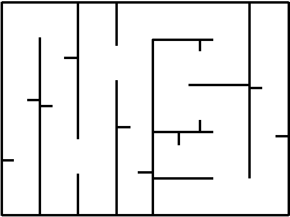
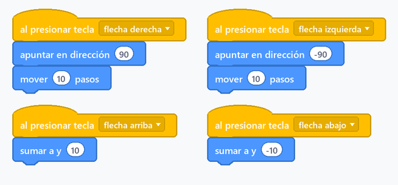
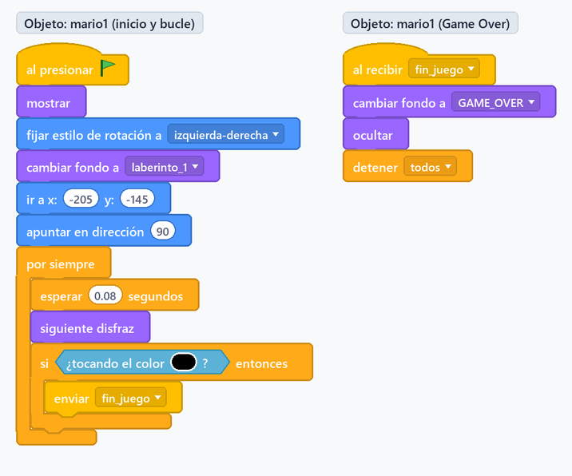
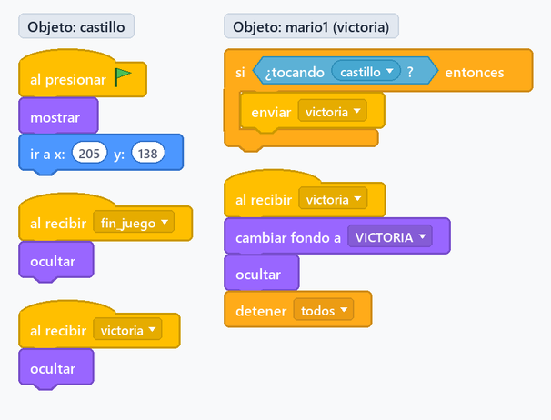
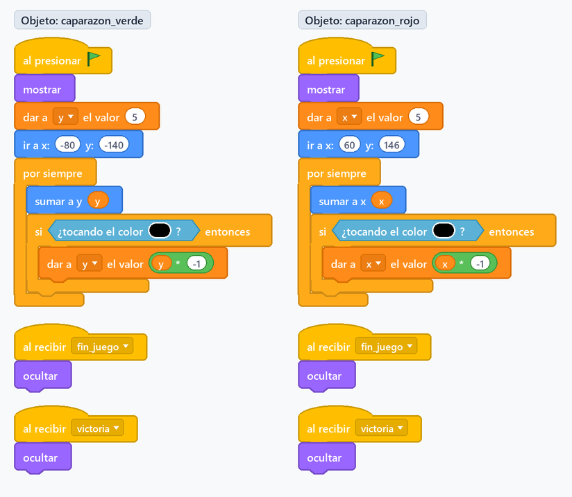
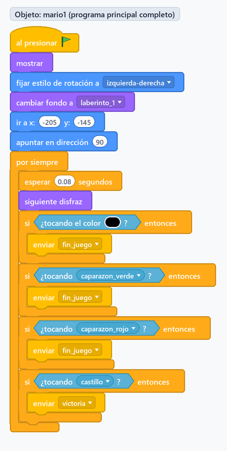
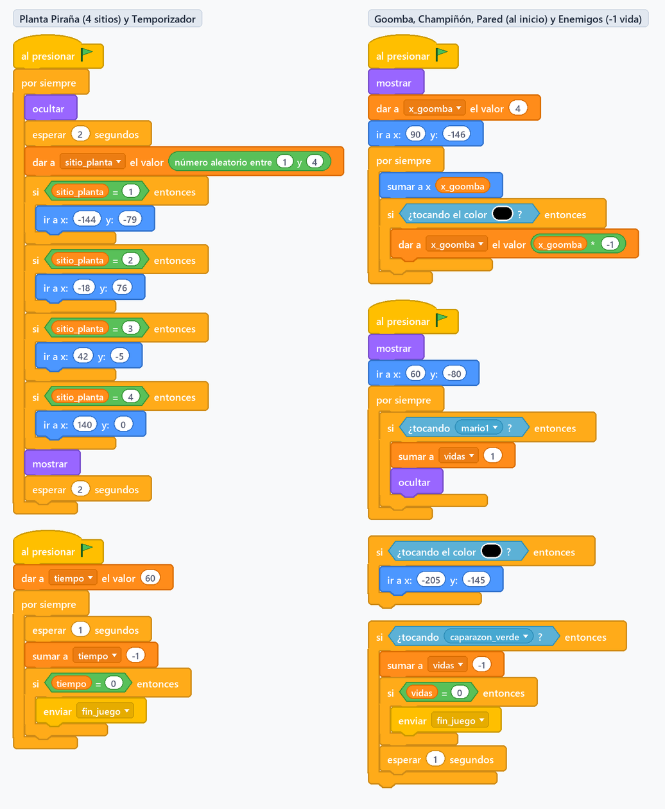

# 👨‍🏫 Guía Docente: El Laberinto de Mario en Scratch (Actividad 1)

Esta guía contiene las instrucciones detalladas paso a paso y todo el **pseudocódigo de bloques de Scratch resuelto** para que el profesorado pueda dirigir en el aula la creación del videojuego **"El Laberinto de Mario"**, estructurada exactamente en las **3 partes** que sigue el alumnado en su enunciado:
- **Parte 1**: Preparación de *sprites*, objetos y fondos en **GIMP** (`.xcf` y `.png`) + dibujo del laberinto en **Scratch**.
- **Parte 2**: Construcción guiada del juego base en **Scratch** *(en la página del alumnado ven clips de vídeo e indicaciones de bloques; aquí tienes el pseudocódigo completo)*.
- **Parte 3**: Reto individual de ampliación *(nuevos personajes recortados en GIMP, sistema de 3 vidas y aumento de dificultad)*.

> 📦 **Archivos `.sb3`, proyecto online, paquete `.zip` y vídeo de referencia para mostrar en clase**:
> - **Paquete de recursos base del alumnado (`.zip`)**: [**Descargar `recursos_actividad1.zip`**](./recursos_actividad1.zip) *(contiene `sprites.png`, `castillo.png` y `SuperMario256.ttf`)*.
> - **Proyecto Scratch resuelto — Parte 2 (Juego Base)**: [**Descargar `Laberinto-Mario.sb3`**](./Laberinto-Mario.sb3) | [**Abrir en Scratch Online (`scratch.mit.edu/projects/1440412974`)**](https://scratch.mit.edu/projects/1440412974)
> - **Proyecto Scratch resuelto — Parte 3 (Juego Ampliado con 3 vidas, tiempo de 60 s, Goomba, Planta Piraña, Champiñón y Moneda)**: [**Descargar `Laberinto-Mario-Ampliado.sb3`**](./Laberinto-Mario-Ampliado.sb3)
> - **Vídeo completo del juego base sin marcas de agua**: [**Ver/Descargar `juego_mario.mp4`**](./imagenes_juego/juego_mario.mp4)
{: .alert-info}

> 🗂️ **Recursos de respaldo para el profesorado (para alumnado rezagado o con dificultades)**:
> - **Imágenes y fondos ya recortados/creados (sin marca de agua)**: Guardados en [`./imagenes_juego/recortadas/`](./imagenes_juego/recortadas/) (`mario1.png` a `mario4.png`, `caparazon_rojo.png`, `caparazon_verde.png`, `goomba.png`, `planta_pirana.png`, `koopa.png`, `champinon.png`, `moneda.png`, `castillo.png`, `GAME_OVER.png`, `VICTORIA.png`), junto con los editables de muestra [`caparazon.xcf`](./imagenes_juego/caparazon.xcf) y [`GAME_OVER.xcf`](./imagenes_juego/GAME_OVER.xcf).
> - **Laberinto original limpio (sin marca de agua)**: Mientras que el alumnado ve en su guía [`laberinto_ejemplo.png`](./imagenes_juego/laberinto_ejemplo.png), [`GAME_OVER_ejemplo.png`](./imagenes_juego/GAME_OVER_ejemplo.png) y [`VICTORIA_ejemplo.png`](./imagenes_juego/VICTORIA_ejemplo.png) con marca de agua, conservas los originales limpios en [`./imagenes_juego/laberinto_1.png`](./imagenes_juego/laberinto_1.png) y [`./imagenes_juego/laberinto_1.svg`](./imagenes_juego/laberinto_1.svg) por si necesitas facilitárselos a algún alumno o alumna que vaya atrasado.
{: .alert-warning}

<video src="./imagenes_juego/juego_mario.mp4" width="600" controls></video>

---

## 📋 1. Resumen de la arquitectura del proyecto

| Elemento | Tipo | Nombre en Scratch | Posición inicial $(x, y)$ | Tamaño | Función principal |
|---|---|---|---|---|---|
| **Escenario** | Fondo 1 | `laberinto_1` | $(0, 0)$ | $480 \times 360$ | Laberinto vectorial con paredes negras (`#000000`, grosor `4`). |
| **Escenario** | Fondo 2 | `GAME_OVER` | $(0, 0)$ | $480 \times 360$ | Pantalla de derrota creada en GIMP (`GAME_OVER.xcf` / `.png`). |
| **Escenario** | Fondo 3 | `VICTORIA` | $(0, 0)$ | $480 \times 360$ | Pantalla de victoria creada en GIMP (`VICTORIA.xcf` / `.png`). |
| **Jugador** | Objeto | `mario1` | $(-205, -145)$ | `50` | Controlado con las 4 flechas; 4 disfraces (`mario1` a `mario4`). |
| **Meta** | Objeto | `castillo` | $(205, 138)$ | `95` | Meta en la esquina superior derecha; al tocarlo se gana. |
| **Enemigo 1** | Objeto | `caparazon_verde` | $(-80, -140)$ | `50` | Patrulla **verticalmente** en el pasillo 3 usando la variable `y`. |
| **Enemigo 2** | Objeto | `caparazon_rojo` | $(60, 146)$ | `50` | Patrulla **horizontalmente** en el pasillo superior usando la variable `x`. |
| **Enemigo 3 (Parte 3)** | Objeto | `goomba` | $(90, -146)$ | `55` | Patrulla **horizontalmente** en el pasillo inferior usando `x_goomba`. |
| **Enemigo 4 (Parte 3)** | Objeto | `planta_pirana` | 4 sitios aleatorios: $(-144, -79)$, $(-18, 76)$, $(42, -5)$ y $(140, 0)$ | `45` | Se oculta 2 s, elige al azar uno de los 4 sitios con `sitio_planta` y aparece 2 s. |
| **Bonus 1 (Parte 3)** | Objeto | `champinon` | $(60, -80)$ | `45` | En el callejón central; suma `+1` a `vidas` y se oculta. |
| **Bonus 2 (Parte 3)** | Objeto | `moneda` | $(-165, -145)$ | `45` | En el primer callejón inferior; suma `+1` a `monedas` y se oculta. |

---

## 🎨 2. Guía Docente de la Parte 1: Preparación de imágenes, *sprites*, fondos (GIMP) y laberinto (Scratch)

### Paso 1.1: Carpeta de trabajo y descompresión de `recursos_actividad1.zip`
- El alumnado crea la carpeta **`Documentos/PIARI/Tema 2/Actividad 1`**, descarga [`recursos_actividad1.zip`](./recursos_actividad1.zip) y lo descomprime allí con **clic derecho → Extraer aquí** (*Extreu ací*), obteniendo `sprites.png`, `castillo.png` y `SuperMario256.ttf`.
- **Requisito clave de evaluación**: De cada imagen trabajada en GIMP deben guardar tanto el archivo editable **`.xcf`** (**Archivo → Guardar como...**) como la imagen exportada **`.png`** (**Archivo → Exportar como...**).

### Paso 1.2: Extraer los disfraces de Mario y el caparazón rojo desde `sprites.png`
1. Abrir [`sprites.png`](./imagenes_juego/sprites.png) en **GIMP**.
2. Con la herramienta de **Selección rectangular** (tecla `R`), hacer la selección del disfraz lo más ajustada posible, luego **Edita → Copiar** (`Ctrl + C`) y después **Edita → Apega com a → Imatge nova** (*Pegar como → Imagen nueva* / `Ctrl + Shift + V`).
3. Como en la hoja de *sprites* original Mario mira hacia la izquierda y en Scratch la dirección por defecto ($90^\circ$) apunta hacia la derecha, voltear la imagen horizontalmente con la herramienta **Volteo / Eina Capgira** (`Shift + F`, en modo Horizontal).
4. Guardar el editable y exportar cada fotograma:
   - `mario1.xcf` y `mario1.png`
   - `mario2.xcf` y `mario2.png`
   - `mario3.xcf` y `mario3.png`
   - `mario4.xcf` y `mario4.png` (copia de `mario2` para que el ciclo `parado → paso → zancada → paso` sea fluido).
5. De la fila inferior de `sprites.png`, recortar el caparazón rojo y guardarlo como `caparazon_rojo.xcf` y `caparazon_rojo.png`.

### Paso 1.3: Crear el `caparazon_verde` con Selección por color en GIMP
1. Con el caparazón rojo abierto en GIMP, elegir la **Herramienta de selección por color** (*Eina de selecció per color*, `Shift + O`).
2. Ajustar el **Umbral (*Llindar*)** a `35`–`45` (o mantener pulsada la tecla **`Shift`** al hacer clic en los distintos tonos de rojo del caparazón) para seleccionar únicamente los píxeles rojos del caparazón sin tocar el borde oscuro ni la base blanca.
3. Cambiar las zonas seleccionadas a verde mediante **Colores → Tono-Saturación...** / **Colores → Colorear...** (desplazando el tono hacia `+100` / `+120`), o rellenando toda la selección con la **Herramienta de relleno** (`Shift + B`) y un color verde vivo.
4. Quitar la selección (**Seleccionar → Nada**, `Ctrl + Shift + A`) y guardar como **`caparazon_verde.xcf`** y **`caparazon_verde.png`**.

> ⚠️ **Detalle técnico clave sobre el color negro (`#000000`)**: En la hoja `sprites.png` y en `castillo.png`, los bordes oscuros de los personajes y los ladrillos oscuros tienen un tono marrón muy oscuro (`#261610`) y **no negro puro (`#000000`)**. Así garantizamos que el bloque `¿tocando el color (#000000)?` detecte **únicamente las paredes del laberinto** y nunca provoque falsos choques al tocar el castillo.
{: .alert-warning}

### Paso 1.4: Diseñar los fondos `GAME_OVER` y `VICTORIA` en GIMP
1. **Instalar la fuente `SuperMario256.ttf` en GIMP**:
   - Ir a **Editar → Preferencias → Carpetas → Tipografías** (*Edita → Preferències → Carpetes → Tipografies*).
   - Seleccionar la carpeta **`fonts`** situada en la carpeta de usuario y pulsar el botón superior derecho para **abrir la carpeta en el gestor de archivos**.
   - Copiar ahí dentro el archivo **`SuperMario256.ttf`** y **reiniciar GIMP**.
2. Abrir un lienzo nuevo de **$480 \times 360$ píxeles** (fondo blanco).
3. Con la **Herramienta de texto (`T`)** y la fuente **`Super Mario 256`**, elegir un color vivo (rojo `#e60012` para *GAME OVER* o verde `#28dc3c` para *VICTORIA*) y escribir el texto en **MAYÚSCULAS** con tamaño grande.
4. **Paso 1 — Crear el contorno negro grueso (`Borde Negro`)**:
   - En el panel de capas, clic derecho sobre la capa de texto → **Texto a selección**.
   - Menú **Seleccionar → Agrandar...** → introducir entre `6` y `10` píxeles (`8` px recomendado) y pulsar **Aceptar**.
   - Crear una **capa nueva transparente** llamada `"Borde Negro"` y arrastrarla **debajo** de la capa de texto.
   - Rellenar la selección de **Negro (`#000000`)** con la **Herramienta de relleno** (`Shift + B`) y quitar la selección (**Seleccionar → Nada**, `Ctrl + Shift + A`).
5. **Paso 2 — Crear el efecto 3D / Sombra difuminada (`Sombra 3D`)**:
   - Clic derecho sobre la capa `"Borde Negro"` → **Duplicar la capa**, renombrarla como `"Sombra 3D"` y colocarla debajo de `"Borde Negro"`.
   - Con `"Sombra 3D"` seleccionada, ir a **Filtros → Difuminar** (o *Desenfoque*) **→ Desenfoque de movimiento lineal...** (*Filtres → Difumina → Desenfocament de moviment lineal...*), ajustar **Longitud = `40`** y **Ángulo = `40`**, y pulsar **Aceptar**.
   - Si es necesario, ajustar ligeramente su posición con la **Herramienta de mover (`M`)** y las flechas del teclado.
6. Guardar ambos fondos con todas sus capas (**`GAME_OVER.xcf`** y **`VICTORIA.xcf`**) y exportarlos como PNG (**`GAME_OVER.png`** y **`VICTORIA.png`**).

### Paso 1.5: Dibujar el laberinto (`laberinto_1`) en Scratch e importar recursos
1. Eliminar el objeto del Gato por defecto en Scratch.
2. En **Escenario → Fondos**, nombrar el primer fondo **`laberinto_1`** y, en modo **Vectorial**, usar **Rectángulo** (sin relleno, borde negro `#000000`, grosor `4`) para el marco exterior y **Línea** (borde negro `#000000`, grosor `4`, manteniendo pulsado `Shift` para líneas rectas) para los pasillos.
   - Si algún alumno/a necesita la plantilla limpia por adaptación o retraso, puedes facilitarle [`laberinto_1.png`](./imagenes_juego/laberinto_1.png) o [`laberinto_1.svg`](./imagenes_juego/laberinto_1.svg):


{: .img}

3. Importar en **Escenario → Subir fondo** los archivos `GAME_OVER.png` y `VICTORIA.png`.
4. Importar en **Objetos → Subir objeto** a `mario1.png` (añadiendo sus disfraces `mario2.png`, `mario3.png` y `mario4.png`, tamaño `50`, posición `(-205, -145)`, rotación `izquierda-derecha`), `castillo.png` (tamaño `95`, posición `(205, 138)`), `caparazon_verde.png` (tamaño `50`, posición `(-80, -140)`) y `caparazon_rojo.png` (tamaño `50`, posición `(60, 146)`).

---

## 🛠️ 3. Guía Docente y Pseudocódigo de la Parte 2: Construcción del Juego Base

*(Nota: En la página del alumnado no aparece este pseudocódigo, sino los clips de vídeo en funcionamiento y pistas de bloques para que ellos mismos deduzcan y construyan los programas).*

### Paso 2.1: Movimiento de Mario en las 4 direcciones y animación al caminar
Clip mostrado al alumnado: [`clip_1_movimiento_mario.mp4`](./imagenes_juego/clip_1_movimiento_mario.mp4)

**Bloques visuales y pseudocódigo en el objeto `mario1` (eventos de teclado):**


{: .img}

```plaintext
al presionar tecla [flecha derecha v]
apuntar en dirección (90)
mover (10) pasos

al presionar tecla [flecha izquierda v]
apuntar en dirección (-90)
mover (10) pasos

al presionar tecla [flecha arriba v]
sumar a y (10)

al presionar tecla [flecha abajo v]
sumar a y (-10)
```

---

### Paso 2.2: Animación inicial, colisión con las paredes negras y pantalla de `GAME OVER`
Clip mostrado al alumnado: [`clip_2_choque_game_over.mp4`](./imagenes_juego/clip_2_choque_game_over.mp4)

**Bloques visuales y pseudocódigo en el objeto `mario1`:**


{: .img}

```plaintext
al presionar ⚑
mostrar
fijar estilo de rotación a [izquierda-derecha v]
cambiar fondo a [laberinto_1 v]
ir a x: (-205) y: (-145)
apuntar en dirección (90)
por siempre
    esperar (0.08) segundos
    siguiente disfraz
    si <¿tocando el color (#000000)?> entonces
        enviar [fin_juego v]
    fin
fin

al recibir [fin_juego v]
cambiar fondo a [GAME_OVER v]
ocultar
detener [todos v]
```

---

### Paso 2.3: Llegada al Castillo (`castillo`) y pantalla de `VICTORIA`
Clip mostrado al alumnado: [`clip_3_castillo_victoria.mp4`](./imagenes_juego/clip_3_castillo_victoria.mp4)

**Bloques visuales en `castillo` y `mario1`:**


{: .img}

**Pseudocódigo en el objeto `castillo`:**

```plaintext
al presionar ⚑
mostrar
ir a x: (205) y: (138)

al recibir [fin_juego v]
ocultar

al recibir [victoria v]
ocultar
```

**Pseudocódigo a añadir en el objeto `mario1`:**

```plaintext
// Añadir dentro del bucle "por siempre" de mario1:
si <¿tocando (castillo v)?> entonces
    enviar [victoria v]
fin

// Receptor de victoria en mario1:
al recibir [victoria v]
cambiar fondo a [VICTORIA v]
ocultar
detener [todos v]
```

---

### Paso 2.4: Programar los enemigos patrulleros (`caparazon_verde`, `caparazon_rojo` y `goomba`)
Clip mostrado al alumnado: [`clip_4_enemigos_rebote.mp4`](./imagenes_juego/clip_4_enemigos_rebote.mp4)

**Bloques visuales de los caparazones (`caparazon_verde` y `caparazon_rojo`):**


{: .img}

#### 1. Pseudocódigo en `caparazon_verde` (Patrulla vertical en el Pasillo 3 con variable `y`)

```plaintext
al presionar ⚑
mostrar
dar a [y v] el valor (5)
ir a x: (-80) y: (-140)
por siempre
    sumar a y (y)
    si <¿tocando el color (#000000)?> entonces
        dar a [y v] el valor ((y) * (-1))
    fin
fin

al recibir [fin_juego v]
ocultar

al recibir [victoria v]
ocultar
```

#### 2. Pseudocódigo en `caparazon_rojo` (Patrulla horizontal en el Pasillo Superior con variable `x`)

```plaintext
al presionar ⚑
mostrar
dar a [x v] el valor (5)
ir a x: (60) y: (146)
por siempre
    sumar a x (x)
    si <¿tocando el color (#000000)?> entonces
        dar a [x v] el valor ((x) * (-1))
    fin
fin

al recibir [fin_juego v]
ocultar

al recibir [victoria v]
ocultar
```

#### 3. Paso 2.5: Colisión de Mario con los enemigos del mapa (`clip_5_colision_enemigos.mp4`)
Clip mostrado al alumnado: [`clip_5_colision_enemigos.mp4`](./imagenes_juego/clip_5_colision_enemigos.mp4)

**Bloques visuales y pseudocódigo completo del bucle `por siempre` de `mario1` al finalizar la Parte 2:**


{: .img}

```plaintext
por siempre
    esperar (0.08) segundos
    siguiente disfraz
    si <¿tocando el color (#000000)?> entonces
        enviar [fin_juego v]
    fin
    si <¿tocando (caparazon_verde v)?> entonces
        enviar [fin_juego v]
    fin
    si <¿tocando (caparazon_rojo v)?> entonces
        enviar [fin_juego v]
    fin
    si <¿tocando (castillo v)?> entonces
        enviar [victoria v]
    fin
fin
```

---

## 🚀 4. Solucionario Docente para la Parte 3: Reto Individual (`Laberinto-Mario-Ampliado.sb3`)

En la Parte 3 (disponible completamente resuelta en [**`Laberinto-Mario-Ampliado.sb3`**](./Laberinto-Mario-Ampliado.sb3)) el alumnado recorta en GIMP nuevos personajes/objetos desde `sprites.png` (guardando sus `.xcf` y `.png`) e implementa las 3 misiones:

**Resumen visual de bloques de la Parte 3 (`goomba`, `planta_pirana`, `champinon`, sistema de `vidas` y temporizador `tiempo`):**


{: .img}

### Solución Misión 1: Nuevos personajes (`goomba`, `planta_pirana`, `champinon`, `moneda`)

#### A) Objeto `goomba` (Patrulla horizontal en el Pasillo Inferior con variable `x_goomba`)

```plaintext
al presionar ⚑
mostrar
dar a [x_goomba v] el valor (4)
ir a x: (90) y: (-146)
por siempre
    sumar a x (x_goomba)
    si <¿tocando el color (#000000)?> entonces
        dar a [x_goomba v] el valor ((x_goomba) * (-1))
    fin
fin

al recibir [fin_juego v]
ocultar

al recibir [victoria v]
ocultar
```

#### B) Objeto `planta_pirana` (Aparece y desaparece cada 2 s cambiando al azar entre 4 sitios predefinidos con `sitio_planta`)
*(Cuando un objeto ejecuta `ocultar` en Scratch, deja de activar colisiones con `¿tocando (planta_pirana)?`. Aprovechamos los 2 segundos en que está oculta para sortear con `número aleatorio entre (1) y (4)` en cuál de los 4 pasos clave del laberinto aparecerá a continuación).*

```plaintext
al presionar ⚑
por siempre
    ocultar
    esperar (2) segundos
    dar a [sitio_planta v] el valor (número aleatorio entre (1) y (4))
    si <(sitio_planta) = (1)> entonces
        ir a x: (-144) y: (-79)
    fin
    si <(sitio_planta) = (2)> entonces
        ir a x: (-18) y: (76)
    fin
    si <(sitio_planta) = (3)> entonces
        ir a x: (42) y: (-5)
    fin
    si <(sitio_planta) = (4)> entonces
        ir a x: (140) y: (0)
    fin
    mostrar
    esperar (2) segundos
fin

al recibir [fin_juego v]
ocultar

al recibir [victoria v]
ocultar
```

#### C) Objetos `champinon` (Vida extra en `x: 60, y: -80`) y `moneda` (Coleccionable en `x: -165, y: -145`)

```plaintext
// Código en champinon:
al presionar ⚑
mostrar
ir a x: (60) y: (-80)
por siempre
    si <¿tocando (mario1 v)?> entonces
        sumar a [vidas v] (1)
        ocultar
    fin
fin

al recibir [fin_juego v]
ocultar

al recibir [victoria v]
ocultar
```

---

### Solución Misión 2: Sistema de 3 Vidas (`vidas`) en `mario1` (paredes devuelven al inicio sin quitar vida; enemigos quitan 1 vida sin volver al inicio)

*(Si Mario toca una **pared negra (`#000000`)**, vuelve inmediatamente a la casilla de salida `(-205, -145)` **sin restar vidas**, evitando así que un jugador pueda atravesar paredes aprovechando la inmunidad. En cambio, al chocar con un **enemigo**, se resta `1` vida **sin** devolver a Mario al inicio y se añade `esperar (1) segundos` tras comprobar si `vidas = 0` para darle 1 segundo de inmunidad y que el enemigo pase sin quitarle las 3 vidas de golpe).*

```plaintext
al presionar ⚑
dar a [vidas v] el valor (3)
dar a [monedas v] el valor (0)
mostrar
fijar estilo de rotación a [izquierda-derecha v]
cambiar fondo a [laberinto_1 v]
ir a x: (-205) y: (-145)
apuntar en dirección (90)
por siempre
    esperar (0.08) segundos
    siguiente disfraz
    si <¿tocando el color (#000000)?> entonces
        ir a x: (-205) y: (-145)
    fin
    si <¿tocando (caparazon_verde v)?> entonces
        sumar a [vidas v] (-1)
        si <(vidas) = (0)> entonces
            enviar [fin_juego v]
        fin
        esperar (1) segundos
    fin
    si <¿tocando (caparazon_rojo v)?> entonces
        sumar a [vidas v] (-1)
        si <(vidas) = (0)> entonces
            enviar [fin_juego v]
        fin
        esperar (1) segundos
    fin
    si <¿tocando (goomba v)?> entonces
        sumar a [vidas v] (-1)
        si <(vidas) = (0)> entonces
            enviar [fin_juego v]
        fin
        esperar (1) segundos
    fin
    si <¿tocando (planta_pirana v)?> entonces
        sumar a [vidas v] (-1)
        si <(vidas) = (0)> entonces
            enviar [fin_juego v]
        fin
        esperar (1) segundos
    fin
    si <¿tocando (castillo v)?> entonces
        enviar [victoria v]
    fin
fin
```

---

### Solución Misión 3: Temporizador de cuenta atrás (`tiempo`)

En un segundo bloque `al presionar ⚑` independiente en `mario1` (para que la espera de `1` segundo no detenga la animación de caminar):

```plaintext
al presionar ⚑
dar a [tiempo v] el valor (60)
por siempre
    esperar (1) segundos
    sumar a [tiempo v] (-1)
    si <(tiempo) = (0)> entonces
        enviar [fin_juego v]
    fin
fin
```

---

## 📤 5. Lista de verificación para la corrección en Aules

Al corregir la entrega del alumnado en Aules, verificar que aportan:
1. **`actividad1_apellido_nombre.zip`**: Carpeta comprimida con los archivos editables **`.xcf`** de GIMP (`mario1.xcf` a `mario4.xcf`, `caparazon_rojo.xcf`, `caparazon_verde.xcf`, `GAME_OVER.xcf` con capas, `VICTORIA.xcf` con capas y los `.xcf` de los nuevos objetos de la Parte 3) junto con los `.png` exportados.
2. **`apellido_nombre_laberinto_mario.sb3`**: Proyecto de Scratch funcional con el laberinto dibujado en vectorial y las 3 partes completadas.
3. **`captura_juego.png`**: Captura rotulada con su nombre y apellidos.
4. **`explicacion.odt` / `.pdf`**: Explicación del trabajo en GIMP y Scratch, registro de la prueba por parejas y apartado de créditos, licencias y comparación con Laby.
