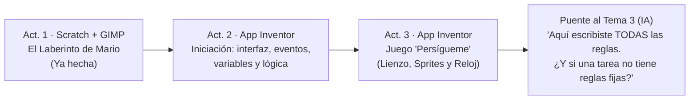
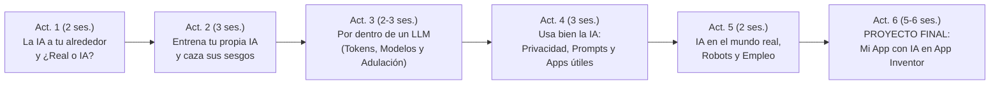

# Propuesta de secuenciación: Tema 2 (Programación) y Tema 3 (Inteligencia Artificial) — PIAR I (2.º ESO)

Esta propuesta parte de tres fuentes revisadas en el repositorio:

1. El estado actual de [`programacion/index.md`](./programacion/index.md) y [`programacion/actividad1/index.md`](./programacion/actividad1/index.md) (*El Laberinto de Mario* en GIMP + Scratch).
2. El contenido actual del Tema 3 en [`inteligencia-artificial/index.md`](./inteligencia-artificial/index.md), sus 5 páginas de teoría, sus 8 actividades, sus 5 mini-webs interactivas y [`preparacion_tema2_ia.md`](./preparacion_tema2_ia.md).
3. El análisis completo del backup de Moodle de cursos anteriores (`2ESO - PIARI [copia 2025-26]`, `../../archivos/backups/copia_de_seguridad-moodle2-course-130797-CEE_108277_2025_PRP_5___1782466394-20261120-0931-nu.mbz`).

---

## 1. Análisis del backup de Moodle (cursos anteriores)

En la copia de seguridad, App Inventor e Inteligencia Artificial estaban mezclados en un único bloque (*Tema 2. Aplicaciones móviles e Inteligencia Artificial*). Separar **programación de apps sin IA (Tema 2)** y **fundamentos + uso + creación con IA (Tema 3)** mejora muchísimo la claridad conceptual.

### Inventario y valoración de las actividades del backup

| Actividad del backup | Tipo | Qué trabaja | Recursos reutilizables en el backup | Valoración para 2.º ESO (13-14 años) |
| :--- | :--- | :--- | :--- | :--- |
| **CityInfo** | App Inventor (sin IA) | Diseñador, disposiciones, botones, `TextoAVoz`, abrir web y Google Maps (`ActivityStarter`) | Vídeo demo, vídeo YouTube, imágenes de Roma, capturas de bloques | **Muy buena toma de contacto** (2-3 ses.), muy visual. Le faltan variables/condicionales, pero se puede vitaminar fácilmente. |
| **Juego «Persígueme»** | App Inventor (sin IA) | `Lienzo`, `Sprites`, `Reloj`, coordenadas táctiles, colisiones, velocidad progresiva, `Notificador`, sonidos | Lista YouTube, vídeo demo, `gato.png`, `rata.png`, `queso.png`, `gato.mp3`, `final.mp3`, capturas de bloques | **Imprescindible.** Engancha muchísimo, conecta directo con el Laberinto de Mario y deja aprendido `Lienzo + Sprites`. |
| **Adivinar un número** | App Inventor (sin IA) | Variables, números aleatorios, condicionales `si / si no si`, caja de texto numérica, depuración con «chivato», límite de intentos | Guía paso a paso (`Act_05_Adivinar_numero.pdf`) | **Muy buena en lógica pura** y no depende de cámara ni sensores. Visualmente sobria, pero fácil de modernizar con voz, sonidos e iconos. |
| **Calculadora simple** | App Inventor (sin IA) | Variable acumuladora, concatenación de texto, botón RESET | Vídeos demo y capturas de bloques | Didácticamente correcta, pero menos motivadora que *Adivinar un número* o una app multimedia. |
| **Teorema de Pitágoras** | App Inventor (sin IA) | Campos numéricos y fórmula matemática | PDF guía (`AppInventor_Pitagoras.pdf`) | Demasiado escolar/abstracta como una de solo 2 apps del tema. **Descartable.** |
| **App «¿Qué es?»** | App Inventor + IA (`LookExtension`) | Clasificador preentrenado de objetos, listas, porcentajes, `Traductor`, `TextoAVoz` | `.aix` de 2018, lista YouTube, capturas de bloques | **Riesgo técnico alto:** extensión de 2018 que suele fallar en Android actual. Además es «caja negra» (no entrenan). |
| **SnapCat** | App Inventor + IA (`Facemesh`) | Puntos clave faciales (*landmarks*), `Lienzo`, `Sprites` siguiendo la cara, captura y compartir | `Facemesh.aix`, 2 vídeos demo, lista YouTube, capturas de bloques | **Factor «wow» enorme** y reutiliza `Lienzo + Sprites` de *Persígueme*. No entrenan modelo y requiere probar `Facemesh.aix` en Android actual. |
| **Piedra, papel o tijera con IA** | App Inventor + IA (`PersonalImageClassifier`) | Entrenamiento propio en `classifier.appinventor.mit.edu`, exportación `.mdl` (offline), listas, lógica de 9 casos, marcador | Guía completa de 9 págs., `PersonalImageClassifier.aix`, modelo `.mdl` de respaldo, vídeo demo, iconos | **La más redonda pedagógicamente:** ven el ciclo completo *datos → entrenamiento → modelo → app → fallos en cámara real*. |
| **Asesor de vacaciones** | App Inventor + IA (ML4K) | Entrenamiento propio de **texto** en Machine Learning for Kids, imágenes, mapas | Lista YouTube, vídeo demo, imágenes de destinos | **Muy robusta en aula:** al ser texto, no sufre con iluminación ni cámara (funciona incluso sin cámara). La temática se puede rejuvenecer. |
| **Reconocimiento facial** | Scratch + ML4K | Webcam + desbloqueo facial | Ficha `worksheet-facelock-es.pdf` | **Descartable:** usa caras de menores + webcam en PC (problemas de privacidad y hardware). |

> **La gran ventaja estructural de esta nueva organización:** En [`propuesta_tema2_ia.md`](./propuesta_tema2_ia.md), hacer una app de IA en App Inventor era arriesgado porque el alumnado nunca había tocado App Inventor. Al trasladar **dos apps de App Inventor sin IA al Tema 2**, llegarán al Tema 3 dominando ya el Diseñador, los bloques, el flujo de exportación `.aia` y la prueba con *AI2 Companion*. Eso convierte el cierre del Tema 3 en una experiencia fluida y sin atascos.

---

## 2. Propuesta para el Tema 2: Programación (3 actividades)

El hilo conductor del Tema 2 queda muy limpio: **de los bloques en el ordenador (Scratch) a aplicaciones reales en el móvil (App Inventor)**.

### ¿Por qué poner «Persígueme» como Actividad 3 y no como Actividad 2?

Empezar App Inventor directamente con *Persígueme* obliga al alumnado a asimilar en el primer día: acceso a la plataforma (`code.appinventor.mit.edu`), conexión Wi-Fi con *AI2 Companion* (o emulador), interfaz del Diseñador, disposiciones, `Lienzo`, `Sprites`, `Reloj`, coordenadas y bloques de colisión.

Dividirlo así suaviza mucho la curva de aprendizaje en 2.º ESO:

1. **Actividad 1 (ya creada): El Laberinto de Mario** (Scratch + GIMP — ~5 sesiones).
2. **Actividad 2 (App Inventor — Iniciación, ~3-4 sesiones):** Una app **sin `Lienzo`** para dominar el Diseñador, disposiciones, eventos de botón, variables, condicionales y componentes nativos del móvil.
3. **Actividad 3 (App Inventor — Videojuego móvil, ~4-5 sesiones): Juego «Persígueme»**, aprovechando que ya manejan el entorno para centrarse en `Lienzo`, `Sprites`, `Reloj`, colisiones y personalización.

*(Si prefieres arrancar con «Persígueme» como Actividad 2 por el gancho inmediato tras Scratch, las candidatas de abajo funcionan igual de bien como Actividad 3 cambiando ligeramente el grado de guía.)*

### Opciones para «la otra aplicación» de App Inventor (Actividad 2)

| Opción | En qué consiste | Qué aprende que complementa a *Persígueme* | Ventaja principal |
| :--- | :--- | :--- | :--- |
| **Opción 1 (Recomendada): «Adivina el número 2.0»** *(evolución del PDF del backup)* | La app piensa un número secreto del 1 al 100 y da pistas («más alto / más bajo») **habladas con `TextoAVoz`**, contador de intentos, barra/emoji de temperatura y botón reiniciar. **Reto:** límite de intentos (vidas), 2 niveles de dificultad (1-50 / 1-100) y récord de menos intentos. | Variables, `NúmeroAleatorio`, condicionales encadenados (`si / si no si`), entrada de texto numérico, **`Notificador`**, **`TextoAVoz`** y depuración con etiqueta «chivato». | **Cero fallos técnicos**, enseña justo el `Notificador` y los condicionales antes de *Persígueme*, y prepara la lógica de estados para el Tema 3. |
| **Opción 2: «Guía / Traductor de Viaje»** *(evolución de CityInfo del backup)* | App con foto y ficha de una ciudad (o del instituto/pueblo) con botones para escuchar la descripción (`TextoAVoz`), **traducir frases al inglés/francés (`Traductor`)**, abrir ubicación en **Google Maps (`ActivityStarter`)** y botón «Dato curioso aleatorio» al **agitar el móvil (`Acelerómetro`)**. | Disposiciones, diseño bonito, `TextoAVoz`, `Traductor`, `ActivityStarter` (abrir mapas/web), listas cortas y sensor **`Acelerómetro`**. | **Muy vistosa y útil** desde la sesión 1; introduce un **sensor físico del móvil** (enlaza con el saber de sensores) y prepara `Traductor` + `TextoAVoz`. |
| **Opción 3: «Pizarra Mágica / Mini-Paint»** *(clásico PaintPot del MIT)* | Hacer una foto con la cámara (o elegir un fondo), dibujar con el dedo eligiendo colores y grosor de trazo, y **agitar el móvil (`Acelerómetro`) para borrar** el lienzo. | `Lienzo` (dibujo táctil), `Cámara`, `Acelerómetro`, `Deslizador` (grosor), disposiciones. | Engancha rápido y ya introduce el `Lienzo` y la `Cámara`, aunque repite `Lienzo` con *Persígueme* y trabaja menos condicionales/variables. |

> **Ajustes sugeridos para «Persígueme» (Actividad 3):**
> - Mantener la base y los vídeos/assets que ya tienes en el backup (`gato.png`, `rata.png`, `queso.png`, `gato.mp3`, `final.mp3`).
> - Mantener el reto de **fin de juego con `Notificador` + sonido `final.mp3` + reinicio**.
> - Añadir una **misión creativa opcional/ampliación** que enlace con la Actividad 1: *personalizar los 3 personajes recortando sus propios sprites con GIMP* (por ejemplo, policía-ladrón-diamante o Pac-Man-fantasma-fruta) o añadir un **sistema de 3 vidas / récord de puntuación**.
> - Incluir una breve **comparativa final (4 líneas)** en la entrega: *¿en qué se parece y en qué se diferencia programar un juego en Scratch frente a App Inventor?* (cubre **CE4.3** sin esfuerzo).

### Nota logística clave para App Inventor en el aula

- **Acceso sin cuenta de Google:** Usar `code.appinventor.mit.edu` anotando el **código de 4 palabras** en un archivo de su carpeta `Documentos/PIARI/Tema 2/`, **y acostumbrarlos a exportar el `.aia` al acabar cada sesión** como copia de seguridad real.
- **Pruebas en dispositivo:** Si el alumnado trae móvil o usa tablets del aula con la Wi-Fi de clase y *MIT AI2 Companion*, estupendo. Si algún alumno no tiene Android (o el centro restringe móviles), conviene dejar preparado el **emulador oficial (`aiStarter`)** o parejas con 1 dispositivo Android por mesa.

---

## 3. Diagnóstico y propuesta de mejora del Tema 3: Inteligencia Artificial

### Qué funciona muy bien hoy en el Tema 3 actual (conservar)

- Las **3 mini-webs ya terminadas** en [`inteligencia-artificial/herramientas/`](./inteligencia-artificial/herramientas): `ruleta-de-palabras`, `taller-de-prompts` y `semaforo-de-datos`. Son prácticas, visuales, sin registro y generan resumen entregable.
- El estilo claro, honesto y directo de las páginas de teoría (especialmente [`como-funciona-un-llm.md`](./inteligencia-artificial/como-funciona-un-llm.md) y [`prompts.md`](./inteligencia-artificial/prompts.md)).
- La idea de **entrenar un clasificador y romperlo** (Act. 2), el **duelo de modelos + adulación** (Act. 3) y la **ficha de transparencia** (Act. 8).

### Qué conviene cambiar para ajustarlo a tus objetivos

| Punto débil del Tema 3 actual | Mejora propuesta |
| :--- | :--- |
| **1. Tono demasiado centrado en riesgos y escepticismo.** Casi la mitad del tema (Act. 1, 5, 6, 7) son riesgos, privacidad, sesgos y debate sobre el futuro. Falta mostrar **por qué la IA es tan útil y apasionante**. | Añadir desde el inicio el bloque **«La IA en el mundo real: para qué sirve y dónde está»** (medicina, accesibilidad, traducción, mapas, ciencia, **robots y vehículos autónomos**) antes de pasar a sus límites. |
| **2. Demasiadas actividades con mucha redacción en Writer** (8 actividades, varias con 10-14 preguntas escritas). A los 13-14 años se hace denso y teórico. | **Compactar de 8 actividades a 6** (5 actividades prácticas cortas de 2-3 sesiones + 1 proyecto final en App Inventor de 4-5 sesiones), reduciendo los cuestionarios largos a fichas breves / capturas / evidencias prácticas. |
| **3. Referencias desactualizadas a Karel (Tema 1)** en [`que-es-la-inteligencia-artificial.md`](./inteligencia-artificial/que-es-la-inteligencia-artificial.md) (línea 15) y [`prompts.md`](./inteligencia-artificial/prompts.md) (línea 23). | Sustituirlas por referencias directas a **Laby (Tema 1)** y **Scratch / App Inventor (Tema 2)** para contraponer visualmente: *«En Persígueme escribiste la regla exacta; con IA entrenas con ejemplos»*. |
| **4. Act. 3 demasiado cargada** (6 tareas + 13 preguntas: ruleta cadena, ruleta temperatura, Tiktokenizer, duelo de 5 sondas, adulación, Perplexity, conclusión). | **Aligerarla sin perder el «ajá»:** mantener `ruleta-de-palabras` (breve), `Tiktokenizer` (3 palabras), **mini-duelo de 3 pruebas clave + adulación** y cierre rápido. Menos texto, más observación. |
| **5. Poca exploración de aplicaciones útiles de IA en su día a día.** Solo usan `duck.ai` y una consulta en `Perplexity`. | Enriquecer la actividad de uso práctico y *prompts* con un **«Kit de usos útiles de la IA»** (tutor de estudio socrático, búsqueda verificada con fuentes, ayuda para depurar código/bloques, traducción/accesibilidad, demostración docente de **NotebookLM** o **Quick, Draw!** / **AutoDraw**). |
| **6. Alta carga de preparación pendiente en 2 mini-webs** (`detector-ia` necesita 11 archivos multimedia; `cazador-de-sesgos` pide generar 48-52 imágenes). | Aligerar `cazador-de-sesgos` (p. ej. **6 prompts × 2-3 imágenes = 12-18 imágenes** o apoyarse en *Survival of the Best Fit* + experimento de datos desequilibrados) y dejar `detector-ia` en **8-10 rondas** bien elegidas. |
| **7. Falta puente explícito hacia la Robótica (Tema 4 / SdA 3).** | Incorporar un apartado claro sobre **IA + Sensores + Robots** (cómo un robot percibe con sensores/cámara, la IA interpreta y el programa acciona motores), dejando la alfombra roja puesta para Micro:bit y Maqueen. |

### Cambios concretos en las páginas de teoría (ligeras y de consulta)

Para no ser demasiado teóricos, conviene dejar **4 páginas cortas y muy visuales** (fusionando/recortando lo denso):

1. **`que-es-la-inteligencia-artificial.md` (ampliada con «Para qué sirve y robots»):**
   - Actualizar el arranque: **Programación clásica (Scratch / App Inventor) vs. IA (ejemplos → patrón → modelo)**.
   - Nuevo apartado visual: **¿Para qué sirve la IA en la vida real?** (recomendadores, medicina, accesibilidad, traducción, ciencia, coches autónomos y **robots con sensores + IA**).
   - Mantener IA predictiva vs. generativa y las 4 fechas breves.
2. **`como-funciona-un-llm.md` (aligerada para 2.º ESO):**
   - Mantener las 5 ideas esenciales: **predicción de siguiente palabra**, **tokens**, **temperatura**, **modelos pequeños vs. grandes** y **por qué alucina / te adula**.
   - Ventana de contexto y fecha de corte: dejarlos en un recuadro breve («2 límites rápidos») para no sobrecargar.
3. **`prompts-y-herramientas.md` (evolución de `prompts.md`):**
   - Mantener el esquema **R.O.C.F.** + iteración + verificación de 4 puntos + tabla «te ayuda vs. te sustituye».
   - Añadir un pequeño **mapa de aplicaciones útiles de IA** (chats generales, buscadores con fuentes como Perplexity, estudio con documentos como NotebookLM, visión/dibujo, accesibilidad y apoyo para programar).
4. **`riesgos-y-futuro.md` (fusión ágil de `riesgos-de-la-ia.md` y `hacia-donde-va-la-ia.md`):**
   - Privacidad (semáforo), sesgos, deepfakes/estafas de voz (palabra clave familiar), desinformación y consumo energético.
   - Bloque breve de futuro: **de chats a agentes y robots**, multimodalidad, cómo cambian las profesiones (tareas vs. trabajos) y una mención ligera de 1 párrafo a ANI vs. AGI (sin convertirlo en una actividad densa de filosofía).

---

### Nueva secuencia propuesta para el Tema 3 (6 actividades · ~18-21 sesiones)

| Act. | Título propuesto | Sesiones | Qué hacen en clase (práctico) | Qué cambia respecto a las 8 actividades actuales |
| :---: | :--- | :---: | :--- | :--- |
| **1** | **La IA en tu vida y «¿Esto lo ha hecho una IA?»** | **2** | 1) Breve radar en parejas: identificar 5 usos reales de IA en su día a día (y distinguir 2 programas normales sin IA). 2) Juego **`detector-ia/`** (8-10 rondas). 3) Cierre breve de deepfakes y qué hacer si ocurre (3 preguntas directas en vez de 7). | Mantiene el enganche de la Act. 1, añade el foco en **utilidad real + diferencia con programación** y recorta redacción. |
| **2** | **Entrena tu propia IA (y descubre de dónde salen los sesgos)** | **3** | 1) Entrenar un clasificador de 3 clases (en **Teachable Machine** o ya en **`classifier.appinventor.mit.edu`** si se enlaza con la app final) + prueba imposible (100 % repartido, nunca dice «no lo sé»). 2) Experimento de **datos desequilibrados** (5 vs. 100 fotos) → conexión directa con **sesgos**. 3) Versión corta de **`cazador-de-sesgos/`** (6 prompts) o partida rápida a *Survival of the Best Fit*. | **Fusiona Act. 2 + esencia de Act. 6** en una secuencia muy lógica: *datos → patrón → sesgo*. Elimina 1 documento largo de 14 preguntas. |
| **3** | **Por dentro de un LLM: tokens, predicción y duelo de modelos** | **2-3** | 1) **`ruleta-de-palabras/`** (cadena + temperatura 0 vs. 1). 2) **Tiktokenizer** (su nombre, `ferrocarril`, un emoji). 3) **Mini-duelo en Duck.ai** (solo **3 pruebas**: contar letras/lógica, dato reciente/local y **prueba de adulación**) + 1 prueba comparada en **Perplexity**. | Mantiene los conceptos clave (**tokens, modelos, LLMs, probabilidad**) pero baja de 6 tareas y 13 preguntas a una ficha guiada de 1 página. |
| **4** | **Usa bien la IA: privacidad, prompts y herramientas útiles** | **3** | 1) **`semaforo-de-datos/`** (15 min) + anonimizar 1 texto breve (antes de tocar ningún chat). 2) **`taller-de-prompts/` (R.O.C.F.)** aplicado a **2 tareas útiles reales** (ej. preparar un examen sin copiar + pedir ayuda para un bloque de código o resumen). 3) Dinámica divertida: **Torneo de prompts** o **Prompt a ciegas** + tour guiado por 3-4 herramientas útiles (Perplexity, NotebookLM en pantalla del profe, AutoDraw/QuickDraw, traductores/accesibilidad). | **Integra la parte práctica de la Act. 5 (privacidad)** justo antes de promptear (*primero qué NO contar, luego cómo pedir*) y añade **aplicaciones útiles**. |
| **5** | **IA en acción: agentes, robots y mi futuro** *(actividad ligera y visual)* | **2** | 1) Vídeos/demos cortas de **IA + robots reales** (brazos robóticos, visión en drones, coches autónomos, prótesis, agentes que reservan/actúan) + análisis «¿qué parte son sensores, qué parte es IA y qué parte son actuadores?» *(puente directo al Tema 4 de Micro:bit/Maqueen)*. 2) Mini-actividad en parejas sobre una profesión que les guste: 5 tareas → ¿IA o humano? + puesta en común oral (en lugar de debate rígido sobre AGI + carta de media página). | Sustituye la Act. 7 (muy teórica/abstracta con ANI/AGI/ASI) por una sesión muy conectada con **vida real, robótica y orientación**. |
| **6** | **PROYECTO FINAL: Mi App con IA en App Inventor** | **5-6** | Creación en parejas de una **aplicación móvil real con IA en App Inventor** + **Ficha de transparencia** + demostración en clase. | Aprovecha que **ya saben App Inventor del Tema 2** para que toda la clase (o casi toda) pueda construir una app con IA real. |

---

## 4. Comparativa de aplicaciones con IA en App Inventor (Actividad 6 / Proyecto final)

Comparativa entre las opciones existentes en el backup y **alternativas nuevas que encajan muy bien** con un tema que incluye LLMs, prompts y aplicaciones de la vida real:

### A. Apps de Visión Artificial (cámara del móvil)

| App | Tecnología en App Inventor | Entrenan modelo propio | Pros | Riesgos / Contras |
| :--- | :--- | :---: | :--- | :--- |
| **1. Piedra, Papel o Tijera con IA** *(backup)* | `PersonalImageClassifier.aix` + `classifier.appinventor.mit.edu` (`.mdl` embebido) | **Sí** | **Ya tienes la guía de 9 págs., iconos y `.mdl` de respaldo.** Funciona **offline** dentro de la app. Enlaza genial si en la Act. 2 entrenaron con imágenes CGI y ahora añaden fotos reales de sus manos para mejorar la app. | Requiere móviles Android + probar que `PersonalImageClassifier.aix` va fluido en Android actual. |
| **2. «EcoEscáner» o «Clasificador útil»** *(misma base que PPT, temática nueva)* | `PersonalImageClassifier.aix` (o `TMIC` + Teachable Machine) | **Sí** | Igual de viable que PPT, pero con **utilidad real** (clasificar 3 tipos de residuos para reciclar, 3 señales de tráfico, o 3 gestos de accesibilidad que disparen `TextoAVoz`). Enlaza con ODS y evita repetir *Piedra, Papel o Tijera* si ya la usaron en la Act. 2. | Mismo requisito de cámara Android y prueba piloto previa. |
| **3. SnapCat (filtros faciales)** *(backup)* | `Facemesh.aix` + `Lienzo` + `Sprites` | No (modelo preentrenado) | **A los de 13-14 años les encanta**, reutiliza `Lienzo + Sprites` de *Persígueme* y ya tienes vídeos y bloques. Permite crear sus propios filtros en GIMP. | Es «caja negra» (no entrenan); requiere cámara frontal y probar `Facemesh.aix` en Android actual; gestionar bien la privacidad de fotos en clase. |
| **4. «¿Qué es?» accesible** *(backup)* | `LookExtension` + `Traductor` + `TextoAVoz` | No | Muy buen enfoque de accesibilidad para personas con discapacidad visual. | Extensión de **2018**, la más propensa a fallar en móviles modernos. **No recomendada** salvo prueba exitosa. |

### B. Apps de Lenguaje / LLMs / Texto (sin problemas de cámara ni iluminación)

| App | Tecnología en App Inventor | Entrenan o configuran IA | Pros | Riesgos / Contras |
| :--- | :--- | :---: | :--- | :--- |
| **5. «Mi Asistente / Tutor con voz»** *(NUEVA — componente nativo oficial)* | Componente **`ChatBot`** integrado en App Inventor (*Experimental*) + `ReconocimientoDeVoz` + `TextoAVoz` | **Configuran `System Prompt`** (R.O.C.F.) | **Conecta directamente los LLMs y Prompts del Tema 3 con App Inventor.** Sin extensiones `.aix` externas, sin cámara, funciona en cualquier móvil o emulador. Pueden diseñar un *tutor de inglés que corrige sin dar la respuesta*, un *personaje histórico entrevistable*, un *asistente de reciclaje* o un *trivial infinito*. | Comprobar antes la **cuota del proxy gratuito de MIT** para un aula completa (o configurar clave API con tope mínimo). |
| **6. «Recomendador Inteligente / Detector de Ciberacoso»** *(evolución de «Asesor de vacaciones» del backup)* | **Machine Learning for Kids** (modelo de texto) + App Inventor | **Sí** (entrenan texto propio) | **Cero líos de cámara e iluminación.** Pueden elegir temática motivadora: *recomendador de videojuegos/series/música*, *asistente del instituto* o *detector de mensajes respetuosos vs. ciberacoso* (que avisa y sugiere cómo reformularlo). Ya conoces el flujo de ML4K del backup. | Requiere crear cuentas en bloque en ML4K (sin correo del alumno) y conexión a internet durante el uso. |

### Recomendación para la Actividad 6 (Proyecto Final)

Si quieres ofrecer **una única app guiada para toda la clase** (más fácil de gestionar en 2.º ESO que 3 itinerarios totalmente distintos):

- **Opción estrella con móviles Android y cámara:** **«EcoEscáner / Piedra, Papel o Tijera con IA»** usando **`PersonalImageClassifier` (`.mdl` offline)**, porque aprovecha tu guía existente y cierra el ciclo completo de *entrenar un modelo propio → meterlo en una app → comprobar sus fallos en el mundo real*. Y como alternativa/extra visual si pasa tu prueba piloto, **SnapCat**.
- **Opción estrella sin depender de cámara (o como itinerario paralelo muy atractivo):** **«Mi Asistente por Voz» con `ChatBot` nativo** (o **ML4K de texto** tipo *Detector de Ciberacoso / Recomendador* si el proxy de `ChatBot` limita demasiado). Enlaza con los LLMs y prompts y **elimina casi todos los problemas técnicos en el aula**.
- **Plan de 2 itinerarios controlados (equilibrio óptimo):**
  - **Itinerario A (Visión artificial con cámara):** *App clasificadora con `PersonalImageClassifier`* (Piedra-Papel-Tijera o EcoEscáner) — o *SnapCat* si pasa prueba piloto.
  - **Itinerario B (IA de lenguaje sin cámara / para quien no tenga Android compatible):** *Asistente especializado con `ChatBot`* o *Recomendador / Detector de texto con ML4K*.

---

## 5. Impacto en la programación de aula y detalles a revisar

1. **Coherencia documental:** Cuando cierres la elección de actividades, convendrá actualizar [`2eso_piari_prog-aula.md`](./2eso_piari_prog-aula.md) (y regenerar [`2eso_piari_eduplanner.json`](./2eso_piari_eduplanner.json)) porque actualmente todavía refleja *Atrapa Objetos* en Scratch (sin App Inventor) y las 8 actividades antiguas de IA.
2. **Privacidad en recursos migrados del backup:** En la copia de seguridad de Moodle hay páginas ocultas con la contraseña Wi-Fi del aula (`A005`) y contraseñas de cuentas de alumnos de ML4K; al llevar materiales a la web pública del repositorio conviene dejar esas credenciales únicamente en Aules.
3. **Pruebas piloto rápidas antes de decidir la app final del Tema 3:** Probar en un móvil Android actual del aula (en 15 minutos) tres cosas: `PersonalImageClassifier.aix`, `Facemesh.aix` y el componente `ChatBot` integrado de App Inventor. Con ese resultado sabrás sobre seguro qué opción ofrecer.

---

## 6. Decisiones pendientes antes de construir los materiales

- [ ] **Tema 2:** Elegir orden y app compañera de *Persígueme* (*Adivina el número 2.0*, *Guía/Traductor de Viaje* o *Pizarra Mágica*).
- [ ] **Pruebas App Inventor:** Confirmar si habrá móviles Android / tablets en clase o si se prevé emulador (`aiStarter`).
- [ ] **Tema 3:** Confirmar el paso de 8 a 6 actividades y los ajustes en las páginas de teoría.
- [ ] **Proyecto Final (Tema 3):** Elegir entre visión artificial (`PersonalImageClassifier` / `Facemesh`), lenguaje (`ChatBot` / ML4K) o 2 itinerarios.
