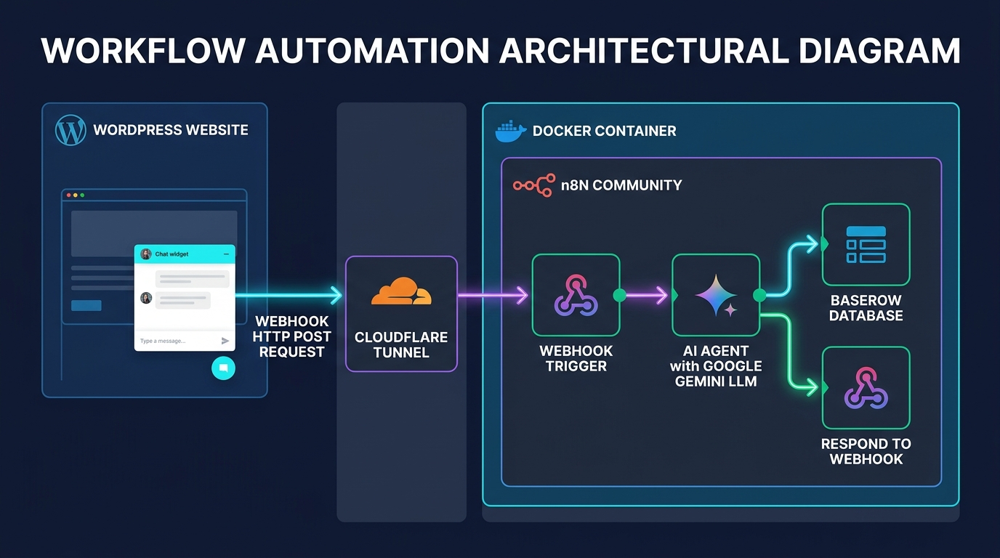

# Actividad 1 (Alternativa). Automatización e IA con Docker Compose (n8n + Cloudflare Tunnel + Asistente IA para WordPress con Baserow)

En esta actividad aprenderás a orquestar un entorno de automatización profesional basado en contenedores. Utilizarás **Docker Compose** para desplegar una instancia de **n8n Community** junto a un túnel seguro con **Cloudflare Tunnel (`cloudflared`)**. Esto permitirá exponer de forma segura tu n8n a Internet para recibir **Webhooks** desde un **widget de chat en WordPress**, procesar las preguntas en tiempo real mediante un **Agente de IA** con APIs gratuitas, devolver la respuesta al visitante y registrar automáticamente todo el historial de conversaciones en una base de datos relacional no-code en **Baserow**.

---

## 💡 ¿Qué es n8n y para qué sirve?

### ¿Qué es n8n?
**n8n** (*nodemation*) es una plataforma de **automatización de flujos de trabajo (*workflow automation*)** de código abierto (*fair-code/source-available*). En lugar de tener que programar integraciones complejas punto a punto entre diferentes sistemas, n8n ofrece una **interfaz visual basada en nodos interconectados** (*low-code / no-code*):

* Cada **nodo** representa una acción, un disparador (*trigger*) o un servicio externo (como una base de datos, un webhook, una API de IA o un gestor de correo).
* Los datos fluyen de un nodo a otro en formato JSON, permitiendo transformar, filtrar y enriquecer la información fácilmente.
* Si necesitas lógica avanzada, permite insertar bloques de **JavaScript** o **Python** en cualquier punto del flujo.

### ¿Para qué sirve y por qué es tan relevante hoy en día?

1. **Automatización de procesos entre plataformas:** Permite conectar servicios dispares que no se comunican de forma nativa: CRM, CMS (WordPress), sistemas de mensajería (Telegram, Discord, Slack), correo electrónico, hojas de cálculo y bases de datos.
2. **Backend ligero / Middleware mediante Webhooks:** Permite crear *endpoints* HTTP en cuestión de segundos. Cualquier aplicación web (como el chat de WordPress de esta práctica) puede enviar una petición a n8n, el cual procesa la lógica en segundo plano y devuelve una respuesta estructurada.
3. **Orquestación nativa de Inteligencia Artificial (Agentes de IA):** A diferencia de herramientas de automatización tradicionales, n8n integra de forma nativa el ecosistema de **LangChain**. Permite conectar fácilmente modelos de lenguaje (Google Gemini, OpenAI, Groq, Ollama), dotarlos de memoria conversacional (*Chat Memory*), vincular bases de datos vectoriales y otorgarles herramientas (*tools*) para interactuar con sistemas reales.
4. **Soberanía del dato y privacidad (Self-hosted con Docker):** Mientras que herramientas comerciales como Zapier o Make cobran suscripciones elevadas por cada tarea ejecutada y retienen tus datos en servidores de terceros, n8n se puede **auto-alojar (*self-host*) en tus propios servidores o en contenedores Docker locales**. Esto garantiza privacidad total, coste cero de ejecuciones y cumplimiento normativo (RGPD).

---

## 🎯 Objetivos de la actividad

1. **Entorno y Permisos de Docker:** Verificar el funcionamiento de Docker Engine y Docker Compose en **Lliurex** sin necesidad de privilegios de superusuario (`sudo`).
2. **Infraestructura como Código con IA:** Comprender y generar la receta de orquestación `docker-compose.yml` utilizando un prompt técnico guiado para levantar de forma coordinada `n8n` y `cloudflared`.
3. **Exposición Segura y Conectividad (Túneles inversos):** Entender por qué un servicio detrás de una NAT/cortafuegos del instituto no puede recibir peticiones web directas desde Internet y cómo un túnel saliente resuelve este problema sin abrir puertos ni requerir IP pública fija.
4. **Integración Frontend-Backend mediante Webhooks:** Configurar un disparador de tipo *Webhook* en n8n capaz de recibir eventos POST enviados por un widget de chat en un sitio WordPress online.
5. **Implementación de un Agente de Inteligencia Artificial:** Conectar n8n con un modelo LLM utilizando una **API Key 100% gratuita** (Google Gemini, Groq u OpenRouter) para generar respuestas coherentes y personalizadas a las consultas del chat.
6. **Persistencia en Base de Datos Relacional (Baserow):** Conectar el flujo a una tabla de **Baserow** para auditar y persistir en tiempo real todas las conversaciones (pregunta, respuesta, usuario y fecha).
7. **Persistencia en Docker y Gestión Segura de Secretos:** Asegurar que los flujos y credenciales persistan con volúmenes de Docker y gestionar contraseñas y API keys mediante **Bitwarden**.

---

## 📌 Paso a paso detallado

### Paso 1: Verificación de Docker en Lliurex y preparación en Bitwarden

1. Abre un terminal en Lliurex (`Ctrl + Alt + T`).
2. Comprueba que el servicio de Docker está activo y operativo:
   ```bash
   docker --version
   docker compose version
   docker run --rm hello-world
   ```
3. Si `docker run` da un error de permisos con el socket, consulta al profesor para verificar que tu usuario pertenezca al grupo `docker`.
4. Crea la carpeta de trabajo para este proyecto y accede a ella:
   ```bash
   mkdir -p ~/docker-n8n
   cd ~/docker-n8n
   ```
5. Abre **Bitwarden** en tu navegador o aplicación de escritorio. Crea una carpeta o conjunto de elementos dedicados a este laboratorio donde almacenarás:
   * Contraseña de administración de n8n.
   * La clave de API (API Key) del proveedor de IA que elijas a continuación.
   * El token de API de tu base de datos en **Baserow**.

---

### Paso 2: Obtención de una API Key de IA gratuita (sin tarjeta de crédito)

Para que tu Agente de IA en n8n pueda procesar información y razonar, necesitarás una clave de API. **Ninguna de las tres opciones siguientes solicita número de tarjeta de crédito ni datos de facturación.** Escoge la **Opción A** (recomendada) y recurre a la **B** o **C** si tienes incidencias con tu cuenta:

#### 🟢 Opción A (Recomendada): Google AI Studio (Gemini)
* **Ventajas:** Integración nativa excelente en n8n con el nodo *Google Gemini Chat Model*, muy rápido y con soporte completo de ejecución de herramientas (*Tool Calling*).
* **Pasos:**
  1. Accede a [aistudio.google.com](https://aistudio.google.com/).
  2. Inicia sesión con una cuenta de Google (si tu cuenta corporativa del centro tiene restricciones de administrador, utiliza una cuenta personal `@gmail.com`).
  3. Acepta los términos de uso del entorno de desarrollo.
  4. Haz clic en el botón superior o lateral **"Get API key"** y luego en **"Create API key"**.
  5. Copia la clave generada y **guárdala inmediatamente en Bitwarden** con el nombre `API Key - Google AI Studio`.

#### 🔵 Opción B: Groq Cloud (Llama 3.3 / Llama 3.1)
* **Ventajas:** Inferencia ultra rápida y acceso a modelos abiertos punteros como `llama-3.3-70b-versatile`.
* **Pasos:**
  1. Accede a [console.groq.com](https://console.groq.com/).
  2. Pulsa en **Sign Up** e inicia sesión con correo, GitHub o Google.
  3. En el menú lateral izquierdo, haz clic en **API Keys**.
  4. Pulsa en **"Create API Key"**, ponle un nombre descriptivo (ej. `n8n-laboratorio`) y copia el token generado.
  5. **Guárdala de inmediato en Bitwarden** como `API Key - Groq Cloud`.

#### 🟣 Opción C: OpenRouter (Modelos gratuitos `:free`)
* **Ventajas:** Permite utilizar diversos modelos de IA gratuitos en una única API compatible con el estándar de OpenAI.
* **Pasos:**
  1. Accede a [openrouter.ai](https://openrouter.ai/).
  2. Regístrate o inicia sesión con tu cuenta de correo o GitHub.
  3. Ve a tu perfil y accede a la sección **Keys** ([openrouter.ai/keys](https://openrouter.ai/keys)).
  4. Crea una nueva clave llamada `n8n-practica` con límite de crédito en 0 (solo usará modelos gratuitos).
  5. Copia el token y **guárdalo en Bitwarden** como `API Key - OpenRouter`.

---

### Paso 3: Generación del archivo `docker-compose.yml` mediante Prompt de IA

En lugar de copiar y pegar directamente el archivo de configuración, en este paso utilizaremos una Inteligencia Artificial (ChatGPT, Google Gemini o Claude) para **generar la receta de Infraestructura como Código (IaC)** a partir de especificaciones técnicas precisas. 

> 👨‍🏫 **Explicación del profesor en el aula:**  
> Antes de ejecutar el prompt, el profesor explicará en la pizarra los bloques fundamentales que componen esta arquitectura: qué es una imagen oficial, cómo se mapean los puertos del host al contenedor (`5678:5678`), para qué sirven las variables de entorno de n8n, cómo funciona la directiva `depends_on` y por qué es indispensable un volumen con nombre (`n8n_data`) para no perder la información al reiniciar el stack.
{: .alert-info}

#### 💬 Prompt para solicitar el `docker-compose.yml` a la IA

Copia y pega el siguiente prompt en tu modelo de IA:

```text
Actúa como un ingeniero DevOps experto en contenedores Docker. Escribe un archivo docker-compose.yml (versión 3.8) para desplegar n8n y exponerlo de forma segura a Internet mediante un túnel de Cloudflare en un equipo con Lliurex / Linux.

Requisitos técnicos que debe cumplir la configuración:
1. Servicio 1 ('n8n'):
   - Imagen oficial: docker.n8n.io/n8nio/n8n:latest
   - Nombre de contenedor: n8n-app
   - Política de reinicio: unless-stopped
   - Mapeo de puertos en el host: 5678:5678
   - Variables de entorno obligatorias:
     * N8N_HOST=0.0.0.0
     * N8N_PORT=5678
     * N8N_PROTOCOL=http
     * NODE_ENV=production
     * GENERIC_TIMEZONE=Europe/Madrid
     * TZ=Europe/Madrid
   - Volumen persistente: volumen con nombre 'n8n_data' montado en la ruta interna '/home/node/.n8n' (para preservar credenciales y flujos).
2. Servicio 2 ('tunnel'):
   - Imagen oficial: cloudflare/cloudflared:latest
   - Nombre de contenedor: n8n-tunnel
   - Política de reinicio: unless-stopped
   - Dependencia de arranque: debe arrancar después de n8n (depends_on: n8n).
   - Comando de ejecución: tunnel --url http://n8n:5678 (túnel saliente rápido sin cuenta hacia el servicio n8n en el puerto interno 5678).
3. Sección de volúmenes:
   - Declarar el volumen con nombre 'n8n_data' al final del archivo.

Devuelve únicamente el código YAML limpio y bien indentado, con comentarios explicativos breves en español para cada sección.
```

Copia el resultado generado por la IA en tu archivo `docker-compose.yml`:

```bash
nano docker-compose.yml
```

<details>
<summary>👁️ <strong>Desplegar código de referencia de <code>docker-compose.yml</code> (solución para comprobación)</strong></summary>

```yaml
version: '3.8'

services:
  # Servicio 1: Plataforma de Automatización de Flujos
  n8n:
    image: docker.n8n.io/n8nio/n8n:latest
    container_name: n8n-app
    restart: unless-stopped
    ports:
      - "5678:5678"
    environment:
      - N8N_HOST=0.0.0.0
      - N8N_PORT=5678
      - N8N_PROTOCOL=http
      - NODE_ENV=production
      - GENERIC_TIMEZONE=Europe/Madrid
      - TZ=Europe/Madrid
    volumes:
      - n8n_data:/home/node/.n8n

  # Servicio 2: Túnel seguro hacia Cloudflare (Quick Tunnel sin cuenta requerida)
  tunnel:
    image: cloudflare/cloudflared:latest
    container_name: n8n-tunnel
    restart: unless-stopped
    command: tunnel --url http://n8n:5678
    depends_on:
      - n8n

volumes:
  n8n_data:
```
</details>

> **¿Cómo funciona este túnel?**  
> El contenedor `tunnel` no publica puertos en tu máquina física; en su lugar, abre una conexión saliente HTTPS directa con la red global de Cloudflare. Cloudflare le asigna una URL pública temporal acabada en `.trycloudflare.com` y redirige el tráfico web que llegue a esa dirección hacia el puerto `5678` del contenedor `n8n` a través de la red interna de Docker.
{: .alert-info}

---

### Paso 4: Despliegue del stack y obtención de la URL pública

1. Levanta los dos contenedores en segundo plano:
   ```bash
   docker compose up -d
   ```
2. Comprueba que ambos contenedores están en estado `Up`:
   ```bash
   docker compose ps
   ```
3. Para descubrir la dirección pública generada por el túnel de Cloudflare, consulta los registros del contenedor `tunnel`:
   ```bash
   docker compose logs tunnel
   ```
   *Busca entre las últimas líneas un mensaje similar a este:*
   ```text
   +--------------------------------------------------------------------------------------------+
   | Your quick Tunnel has been created! Visit it at (it may take some time to be reachable):  |
   | https://example-words-random.trycloudflare.com                                             |
   +--------------------------------------------------------------------------------------------+
   ```
4. Copia esa URL con prefijo `https://` y pruébala en tu navegador. Comprobarás que puedes acceder a tu n8n tanto desde `http://localhost:5678` como desde la dirección pública de Cloudflare.

---

### Paso 5: Configuración inicial de n8n

1. Entra desde tu navegador a `http://localhost:5678`.
2. Completa el asistente inicial creando tu **cuenta de propietario (Owner account)** con tu nombre, correo y una contraseña robusta.
3. Guarda el usuario y la contraseña en **Bitwarden**.
4. En las preguntas de bienvenida de n8n sobre telemetría y uso, puedes omitirlas o indicar que es para uso formativo/personal.

---

### Paso 6: Construcción del flujo con Webhook, Agente de IA y Baserow

A continuación crearemos un flujo de automatización completo y con sentido práctico real: un **backend para un asistente de chat en WordPress**. Cuando un usuario pregunte algo en el chat web, n8n recibirá el mensaje, el Agente de IA formulará una respuesta inteligente, la conversación se registrará en una base de datos en **Baserow** para analítica y auditoría, y la respuesta se devolverá de inmediato al chat de la web.

#### 📊 Arquitectura del flujo de automatización



---

#### 1. Preparación previa de la Base de Datos en Baserow

**Baserow** es una base de datos relacional no-code de código abierto (*open-source*) basada en PostgreSQL. La utilizaremos para registrar cada interacción del chat:

1. Accede a [baserow.io](https://baserow.io/) (o a la instancia que indique el profesor) e inicia sesión con tu cuenta gratuita.
2. Crea una base de datos llamada **Chatbot WordPress**.
3. Dentro de ella, crea una tabla llamada **Conversaciones** con las siguientes columnas o campos:
   * **Mensaje** (tipo: *Single line text* o *Long text*): almacena la pregunta del usuario.
   * **Respuesta** (tipo: *Long text*): almacena la respuesta generada por la IA.
   * **Usuario** (tipo: *Single line text*): nombre o ID de sesión del visitante.
   * **Fecha** (tipo: *Date* con hora incluida): momento de la interacción.
4. Genera un token de base de datos para n8n:
   * Haz clic en tu perfil (esquina superior izquierda) > **Account Settings** > **Database tokens**.
   * Pulsa en **Create token**, dale el nombre `Token n8n Chatbot` y asígnale permisos de creación/lectura sobre tu base de datos.
   * Copia el token y **guárdalo de inmediato en Bitwarden**.
   * Anota también el **Table ID** de tu tabla (aparece en la URL de tu navegador al visualizar la tabla, ej. `baserow.io/database/12345/table/67890`).

---

#### 2. Configuración de los nodos en n8n

En la interfaz de n8n (`http://localhost:5678`), pulsa en **"Create Workflow"** (Crear flujo) y añade los nodos siguiendo estos pasos:

##### A. Nodo Disparador: Webhook
* Haz clic en **Add first step** y busca el nodo **Webhook**.
* Configuración:
  * **HTTP Method:** `POST`.
  * **Path:** `chat-asistente`.
  * **Respond:** Selecciona `Using 'Respond to Webhook' Node` (para devolver la respuesta de la IA a WordPress).
* Observa las dos URLs del webhook:
  * **Test URL:** `https://tu-subdominio.trycloudflare.com/webhook-test/chat-asistente` (para pruebas de diseño).
  * **Production URL:** `https://tu-subdominio.trycloudflare.com/webhook/chat-asistente` (cuando actives el flujo).

##### B. Nodo: AI Agent
* Añade un nodo **AI Agent** y conéctalo a la salida del nodo **Webhook**.
* En **Prompt Type**, selecciona **Define below**.
* En el campo de prompt, introduce la instrucción del sistema y el mensaje que llega de WordPress:
  ```text
  Eres el asistente virtual interactivo del sitio web del centro educativo. Tu misión es responder de manera educada, clara, empática y en un máximo de 3 párrafos a las dudas de los visitantes.

  Mensaje recibido del usuario: {{ $json.body.mensaje }}
  ```

##### C. Nodo de Modelo de Lenguaje (Chat Model)
Conecta a la entrada de modelo (*Model*) del AI Agent el conector correspondiente a la opción que elegiste en el **Paso 2**:

* **Si elegiste Google Gemini (Opción A):**
  * Añade el nodo **Google Gemini Chat Model**.
  * En **Credential for Google Gemini**, pega tu API Key guardada en Bitwarden.
  * Selecciona el modelo `gemini-1.5-flash` o `gemini-2.0-flash`.
* **Si elegiste Groq (Opción B):**
  * Añade el nodo **Groq Chat Model** (o **OpenAI Chat Model** con Base URL `https://api.groq.com/openai/v1`).
  * Introduce tu API Key de Groq y selecciona el modelo `llama-3.3-70b-versatile`.
* **Si elegiste OpenRouter (Opción C):**
  * Añade el nodo **OpenAI Chat Model**.
  * Configura la Base URL en `https://openrouter.ai/api/v1`, introduce tu clave y escribe el modelo `meta-llama/llama-3.3-70b-instruct:free`.

##### D. Nodo: Baserow (Registro de la Conversación)
* Añade un nodo **Baserow** conectado a la salida del nodo **AI Agent**.
* **Resource:** `Database row`.
* **Operation:** `Create`.
* En **Credential for Baserow**, crea una nueva credencial de tipo *Database Token*, pega el token guardado en Bitwarden y deja la URL por defecto (`https://api.baserow.io` si usas la nube oficial).
* Introduce el **Database Table ID** de tu tabla.
* En **Fields / Values to send**, añade los siguientes mapeos:
  * Campo **Mensaje:** `{{ $('Webhook').item.json.body.mensaje }}`
  * Campo **Respuesta:** `{{ $json.output }}`
  * Campo **Usuario:** `{{ $('Webhook').item.json.body.usuario || 'Visitante Web' }}`
  * Campo **Fecha:** `{{ $now.toISO() }}`

##### E. Nodo: Respond to Webhook
* Conecta también la salida del **AI Agent** (o la salida de **Baserow**) al nodo **Respond to Webhook**.
* Configura la respuesta para devolver un JSON que el chat de WordPress interpretará al recibirlo:
  * **Response Code:** `200`
  * **Response Body:** Selecciona `JSON` y escribe:
    ```json
    {
      "respuesta": "={{ $('AI Agent').item.json.output }}"
    }
    ```

---

### Paso 7: Conexión con WordPress online (Plugin de Chat)

Para que los usuarios puedan interactuar con el flujo desde una página web real, integraremos un widget de chat flotante en WordPress.

#### 🔌 Integración del plugin en WordPress

El profesor facilitará el archivo del plugin listo para instalar, o bien se planteará como reto complementario generarlo mediante Inteligencia Artificial:

* **Opción A (Recomendada - Plugin facilitado por el profesor):**
  1. Descarga el archivo del plugin proporcionado por el profesor (`chat-asistente-n8n.zip`).
  2. En el panel de administración de tu WordPress online, ve a **Plugins > Añadir nuevo plugin > Subir plugin**.
  3. Selecciona el archivo `.zip`, instálalo y pulsa en **Activar**.
  4. En el menú de administración, accede a la sección de configuración del plugin (**Ajustes > Asistente n8n**).
  5. En el campo **URL del Webhook de n8n**, pega tu URL de prueba del túnel de Cloudflare:  
     `https://tu-subdominio.trycloudflare.com/webhook-test/chat-asistente`
  6. Guarda los cambios. Al abrir cualquier página de tu WordPress, verás una burbuja flotante de chat en la esquina inferior derecha.

* **Opción B (Reto guiado: Creación del plugin con IA):**
  Si el profesor lo indica en clase, puedes pedirle a tu IA preferida que genere el plugin completo con el siguiente prompt:
  ```text
  Crea un plugin para WordPress en un único archivo PHP ('chat-asistente.php') que muestre un widget flotante de chat en la esquina inferior derecha de la web.
  Requisitos:
  1. Debe tener una interfaz moderna, limpia y responsive con HTML y CSS incrustado (ventana colapsable con botón flotante).
  2. Al enviar un mensaje mediante un botón o la tecla Enter, debe enviar una petición asíncrona fetch() POST en formato JSON con la estructura {"usuario": "Visitante", "mensaje": "..."} hacia la URL del Webhook configurada.
  3. Muestra un indicador de carga ("El asistente está escribiendo...") mientras espera la respuesta.
  4. Al recibir la respuesta JSON {"respuesta": "..."}, renderiza el mensaje en la ventana de chat.
  5. Añade una página sencilla en el menú de administración de WordPress para poder modificar la URL del Webhook sin tocar el código.
  ```

#### 🧪 Prueba de funcionamiento directa (con `curl`)

Si necesitas probar el flujo antes de instalar el plugin en WordPress o si tu WordPress no está disponible temporalmente, puedes simular exactamente la petición del chat desde otra terminal:

```bash
curl -X POST https://tu-subdominio.trycloudflare.com/webhook-test/chat-asistente \
  -H "Content-Type: application/json" \
  -d '{"usuario": "alumno_prueba", "mensaje": "Hola, ¿cuáles son los plazos de matrícula y qué oferta formativa tiene el centro?"}'
```

---

### Paso 8: Comprobación del ciclo completo y persistencia de datos

1. **Prueba en n8n:**
   * En el editor de n8n, pulsa el botón **"Listen for test event"** en el nodo Webhook.
   * Envía un mensaje desde la burbuja de chat de tu WordPress (o ejecuta el comando `curl`).
   * Observa la ejecución en n8n: los datos entran por el Webhook, el Agente de IA consulta al modelo LLM, Baserow almacena la fila y el nodo de respuesta devuelve el texto.
   * Comprueba que en la ventana de chat de WordPress aparece la respuesta generada por la IA de forma instantánea.
2. **Verificación en Baserow:**
   * Abre tu tabla de **Conversaciones** en [baserow.io](https://baserow.io/).
   * Comprueba que ha aparecido una nueva fila con el mensaje del usuario, la respuesta completa de la IA, el usuario y la marca de tiempo.
3. **Prueba de persistencia de Docker:**
   * Detén y destruye los contenedores en la terminal:
     ```bash
     docker compose down
     ```
   * Vuelve a arrancarlos:
     ```bash
     docker compose up -d
     ```
   * Accede de nuevo a `http://localhost:5678`. Comprueba que tu usuario sigue activo, tus credenciales de IA y Baserow siguen guardadas y el flujo diseñado se mantiene intacto. Esto demuestra la persistencia del volumen `n8n_data`.

---

## 📽️ Recursos y material de apoyo

👉 [Documentación oficial de n8n](https://docs.n8n.io/)  
👉 [Documentación oficial de Baserow](https://baserow.io/docs)  
👉 [Guía de Cloudflare Quick Tunnels](https://developers.cloudflare.com/cloudflare-one/connections/connect-networks/do-more-with-tunnels/trycloudflare/)  
👉 [Google AI Studio - Obtención de API Key gratuita](https://aistudio.google.com/)  
👉 [Consola de Groq Cloud](https://console.groq.com/)  
👉 [Documentación de Docker Compose](https://docs.docker.com/compose/)  

---

## 📤 Entrega y Evaluación

Deberás entregar en **Aules** los siguientes elementos:

1. **Documento (PDF)** con un informe de la actividad que contenga:
   - Captura de la terminal con `docker compose ps` mostrando los contenedores de `n8n` y `tunnel` en ejecución.
   - Captura de la terminal con `docker compose logs tunnel` donde se aprecie la URL pública temporal `.trycloudflare.com` asignada.
   - Captura de las entradas en **Bitwarden** con las credenciales de n8n, la API Key de IA y el token de Baserow (ocultando contraseñas).
   - Captura del flujo en n8n con la ejecución completada con éxito (*Execution successful*) mostrando todos los nodos interconectados.
   - Captura del chat en WordPress mostrando una conversación real con la IA.
   - Captura de la tabla en **Baserow** donde se aprecie el registro de la pregunta y la respuesta guardadas.
   - Breve respuesta a las siguientes dos preguntas:
     1. *¿Por qué un servidor en Internet no puede enviar un webhook directo a `http://localhost:5678` de tu ordenador de clase sin un túnel como Cloudflare?*
     2. *¿Dónde se almacenan tus flujos y contraseñas de n8n para que no se borren al hacer `docker compose down`?*
2. **Copia del archivo `docker-compose.yml`** generado y utilizado.

Al finalizar la entrega, muestra la ejecución en directo al profesor en el aula.

---

## 📊 Rúbrica de Evaluación (máx. 10 puntos)

| Criterio | Insuficiente | Básico | Adecuado | Excelente |
| :--- | :--- | :--- | :--- | :--- |
| **Gestión de Seguridad y Credenciales en Bitwarden** (máx. 2 puntos) | **0 puntos:** No utiliza Bitwarden ni almacena de forma segura las claves maestras o las API keys. | **0,5 puntos:** Registra credenciales de forma incompleta o expone claves en texto claro en archivos compartidos. | **1 punto:** Registra la cuenta de n8n o la API key en Bitwarden, aunque con organización mejorable. | **2 puntos:** Registra de forma impecable y segura tanto el acceso a n8n como la API Key de IA y el token de Baserow en Bitwarden. |
| **Orquestación con Docker Compose y Persistencia** (máx. 2,5 puntos) | **0 puntos:** No genera el archivo YAML o contiene errores sintácticos graves que impiden arrancar los servicios. | **0,5 puntos:** Consigue arrancar únicamente uno de los servicios o presenta fallos en la definición de volúmenes. | **1,25 puntos:** Configura y levanta ambos servicios (`n8n` y `tunnel`), pero no verifica la persistencia tras el reinicio. | **2,5 puntos:** Prompt técnico bien interpretado, archivo YAML estructurado, ambos servicios operativos y persistencia comprobada con volúmenes. |
| **Túnel y Conectividad Externa (Webhooks)** (máx. 1,5 puntos) | **0 puntos:** No localiza la URL pública del túnel ni comprende el funcionamiento de la conexión externa. | **0,5 puntos:** Obtiene la URL de Cloudflare pero no logra recibir peticiones en el nodo Webhook de n8n. | **1 punto:** Configura el nodo Webhook y recibe eventos de prueba únicamente en red local (`localhost`). | **1,5 puntos:** Expone n8n mediante Cloudflare Tunnel y recibe con éxito eventos externos vía Webhook a través de la URL pública. |
| **Agente de IA, Integración WordPress y Baserow** (máx. 4 puntos) | **0 puntos:** No integra los nodos requeridos ni conecta el modelo de lenguaje o la base de datos. | **1 punto:** Conecta el modelo de IA pero falla la respuesta al chat de WordPress o no registra datos en Baserow. | **2,5 puntos:** Conecta la IA y responde al chat, pero el almacenamiento en Baserow es incompleto o no guarda todos los campos. | **4 puntos:** Flujo completo y funcional: chat en WordPress interactivo, respuestas contextuales con IA y guardado estructurado en tiempo real en Baserow. |
| **Entrega en plazo y documentación** (máx. 0 puntos) | **-2 puntos:** No entrega la actividad o realiza una entrega vacía o con retraso injustificado. | **-1,5 puntos:** Entrega con retraso importante o faltan evidencias clave en el informe. | **-1 punto:** Entrega con un pequeño retraso o documentación incompleta (falta informe o YAML). | **0 puntos:** Entrega puntual en Aules con todo el material requerido y demostración en el aula. |

> ⚠️ **Nota sobre la entrega en plazo:** La entrega dentro del plazo establecido no resta puntuación (0 pts). Las entregas con retraso supondrán una penalización de hasta 2 puntos sobre la calificación de la actividad.
{: .alert-error}
