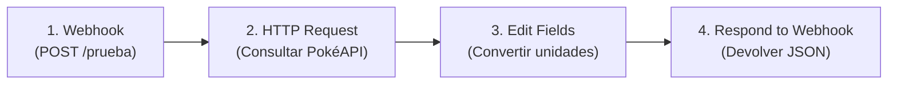
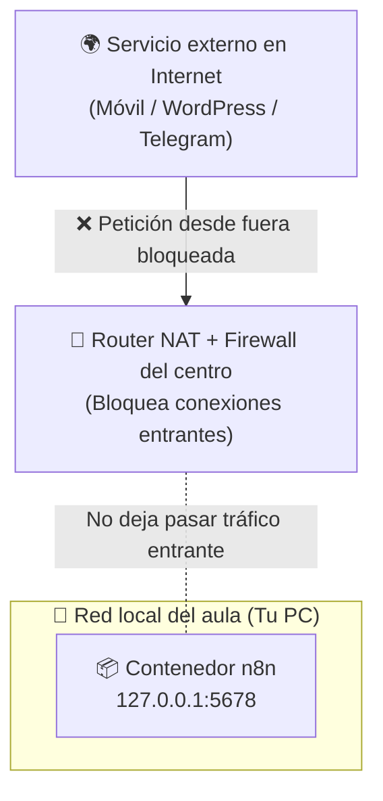
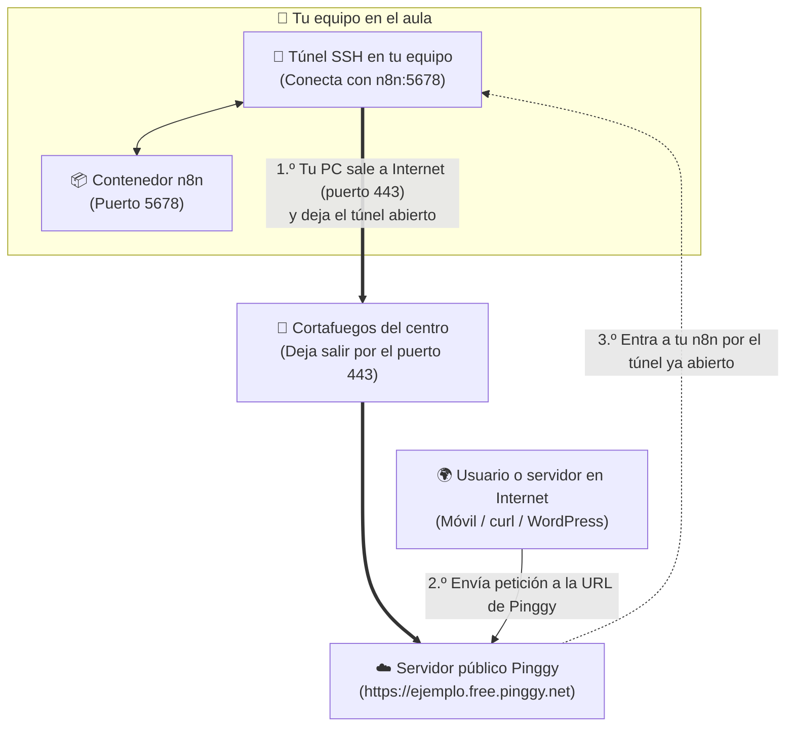



# Actividad 1. Despliegue de n8n y túnel público con Pinggy en Docker Compose

> [📖 **Apuntes: Introducción a Docker y Contenerización**](../apuntes)
{: .alert-info}

En esta primera actividad desplegarás **n8n Community** mediante **Docker Compose** y construirás tu primer flujo de automatización conectando un **Webhook** con la API pública de **PokéAPI**. Una vez que entiendas cómo funciona n8n en local, descubrirás qué es un **túnel inverso** y cómo permite publicar temporalmente tu servicio en Internet sin abrir puertos en el router del centro: primero lo probarás de forma manual por terminal con **Pinggy** y después lo automatizarás como un servicio más dentro de tu `docker-compose.yml`. Finalmente, verificarás la persistencia de datos del volumen **`n8n_data`**. En la Actividad 2 conectaremos esta infraestructura con WordPress, Qdrant y un Agente de IA.

## 🎯 Objetivos

1. Verificar Docker en **LliureX** y distinguir imagen, contenedor, puerto, red interna y volumen.
2. Desplegar **n8n** con **Docker Compose**, comprendiendo cada directiva del archivo `docker-compose.yml`, y construir un primer flujo práctico (`Webhook` → `HTTP Request` → `Edit Fields` → `Respond to Webhook`) probándolo en local con `curl`.
3. Comprender de forma sencilla qué es un **túnel inverso**, por qué es necesario detrás del router/cortafuegos del aula y cómo funciona **Pinggy** sobre el puerto `443`.
4. Probar primero el túnel de **Pinggy de forma manual** desde la terminal (`ssh -p 443 -R0:127.0.0.1:5678 free.pinggy.io`) y posteriormente **añadir el servicio `tunnel` en `docker-compose.yml`** conectado a la red interna de Docker (`n8n:5678`).
5. Aplicar el protocolo de inicio de sesión: levantar primero el túnel de Pinggy, registrar su URL temporal en `.env`, actualizar `n8n` y probar el flujo desde Internet.
6. Comprobar la persistencia del volumen Docker (`n8n_data`) al eliminar los contenedores y simular el cambio o caducidad de la URL temporal del túnel.

## 💡 ¿Qué es n8n?

> **n8n** es una plataforma de automatización visual, con código fuente disponible y licencia *fair-code*. Cada nodo representa un disparador, una transformación o una acción. Los datos circulan normalmente en formato **JSON**. Un **webhook** es una dirección URL que recibe peticiones HTTP y puede iniciar un flujo automáticamente.
{: .alert-info}

### Ejemplo de flujo real: Gestión de incidencias o consultas web

Para entender cómo opera n8n en entornos reales, veamos un caso habitual de automatización: la recepción y tramitación de un formulario de soporte o contacto desde una web.


En este flujo intervienen los tres tipos esenciales de nodos:

1. **Disparador (*Trigger* — `Webhook`):** Se activa en cuanto un usuario envía el formulario en la web. La página realiza una petición HTTP `POST` a la URL del webhook de n8n entregando los datos en formato **JSON**:
   ```json
   {
     "nombre": "Lucía",
     "email": "lucia@ejemplo.com",
     "asunto": "Incidencia de acceso",
     "mensaje": "No puedo entrar al aula virtual"
   }
   ```
2. **Transformación y lógica (`Edit Fields` / `If`):** n8n recoge los datos, comprueba que los campos obligatorios contengan información, añade una marca de tiempo (`timestamp`) y asigna la prioridad según el asunto.
3. **Acciones (*Actions* en paralelo):**
   * **Persistencia:** Inserta automáticamente una fila en una base de datos (**Baserow** o **Google Sheets**) para conservar el histórico.
   * **Notificación instantánea:** Lanza un mensaje al canal del equipo técnico en **Telegram** o **Discord** avisando del nuevo ticket:  
     *`🔔 Nueva incidencia de Lucía (lucia@ejemplo.com): "No puedo entrar al aula virtual"`*.


---

## 📌 Parte 1: Desplegar n8n y crear nuestro primer flujo en local

Antes de preocuparnos por cómo exponer nuestro servidor a Internet, vamos a poner en marcha **n8n** en nuestro propio equipo y a construir un ejemplo práctico con la **PokéAPI** para entender cómo funcionan los nodos y los webhooks.

### Paso 1: Verificar Docker y preparar la carpeta

1. Abre una terminal en LliureX (`Ctrl + Alt + T`):
   ```bash
   docker --version
   docker compose version
   docker run --rm hello-world
   ```
2. Si falta Docker o aparece un error de permisos con su socket, consulta al profesor. No cambies permisos del sistema por tu cuenta.
3. Prepara la carpeta del proyecto:
   ```bash
   mkdir -p ~/docker-n8n
   cd ~/docker-n8n
   ```
4. Prepara una carpeta en **Bitwarden** donde guardarás la cuenta de propietario de n8n cuando la crees.

**Comprobación:** `hello-world` funciona y estás situado en `~/docker-n8n`.

---

### Paso 2: Desplegar `n8n` con Docker Compose

#### A. Crear el archivo `docker-compose.yml` inicial con `n8n`

Dentro de `~/docker-n8n`, abre el editor `nano`:

```bash
nano docker-compose.yml
```

Pega la configuración inicial con el servicio `n8n` y su volumen persistente `n8n_data`:

```yaml
services:
  n8n:
    image: docker.n8n.io/n8nio/n8n:latest
    restart: unless-stopped
    ports:
      - "127.0.0.1:5678:5678"
    environment:
      N8N_HOST: localhost
      N8N_PORT: 5678
      N8N_PROTOCOL: http
      NODE_ENV: production
      GENERIC_TIMEZONE: Europe/Madrid
      TZ: Europe/Madrid
      N8N_WEBHOOK_URL: ${N8N_WEBHOOK_URL:-http://localhost:5678/}
      N8N_PROXY_HOPS: 1
    volumes:
      - n8n_data:/home/node/.n8n

volumes:
  n8n_data:
```

*(Guarda con `Ctrl + O`, pulsa `Enter` y sal con `Ctrl + X`)*.

#### B. Qué significa cada bloque del archivo `docker-compose.yml`

Antes de arrancarlo, revisemos qué hace cada línea:

1. **Imagen y reinicio (`image` y `restart`):**
   * `image: docker.n8n.io/n8nio/n8n:latest`: descarga la imagen oficial de n8n Community.
   * `restart: unless-stopped`: indica a Docker que reinicie el contenedor automáticamente si se cierra por error o al encender el ordenador, salvo que nosotros lo paremos expresamente.
2. **Puertos y seguridad en el aula (`"127.0.0.1:5678:5678"`):**
   * Se lee **IP del equipo : puerto del equipo : puerto del contenedor**.
   * Al anteponer **`127.0.0.1`** (*localhost*), garantizamos que solo tu propio navegador pueda abrir tu n8n. Si pusiéramos solo `"5678:5678"`, cualquier compañero de la red del aula podría entrar a tu n8n poniendo tu IP privada.
3. **Variables de entorno (`environment`):**

   <details markdown="1" style="cursor: pointer;">
   <summary style="cursor: pointer;">🔎 <strong>Ver qué significa cada variable de entorno de n8n</strong></summary>

   | Variable y valor | Para qué sirve |
   | :--- | :--- |
   | `N8N_HOST: localhost` | Nombre de host que utiliza n8n internamente para su configuración de acceso local. |
   | `N8N_PORT: 5678` | Puerto interno en el que n8n escucha dentro del contenedor. |
   | `N8N_PROTOCOL: http` | Protocolo en local (HTTP). Cuando más adelante usemos el túnel exterior, éste añadirá HTTPS. |
   | `NODE_ENV: production` | Modo de ejecución optimizado de la aplicación. |
   | `GENERIC_TIMEZONE` y `TZ` | Configuran la hora oficial de España (`Europe/Madrid`) para los flujos programados y el contenedor. |
   | `N8N_WEBHOOK_URL` | Dirección base que n8n utiliza al generar los enlaces de sus webhooks. |
   | `N8N_PROXY_HOPS: 1` | Permite que n8n funcione sin errores cuando más adelante reciba tráfico a través de un túnel. |

   La expresión **`${N8N_WEBHOOK_URL:-http://localhost:5678/}`** es muy útil:
   * Si todavía **no** existe un archivo `.env` (como ahora mismo), usa por defecto lo que va después de `:-`, es decir, **`http://localhost:5678/`**.
   * Cuando más adelante creemos un archivo `.env` con la dirección pública del túnel, n8n la tomará automáticamente sin tener que modificar el `docker-compose.yml`.

   </details>

4. **Persistencia (`volumes` y `n8n_data`):**
   * `n8n_data:/home/node/.n8n` guarda la base de datos de n8n, tu usuario y todos tus flujos en un volumen gestionado por Docker llamado `n8n_data`, para que no se borren aunque destruyas el contenedor.

#### C. Arrancar `n8n` y crear tu cuenta

Valida que el archivo YAML no tenga errores de formato y arranca el contenedor:

```bash
docker compose config --quiet
docker compose up -d
docker compose ps
```

1. Abre **`http://localhost:5678`** en tu navegador.
2. Crea tu **cuenta de propietario** y guarda inmediatamente el correo y la contraseña robusta en **Bitwarden**.
3. Completa el asistente inicial; las preguntas de perfil son opcionales.

---

### Paso 3: Construir tu primer flujo en n8n con la PokéAPI (en local)

Vamos a construir un flujo que reciba el nombre de un Pokémon mediante un **Webhook**, consulte en tiempo real la API pública de **PokéAPI** (que devuelve la altura en decímetros y el peso en hectogramos), convierta esas unidades al sistema métrico habitual y nos devuelva una ficha limpia con su imagen:



#### A. Construir los 4 nodos del flujo

1. En el panel de n8n (`http://localhost:5678`), pulsa **Create Workflow** y llámalo **Primera práctica**.
2. **Nodo 1 — Recibir la petición (`Webhook`):**
   * Pulsa **`+`** en el lienzo, busca **Webhook** y selecciónalo.
   * **HTTP Method:** `POST`.
   * **Path:** `prueba`.
   * **Respond:** `Using 'Respond to Webhook' Node`.
   * *Fíjate en las Webhook URLs:* Al desplegar **Webhook URLs**, verás que por ahora muestra `http://localhost:5678/webhook-test/prueba`.
3. **Nodo 2 — Consultar la API pública (`HTTP Request`):**
   * Vuelve al lienzo, pulsa el **`+`** que sale a la derecha del Webhook y añade el nodo **HTTP Request**.
   * **Method:** `GET`.
   * **URL:** activa el modo **Expression** (`fx`) y escribe:
     ```text
     https://pokeapi.co/api/v2/pokemon/{{ $json.body.pokemon.toLowerCase() }}
     ```
     *(Así n8n tomará el nombre que enviemos por `curl` y lo insertará directamente en la dirección de la API).*
4. **Nodo 3 — Procesar y limpiar los datos (`Edit Fields`):**
   * Pulsa el **`+`** a la derecha de **HTTP Request** y añade el nodo **Edit Fields (Set)**.
   * En **Fields to Set**, pulsa **Add Field** y añade estos cinco campos de tipo **String** activando **Expression** (`fx`) en cada valor:
     * **`ficha`**: `{{ $json.name.toUpperCase() }} (#{{ $json.id }})` *(pone el nombre en mayúsculas junto a su número de Pokédex)*.
     * **`altura`**: `{{ $json.height / 10 }} metros` *(convierte los decímetros de la API a metros)*.
     * **`peso`**: `{{ $json.weight / 10 }} kg` *(convierte los hectogramos de la API a kilogramos)*.
     * **`tipo_principal`**: `{{ $json.types[0].type.name }}` *(extrae el primer tipo del array devuelto por la API)*.
     * **`imagen`**: `{{ $json.sprites.front_default }}` *(extrae la URL del sprite oficial del Pokémon)*.
5. **Nodo 4 — Devolver la respuesta (`Respond to Webhook`):**
   * Pulsa el **`+`** a la derecha de **Edit Fields** y añade el nodo **Respond to Webhook**.
   * Deja **Respond With** en `First Incoming Item` para que devuelva el JSON ya procesado.
6. Pulsa **Save** arriba a la derecha para guardar tu flujo.

#### B. Probar el flujo en local con `curl`

1. Abre el nodo **Webhook** y pulsa el botón **Listen for test event** (n8n se quedará esperando tu llamada).
2. Abre una terminal en LliureX y lanza esta petición `POST` con `curl` apuntando a tu `localhost:5678` (usamos `tee` para ver el resultado en pantalla y guardarlo a la vez en `pokemon.json`):

```bash
curl -s -X POST http://localhost:5678/webhook-test/prueba \
  -H "Content-Type: application/json" \
  -d '{"pokemon": "snorlax"}' | tee pokemon.json
```

3. Verás que n8n recibe la petición, consulta la PokéAPI en Internet y te devuelve en la terminal el JSON limpio:
{:start="3"}

```json
{
  "ficha": "SNORLAX (#143)",
  "altura": "2.1 metros",
  "peso": "460 kg",
  "tipo_principal": "normal",
  "imagen": "https://raw.githubusercontent.com/PokeAPI/sprites/master/sprites/pokemon/143.png"
}
```

4. Ahora extrae automáticamente la URL del campo `imagen` desde `pokemon.json`, descarga el PNG y ábrelo en el visor de LliureX con un solo comando:
{:start="4"}

```bash
curl -sL "$(grep -o 'https://[^"]*' pokemon.json)" -o pokemon.png && xdg-open pokemon.png
```

5. Regresa a la pestaña de n8n: verás los cuatro nodos marcados en verde y podrás hacer clic en **HTTP Request** y **Edit Fields** para comparar el JSON gigante que devolvió la API original con el resumen limpio que has generado.
{:start="5"}

---

## 🌐 Parte 2: ¿Qué es un túnel inverso y cómo funciona?

Tu flujo con la PokéAPI ya funciona cuando lo llamas desde tu propio ordenador (`http://localhost:5678`). Pero ¿qué pasa si quieres llamarlo desde tu teléfono móvil con datos, o cuando en la siguiente práctica un servidor externo en Internet (como un **WordPress** en la nube o un bot de **Telegram**) necesite enviar datos al **Webhook** de tu n8n? **Internet no sabe cómo llegar a tu ordenador de clase**.

### 1. El problema: NAT y cortafuegos en la red del aula

En una red local doméstica o educativa, todos los ordenadores comparten una salida a Internet a través de un router con **NAT (*Network Address Translation*)** y un **cortafuegos (*Firewall*)**:

* **Las conexiones salientes están permitidas:** tu ordenador puede conectarse hacia fuera a páginas web o servidores (como acaba de hacer n8n al consultar `pokeapi.co` por el puerto `443`).
* **Las conexiones entrantes están bloqueadas:** si alguien desde Internet intenta conectarse a tu ordenador, el router/cortafuegos del centro rechaza la petición porque no hay ningún puerto abierto que apunte a tu equipo del aula.
* Además, los cortafuegos educativos suelen bloquear cualquier puerto extraño que no sea el de navegación web estándar (`80` o `443`).



### 2. La solución sencilla: un túnel inverso con Pinggy

Si desde fuera no pueden entrar a buscarnos, **la solución es que nuestro ordenador salga primero a buscar al servidor exterior y deje un "tubo" (túnel) abierto**. Eso es un **túnel inverso**:

1. **Tu PC abre el camino desde dentro:** Ejecutamos un comando `ssh` que se conecta desde tu ordenador hacia el servidor público **`free.pinggy.io`** usando el **puerto `443`** (el mismo que usan las webs `https://`). Como la conexión sale desde dentro de clase por el puerto `443`, el cortafuegos del centro la deja pasar sin problema.
2. **Pinggy te da una dirección web pública:** Al conectarte, Pinggy te presta durante **60 minutos** una dirección web pública gratuita (por ejemplo, `https://ejemplo.free.pinggy.net`).
3. **Las peticiones entran por el tubo ya abierto:** Cuando alguien desde Internet escribe esa dirección de Pinggy, Pinggy recoge el mensaje y te lo envía hacia dentro aprovechando la conexión que tu ordenador mantiene abierta, entregándolo directamente a tu **n8n** en el puerto `5678`.



### 3. Anatomía del comando de Pinggy

Para abrir este túnel con Pinggy no hace falta instalar programas especiales ni registrarse: basta con el comando **`ssh`** que ya viene incluido en LliureX. Fíjate qué significa cada parte:

```bash
ssh -p 443 -R0:127.0.0.1:5678 free.pinggy.io
```

| Fragmento | Qué significa de forma sencilla |
| :--- | :--- |
| **`ssh`** | Abre una conexión segura y cifrada con otro servidor. |
| **`-p 443`** | Usa el **puerto `443`** (el de las webs HTTPS) para que el cortafuegos del instituto no lo bloquee. |
| **`-R0:127.0.0.1:5678`** | **`-R`** significa **túnel inverso (*Reverse*)**: todo lo que llegue a la dirección pública que nos asigne Pinggy (`0`) se reenviará a nuestro **`127.0.0.1:5678`** (donde escucha n8n). |
| **`free.pinggy.io`** | Es el servidor gratuito de Pinggy (da una URL válida durante **60 minutos** sin registro). |

> **¿Cómo lo vamos a hacer ahora?**
> 1. **Primero lo probaremos manualmente en una terminal** para ver en directo cómo Pinggy nos da la URL pública.
> 2. **Después lo meteremos dentro de `docker-compose.yml`** como un servicio llamado `tunnel` para no tener que dejar una ventana de terminal ocupada.
{: .alert-info}

---

### Paso 4: Probar primero el túnel de Pinggy de forma manual

Con `n8n` ya encendido en `127.0.0.1:5678`, abre una **segunda pestaña o ventana de terminal** en LliureX y ejecuta el comando de Pinggy:

```bash
ssh -p 443 -R0:127.0.0.1:5678 free.pinggy.io
```

1. Si es la primera vez que te conectas y SSH te pregunta `Are you sure you want to continue connecting (yes/no/[fingerprint])?`, escribe **`yes`** y pulsa `Enter`.
2. Si te pide contraseña (*password*), simplemente pulsa **`Enter`** (dejándola vacía).
3. En un par de segundos aparecerá en tu terminal la pantalla de Pinggy mostrándote las **URLs públicas HTTPS** asignadas a tu túnel:

```text
You are not authenticated.
Your tunnel will expire in 60 minutes.
https://ejemplo-aula.free.pinggy.net
https://ejemplo-aula.run.pinggy-free.link
```

4. **Comprueba que funciona:** copia cualquiera de las direcciones **`https://...`** que muestra la terminal y ábrela en el navegador (o pruébala con `curl` hacia `/webhook-test/prueba` pulsando antes *Listen for test event* en n8n). ¡Verás que responde a través de Internet y que en la terminal de Pinggy aparecen las peticiones en tiempo real!
5. Cuando lo hayas comprobado (haz una captura para el informe), **cierra el túnel manual pulsando `Ctrl + C`** en esa terminal.

---

### Paso 5: Añadir el servicio `tunnel` en `docker-compose.yml`

Mantener una ventana de terminal abierta toda la clase es incómodo. Vamos a añadir un segundo servicio llamado **`tunnel`** dentro de nuestro `docker-compose.yml` para que Docker gestione el túnel automáticamente en segundo plano.

#### A. Editar `docker-compose.yml` para añadir el servicio `tunnel`

Abre de nuevo el archivo `docker-compose.yml` en `~/docker-n8n`:

```bash
nano docker-compose.yml
```

Añade el bloque `tunnel` justo debajo del servicio `n8n` (respetando los dos espacios de sangría delante de `tunnel:`):

```yaml
services:
  n8n:
    image: docker.n8n.io/n8nio/n8n:latest
    restart: unless-stopped
    ports:
      - "127.0.0.1:5678:5678"
    environment:
      N8N_HOST: localhost
      N8N_PORT: 5678
      N8N_PROTOCOL: http
      NODE_ENV: production
      GENERIC_TIMEZONE: Europe/Madrid
      TZ: Europe/Madrid
      N8N_WEBHOOK_URL: ${N8N_WEBHOOK_URL:-http://localhost:5678/}
      N8N_PROXY_HOPS: 1
    volumes:
      - n8n_data:/home/node/.n8n

  tunnel:
    image: alpine:latest
    restart: "no"
    command: >
      sh -c "apk add --no-cache openssh-client >/dev/null &&
      ssh -p 443 -o StrictHostKeyChecking=no -o ServerAliveInterval=30 -R0:n8n:5678 free.pinggy.io"

volumes:
  n8n_data:
```

*(Guarda con `Ctrl + O`, pulsa `Enter` y sal con `Ctrl + X`)*.

Comprueba que no hayas cometido ningún error de indentación al editar el archivo:

```bash
docker compose config --quiet
```

#### B. Qué significa cada línea del nuevo servicio `tunnel`

[](./imagenes/03-compose.svg)

Veamos por qué hemos escrito así el servicio `tunnel`:

| Línea añadida | Qué hace y por qué se pone |
| :--- | :--- |
| **`image: alpine:latest`** | Usa **Alpine Linux**, una imagen oficial minúscula (solo ~4 MB) ideal para ejecutar herramientas ligeras sin consumir memoria. |
| **`restart: "no"`** | No se reinicia solo. Ponemos `"no"` entre comillas para que YAML no lo confunda con un valor booleano. Además, **no ponemos `depends_on: n8n`** porque en cada sesión nos interesa encender primero el túnel, mirar qué URL nos ha tocado y pasársela después a `n8n`. |
| **`apk add --no-cache openssh-client >/dev/null`** | Como Alpine viene vacía, instala en un par de segundos el cliente `ssh` de forma silenciosa antes de abrir el túnel. |
| **`-o StrictHostKeyChecking=no`** | Como el contenedor corre en segundo plano sin nadie delante para escribir `yes`, esta opción acepta automáticamente la conexión con Pinggy sin detenerse a preguntar. |
| **`-o ServerAliveInterval=30`** | Envía una señal cada 30 segundos para que el cortafuegos del centro vea que el túnel sigue vivo y no lo corte cuando nadie esté haciendo peticiones. |
| **`-R0:n8n:5678`** | **¡Muy importante!** En la terminal de LliureX pusimos `127.0.0.1:5678`, pero dentro de Docker cada contenedor es como un mini-ordenador independiente conectados entre sí por una **red interna de Docker**. Dentro de esa red, el contenedor `tunnel` encuentra a n8n por su nombre de servicio: **`n8n:5678`**. |

[](./imagenes/04-puertos-red.svg)

---

### Paso 6: Conectar el túnel a `n8n` mediante `.env` y probar el flujo desde Internet

[](./imagenes/06-tunel.svg)

Los túneles gratuitos de Pinggy (`free.pinggy.io`) **duran 60 minutos y generan una dirección nueva cada vez que se arranca el contenedor `tunnel`**.

Por eso, para que `n8n` conozca cuál es su dirección pública de hoy y la muestre en sus Webhooks, seguiremos siempre este orden: **1.º Arrancar `tunnel` → 2.º Copiar la URL en `.env` → 3.º Actualizar `n8n`**.

#### A. Paso 1: Levantar el contenedor `tunnel` y ver su URL en los logs

Desde `~/docker-n8n`, arranca el servicio `tunnel` y consulta sus registros:

```bash
docker compose up -d tunnel
docker compose ps
docker compose logs --tail=30 tunnel
```

Espera unos 3–5 segundos mientras Alpine instala `ssh` y conecta con Pinggy. Al ejecutar `docker compose logs --tail=30 tunnel`, verás al final las dos URLs públicas HTTPS que te ha asignado Pinggy:

```text
Allocated port 5 for remote forward to n8n:5678
You are not authenticated.
Your tunnel will expire in 60 minutes. Upgrade to Pinggy Pro to get unrestricted tunnels. https://dashboard.pinggy.io
https://ejemplo-subdominio.free.pinggy.net
https://ejemplo-subdominio.run.pinggy-free.link
```

*(Si aún no aparecen las líneas `https://...`, espera 3 segundos más y vuelve a ejecutar `docker compose logs --tail=30 tunnel`).* Copia cualquiera de las dos URLs HTTPS (`https://....free.pinggy.net` o `https://....run.pinggy-free.link`).

> **Uso en la práctica:** El túnel publica tu instancia de n8n en Internet. HTTPS cifra la comunicación, pero no sustituye una contraseña robusta ni protege un webhook sin autenticación. No difundas la URL y mantén el túnel abierto solo durante las pruebas de clase.
{: .alert-warning}

#### B. Paso 2: Guardar la URL del túnel en el archivo `.env`

Crea o edita el archivo `.env` dentro de `~/docker-n8n`:

```bash
nano .env
```

Escribe la siguiente línea sustituyendo el dominio por la URL `https://...` que te acaba de mostrar Pinggy y **asegurándote de terminar con la barra final `/`**:

```dotenv
N8N_WEBHOOK_URL=https://ejemplo-subdominio.free.pinggy.net/
```

*(Guarda con `Ctrl + O`, `Enter` y sal con `Ctrl + X`).*

#### C. Paso 3: Actualizar `n8n` con la nueva variable y probar con `curl`

Ahora que `.env` tiene la URL pública de Pinggy, aplícala a `n8n`:

```bash
docker compose up -d n8n
docker compose ps
```

*(Docker Compose detecta que `N8N_WEBHOOK_URL` ha cambiado en `.env` y recrea en un segundo el contenedor `n8n` conservando intactos tu cuenta y tu flujo de la PokéAPI gracias al volumen `n8n_data`).*

¡Vamos a probar nuestro flujo de la PokéAPI a través del túnel público!

1. Entra en `http://localhost:5678`, abre tu flujo **Primera práctica** y entra en el nodo **Webhook**.
2. Despliega **Webhook URLs**: comprobarás que ahora ya no dice `localhost`, sino que muestra tu dominio público de Pinggy (`https://ejemplo-subdominio.free.pinggy.net/webhook-test/prueba`).
3. Pulsa **Listen for test event** y lanza desde la terminal el `curl` apuntando **a tu URL HTTPS de Pinggy** (puedes probar con otro Pokémon, por ejemplo `pikachu` o `charizard`):

```bash
curl -s -X POST https://ejemplo-subdominio.free.pinggy.net/webhook-test/prueba \
  -H "Content-Type: application/json" \
  -d '{"pokemon": "charizard"}' | tee pokemon.json
```

4. Tu petición habrá salido a Internet hasta el servidor de Pinggy, habrá entrado por el túnel SSH hasta el contenedor `tunnel`, habrá pasado por la red interna de Docker hasta `n8n:5678` y te devolverá el JSON con los datos de Charizard.

---

### Paso 7: Verificar la persistencia del volumen y simular el cambio de clase

[](./imagenes/11-persistencia.svg)

Para terminar esta actividad, vamos a simular que acaba la clase de hoy, se apagan los contenedores y volvemos el próximo día (o que han pasado los 60 minutos del túnel gratuito de Pinggy y necesitamos renovar su URL):

1. En la terminal, dentro de `~/docker-n8n`, detén y elimina los contenedores actuales:
   ```bash
   docker compose down
   ```
   > **¡Atención!** Nunca añadas `-v` a `docker compose down`, porque `-v` borraría el volumen `n8n_data` con tu cuenta y tus flujos.
   {: .alert-warning}

2. Ahora aplica el **protocolo de inicio de clase** como harás al comenzar la siguiente sesión:
   * **1.º Arranca el túnel y obtén la nueva URL de Pinggy:**
     ```bash
     docker compose up -d tunnel
     sleep 4
     docker compose logs --tail=30 tunnel
     ```
     Comprueba que Pinggy te ha asignado un dominio `https://....free.pinggy.net` **distinto** al anterior.
   * **2.º Actualiza `.env` con la nueva URL:**
     ```bash
     nano .env
     ```
     Sustituye el valor de `N8N_WEBHOOK_URL=` por la nueva URL de Pinggy (terminada en `/`) y guarda el archivo.
   * **3.º Arranca `n8n`:**
     ```bash
     docker compose up -d n8n
     ```
     *(Nota: si en mitad de una clase caducan los 60 minutos de Pinggy con `n8n` ya encendido, basta con ejecutar `docker compose restart tunnel`, mirar la nueva URL en `docker compose logs --tail=30 tunnel`, actualizar `.env` y ejecutar `docker compose up -d --no-deps n8n`).*

3. Entra en `http://localhost:5678` y verifica dos cosas:
   * Tu **cuenta de usuario** y el flujo **Primera práctica** siguen intactos gracias al volumen **`n8n_data`**.
   * Al abrir el nodo **Webhook**, la **Test URL** ya muestra el **nuevo dominio de Pinggy** y responde correctamente si vuelves a probarla con `curl`.

4. Cuando termines las comprobaciones y se lo muestres al profesor, detén el túnel (o ejecuta `docker compose down` sin `-v` si finaliza la sesión):
   ```bash
   docker compose stop tunnel
   ```

## 🛠️ Diagnóstico de problemas

| Síntoma | Qué comprobar |
| :--- | :--- |
| Error de YAML | Indentación con espacios, servicios y variables. Ejecuta `docker compose config --quiet`. |
| Al arrancar `tunnel` también arranca `n8n` | Asegúrate de no haber puesto `depends_on: - n8n` en el servicio `tunnel` de `docker-compose.yml`, para poder levantar primero el túnel en cada clase. |
| `docker compose logs tunnel` aún no muestra la URL `https://...` | Espera 4–5 segundos tras `docker compose up -d tunnel` (mientras Alpine descarga `openssh-client` y conecta con `free.pinggy.io`) y vuelve a consultar `docker compose logs --tail=30 tunnel`. |
| El túnel de Pinggy deja de responder tras 1 hora | La versión gratuita de Pinggy dura 60 minutos. Ejecuta `docker compose restart tunnel`, copia la nueva URL de `docker compose logs --tail=30 tunnel` en `.env` y lanza `docker compose up -d --no-deps n8n`. |
| n8n no abre | `docker compose ps` y `docker compose logs --tail=50 n8n`. Espera unos segundos al arranque y usa `http://localhost:5678`. |
| Túnel con error de conexión o `502 Bad Gateway` | `n8n` debe estar en ejecución y listo; dentro del contenedor `tunnel` el destino debe ser `-R0:n8n:5678` (red interna de Docker), mientras que en la prueba manual desde LliureX es `-R0:127.0.0.1:5678`. |
| Se sigue mostrando `http://localhost:5678` o la URL antigua en el Webhook | Revisa que `.env` tenga `N8N_WEBHOOK_URL=https://.../` con barra final, ejecuta `docker compose up -d --no-deps n8n` y recarga el navegador. |
| Webhook devuelve `404` | Asegúrate de haber pulsado **Listen for test event** antes de lanzar el `curl` contra `/webhook-test/prueba` y de usar `-X POST`. |

## 📤 Entrega y evaluación

Entrega en **Aules**:

1. **Informe PDF** con:
   * Captura del flujo **Primera práctica** en n8n con los 4 nodos en verde y de la prueba en local con `curl` junto con la imagen descargada del Pokémon.
   * Captura de la prueba manual del túnel de Pinggy en la terminal (`ssh -p 443 -R0:127.0.0.1:5678 free.pinggy.io`) mostrando las URLs asignadas.
   * `docker compose ps` mostrando los servicios `n8n` y `tunnel` en ejecución.
   * Captura de los logs del contenedor `tunnel` (`docker compose logs tunnel`) mostrando la URL temporal de Pinggy, del archivo `.env` configurado y de la prueba con `curl` a través de la URL pública HTTPS de Pinggy.
   * Demostración del cambio de sesión (`docker compose down` → `up -d tunnel` → nuevo `.env` → `up -d n8n`) verificando que se conserva el flujo en `n8n_data` y se actualiza la URL del Webhook.
   * Respuestas breves:
     1. ¿Qué es un túnel inverso, por qué utilizamos el puerto `443` con Pinggy en la red del aula y qué significa `-R0`?
     2. ¿Por qué en el comando manual usamos `-R0:127.0.0.1:5678` mientras que en el servicio `tunnel` de Docker Compose usamos `-R0:n8n:5678`?
     3. ¿Por qué en cada clase debemos levantar primero `tunnel`, editar `.env` y después levantar `n8n`?
     4. ¿Qué ocurre si ejecutamos `docker compose down` frente a `docker compose down -v`?
2. **`docker-compose.yml` utilizado** y el flujo **Primera práctica** exportado en formato `.json`.

## 📊 Rúbrica de evaluación (máx. 10 puntos)

| Criterio | Insuficiente | Básico | Adecuado | Excelente |
| :--- | :--- | :--- | :--- | :--- |
| **Docker Compose y seguridad local** (máx. 3 puntos) | **0 puntos:** El YAML no es válido o no arranca los contenedores. | **1 punto:** Arranca los contenedores, pero publica puertos en `0.0.0.0` o no comprende la red interna. | **2 puntos:** Configura `127.0.0.1:5678:5678`, la red interna y las variables, con explicaciones parciales. | **3 puntos:** Valida el YAML sin errores, enlaza puertos a `127.0.0.1`, guarda la cuenta en Bitwarden y explica con precisión puertos y red interna. |
| **Flujo Webhook + PokéAPI con `curl`** (máx. 2,5 puntos) | **0 puntos:** No construye el flujo o no responde al webhook. | **1 punto:** El webhook responde, pero no consulta la API externa o no transforma los datos. | **1,75 puntos:** Consulta la PokéAPI y transforma los campos en local, pero no descarga la imagen o no lo prueba luego por el túnel. | **2,5 puntos:** Construye los 4 nodos, transforma las unidades con expresiones, descarga la imagen y lo prueba tanto en local como a través de Pinggy. |
| **Túnel de Pinggy (manual y Docker) y protocolo `.env`** (máx. 2,5 puntos) | **0 puntos:** No consigue levantar el túnel de Pinggy o no obtiene URL pública. | **1 punto:** Abre el túnel manual, pero no lo integra en Compose o n8n sigue mostrando `localhost` en sus webhooks. | **1,75 puntos:** Prueba el túnel manual, integra `tunnel` en Compose y configura `.env`, pero no sigue el orden óptimo al cambiar de sesión. | **2,5 puntos:** Realiza la prueba manual por SSH, automatiza el servicio `tunnel` en Compose, aplica el orden `1.º tunnel → 2.º .env → 3.º n8n` y explica cómo funciona el túnel inverso. |
| **Persistencia (`n8n_data`)** (máx. 2 puntos) | **0 puntos:** Pierde los datos al recrear contenedores o no configura el volumen. | **0,75 puntos:** Configura `n8n_data`, pero no demuestra la recuperación tras `docker compose down`. | **1,5 puntos:** Demuestra que el flujo persiste tras `down` y `up`, pero no actualiza la nueva URL del túnel. | **2 puntos:** Demuestra la persistencia completa de cuenta y flujo tras `docker compose down` y actualiza la nueva URL de Pinggy en la nueva sesión. |
| **Entrega en plazo y documentación** (máx. 0 puntos) | **-2 puntos:** No entrega la actividad o realiza una entrega vacía o con retraso injustificado. | **-1,5 puntos:** Entrega con retraso importante o faltan evidencias clave. | **-1 punto:** Entrega con un pequeño retraso o documentación incompleta. | **0 puntos:** Entrega puntual en Aules con informe completo, `docker-compose.yml` y flujo `.json`. |

> La entrega dentro del plazo no resta puntuación. Las entregas con retraso supondrán una penalización de hasta 2 puntos sobre la calificación.
{: .alert-error}

## 📚 Recursos

* [Pinggy: Página oficial](https://pinggy.io/) y [Guía rápida para n8n con Pinggy](https://pinggy.io/quickstart/n8n/).
* [n8n: Webhook](https://docs.n8n.io/integrations/builtin/core-nodes/n8n-nodes-base.webhook/) y [HTTP Request](https://docs.n8n.io/integrations/builtin/core-nodes/n8n-nodes-base.httprequest/).
* [n8n: URL pública detrás de un proxy (`N8N_WEBHOOK_URL`)](https://docs.n8n.io/hosting/configuration/configuration-examples/webhook-url/).
* [Docker Compose](https://docs.docker.com/compose/) y [variables de .env](https://docs.docker.com/compose/how-tos/environment-variables/variable-interpolation/).
* [PokéAPI Documentation](https://pokeapi.co/docs/v2).


