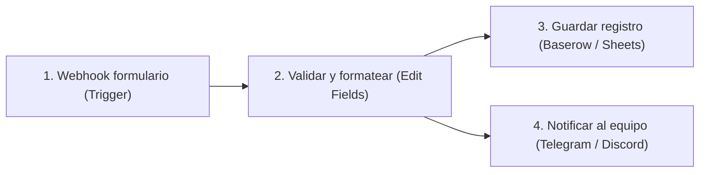
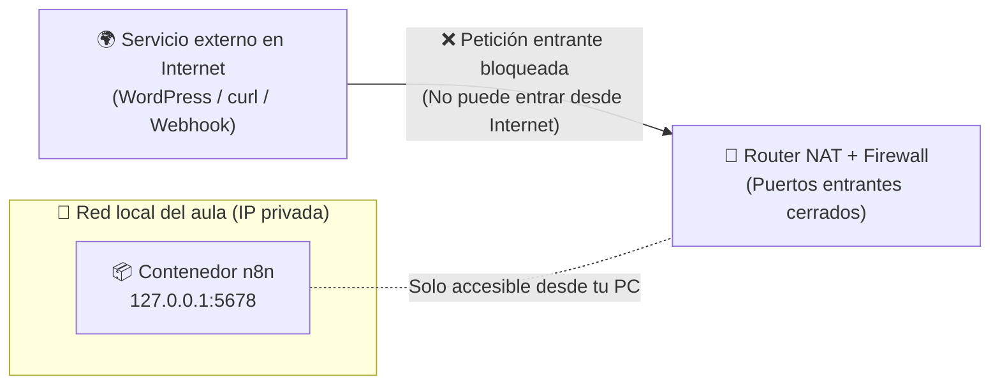
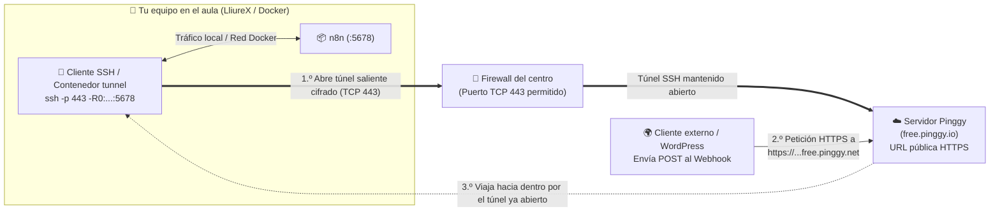
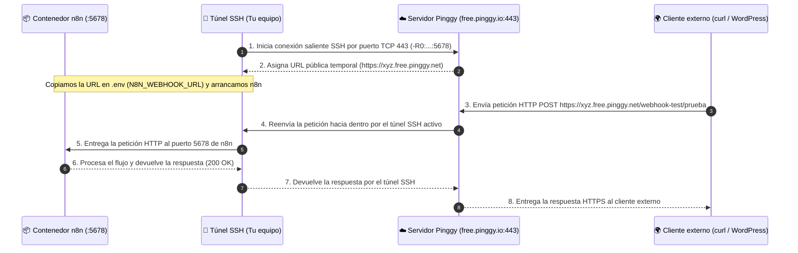
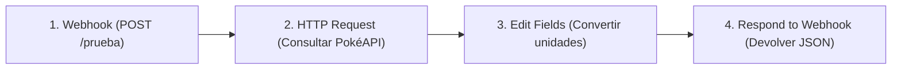



# Actividad 1. Despliegue de n8n y túnel público con Pinggy en Docker Compose

> [📖 **Apuntes: Introducción a Docker y Contenerización**](../apuntes)
{: .alert-info}

En esta primera actividad comprenderás qué es un **túnel inverso** y cómo permite publicar temporalmente un servicio local en Internet sin abrir puertos en el router del centro. Desplegarás **n8n Community** mediante **Docker Compose**, probarás primero un túnel **Pinggy** de forma manual por terminal mediante **SSH en el puerto 443** y después lo automatizarás como un servicio más dentro de tu `docker-compose.yml`. Finalmente, construirás tu primer flujo con un **Webhook** que consulta una API pública y verificarás la persistencia de datos del volumen **`n8n_data`**. En la **[Actividad 2](../actividad2)** conectaremos esta infraestructura con WordPress, Qdrant y un Agente de IA.

## 🎯 Objetivos

1. Verificar Docker en **LliureX** y distinguir imagen, contenedor, puerto, red interna y volumen.
2. Comprender qué es un **túnel inverso (SSH Remote Port Forwarding)**, por qué es necesario detrás de un router con NAT/cortafuegos y cómo funciona **Pinggy** sobre el puerto TCP `443`.
3. Probar primero el túnel de **Pinggy de forma manual** desde la terminal de LliureX (`ssh -p 443 -R0:127.0.0.1:5678 free.pinggy.io`) y posteriormente **automatizarlo en `docker-compose.yml`** mediante un servicio `tunnel` conectado a la red interna de Docker (`n8n:5678`).
4. Aplicar el protocolo de inicio de sesión: levantar primero el túnel de Pinggy, registrar su URL temporal en `.env` y levantar o actualizar después `n8n`.
5. Construir un flujo de prueba en n8n (`Webhook` → `HTTP Request` → `Edit Fields` → `Respond to Webhook`) y probarlo mediante `curl` a través de la URL pública HTTPS de Pinggy.
6. Comprobar la persistencia del volumen Docker (`n8n_data`) al eliminar los contenedores y simular el cambio o caducidad de la URL temporal del túnel.

## 💡 ¿Qué es n8n?

> **n8n** es una plataforma de automatización visual, con código fuente disponible y licencia *fair-code*. Cada nodo representa un disparador, una transformación o una acción. Los datos circulan normalmente en formato **JSON**. Un **webhook** es una dirección que recibe peticiones HTTP y puede iniciar un flujo.
{: .alert-info}

### Ejemplo de flujo real: Gestión de incidencias o consultas web

Para entender cómo opera n8n en entornos reales, veamos un caso habitual de automatización: la recepción y tramitación de un formulario de soporte o contacto desde una web.



En este flujo intervienen los tres tipos esenciales de nodos:

1. **Disparador (*Trigger* — `Webhook`):** Se activa en cuanto un usuario envía el formulario en la web. La página realiza una petición HTTP `POST` a la URL del webhook de n8n entregando los datos en formato **JSON**:
   ```json
   {
     "nombre": "Lucía",
     "email": "lucia@ejemplo.com",
     "asunto": "Incidencia de acceso",
     "mensaje": "No puedo entrar al aula virtual"
   }
   ```
2. **Transformación y lógica (`Edit Fields` / `If`):** n8n recoge los datos, comprueba que los campos obligatorios contengan información, añade una marca de tiempo (`timestamp`) y asigna la prioridad según el asunto.
3. **Acciones (*Actions* en paralelo):**
   * **Persistencia:** Inserta automáticamente una fila en una base de datos (**Baserow** o **Google Sheets**) para conservar el histórico.
   * **Notificación instantánea:** Lanza un mensaje al canal del equipo técnico en **Telegram** o **Discord** avisando del nuevo ticket:  
     *`🔔 Nueva incidencia de Lucía (lucia@ejemplo.com): "No puedo entrar al aula virtual"`*.


---

## 🌐 ¿Qué es un túnel inverso y cómo funciona?

Cuando ejecutas **n8n** en tu ordenador del aula, el servicio escucha en **`localhost:5678`** (`127.0.0.1:5678`). Desde tu propio navegador puedes abrirlo sin problema, pero surge un obstáculo fundamental cuando un servicio externo en Internet (como un sitio **WordPress** alojado en un servidor externo, un bot de **Telegram** o una pasarela de pago) necesita enviar datos a un **Webhook** de tu n8n: **Internet no sabe cómo llegar a tu ordenador de clase**.

### 1. El problema: NAT y cortafuegos en la red del aula

En una red local doméstica o educativa, todos los ordenadores comparten una salida a Internet a través de un router con **NAT (*Network Address Translation*)** y un **cortafuegos (*Firewall*)**:

* **Las conexiones salientes están permitidas:** tu ordenador puede conectarse hacia fuera a páginas web o servidores por el puerto TCP `443` (HTTPS).
* **Las conexiones entrantes están bloqueadas:** si un servidor de Internet intenta conectarse desde fuera a tu ordenador, el router/cortafuegos del centro rechaza el paquete porque no hay ningún puerto abierto (*Port Forwarding*) que apunte a tu IP privada del aula (`192.168.x.x` o `10.x.x.x`).
* Además, los túneles que utilizan puertos de salida no estándar (distintos del `80` o `443`) suelen estar bloqueados por los cortafuegos corporativos o educativos.



### 2. La solución: un túnel inverso con Pinggy sobre el puerto 443

Un **túnel inverso (*Reverse Tunnel*)** da la vuelta al sentido de la conexión:

1. **Conexión saliente desde dentro hacia fuera:** En lugar de esperar una conexión entrante, **tu propio equipo inicia una conexión saliente cifrada mediante SSH a través del puerto TCP `443`** hacia el servidor público **`free.pinggy.io`**. Como la conexión nace desde dentro del aula hacia el puerto `443` (el puerto estándar de HTTPS), el cortafuegos la permite y mantiene abierto ese canal bidireccional.
2. **Asignación de una URL pública HTTPS temporal:** El servidor de Pinggy te asigna al instante una dirección pública en Internet (por ejemplo, `https://ejemplo.free.pinggy.net` o `https://ejemplo.run.pinggy-free.link`), válida durante **60 minutos** en su modalidad gratuita sin registro.
3. **Reenvío inverso de puertos (*Remote Port Forwarding*):** Cuando alguien en Internet hace una petición HTTPS a esa URL pública, el servidor de Pinggy recibe la petición, la introduce por el túnel SSH que ya tenías abierto y la entrega directamente a tu `n8n` en el puerto `5678`.



### 3. Secuencia paso a paso de una petición por el túnel

Observa en este diagrama de secuencia cómo viaja la información desde que abres el túnel hasta que `n8n` devuelve la respuesta al exterior:



### 4. Anatomía del comando de Pinggy

Para abrir un túnel con Pinggy no hace falta instalar programas propietarios ni crear cuentas: utiliza el cliente **OpenSSH (`ssh`)** que ya viene integrado en cualquier distribución Linux (y en contenedores ligeros como Alpine). Desglosemos qué hace cada parte del comando:

```bash
ssh -p 443 -R0:127.0.0.1:5678 free.pinggy.io
```

| Fragmento | Qué significa |
| :--- | :--- |
| **`ssh`** | Ejecuta el cliente estándar de conexión cifrada *Secure Shell*. |
| **`-p 443`** | Conecta al servidor de Pinggy usando el **puerto TCP `443`** en lugar del puerto SSH tradicional (`22`), que suele estar bloqueado en redes educativas o corporativas. |
| **`-R0:127.0.0.1:5678`** | Activa el **reenvío inverso de puertos (*Remote Port Forwarding*, `-R`)**. El `0` pide a Pinggy que asigne dinámicamente un puerto/subdominio público libre y redirija todo lo que llegue a él hacia `127.0.0.1:5678` (o hacia `n8n:5678` cuando lo ejecutemos dentro de la red interna de Docker). |
| **`free.pinggy.io`** | Servidor público gratuito de Pinggy. Genera túneles HTTPS temporales de **60 minutos** sin necesidad de registro. |

> **En esta actividad lo haremos en dos fases:**
> 1. **Primero de forma manual en la terminal de LliureX** (`ssh -p 443 -R0:127.0.0.1:5678 free.pinggy.io`), para ver en directo cómo se abre el túnel y cómo responde `n8n`.
> 2. **Después automatizado dentro de `docker-compose.yml`**, añadiendo un servicio `tunnel` que se conecte directamente a `n8n:5678` por la red interna de Docker sin tener que dejar una terminal ocupada.
{: .alert-info}

---

## 📌 Paso a paso

### Paso 1: Verificar Docker y preparar la carpeta

1. Abre una terminal en LliureX (`Ctrl + Alt + T`):
   ```bash
   docker --version
   docker compose version
   docker run --rm hello-world
   ```
2. Si falta Docker o aparece un error de permisos con su socket, consulta al profesor. No cambies permisos del sistema por tu cuenta.
3. Prepara la carpeta del proyecto:
   ```bash
   mkdir -p ~/docker-n8n
   cd ~/docker-n8n
   ```
4. Prepara una carpeta en **Bitwarden** donde guardarás la cuenta de propietario de n8n cuando la crees.

**Comprobación:** `hello-world` funciona y estás situado en `~/docker-n8n`.

---

### Paso 2: Desplegar `n8n` y probar primero el túnel de Pinggy de forma manual

Antes de automatizar el túnel dentro de Docker Compose, vamos a levantar primero el contenedor de **`n8n`** y abrir el túnel de **Pinggy manualmente desde la terminal de LliureX**. Así comprobarás de forma visual cómo funciona el reenvío inverso hacia `127.0.0.1:5678`.

#### A. Crear el archivo `docker-compose.yml` inicial con `n8n`

Dentro de `~/docker-n8n`, abre el editor `nano`:

```bash
nano docker-compose.yml
```

Pega la configuración inicial con el servicio `n8n` y su volumen persistente `n8n_data`:

```yaml
services:
  n8n:
    image: docker.n8n.io/n8nio/n8n:latest
    restart: unless-stopped
    ports:
      - "127.0.0.1:5678:5678"
    environment:
      N8N_HOST: localhost
      N8N_PORT: 5678
      N8N_PROTOCOL: http
      NODE_ENV: production
      GENERIC_TIMEZONE: Europe/Madrid
      TZ: Europe/Madrid
      N8N_WEBHOOK_URL: ${N8N_WEBHOOK_URL:-http://localhost:5678/}
      N8N_PROXY_HOPS: 1
    volumes:
      - n8n_data:/home/node/.n8n

volumes:
  n8n_data:
```

*(Guarda con `Ctrl + O`, pulsa `Enter` y sal con `Ctrl + X`)*.

Arranca `n8n` y comprueba que está en marcha:

```bash
docker compose up -d
docker compose ps
```

1. Abre **`http://localhost:5678`** en tu navegador.
2. Crea tu **cuenta de propietario** y guarda inmediatamente el correo y la contraseña robusta en **Bitwarden**.
3. Completa el asistente inicial; las preguntas de perfil son opcionales.

#### B. Abrir el túnel de Pinggy manualmente desde la terminal

Ahora que `n8n` está escuchando en `127.0.0.1:5678`, abre una **segunda pestaña o ventana de terminal** en LliureX y ejecuta el comando de Pinggy:

```bash
ssh -p 443 -R0:127.0.0.1:5678 free.pinggy.io
```

1. Si es la primera vez que te conectas y SSH te pregunta `Are you sure you want to continue connecting (yes/no/[fingerprint])?`, escribe **`yes`** y pulsa `Enter`.
2. Si te pide contraseña (*password*), simplemente pulsa **`Enter`** (dejándola vacía).
3. En un par de segundos aparecerá en tu terminal la pantalla interactiva de Pinggy mostrándote las **URLs públicas HTTPS** asignadas a tu túnel (por ejemplo, `https://xxxxx-213-0-87-106.free.pinggy.net` o `https://xxxxx.run.pinggy-free.link`):

```text
You are not authenticated.
Your tunnel will expire in 60 minutes.
https://ejemplo-aula.free.pinggy.net
https://ejemplo-aula.run.pinggy-free.link
```

4. **Comprueba que funciona:** copia cualquiera de las direcciones **`https://...`** que muestra la terminal y ábrela en una pestaña nueva del navegador (o desde el navegador de tu móvil conectado a datos móviles). ¡Verás que carga tu instancia de `n8n` a través de Internet y que en la terminal de Pinggy aparecen registradas en tiempo real las peticiones HTTP entrantes!
5. Cuando hayas comprobado cómo llegan las peticiones en directo a la terminal, **cierra el túnel manual pulsando `Ctrl + C`** en esa ventana de terminal.

> **¿Por qué vamos a dar un paso más y meter el túnel dentro de `docker-compose.yml`?**
> Porque con el método manual tendrías que mantener una ventana de terminal abierta toda la clase y el tráfico pasa por el puerto publicado del host (`127.0.0.1:5678`). Al integrarlo como un servicio **`tunnel`** en Docker Compose, el túnel correrá en segundo plano (`-d`), no bloqueará tu terminal y se comunicará con `n8n` directamente a través de la **red interna de Docker (`n8n:5678`)**.
{: .alert-info}

---

### Paso 3: Automatizar el servicio `tunnel` en `docker-compose.yml` con la IA

#### A. Qué infraestructura completa necesitamos y qué le vamos a pedir a la IA

**Docker Compose** lee el archivo YAML (`docker-compose.yml`) y orquesta todos nuestros contenedores y su red interna. Vamos a diseñar la arquitectura completa con dos servicios (`n8n` y `tunnel`):

1. **Servicio de comunicación externa (`tunnel`):**
   * Utilizaremos una imagen oficial ultraligera de Linux (**`alpine:latest`**, de apenas 4 MB) que instale el cliente `openssh-client` al arrancar y ejecute el comando `ssh` de Pinggy en segundo plano hacia el puerto `443`.
   * **Conexión por red interna (`-R0:n8n:5678`):** En lugar de apuntar a `127.0.0.1:5678`, dentro de Docker Compose los contenedores se ven entre sí por su nombre de servicio. Por tanto, el túnel apuntará a **`n8n:5678`**.
   * **Opciones para ejecución desatendida en segundo plano:**
     * `-o StrictHostKeyChecking=no`: evita que SSH se detenga preguntando `yes/no` al verificar la huella del servidor cuando arranca en segundo plano.
     * `-o ServerAliveInterval=30`: envía un paquete de latido (*keep-alive*) cada 30 segundos para evitar que el cortafuegos cierre el túnel por inactividad.
   * **Importante para el trabajo en varias sesiones:** Como la dirección gratuita de Pinggy cambia cada vez que se inicia el contenedor (y caduca a los 60 minutos), **al empezar cada clase levantaremos primero el servicio `tunnel`**, copiaremos su URL desde `docker compose logs tunnel` al archivo `.env` y **después arrancaremos `n8n`**. Por eso `tunnel` **no debe llevar `depends_on: n8n`** y tendrá `restart: "no"`.

2. **Servicio principal (`n8n`):**
   * Accesible en local únicamente desde tu propio equipo (`"127.0.0.1:5678:5678"`).
   * Volumen persistente `n8n_data` montado en `/home/node/.n8n`.
   * Lectura dinámica de `N8N_WEBHOOK_URL` desde el archivo `.env` (`${N8N_WEBHOOK_URL:-http://localhost:5678/}`) y `N8N_PROXY_HOPS=1`.

#### B. Generar el archivo con la IA

Escribe un **prompt claro y descriptivo centrado en los requisitos**:

```text
Actúa como administrador de sistemas Linux y experto en Docker. Necesito un archivo docker-compose.yml para una práctica en clase con dos servicios:

1. Servicio 'n8n':
   - Utiliza la imagen oficial de n8n Community (docker.n8n.io/n8nio/n8n:latest).
   - Por seguridad en la red del aula, debe ser accesible en local únicamente desde el navegador de este mismo equipo en el puerto 5678 (enlazado a 127.0.0.1).
   - Persistencia: monta un volumen llamado 'n8n_data' en /home/node/.n8n.
   - Configura la zona horaria en Europe/Madrid (TZ y GENERIC_TIMEZONE).
   - Configura N8N_HOST=localhost, N8N_PORT=5678, N8N_PROTOCOL=http, NODE_ENV=production y N8N_PROXY_HOPS=1.
   - Para la variable del webhook (N8N_WEBHOOK_URL), haz que lea el valor de un archivo .env y use por defecto http://localhost:5678/ si no está definida (${N8N_WEBHOOK_URL:-http://localhost:5678/}).
   - Debe reiniciarse automáticamente salvo que lo detengamos manualmente (unless-stopped).

2. Servicio 'tunnel' (Túnel inverso con Pinggy por SSH en el puerto 443):
   - Utiliza la imagen oficial ligera alpine:latest.
   - Ejecuta un comando con sh -c que instale openssh-client silenciosamente (apk add --no-cache openssh-client >/dev/null) y abra un túnel SSH hacia free.pinggy.io por el puerto 443 reenviando el tráfico al servicio n8n en el puerto 5678 (-R0:n8n:5678).
   - Añade las opciones de SSH -o StrictHostKeyChecking=no y -o ServerAliveInterval=30 para que funcione de forma desatendida en segundo plano sin pedir confirmación interactiva.
   - No publiques ningún puerto en el host ni pongas stdin_open/tty para que imprima la URL asignada en texto plano en los logs de Docker.
   - No pongas depends_on hacia n8n y configura restart: "no", porque en cada clase arrancaremos primero el túnel para anotar su URL temporal en .env antes de arrancar n8n.

Requisitos adicionales:
   - Usa la especificación moderna de Docker Compose (sin la directiva obsoleta 'version').
   - Declara el volumen n8n_data en la sección volumes.
   - Añade comentarios breves en español explicando cada sección.
```

Copia o actualiza el archivo `docker-compose.yml` dentro de `~/docker-n8n`:

```bash
nano docker-compose.yml
```

#### C. Comprender y revisar el archivo generado (y corregirlo)

**Que lo genere una IA no garantiza que sea seguro ni correcto.** Revisa bloque a bloque lo que ha devuelto la IA:

[](./imagenes/03-compose.svg)

##### 1. Los servicios, las imágenes y el reinicio

| Elemento | Qué significa | Qué comprobar y corregir |
| :--- | :--- | :--- |
| `services` | Agrupa las aplicaciones gestionadas por Compose: `n8n` y `tunnel`. | Comprueba que ambos servicios estén al mismo nivel de indentación. |
| `image` | La plantilla descargable con la que se creará cada contenedor. | Comprueba que utilice `docker.n8n.io/n8nio/n8n:latest` (o `n8nio/n8n:latest`) para n8n y `alpine:latest` para el servicio `tunnel`. |
| `restart: unless-stopped` en n8n | Docker reinicia n8n si cae o al reiniciar el PC, salvo que lo apagues expresamente. | Asegúrate de que n8n lo incluya. |
| `restart: "no"` en tunnel | No se reinicia solo. Las comillas evitan que el parser YAML interprete `no` como un valor booleano (`false`). | Comprueba que tenga `"no"` y que **no incluya `depends_on: n8n`**, para poder levantar el túnel antes que n8n. |

##### 2. Los puertos y los dos significados de localhost

[](./imagenes/04-puertos-red.svg)

La línea de `ports` se lee **dirección IP del equipo : puerto del equipo : puerto del contenedor**:

* **`127.0.0.1`** limita la escucha a la dirección de *loopback* (tu propio ordenador).
  > ⚠️ **Corrección crítica:** Si la IA escribió `ports: - "5678:5678"` o `"0.0.0.0:5678:5678"`, **cámbialo inmediatamente a `"127.0.0.1:5678:5678"`**. Si no especificas `127.0.0.1`, Docker publica el puerto en todas las interfaces de red del equipo y cualquier ordenador del aula podría conectarse a tu n8n.
* El **primer `5678`** es el puerto al que te conectas desde el navegador de tu LliureX; el **segundo `5678`** es el puerto en el que escucha n8n dentro del contenedor.
* **Red interna de Docker:** Compose crea una red interna automática donde los servicios se comunican entre sí usando su propio nombre como nombre de dominio. Por eso, mientras en la prueba manual desde tu terminal de LliureX pusimos `-R0:127.0.0.1:5678`, **dentro del contenedor `tunnel` debemos poner `-R0:n8n:5678`**. Si el contenedor `tunnel` usara `127.0.0.1` o `localhost`, se buscaría a sí mismo dentro de su propio contenedor Alpine y daría error de conexión rechazada.

##### 3. Las variables de entorno de n8n

<details markdown="1" style="cursor: pointer;">
<summary style="cursor: pointer;">🔎 <strong>Qué significa cada variable generada</strong></summary>

| Variable y valor | Para qué sirve |
| :--- | :--- |
| `N8N_HOST: localhost` | Nombre de host que utiliza n8n internamente para su configuración de acceso local. |
| `N8N_PORT: 5678` | Puerto interno en el que n8n escucha dentro del contenedor. |
| `N8N_PROTOCOL: http` | Protocolo en el montaje local (HTTP). El túnel público externo de Pinggy usará HTTPS. |
| `NODE_ENV: production` | Modo de ejecución de la aplicación Node.js. |
| `GENERIC_TIMEZONE: Europe/Madrid` | Zona horaria para la ejecución de flujos programados en n8n. |
| `TZ: Europe/Madrid` | Zona horaria del contenedor del sistema operativo. |
| `N8N_WEBHOOK_URL` | Dirección base que n8n muestra al crear webhooks. |
| `N8N_PROXY_HOPS: 1` | Indica a n8n que confíe en un salto de proxy inverso (el túnel de Pinggy). |

La expresión **`${N8N_WEBHOOK_URL:-http://localhost:5678/}`** utiliza la sintaxis de sustitución por defecto de Compose:

* Si existe un archivo `.env` con la variable `N8N_WEBHOOK_URL`, Compose le pasará a n8n esa URL pública del túnel de Pinggy.
* Si no existe o está vacía, Compose aplica lo que va tras `:-` (`http://localhost:5678/`).

> ⚠️ **Corrección:** Si la IA puso simplemente `N8N_WEBHOOK_URL: http://localhost:5678/` fijo, cámbialo a `${N8N_WEBHOOK_URL:-http://localhost:5678/}` para que lea automáticamente el archivo `.env`.
{: .alert-info}

</details>

##### 4. El volumen y el comando del túnel automatizado

* **`n8n_data:/home/node/.n8n`** y `volumes: n8n_data:` aseguran que la base de datos SQLite de n8n, tu cuenta y tus flujos persistan en el anfitrión aunque destruyas el contenedor.
* **`ssh -p 443 -o StrictHostKeyChecking=no -o ServerAliveInterval=30 -R0:n8n:5678 free.pinggy.io`:** abre el túnel SSH hacia Pinggy por el puerto `443` sin pedir confirmación interactiva y reenvía las peticiones al servicio `n8n` dentro de la red de Docker. *(Nota importante: al no incluir `tty: true` en el contenedor, Pinggy desactiva su interfaz gráfica de consola y escribe las URLs directamente como texto limpio en `docker compose logs tunnel`).*

<details markdown="1" style="cursor: pointer;">
<summary style="cursor: pointer;">👁️ <strong>Archivo de referencia para cotejar y corregir el resultado</strong></summary>

```yaml
services:
  n8n:
    image: docker.n8n.io/n8nio/n8n:latest
    restart: unless-stopped
    ports:
      - "127.0.0.1:5678:5678"
    environment:
      N8N_HOST: localhost
      N8N_PORT: 5678
      N8N_PROTOCOL: http
      NODE_ENV: production
      GENERIC_TIMEZONE: Europe/Madrid
      TZ: Europe/Madrid
      N8N_WEBHOOK_URL: ${N8N_WEBHOOK_URL:-http://localhost:5678/}
      N8N_PROXY_HOPS: 1
    volumes:
      - n8n_data:/home/node/.n8n

  tunnel:
    image: alpine:latest
    restart: "no"
    command: >
      sh -c "apk add --no-cache openssh-client >/dev/null &&
      ssh -p 443 -o StrictHostKeyChecking=no -o ServerAliveInterval=30 -R0:n8n:5678 free.pinggy.io"

volumes:
  n8n_data:
```

</details>

Valida que la sintaxis del YAML no tenga ningún error antes de continuar:

```bash
docker compose config --quiet
```

`config --quiet` no muestra nada si el archivo es válido. Corrige cualquier error antes de pasar al siguiente apartado.

---

### Paso 4: Orden de arranque en cada clase (1.º Túnel → 2.º `.env` → 3.º n8n)

[](./imagenes/06-tunel.svg)

Los túneles gratuitos de Pinggy (`free.pinggy.io`) no requieren cuenta, pero **duran 60 minutos y generan un subdominio aleatorio nuevo cada vez que se inicia el contenedor `tunnel`**.

Por eso, **al empezar cada clase (o si pasan más de 60 minutos y caduca el túnel) seguiremos siempre este orden de tres pasos**: primero levantamos `tunnel`, después anotamos su URL en `.env` y por último arrancamos o actualizamos `n8n` para que tome esa dirección pública.

#### A. Paso 1: Levantar el contenedor del túnel y obtener la URL de Pinggy

Desde `~/docker-n8n`, arranca el servicio `tunnel` y revisa sus registros:

```bash
docker compose up -d tunnel
docker compose ps
docker compose logs --tail=30 tunnel
```

Espera unos 3–5 segundos mientras instala `openssh-client` y conecta con Pinggy. Al ejecutar `docker compose logs --tail=30 tunnel`, verás al final las dos URLs públicas HTTPS que te ha asignado Pinggy:

```text
Allocated port 5 for remote forward to n8n:5678
You are not authenticated.
Your tunnel will expire in 60 minutes. Upgrade to Pinggy Pro to get unrestricted tunnels. https://dashboard.pinggy.io
https://ejemplo-subdominio.free.pinggy.net
https://ejemplo-subdominio.run.pinggy-free.link
```

*(Si aún no aparecen las líneas `https://...`, espera 3 segundos más y vuelve a ejecutar `docker compose logs --tail=30 tunnel`).* Puedes copiar cualquiera de las dos URLs HTTPS (`https://....free.pinggy.net` o `https://....run.pinggy-free.link`).

> **Uso en la práctica:** El túnel publica tu instancia de n8n en Internet, incluido el acceso al editor cuando `n8n` esté en marcha. HTTPS cifra la comunicación, pero no sustituye una contraseña robusta ni protege un webhook sin autenticación. No difundas la URL y mantén el túnel abierto solo durante las pruebas de clase.
{: .alert-warning}

#### B. Paso 2: Guardar la URL del túnel en el archivo `.env`

Crea o edita el archivo `.env` dentro de `~/docker-n8n`:

```bash
nano .env
```

Escribe la siguiente línea sustituyendo el dominio por la URL `https://...` que te acaba de mostrar Pinggy y **asegurándote de terminar con la barra final `/`**:

```dotenv
N8N_WEBHOOK_URL=https://ejemplo-subdominio.free.pinggy.net/
```

*(Guarda con `Ctrl + O`, `Enter` y sal con `Ctrl + X`).*

#### C. Paso 3: Arrancar (o actualizar) `n8n` con la nueva variable

Ahora que `.env` ya tiene la URL pública de Pinggy, aplica los cambios a `n8n`:

```bash
docker compose up -d n8n
docker compose ps
docker compose logs --tail=30 n8n
```

*(Como Docker Compose detecta que `N8N_WEBHOOK_URL` ha cambiado en `.env`, recreará automáticamente el contenedor `n8n` conservando intactos todos tus datos del volumen `n8n_data`).*

---

### Paso 5: Construir tu primer flujo en n8n y probarlo por el túnel de Pinggy con `curl`

Vamos a comprobar que tanto `n8n` como el túnel automatizado de Pinggy funcionan construyendo un flujo sencillo que reciba el nombre de un Pokémon mediante `curl`, consulte en tiempo real la API pública de **PokéAPI** (que devuelve la altura en decímetros y el peso en hectogramos), convierta esas unidades al sistema métrico habitual y nos devuelva una ficha limpia con su imagen:



#### A. Construir los 4 nodos del flujo

1. En el panel de n8n (`http://localhost:5678`), pulsa **Create Workflow** y llámalo **Primera práctica**.
2. **Nodo 1 — Recibir la petición (`Webhook`):**
   * Pulsa **`+`** en el lienzo, busca **Webhook** y selecciónalo.
   * **HTTP Method:** `POST`.
   * **Path:** `prueba`.
   * **Respond:** `Using 'Respond to Webhook' Node`.
   * **Fíjate en las Webhook URLs:** Al desplegar **Webhook URLs**, comprobarás que la **Test URL** y la **Production URL** ya muestran automáticamente tu dominio de Pinggy `https://ejemplo-subdominio.free.pinggy.net/webhook-test/prueba` gracias al archivo `.env`.
3. **Nodo 2 — Consultar la API pública (`HTTP Request`):**
   * Vuelve al lienzo, pulsa el **`+`** que sale a la derecha del Webhook y añade el nodo **HTTP Request**.
   * **Method:** `GET`.
   * **URL:** activa el modo **Expression** (`fx`) y escribe:
     ```text
     https://pokeapi.co/api/v2/pokemon/{{ $json.body.pokemon.toLowerCase() }}
     ```
     *(Así n8n tomará el nombre que enviemos por `curl` y lo insertará directamente en la dirección de la API).*
4. **Nodo 3 — Procesar y limpiar los datos (`Edit Fields`):**
   * Pulsa el **`+`** a la derecha de **HTTP Request** y añade el nodo **Edit Fields (Set)**.
   * En **Fields to Set**, pulsa **Add Field** y añade estos cinco campos de tipo **String** activando **Expression** (`fx`) en cada valor:
     * **`ficha`**: `{{ $json.name.toUpperCase() }} (#{{ $json.id }})` *(pone el nombre en mayúsculas junto a su número de Pokédex)*.
     * **`altura`**: `{{ $json.height / 10 }} metros` *(convierte los decímetros de la API a metros)*.
     * **`peso`**: `{{ $json.weight / 10 }} kg` *(convierte los hectogramos de la API a kilogramos)*.
     * **`tipo_principal`**: `{{ $json.types[0].type.name }}` *(extrae el primer tipo del array devuelto por la API)*.
     * **`imagen`**: `{{ $json.sprites.front_default }}` *(extrae la URL del sprite oficial del Pokémon)*.
5. **Nodo 4 — Devolver la respuesta (`Respond to Webhook`):**
   * Pulsa el **`+`** a la derecha de **Edit Fields** y añade el nodo **Respond to Webhook**.
   * Deja **Respond With** en `First Incoming Item` para que devuelva el JSON ya procesado.

#### B. Probar el flujo a través del túnel público de Pinggy

1. Abre el nodo **Webhook** y pulsa el botón **Listen for test event** (n8n se quedará esperando tu llamada).
2. Abre una terminal en LliureX y lanza esta petición `POST` con `curl` apuntando **a tu URL pública de Pinggy** (sustituye el dominio de ejemplo por el tuyo; usamos `tee` para ver el resultado en pantalla y guardarlo a la vez en `pokemon.json`):

```bash
curl -s -X POST https://ejemplo-subdominio.free.pinggy.net/webhook-test/prueba \
  -H "Content-Type: application/json" \
  -d '{"pokemon": "snorlax"}' | tee pokemon.json
```

3. Tu petición saldrá a Internet, entrará por el servidor de Pinggy y viajará por el túnel SSH hasta el contenedor `tunnel`, pasará por la red interna de Docker hasta `n8n:5678`, consultará la PokéAPI y te devolverá en la terminal el JSON limpio:

```json
{
  "ficha": "SNORLAX (#143)",
  "altura": "2.1 metros",
  "peso": "460 kg",
  "tipo_principal": "normal",
  "imagen": "https://raw.githubusercontent.com/PokeAPI/sprites/master/sprites/pokemon/143.png"
}
```

4. Ahora extrae automáticamente la URL del campo `imagen` desde `pokemon.json`, descarga el PNG y ábrelo en el visor de LliureX con un solo comando:

```bash
curl -sL "$(grep -o 'https://[^"]*' pokemon.json)" -o pokemon.png && xdg-open pokemon.png
```

5. Regresa a la pestaña de n8n: verás los cuatro nodos marcados en verde y podrás hacer clic en **HTTP Request** y **Edit Fields** para comparar el JSON gigante que devolvió la API original con el resumen limpio que has generado. **Guarda el flujo** pulsando **Save**.

---

### Paso 6: Verificar la persistencia del volumen y simular el cambio de clase

[](./imagenes/11-persistencia.svg)

Para terminar esta actividad, vamos a simular que acaba la clase de hoy, se apagan los contenedores y volvemos el próximo día (o que han pasado los 60 minutos del túnel gratuito de Pinggy y necesitamos renovar su URL):

1. En la terminal, dentro de `~/docker-n8n`, detén y elimina los contenedores actuales:
   ```bash
   docker compose down
   ```
   > **¡Atención!** Nunca añadas `-v` a `docker compose down`, porque `-v` borraría el volumen `n8n_data` con tu cuenta y tus flujos.
   {: .alert-warning}

2. Ahora aplica el **protocolo de inicio de clase** como harás al comenzar la siguiente sesión:
   * **1.º Arranca el túnel y obtén la nueva URL de Pinggy:**
     ```bash
     docker compose up -d tunnel
     sleep 4
     docker compose logs --tail=30 tunnel
     ```
     Comprueba que Pinggy te ha asignado un dominio `https://....free.pinggy.net` **distinto** al anterior.
   * **2.º Actualiza `.env` con la nueva URL:**
     ```bash
     nano .env
     ```
     Sustituye el valor de `N8N_WEBHOOK_URL=` por la nueva URL de Pinggy (terminada en `/`) y guarda el archivo.
   * **3.º Arranca `n8n`:**
     ```bash
     docker compose up -d n8n
     ```
     *(Nota: si en mitad de una clase caducan los 60 minutos de Pinggy con `n8n` ya encendido, basta con ejecutar `docker compose restart tunnel`, mirar la nueva URL en `docker compose logs --tail=30 tunnel`, actualizar `.env` y ejecutar `docker compose up -d --no-deps n8n`).*

3. Entra en `http://localhost:5678` y verifica dos cosas:
   * Tu **cuenta de usuario** y el flujo **Primera práctica** siguen intactos gracias al volumen **`n8n_data`**.
   * Al abrir el nodo **Webhook**, la **Test URL** ya muestra el **nuevo dominio de Pinggy** y responde correctamente si vuelves a probarla con `curl`.

4. Cuando termines las comprobaciones y se lo muestres al profesor, detén el túnel (o ejecuta `docker compose down` sin `-v` si finaliza la sesión):
   ```bash
   docker compose stop tunnel
   ```

## 🛠️ Diagnóstico de problemas

| Síntoma | Qué comprobar |
| :--- | :--- |
| Error de YAML | Indentación con espacios, servicios y variables. Ejecuta `docker compose config --quiet`. |
| Al arrancar `tunnel` también arranca `n8n` | Quita `depends_on: - n8n` del servicio `tunnel` en `docker-compose.yml` para poder levantar primero el túnel en cada clase. |
| `docker compose logs tunnel` aún no muestra la URL `https://...` | Espera 4–5 segundos tras `docker compose up -d tunnel` (mientras Alpine descarga `openssh-client` y conecta con `free.pinggy.io`) y vuelve a consultar `docker compose logs --tail=30 tunnel`. |
| El túnel de Pinggy deja de responder tras 1 hora | La versión gratuita de Pinggy dura 60 minutos. Ejecuta `docker compose restart tunnel`, copia la nueva URL de `docker compose logs --tail=30 tunnel` en `.env` y lanza `docker compose up -d --no-deps n8n`. |
| n8n no abre | `docker compose ps` y `docker compose logs --tail=50 n8n`. Espera unos segundos al arranque y usa `http://localhost:5678`. |
| Túnel con error de conexión o `502 Bad Gateway` | `n8n` debe estar en ejecución y listo; dentro del contenedor `tunnel` el destino debe ser `-R0:n8n:5678` (red interna de Docker), mientras que en la prueba manual desde LliureX es `-R0:127.0.0.1:5678`. |
| Se sigue mostrando `http://localhost:5678` o la URL antigua en el Webhook | Revisa que `.env` tenga `N8N_WEBHOOK_URL=https://.../` con barra final, ejecuta `docker compose up -d --no-deps n8n` y recarga el navegador. |
| Webhook devuelve `404` | Asegúrate de haber pulsado **Listen for test event** antes de lanzar el `curl` contra `/webhook-test/prueba` y de usar `-X POST`. |

## 📤 Entrega y evaluación

Entrega en **Aules**:

1. **Informe PDF** con:
   * Captura de la prueba inicial manual del túnel de Pinggy en la terminal (`ssh -p 443 -R0:127.0.0.1:5678 free.pinggy.io`) mostrando las URLs asignadas.
   * `docker compose ps` mostrando los servicios `n8n` y `tunnel` en ejecución.
   * Captura de los logs del contenedor `tunnel` (`docker compose logs tunnel`) mostrando la URL temporal de Pinggy y del archivo `.env` configurado.
   * Captura del flujo **Primera práctica** en n8n con los 4 nodos en verde y de la terminal mostrando la respuesta JSON del `curl` a través de la URL de Pinggy junto con la imagen descargada del Pokémon.
   * Demostración del cambio de sesión (`docker compose down` → `up -d tunnel` → nuevo `.env` → `up -d n8n`) verificando que se conserva el flujo en `n8n_data` y se actualiza la URL del Webhook.
   * Respuestas breves:
     1. ¿Qué es un túnel inverso, por qué utilizamos el puerto TCP `443` con Pinggy en la red del aula y qué significa `-R0`?
     2. ¿Por qué en el comando manual usamos `-R0:127.0.0.1:5678` mientras que en el servicio `tunnel` de Docker Compose usamos `-R0:n8n:5678`?
     3. ¿Por qué en cada clase debemos levantar primero `tunnel`, editar `.env` y después levantar `n8n`?
     4. ¿Qué ocurre si ejecutamos `docker compose down` frente a `docker compose down -v`?
2. **`docker-compose.yml` utilizado** y el flujo **Primera práctica** exportado en formato `.json`.

## 📊 Rúbrica de evaluación (máx. 10 puntos)

| Criterio | Insuficiente | Básico | Adecuado | Excelente |
| :--- | :--- | :--- | :--- | :--- |
| **Docker Compose y seguridad local** (máx. 3 puntos) | **0 puntos:** El YAML no es válido o no arranca los contenedores. | **1 punto:** Arranca los contenedores, pero publica puertos en `0.0.0.0` o no comprende la red interna. | **2 puntos:** Configura `127.0.0.1:5678:5678`, la red interna y las variables, con explicaciones parciales. | **3 puntos:** Valida el YAML sin errores, enlaza puertos a `127.0.0.1`, guarda la cuenta en Bitwarden y explica con precisión puertos y red interna. |
| **Túnel de Pinggy (manual y Docker) y protocolo `.env`** (máx. 2,5 puntos) | **0 puntos:** No consigue levantar el túnel de Pinggy o no obtiene URL pública. | **1 punto:** Abre el túnel manual, pero no lo integra en Compose o n8n sigue mostrando `localhost` en sus webhooks. | **1,75 puntos:** Prueba el túnel manual, integra `tunnel` en Compose y configura `.env`, pero no sigue el orden óptimo al cambiar de sesión. | **2,5 puntos:** Realiza la prueba manual por SSH, automatiza el servicio `tunnel` en Compose, aplica el orden `1.º tunnel → 2.º .env → 3.º n8n` y explica cómo funciona el túnel inverso. |
| **Flujo Webhook + API pública con `curl`** (máx. 2,5 puntos) | **0 puntos:** No construye el flujo o no responde al webhook. | **1 punto:** El webhook responde, pero no consulta la API externa o no transforma los datos. | **1,75 puntos:** Consulta la PokéAPI y transforma los campos, pero solo lo prueba en local o no descarga la imagen. | **2,5 puntos:** Construye los 4 nodos, transforma las unidades con expresiones, prueba el webhook a través de la URL pública de Pinggy con `curl` y descarga la imagen. |
| **Persistencia (`n8n_data`)** (máx. 2 puntos) | **0 puntos:** Pierde los datos al recrear contenedores o no configura el volumen. | **0,75 puntos:** Configura `n8n_data`, pero no demuestra la recuperación tras `docker compose down`. | **1,5 puntos:** Demuestra que el flujo persiste tras `down` y `up`, pero no actualiza la nueva URL del túnel. | **2 puntos:** Demuestra la persistencia completa de cuenta y flujo tras `docker compose down` y actualiza la nueva URL de Pinggy en la nueva sesión. |
| **Entrega en plazo y documentación** (máx. 0 puntos) | **-2 puntos:** No entrega la actividad o realiza una entrega vacía o con retraso injustificado. | **-1,5 puntos:** Entrega con retraso importante o faltan evidencias clave. | **-1 punto:** Entrega con un pequeño retraso o documentación incompleta. | **0 puntos:** Entrega puntual en Aules con informe completo, `docker-compose.yml` y flujo `.json`. |

> La entrega dentro del plazo no resta puntuación. Las entregas con retraso supondrán una penalización de hasta 2 puntos sobre la calificación.
{: .alert-error}

## 📚 Recursos

* [Pinggy: Página oficial](https://pinggy.io/) y [Guía rápida para n8n con Pinggy](https://pinggy.io/quickstart/n8n/).
* [n8n: Webhook](https://docs.n8n.io/integrations/builtin/core-nodes/n8n-nodes-base.webhook/) y [HTTP Request](https://docs.n8n.io/integrations/builtin/core-nodes/n8n-nodes-base.httprequest/).
* [n8n: URL pública detrás de un proxy (`N8N_WEBHOOK_URL`)](https://docs.n8n.io/hosting/configuration/configuration-examples/webhook-url/).
* [Docker Compose](https://docs.docker.com/compose/) y [variables de .env](https://docs.docker.com/compose/how-tos/environment-variables/variable-interpolation/).
* [PokéAPI Documentation](https://pokeapi.co/docs/v2).


