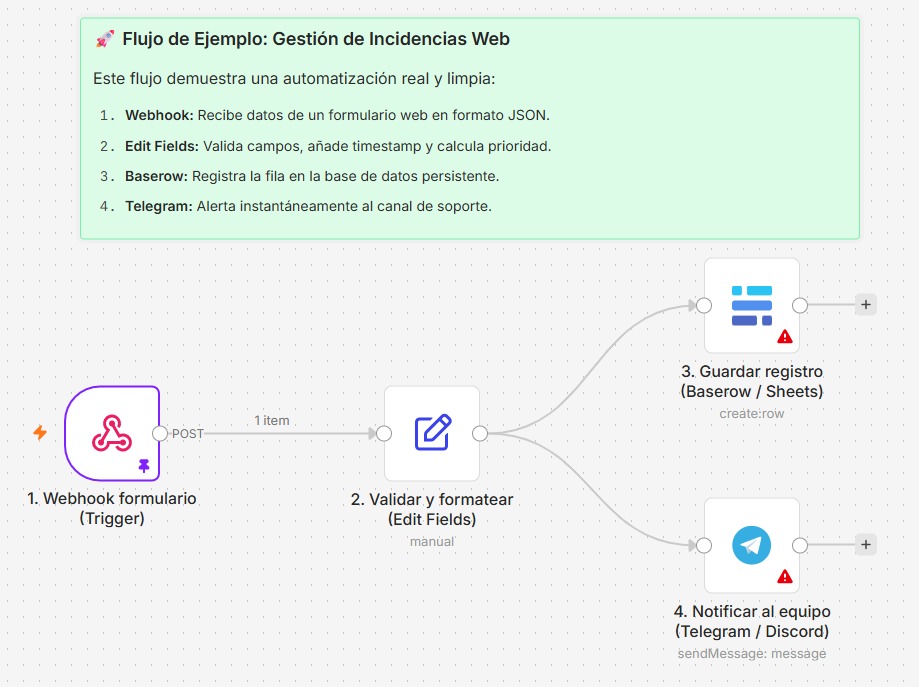
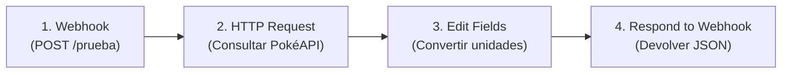
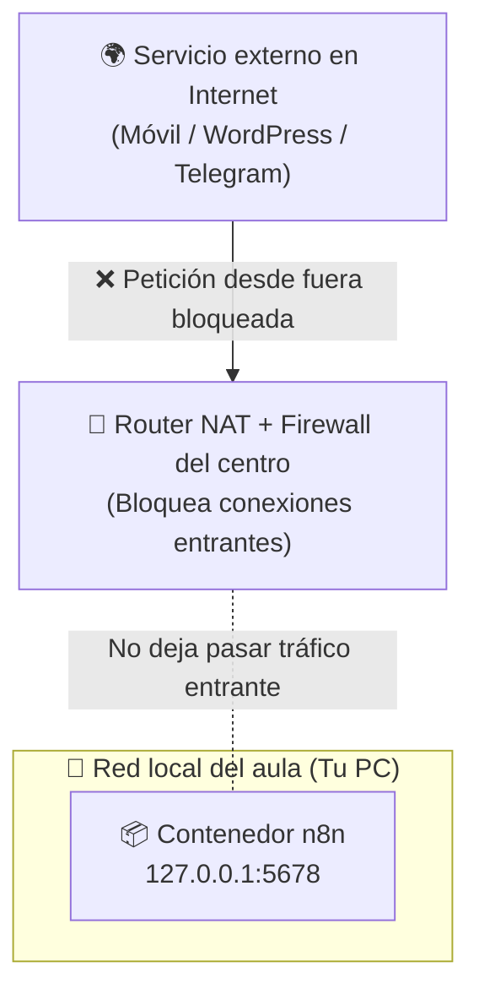
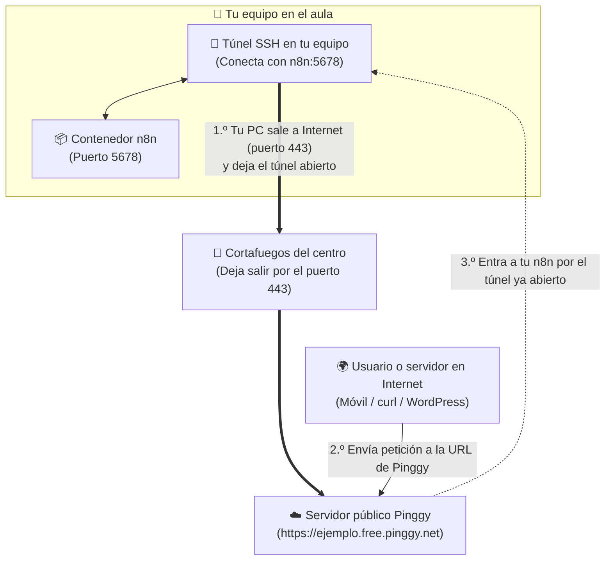
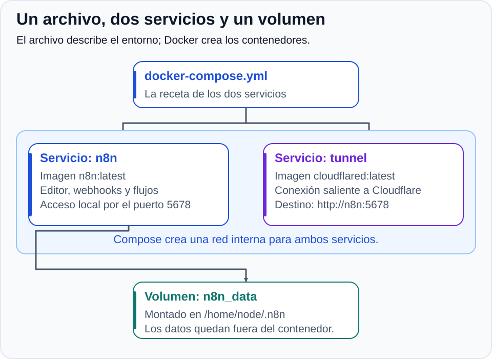
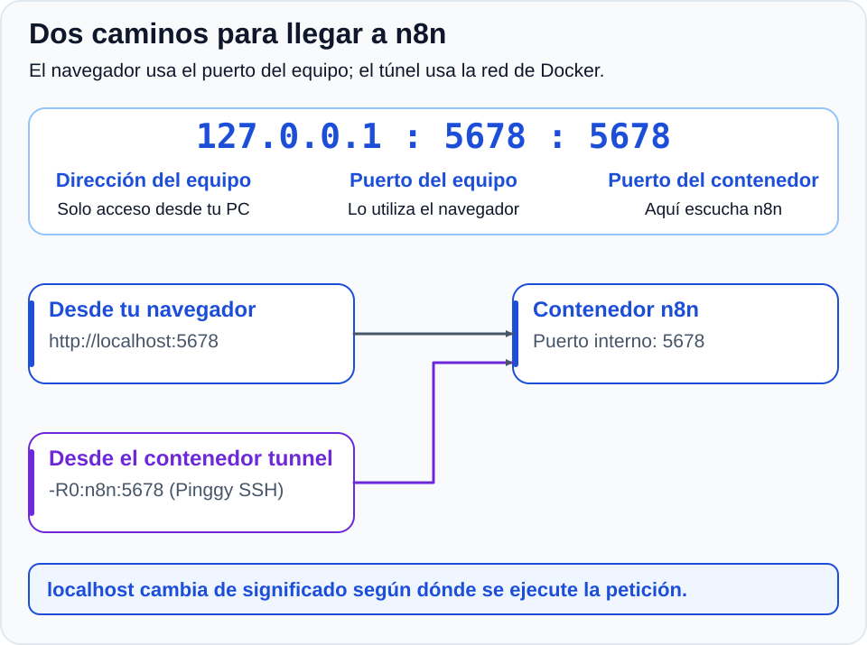
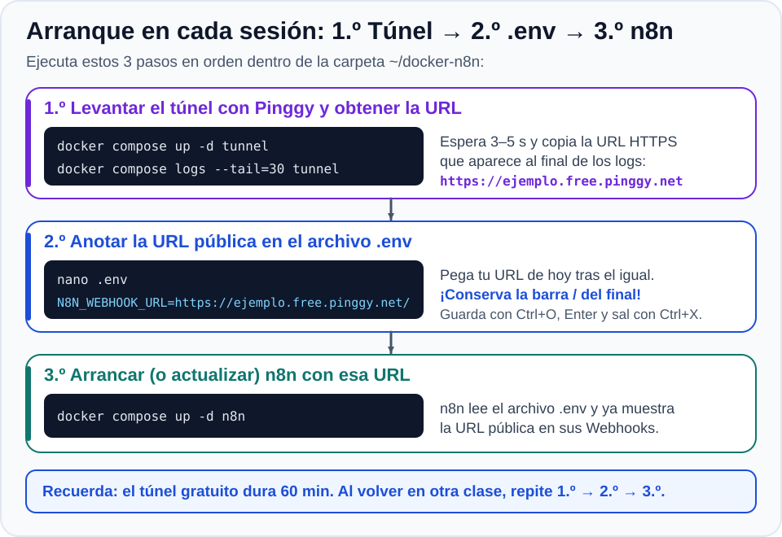



# Actividad 1. Despliegue de n8n y túnel público con Pinggy en Docker Compose

> [📖 **Apuntes: Introducción a Docker y Contenerización**](../apuntes)
{: .alert-info}

En esta primera actividad desplegarás **n8n Community** mediante **Docker Compose** y construirás tu primer flujo de automatización conectando un **Webhook** con la API pública de **PokéAPI**. Una vez que entiendas cómo funciona n8n en local, descubrirás qué es un **túnel inverso** y cómo permite publicar temporalmente tu servicio en Internet sin abrir puertos en el router del centro: primero lo probarás de forma manual por terminal con **Pinggy** y después lo automatizarás como un servicio más dentro de tu `docker-compose.yml`. A continuación, crearás una aplicación web sencilla (HTML, CSS y JS) con aspecto de **Pokédex** conectada al Webhook de n8n y, como reto final, crearás con ayuda de la IA un **segundo workflow/webhook** para ampliar tu Pokédex con nuevas funcionalidades. En la Actividad 2 conectaremos esta infraestructura con WordPress, Qdrant y un Agente de IA.

## 🎯 Objetivos

1. Verificar Docker en **LliureX** y distinguir imagen, contenedor, puerto, red interna y volumen.
2. Desplegar **n8n** con **Docker Compose**, comprendiendo cada directiva del archivo `docker-compose.yml`, y construir un primer flujo práctico (`Webhook` → `HTTP Request` → `Edit Fields` → `Respond to Webhook`) probándolo en local con `curl`.
3. Comprender de forma sencilla qué es un **túnel inverso**, por qué es necesario detrás del router/cortafuegos del aula y cómo funciona **Pinggy** sobre el puerto `443`.
4. Probar primero el túnel de **Pinggy de forma manual** desde la terminal (`ssh -p 443 -R0:127.0.0.1:5678 -t free.pinggy.io x:passpreflight`) y posteriormente **añadir el servicio `tunnel` en `docker-compose.yml`** conectado a la red interna de Docker (`n8n:5678`).
5. Aplicar el protocolo de inicio de sesión: levantar primero el túnel de Pinggy, registrar su URL temporal en `.env`, actualizar `n8n` y probar el flujo desde Internet.
6. Construir una aplicación web tipo **Pokédex** (HTML, CSS y JS) asistida por IA que envíe peticiones HTTP `POST` al Webhook de n8n (en local o a través de Pinggy) y muestre la ficha y la imagen del Pokémon devuelto.
7. Diseñar de forma autónoma con ayuda de la IA (apoyándote en la exportación `.json` de tu primer flujo) un **nuevo workflow con su propio Webhook en n8n** y ampliar la aplicación **Pokédex** para que utilice ese nuevo webhook e incorpore funcionalidades más allá de la búsqueda simple de un Pokémon.

## 💡 ¿Qué es n8n?

> **n8n** es una plataforma de automatización visual, con código fuente disponible y licencia *fair-code*. Cada nodo representa un disparador, una transformación o una acción. Los datos circulan normalmente en formato **JSON**. Un **webhook** es una dirección URL que recibe peticiones HTTP y puede iniciar un flujo automáticamente.
{: .alert-info}

### Ejemplo de flujo real: Gestión de incidencias o consultas web

Para entender cómo opera n8n en entornos reales, veamos un caso habitual de automatización: la recepción y tramitación de un formulario de soporte o contacto desde una web.



En este flujo intervienen los tres tipos esenciales de nodos:

1. **Disparador (*Trigger* — `Webhook`):** Se activa en cuanto un usuario envía el formulario en la web. La página realiza una petición HTTP `POST` a la URL del webhook de n8n entregando los datos en formato **JSON**:
   ```json
   {
     "nombre": "Lucía",
     "email": "lucia@ejemplo.com",
     "asunto": "Incidencia de acceso",
     "mensaje": "No puedo entrar al aula virtual"
   }
   ```
2. **Transformación y lógica (`Edit Fields` / `If`):** n8n recoge los datos, comprueba que los campos obligatorios contengan información, añade una marca de tiempo (`timestamp`) y asigna la prioridad según el asunto.
3. **Acciones (*Actions* en paralelo):**
   * **Persistencia:** Inserta automáticamente una fila en una base de datos (**Baserow** o **Google Sheets**) para conservar el histórico.
   * **Notificación instantánea:** Lanza un mensaje al canal del equipo técnico en **Telegram** o **Discord** avisando del nuevo ticket:  
     *`🔔 Nueva incidencia de Lucía (lucia@ejemplo.com): "No puedo entrar al aula virtual"`*.


---

## 📌 Parte 1: Desplegar n8n y crear nuestro primer flujo en local

Antes de preocuparnos por cómo exponer nuestro servidor a Internet, vamos a poner en marcha **n8n** en nuestro propio equipo y a construir un ejemplo práctico con la **PokéAPI** para entender cómo funcionan los nodos y los webhooks.

### Paso 1: Verificar Docker y preparar la carpeta

1. Abre una terminal en LliureX (`Ctrl + Alt + T`):
   ```bash
   docker --version
   docker compose version
   docker run --rm hello-world
   ```
2. Si falta Docker o aparece un error de permisos con su socket, consulta al profesor. No cambies permisos del sistema por tu cuenta.
3. Prepara la carpeta del proyecto:
   ```bash
   mkdir -p ~/docker-n8n
   cd ~/docker-n8n
   ```
4. Prepara una carpeta en **Bitwarden** donde guardarás la cuenta de propietario de n8n cuando la crees.

**Comprobación:** `hello-world` funciona y estás situado en `~/docker-n8n`.

---

### Paso 2: Desplegar `n8n` con Docker Compose

#### A. Crear el archivo `docker-compose.yml` inicial con `n8n`

Dentro de `~/docker-n8n`, abre el editor `nano`:

```bash
nano docker-compose.yml
```

Pega la configuración inicial con el servicio `n8n` y su volumen persistente `n8n_data`:

```yaml
services:
  n8n:
    image: docker.n8n.io/n8nio/n8n:latest
    restart: unless-stopped
    ports:
      - "127.0.0.1:5678:5678"
    environment:
      N8N_HOST: localhost
      N8N_PORT: 5678
      N8N_PROTOCOL: http
      NODE_ENV: production
      GENERIC_TIMEZONE: Europe/Madrid
      TZ: Europe/Madrid
      N8N_WEBHOOK_URL: ${N8N_WEBHOOK_URL:-http://localhost:5678/}
      N8N_PROXY_HOPS: 1
    volumes:
      - n8n_data:/home/node/.n8n

volumes:
  n8n_data:
```

*(Guarda con `Ctrl + O`, pulsa `Enter` y sal con `Ctrl + X`)*.

#### B. Qué significa cada bloque del archivo `docker-compose.yml`

Antes de arrancarlo, revisemos qué hace cada línea:

1. **Imagen y reinicio (`image` y `restart`):**
   * `image: docker.n8n.io/n8nio/n8n:latest`: descarga la imagen oficial de n8n Community.
   * `restart: unless-stopped`: indica a Docker que reinicie el contenedor automáticamente si se cierra por error o al encender el ordenador, salvo que nosotros lo paremos expresamente.
2. **Puertos y seguridad en el aula (`"127.0.0.1:5678:5678"`):**
   * Se lee **IP del equipo : puerto del equipo : puerto del contenedor**.
   * Al anteponer **`127.0.0.1`** (*localhost*), garantizamos que solo tu propio navegador pueda abrir tu n8n. Si pusiéramos solo `"5678:5678"`, cualquier compañero de la red del aula podría entrar a tu n8n poniendo tu IP privada.
3. **Variables de entorno (`environment`):**

   <details markdown="1" style="cursor: pointer;">
   <summary style="cursor: pointer;">🔎 <strong>Ver qué significa cada variable de entorno de n8n</strong></summary>

   | Variable y valor | Para qué sirve |
   | :--- | :--- |
   | `N8N_HOST: localhost` | Nombre de host que utiliza n8n internamente para su configuración de acceso local. |
   | `N8N_PORT: 5678` | Puerto interno en el que n8n escucha dentro del contenedor. |
   | `N8N_PROTOCOL: http` | Protocolo en local (HTTP). Cuando más adelante usemos el túnel exterior, éste añadirá HTTPS. |
   | `NODE_ENV: production` | Modo de ejecución optimizado de la aplicación. |
   | `GENERIC_TIMEZONE` y `TZ` | Configuran la hora oficial de España (`Europe/Madrid`) para los flujos programados y el contenedor. |
   | `N8N_WEBHOOK_URL` | Dirección base que n8n utiliza al generar los enlaces de sus webhooks. |
   | `N8N_PROXY_HOPS: 1` | Permite que n8n funcione sin errores cuando más adelante reciba tráfico a través de un túnel. |

   La expresión **`${N8N_WEBHOOK_URL:-http://localhost:5678/}`** es muy útil:
   * Si todavía **no** existe un archivo `.env` (como ahora mismo), usa por defecto lo que va después de `:-`, es decir, **`http://localhost:5678/`**.
   * Cuando más adelante creemos un archivo `.env` con la dirección pública del túnel, n8n la tomará automáticamente sin tener que modificar el `docker-compose.yml`.

   </details>

4. **Persistencia (`volumes` y `n8n_data`):**
   * `n8n_data:/home/node/.n8n` guarda la base de datos de n8n, tu usuario y todos tus flujos en un volumen gestionado por Docker llamado `n8n_data`, para que no se borren aunque destruyas el contenedor.

#### C. Arrancar `n8n` y crear tu cuenta

Valida que el archivo YAML no tenga errores de formato y arranca el contenedor:

```bash
docker compose config --quiet
docker compose up -d
docker compose ps
```

1. Abre **`http://localhost:5678`** en tu navegador.
2. Crea tu **cuenta de propietario** y guarda inmediatamente el correo y la contraseña robusta en **Bitwarden**.
3. Completa el asistente inicial; las preguntas de perfil son opcionales.

---

### Paso 3: Construir tu primer flujo en n8n con la PokéAPI (en local)

Vamos a construir un flujo que reciba el nombre de un Pokémon mediante un **Webhook**, consulte en tiempo real la API pública de **PokéAPI** (que devuelve la altura en decímetros y el peso en hectogramos), convierta esas unidades al sistema métrico habitual y nos devuelva una ficha limpia con su imagen:



#### A. Construir los 4 nodos del flujo

1. En el panel de n8n (`http://localhost:5678`), pulsa **Create Workflow** y llámalo **Primera práctica**.
2. **Nodo 1 — Recibir la petición (`Webhook`):**
   * Pulsa **`+`** en el lienzo, busca **Webhook** y selecciónalo.
   * **HTTP Method:** `POST`.
   * **Path:** `prueba`.
   * **Respond:** `Using 'Respond to Webhook' Node`.
   * En **Options**, pulsa **Add Option**, elige **Allowed Origins (CORS)** y asegúrate de que tenga el valor **`*`** *(imprescindible para que más adelante nuestra aplicación web Pokédex pueda hacer peticiones desde el navegador sin bloqueo por CORS)*.
   * *Fíjate en las Webhook URLs:* Al desplegar **Webhook URLs**, verás que por ahora muestra `http://localhost:5678/webhook-test/prueba`.
3. **Nodo 2 — Consultar la API pública (`HTTP Request`):**
   * Vuelve al lienzo, pulsa el **`+`** que sale a la derecha del Webhook y añade el nodo **HTTP Request**.
   * **Method:** `GET`.
   * **URL:** activa el modo **Expression** (`fx`) y escribe:
     ```text
     https://pokeapi.co/api/v2/pokemon/{{ $json.body.pokemon.toLowerCase() }}
     ```
     *(Así n8n tomará el nombre que enviemos por `curl` y lo insertará directamente en la dirección de la API).*
4. **Nodo 3 — Procesar y limpiar los datos (`Edit Fields`):**
   * Pulsa el **`+`** a la derecha de **HTTP Request** y añade el nodo **Edit Fields (Set)**.
   * En **Fields to Set**, pulsa **Add Field** y añade estos cinco campos de tipo **String** activando **Expression** (`fx`) en cada valor:
     * **`ficha`**: `{{ $json.name.toUpperCase() }} (#{{ $json.id }})` *(pone el nombre en mayúsculas junto a su número de Pokédex)*.
     * **`altura`**: `{{ $json.height / 10 }} metros` *(convierte los decímetros de la API a metros)*.
     * **`peso`**: `{{ $json.weight / 10 }} kg` *(convierte los hectogramos de la API a kilogramos)*.
     * **`tipo_principal`**: `{{ $json.types[0].type.name }}` *(extrae el primer tipo del array devuelto por la API)*.
     * **`imagen`**: `{{ $json.sprites.front_default }}` *(extrae la URL del sprite oficial del Pokémon)*.
5. **Nodo 4 — Devolver la respuesta (`Respond to Webhook`):**
   * Pulsa el **`+`** a la derecha de **Edit Fields** y añade el nodo **Respond to Webhook**.
   * Deja **Respond With** en `First Incoming Item` para que devuelva el JSON ya procesado.
6. Pulsa **Save** arriba a la derecha para guardar tu flujo.

#### B. Probar el flujo en local con `curl`

1. Abre el nodo **Webhook** y pulsa el botón **Listen for test event** (n8n se quedará esperando tu llamada).
2. Abre una terminal en LliureX y lanza esta petición `POST` con `curl` apuntando a tu `localhost:5678` (usamos `tee` para ver el resultado en pantalla y guardarlo a la vez en `pokemon.json`):

```bash
curl -s -X POST http://localhost:5678/webhook-test/prueba \
  -H "Content-Type: application/json" \
  -d '{"pokemon": "snorlax"}' | tee pokemon.json
```

3. Verás que n8n recibe la petición, consulta la PokéAPI en Internet y te devuelve en la terminal el JSON limpio:
{:start="3"}

```json
{
  "ficha": "SNORLAX (#143)",
  "altura": "2.1 metros",
  "peso": "460 kg",
  "tipo_principal": "normal",
  "imagen": "https://raw.githubusercontent.com/PokeAPI/sprites/master/sprites/pokemon/143.png"
}
```

4. Ahora extrae automáticamente la URL del campo `imagen` desde `pokemon.json`, descarga el PNG y ábrelo en el visor de LliureX con un solo comando:
{:start="4"}

```bash
curl -sL "$(grep -o 'https://[^"]*' pokemon.json)" -o pokemon.png && xdg-open pokemon.png
```

5. Regresa a la pestaña de n8n: verás los cuatro nodos marcados en verde y podrás hacer clic en **HTTP Request** y **Edit Fields** para comparar el JSON gigante que devolvió la API original con el resumen limpio que has generado.
{:start="5"}

---

## 🌐 Parte 2: ¿Qué es un túnel inverso y cómo funciona?

Tu flujo con la PokéAPI ya funciona cuando lo llamas desde tu propio ordenador (`http://localhost:5678`). Pero ¿qué pasa si quieres llamarlo desde tu teléfono móvil con datos, o cuando en la siguiente práctica un servidor externo en Internet (como un **WordPress** en la nube o un bot de **Telegram**) necesite enviar datos al **Webhook** de tu n8n? **Internet no sabe cómo llegar a tu ordenador de clase**.

### 1. El problema: NAT y cortafuegos en la red del aula

En una red local doméstica o educativa, todos los ordenadores comparten una salida a Internet a través de un router con **NAT (*Network Address Translation*)** y un **cortafuegos (*Firewall*)**:

* **Las conexiones salientes están permitidas:** tu ordenador puede conectarse hacia fuera a páginas web o servidores (como acaba de hacer n8n al consultar `pokeapi.co` por el puerto `443`).
* **Las conexiones entrantes están bloqueadas:** si alguien desde Internet intenta conectarse a tu ordenador, el router/cortafuegos del centro rechaza la petición porque no hay ningún puerto abierto que apunte a tu equipo del aula.
* Además, los cortafuegos educativos suelen bloquear cualquier puerto extraño que no sea el de navegación web estándar (`80` o `443`).



### 2. La solución sencilla: un túnel inverso con Pinggy

Si desde fuera no pueden entrar a buscarnos, **la solución es que nuestro ordenador salga primero a buscar al servidor exterior y deje un "tubo" (túnel) abierto**. Eso es un **túnel inverso**:

1. **Tu PC abre el camino desde dentro:** Ejecutamos un comando `ssh` que se conecta desde tu ordenador hacia el servidor público **`free.pinggy.io`** usando el **puerto `443`** (el mismo que usan las webs `https://`). Como la conexión sale desde dentro de clase por el puerto `443`, el cortafuegos del centro la deja pasar sin problema.
2. **Pinggy te da una dirección web pública:** Al conectarte, Pinggy te presta durante **60 minutos** una dirección web pública gratuita (por ejemplo, `https://ejemplo.free.pinggy.net`).
3. **Las peticiones entran por el tubo ya abierto:** Cuando alguien desde Internet escribe esa dirección de Pinggy, Pinggy recoge el mensaje y te lo envía hacia dentro aprovechando la conexión que tu ordenador mantiene abierta, entregándolo directamente a tu **n8n** en el puerto `5678`.



### 3. Anatomía del comando de Pinggy

Para abrir este túnel con Pinggy no hace falta instalar programas especiales ni registrarse: basta con el comando **`ssh`** que ya viene incluido en LliureX. Fíjate qué significa cada parte:

```bash
ssh -p 443 -R0:127.0.0.1:5678 -t free.pinggy.io x:passpreflight
```

| Fragmento | Qué significa de forma sencilla |
| :--- | :--- |
| **`ssh`** | Abre una conexión segura y cifrada con otro servidor. |
| **`-p 443`** | Usa el **puerto `443`** (el de las webs HTTPS) para que el cortafuegos del instituto no lo bloquee. |
| **`-R0:127.0.0.1:5678`** | **`-R`** significa **túnel inverso (*Reverse*)**: todo lo que llegue a la dirección pública que nos asigne Pinggy (`0`) se reenviará a nuestro **`127.0.0.1:5678`** (donde escucha n8n). |
| **`-t`** | Fuerza la asignación de una pseudo-terminal interactiva (*tty*) en SSH; es necesario ponerlo delante de `free.pinggy.io` cuando añadimos opciones extra al final del comando (como `x:passpreflight`), ya que sin `-t` SSH cree que solo queremos ejecutar un comando puntual y no inicia bien la sesión del túnel. |
| **`free.pinggy.io`** | Es el servidor gratuito de Pinggy (da una URL válida durante **60 minutos** sin registro). |
| **`x:passpreflight`** | Indica a Pinggy que deje pasar hasta nuestro `n8n` las peticiones previas de comprobación (**CORS *preflight* `OPTIONS`**) que hacen los navegadores web antes de enviar un `POST` con JSON (imprescindible para que funcione nuestra web Pokédex en la Parte 3). |

> **¿Cómo lo vamos a hacer ahora?**
> 1. **Primero lo probaremos manualmente en una terminal** para ver en directo cómo Pinggy nos da la URL pública.
> 2. **Después lo meteremos dentro de `docker-compose.yml`** como un servicio llamado `tunnel` para no tener que dejar una ventana de terminal ocupada.
{: .alert-info}

---

### Paso 4: Probar primero el túnel de Pinggy de forma manual

Con `n8n` ya encendido en `127.0.0.1:5678`, abre una **segunda pestaña o ventana de terminal** en LliureX y ejecuta el comando de Pinggy:

```bash
ssh -p 443 -R0:127.0.0.1:5678 -t free.pinggy.io x:passpreflight
```

1. Si es la primera vez que te conectas y SSH te pregunta `Are you sure you want to continue connecting (yes/no/[fingerprint])?`, escribe **`yes`** y pulsa `Enter`.
2. Si te pide contraseña (*password*), simplemente pulsa **`Enter`** (dejándola vacía).
3. En un par de segundos aparecerá en tu terminal la pantalla de Pinggy mostrándote las **URLs públicas HTTPS** asignadas a tu túnel:

```text
You are not authenticated.
Your tunnel will expire in 60 minutes.
https://ejemplo-aula.free.pinggy.net
https://ejemplo-aula.run.pinggy-free.link
```

4. **Comprueba que funciona:** copia cualquiera de las direcciones **`https://...`** que muestra la terminal y ábrela en el navegador, o pruébala en otra terminal con `curl` (pulsando antes **Listen for test event** en tu flujo de n8n y sustituyendo la URL por la tuya):
{:start="4"}

   ```bash
   curl -s -X POST https://ejemplo-aula.free.pinggy.net/webhook-test/prueba \
     -H "Content-Type: application/json" \
     -d '{"pokemon": "pikachu"}'
   ```

   ¡Verás que responde a través de Internet y que en la terminal de Pinggy aparecen las peticiones en tiempo real!
5. Cuando lo hayas comprobado (haz una captura para el informe), **cierra el túnel manual pulsando `Ctrl + C`** en esa terminal.
{:start="5"}


---

### Paso 5: Añadir el servicio `tunnel` en `docker-compose.yml`

Mantener una ventana de terminal abierta toda la clase es incómodo. Vamos a añadir un segundo servicio llamado **`tunnel`** dentro de nuestro `docker-compose.yml` para que Docker gestione el túnel automáticamente en segundo plano.

#### A. Editar `docker-compose.yml` para añadir el servicio `tunnel`

Abre de nuevo el archivo `docker-compose.yml` en `~/docker-n8n`:

```bash
nano docker-compose.yml
```

Añade el bloque `tunnel` justo debajo del servicio `n8n` (respetando los dos espacios de sangría delante de `tunnel:`):

```yaml
services:
  n8n:
    image: docker.n8n.io/n8nio/n8n:latest
    restart: unless-stopped
    ports:
      - "127.0.0.1:5678:5678"
    environment:
      N8N_HOST: localhost
      N8N_PORT: 5678
      N8N_PROTOCOL: http
      NODE_ENV: production
      GENERIC_TIMEZONE: Europe/Madrid
      TZ: Europe/Madrid
      N8N_WEBHOOK_URL: ${N8N_WEBHOOK_URL:-http://localhost:5678/}
      N8N_PROXY_HOPS: 1
    volumes:
      - n8n_data:/home/node/.n8n

  tunnel:
    image: alpine:latest
    restart: "no"
    command: >
      sh -c "apk add --no-cache openssh-client >/dev/null &&
      ssh -p 443 -o StrictHostKeyChecking=no -o ServerAliveInterval=30 -R0:n8n:5678 -t free.pinggy.io x:passpreflight"

volumes:
  n8n_data:
```

*(Guarda con `Ctrl + O`, pulsa `Enter` y sal con `Ctrl + X`)*.

Comprueba que no hayas cometido ningún error de indentación al editar el archivo:

```bash
docker compose config --quiet
```

#### B. Qué significa cada línea del nuevo servicio `tunnel`

[](./imagenes/03-compose.svg)

Veamos por qué hemos escrito así el servicio `tunnel`:

| Línea añadida | Qué hace y por qué se pone |
| :--- | :--- |
| **`image: alpine:latest`** | Usa **Alpine Linux**, una imagen oficial minúscula (solo ~4 MB) ideal para ejecutar herramientas ligeras sin consumir memoria. |
| **`restart: "no"`** | No se reinicia solo. Ponemos `"no"` entre comillas para que YAML no lo confunda con un valor booleano. Además, **no ponemos `depends_on: n8n`** porque en cada sesión nos interesa encender primero el túnel, mirar qué URL nos ha tocado y pasársela después a `n8n`. |
| **`apk add --no-cache openssh-client >/dev/null`** | Como Alpine viene vacía, instala en un par de segundos el cliente `ssh` de forma silenciosa antes de abrir el túnel. |
| **`-o StrictHostKeyChecking=no`** | Como el contenedor corre en segundo plano sin nadie delante para escribir `yes`, esta opción acepta automáticamente la conexión con Pinggy sin detenerse a preguntar. |
| **`-o ServerAliveInterval=30`** | Envía una señal cada 30 segundos para que el cortafuegos del centro vea que el túnel sigue vivo y no lo corte cuando nadie esté haciendo peticiones. |
| **`-R0:n8n:5678`** | **¡Muy importante!** En la terminal de LliureX pusimos `127.0.0.1:5678`, pero dentro de Docker cada contenedor es como un mini-ordenador independiente conectados entre sí por una **red interna de Docker**. Dentro de esa red, el contenedor `tunnel` encuentra a n8n por su nombre de servicio: **`n8n:5678`**. |
| **`-t free.pinggy.io x:passpreflight`** | El parámetro **`-t`** delante de `free.pinggy.io` fuerza la sesión interactiva en SSH al pasar opciones finales, y **`x:passpreflight`** hace que Pinggy reenvíe a `n8n` las peticiones previas `OPTIONS` de **CORS** para que las aplicaciones web del navegador no sean bloqueadas. |

[](./imagenes/04-puertos-red.svg)

---

### Paso 6: Conectar el túnel a `n8n` mediante `.env` y probar el flujo desde Internet

[](./imagenes/06-tunel.svg)

Los túneles gratuitos de Pinggy (`free.pinggy.io`) **duran 60 minutos y generan una dirección nueva cada vez que se arranca el contenedor `tunnel`**.

Por eso, para que `n8n` conozca cuál es su dirección pública de hoy y la muestre en sus Webhooks, seguiremos siempre este orden: **1.º Arrancar `tunnel` → 2.º Copiar la URL en `.env` → 3.º Actualizar `n8n`**.

#### A. Paso 1: Levantar el contenedor `tunnel` y ver su URL en los logs

Desde `~/docker-n8n`, arranca el servicio `tunnel` y consulta sus registros:

```bash
docker compose up -d tunnel
docker compose ps
docker compose logs --tail=30 tunnel
```

Espera unos 3–5 segundos mientras Alpine instala `ssh` y conecta con Pinggy. Al ejecutar `docker compose logs --tail=30 tunnel`, verás al final las dos URLs públicas HTTPS que te ha asignado Pinggy:

```text
Allocated port 5 for remote forward to n8n:5678
You are not authenticated.
Your tunnel will expire in 60 minutes. Upgrade to Pinggy Pro to get unrestricted tunnels. https://dashboard.pinggy.io
https://ejemplo-subdominio.free.pinggy.net
https://ejemplo-subdominio.run.pinggy-free.link
```

*(Si aún no aparecen las líneas `https://...`, espera 3 segundos más y vuelve a ejecutar `docker compose logs --tail=30 tunnel`).* Copia cualquiera de las dos URLs HTTPS (`https://....free.pinggy.net` o `https://....run.pinggy-free.link`).

> **Uso en la práctica:** El túnel publica tu instancia de n8n en Internet. HTTPS cifra la comunicación, pero no sustituye una contraseña robusta ni protege un webhook sin autenticación. No difundas la URL y mantén el túnel abierto solo durante las pruebas de clase.
{: .alert-warning}

#### B. Paso 2: Guardar la URL del túnel en el archivo `.env`

Crea o edita el archivo `.env` dentro de `~/docker-n8n`:

```bash
nano .env
```

Escribe la siguiente línea sustituyendo el dominio por la URL `https://...` que te acaba de mostrar Pinggy y **asegurándote de terminar con la barra final `/`**:

```dotenv
N8N_WEBHOOK_URL=https://ejemplo-subdominio.free.pinggy.net/
```

*(Guarda con `Ctrl + O`, `Enter` y sal con `Ctrl + X`).*

#### C. Paso 3: Actualizar `n8n` con la nueva variable y probar con `curl`

Ahora que `.env` tiene la URL pública de Pinggy, aplícala a `n8n`:

```bash
docker compose up -d n8n
docker compose ps
```

*(Docker Compose detecta que `N8N_WEBHOOK_URL` ha cambiado en `.env` y recrea en un segundo el contenedor `n8n` conservando intactos tu cuenta y tu flujo de la PokéAPI gracias al volumen `n8n_data`).*

¡Vamos a probar nuestro flujo de la PokéAPI a través del túnel público!

1. Entra en el navegador a **tu URL pública de Pinggy** (`https://ejemplo-subdominio.free.pinggy.net`) —así comprobarás además que tu n8n ya es accesible desde Internet por HTTPS—, abre tu flujo **Primera práctica** y entra en el nodo **Webhook**. *(Si lo prefieres, también puedes seguir entrando en local por `http://localhost:5678`).*
2. Despliega **Webhook URLs**: comprobarás que ahora ya no dice `localhost`, sino que muestra tu dominio público de Pinggy (`https://ejemplo-subdominio.free.pinggy.net/webhook-test/prueba`).
3. Pulsa **Listen for test event** y lanza desde la terminal el `curl` apuntando **a tu URL HTTPS de Pinggy** (puedes probar con otro Pokémon, por ejemplo `pikachu` o `charizard`):

```bash
curl -s -X POST https://ejemplo-subdominio.free.pinggy.net/webhook-test/prueba \
  -H "Content-Type: application/json" \
  -d '{"pokemon": "charizard"}' | tee pokemon.json
```

4. Tu petición habrá salido a Internet hasta el servidor de Pinggy, habrá entrado por el túnel SSH hasta el contenedor `tunnel`, habrá pasado por la red interna de Docker hasta `n8n:5678` y te devolverá el JSON con los datos de Charizard.
{:start="4"}

---

### Paso 7: Automatizar el arranque con un script en Bash

Repetir manualmente en cada clase los pasos de levantar `tunnel`, buscar la URL en los logs, editar `.env` y levantar `n8n` (o repetirlo cuando caduca el túnel gratuito a los 60 minutos) es lento y propenso a errores al copiar. Vamos a crear un script en **Bash** que realice todo el flujo automáticamente con un solo comando.

#### A. Crear el script `arrancar.sh`

Dentro de `~/docker-n8n`, crea el archivo `arrancar.sh`:

```bash
nano arrancar.sh
```

Pega el siguiente contenido:

```bash
#!/usr/bin/env bash
set -euo pipefail

cd "$(dirname "$0")"

echo "1. Levantando el túnel de Pinggy..."
docker compose up -d --force-recreate tunnel

echo "2. Esperando la URL pública de Pinggy..."
URL=""
for _ in $(seq 1 15); do
  URL=$(docker compose logs --no-color tunnel 2>/dev/null \
    | grep -oE 'https://[a-zA-Z0-9.-]+\.(free\.pinggy\.(net|link)|run\.pinggy-free\.link)' \
    | head -n 1 || true)
  if [ -n "$URL" ]; then
    break
  fi
  sleep 2
done

if [ -z "$URL" ]; then
  echo "Error: no se pudo obtener la URL de Pinggy. Revisa los logs con: docker compose logs tunnel"
  exit 1
fi

echo "   URL obtenida: $URL"

echo "3. Actualizando el archivo .env..."
touch .env
if grep -q '^N8N_WEBHOOK_URL=' .env; then
  sed -i "s|^N8N_WEBHOOK_URL=.*|N8N_WEBHOOK_URL=${URL}/|" .env
else
  echo "N8N_WEBHOOK_URL=${URL}/" >> .env
fi

echo "4. Levantando el servicio n8n..."
docker compose up -d n8n

echo ""
echo "Listo. n8n está disponible en:"
echo "  - Local:   http://localhost:5678"
echo "  - Público: ${URL}"
```

*(Guarda con `Ctrl + O`, pulsa `Enter` y sal con `Ctrl + X`)*.

#### B. Dar permisos de ejecución y probarlo

Dale permiso de ejecución una sola vez y lánzalo:

```bash
chmod +x arrancar.sh
./arrancar.sh
```

A partir de ahora, al iniciar la sesión en clase (o si pasados 60 minutos necesitas renovar el túnel de Pinggy), te bastará con ejecutar `./arrancar.sh` dentro de `~/docker-n8n`.

<details markdown="1" style="cursor: pointer;">
<summary style="cursor: pointer;">🔎 <strong>Cómo funciona cada parte del script</strong></summary>

| Fragmento | Qué hace |
| :--- | :--- |
| **`cd "$(dirname "$0")"`** | Se sitúa automáticamente en la carpeta donde está guardado el script (`~/docker-n8n`), aunque lo lances desde otra ruta. |
| **`docker compose up -d --force-recreate tunnel`** | Crea y arranca un contenedor `tunnel` limpio para obtener un túnel nuevo y evitar que queden URLs antiguas en los logs de ejecuciones anteriores. |
| **Bucle `for` + `sleep 2`** | Comprueba los logs cada 2 segundos (hasta un máximo de 30 segundos) mientras Alpine instala `openssh-client` y Pinggy devuelve las URLs. |
| **`grep -oE ... \| head -n 1`** | Extrae únicamente las URLs del túnel de Pinggy (ignorando `https://dashboard.pinggy.io` que aparece en el mensaje informativo) y se queda con la primera de las dos devueltas. |
| **`grep` + `sed -i`** | Crea `.env` si no existe y actualiza solo la línea `N8N_WEBHOOK_URL=.../` (añadiendo la barra final `/`) sin borrar otras variables que pudieras tener en `.env`. |
| **`docker compose up -d n8n`** | Detecta el nuevo valor de `N8N_WEBHOOK_URL` en `.env` y levanta o recrea `n8n` manteniendo tus flujos y usuario en el volumen `n8n_data`. |

</details>

---

## 🖥️ Parte 3: Crear una aplicación web tipo Pokédex conectada a tu Webhook de n8n

Hasta ahora has probado tu flujo enviando peticiones `curl` desde la terminal. Para comprobar cómo se integra un flujo de n8n en un producto real, vas a construir una **aplicación web sencilla (HTML, CSS y JavaScript)** que funcione como una **Pokédex**: al escribir el nombre o número de un Pokémon en el buscador, la web enviará la petición HTTP a tu Webhook de n8n y mostrará en pantalla la ficha, las estadísticas y la imagen devuelta (o un aviso si no se encuentra).

### 1. Preparar el Webhook de n8n y Pinggy para que no den problemas de CORS

Por seguridad, los navegadores web bloquean las peticiones `fetch()` de JavaScript cuando la página web (`http://localhost:8000` o `file://`) tiene un origen distinto al del servidor de destino (**CORS**, *Cross-Origin Resource Sharing*). Además, la versión gratuita de **Pinggy** intercepta por defecto las peticiones que vienen de un navegador para mostrar una pantalla de aviso intermedia.

Para que nuestra Pokédex funcione sin errores de CORS tanto en local como a través del túnel de Pinggy, deben cumplirse **tres requisitos**:

1. **En el nodo `Webhook` de n8n (`Allowed Origins (CORS)`):**
   * Abre tu flujo **Primera práctica** en n8n y entra en el nodo **Webhook**.
   * En **Options**, pulsa **Add Option**, selecciona **Allowed Origins (CORS)** y comprueba que tenga escrito **`*`** (para permitir peticiones desde cualquier origen).
   * Pulsa **Save** arriba a la derecha.
   * **Activa el flujo** desde el interruptor superior de n8n para que el webhook escuche de forma permanente en la **Production URL** (`/webhook/prueba`) sin tener que pulsar *Listen for test event* en cada búsqueda.
2. **En el comando del túnel de Pinggy (`-t` y `x:passpreflight`):**
   * Revisa que en tu servicio `tunnel` de `docker-compose.yml` (o en el comando manual de terminal) hayas puesto el parámetro **`-t`** delante de `free.pinggy.io` y el parámetro **`x:passpreflight`** al final del comando:
     ```text
     ssh -p 443 ... -R0:n8n:5678 -t free.pinggy.io x:passpreflight
     ```
   * Así Pinggy no bloqueará las peticiones previas `OPTIONS` (*CORS preflight*) que lanza el navegador antes de enviar el JSON, sino que las pasará directamente a n8n.
3. **En el código JavaScript de la Pokédex (cabecera `X-Pinggy-No-Screen`):**
   * Al hacer el `fetch()` desde la aplicación web, además de enviar `"Content-Type": "application/json"`, debemos enviar siempre la cabecera **`"X-Pinggy-No-Screen": "true"`**:
     ```json
     {
       "Content-Type": "application/json",
       "X-Pinggy-No-Screen": "true"
     }
     ```
   * Esta cabecera indica a Pinggy que omita su pantalla de bienvenida para navegadores y entregue directamente la respuesta JSON de n8n sin provocar un fallo de CORS.

### 2. Contrato HTTP que debe usar tu aplicación

Tu aplicación web se comunicará exclusivamente con tu workflow de n8n (no llamará directamente a `pokeapi.co`):

* **Petición (`POST`):**
  * URL local: `http://localhost:5678/webhook/prueba` (o `/webhook-test/prueba` en modo test).
  * URL pública (Pinggy): `https://<tu-subdominio>.free.pinggy.net/webhook/prueba`.
  * Cabeceras (`headers`):
    ```json
    {
      "Content-Type": "application/json",
      "X-Pinggy-No-Screen": "true"
    }
    ```
  * Cuerpo JSON (`body`): `{"pokemon": "pikachu"}`.
* **Respuesta JSON devuelta por `Respond to Webhook`:**
  ```json
  {
    "ficha": "PIKACHU (#25)",
    "altura": "0.4 metros",
    "peso": "6 kg",
    "tipo_principal": "electric",
    "imagen": "https://raw.githubusercontent.com/PokeAPI/sprites/master/sprites/pokemon/25.png"
  }
  ```

### 3. Generar la aplicación web con IA

1. Crea una carpeta para la aplicación web fuera o junto a tu proyecto Docker:
   ```bash
   mkdir -p ~/pokedex-n8n
   cd ~/pokedex-n8n
   ```
2. Utiliza tu asistente de IA (por ejemplo en **Antigravity IDE** abriendo la carpeta `~/pokedex-n8n`) con el siguiente *prompt* para generar los archivos `index.html`, `styles.css` y `app.js`:

<details markdown="1" style="cursor: pointer;">
<summary style="cursor: pointer;">🤖 <strong>Ver prompt para generar la aplicación web Pokédex con IA (clic para desplegar)</strong></summary>

> Copia y envía este prompt al agente en Antigravity IDE (o a tu asistente de IA):

```text
Crea una aplicación web sencilla en HTML, CSS y JavaScript puro (archivos index.html, styles.css y app.js) que funcione como una Pokédex real conectada a un webhook de n8n.

Requisitos de diseño y funcionamiento:
1. La interfaz debe parecer una Pokédex (carcasa o tarjeta visual limpia, buscador principal por nombre o número de Pokédex, botones de sugerencia rápida como pikachu, snorlax y charizard, y pantalla principal). No debe parecer una herramienta técnica para probar APIs ni mostrar paneles de cURL o JSON en bruto.
2. Al enviar un Pokémon, la aplicación debe hacer una petición HTTP POST con fetch() a la URL del webhook de n8n enviando las cabeceras:
   {
     "Content-Type": "application/json",
     "X-Pinggy-No-Screen": "true"
   }
   (la cabecera "X-Pinggy-No-Screen": "true" es obligatoria para que el túnel gratuito de Pinggy no dé problemas de CORS ni muestre su pantalla intermedia) y el cuerpo JSON {"pokemon": "<texto_buscado>"}.
3. Mientras espera respuesta, debe mostrar un estado de carga en pantalla.
4. La respuesta JSON del webhook tiene exactamente estos campos:
   - ficha (ej. "SNORLAX (#143)")
   - altura (ej. "2.1 metros")
   - peso (ej. "460 kg")
   - tipo_principal (ej. "normal")
   - imagen (URL del sprite PNG)
   Cuando llegue la respuesta válida, muestra en la pantalla de la Pokédex la imagen, el título (ficha), el tipo con un distintivo de color, la altura y el peso.
5. Si el Pokémon no se encuentra (error HTTP 404/500 o datos inválidos) o no hay conexión con n8n, muestra un mensaje de error claro y amigable en la pantalla de la Pokédex.
6. Incluye un historial visual compacto en la sesión con los últimos Pokémon consultados para poder volver a verlos haciendo clic.
7. Añade un botón discreto de ajustes (⚙️) en una esquina que abra un modal para cambiar la URL base de n8n (por defecto http://localhost:5678, o una URL pública de Pinggy), el modo (Producción /webhook/ o Test /webhook-test/) y el path (por defecto "prueba"), guardando esta configuración en localStorage.
```

</details>

### 4. Probar la Pokédex base

1. Sirve la carpeta de la web en local con Python (o abre directamente `index.html` en tu navegador):
   ```bash
   cd ~/pokedex-n8n
   python3 -m http.server 8000
   ```
   Abre **`http://localhost:8000`** en el navegador.
2. Comprueba los siguientes casos (toma capturas para el informe):
   * Busca al menos **dos Pokémon válidos** (por ejemplo, `snorlax` y `charizard`) y comprueba que aparecen sus datos y su imagen.
   * Busca un **nombre inexistente** (por ejemplo, `noexiste`) y comprueba que la Pokédex muestra un mensaje de error claro.
   * Abre los ajustes (`⚙️`) de la web y prueba también a conectar usando tu **URL pública HTTPS de Pinggy** (con el servicio `tunnel` encendido).

---

## 🚀 Parte 4: Reto final — Crear un nuevo workflow en n8n y ampliar tu Pokédex

Hasta aquí has seguido una guía paso a paso para construir el flujo **Primera práctica** (`/webhook/prueba`) y tu primera versión de la Pokédex. Sin embargo, ahora mismo tu aplicación se limita únicamente a buscar la ficha básica de un Pokémon individual.

En esta última tarea **deberás apañártelas por tu cuenta con la ayuda de la IA** para:

1. **Crear un segundo workflow en n8n con un nuevo Webhook** (por ejemplo, `/webhook/comparar`, `/webhook/tipo`, `/webhook/equipo`, `/webhook/evoluciones` o el que tú diseñes).
2. **Ampliar tu aplicación web Pokédex** para que incorpore una **nueva funcionalidad o modo** que llame a ese nuevo Webhook de n8n y muestre los nuevos datos en pantalla.

### 1. ¿Cómo apoyarte en el JSON de tu flujo actual y en la IA?

Una ventaja muy potente de **n8n** es que todos sus flujos son archivos **JSON** que puedes exportar, pasar a una IA para que los modifique o tome como plantilla, y volver a importar:

1. **Exporta tu flujo actual como referencia:**
   * En n8n, abre tu flujo **Primera práctica**, pulsa el botón de menú **`⋯`** (arriba a la derecha) y elige **Download**.
   * Se descargará un archivo `.json` con la definición exacta de tus nodos (`Webhook`, `HTTP Request`, `Edit Fields`, `Respond to Webhook`).
2. **Diseña tu nuevo flujo en n8n (con ayuda de la IA o en el lienzo):**
   * Puedes abrir ese `.json` en tu entorno con IA (por ejemplo en **Antigravity IDE**), explicarle qué nueva función quieres hacer con la [PokéAPI](https://pokeapi.co/docs/v2) y pedirle que te genere un **nuevo archivo `.json` listo para importar en n8n** (desde un flujo nuevo: menú **`⋯` → Import from File...**), o que te indique qué nodos y expresiones configurar.
   * **¡No olvides los requisitos del nuevo Webhook!** Configura un `Path` nuevo (distinto de `prueba`), activa **Options → Allowed Origins (CORS): `*`**, guarda el nuevo workflow y **actívalo/publícalo**.
3. **Algunas ideas de ampliación (elige una o inventa la tuya propia):**
   * ⚔️ **Comparador o simulador de combate entre 2 Pokémon:** el Webhook recibe `{"pokemon1": "pikachu", "pokemon2": "bulbasaur"}`, consulta las estadísticas base (`stats`: HP, ataque, defensa, velocidad) de ambos en la PokéAPI y devuelve la comparativa para que la Pokédex muestre cara a cara quién gana en cada atributo.
   * 🔥 **Explorador por tipo elemental o hábitat:** el Webhook recibe un tipo (`fire`, `water`, `electric`, `dragon`, `ghost`...), consulta `https://pokeapi.co/api/v2/type/<tipo>`, extrae una lista de Pokémon de ese elemento (junto con sus relaciones de daño: doble daño contra / débil contra) y la Pokédex los muestra en una galería interactiva.
   * 🔊 **Ficha avanzada Pro (estadísticas base, habilidades, versión *shiny* y grito oficial):** un segundo Webhook que extraiga los 6 `stats` numéricos para pintarlos con barras de progreso en la Pokédex, las habilidades (`abilities`), el botón para alternar el sprite normal/variocolor (`front_shiny`) y el reproductor de audio con el grito original del Pokémon (`cries.latest`).
   * 🎲 **Descubridor de Pokémon aleatorio o generador de equipo de 6 Pokémon:** un Webhook que genere IDs aleatorios (del `1` al `1025`), consulte la PokéAPI y devuelva los datos para montar o descubrir un equipo en la Pokédex.

### 2. Ampliar la web Pokédex y finalizar la sesión

1. Con tu nuevo workflow probado y activo en n8n, pide a la IA en tu proyecto `~/pokedex-n8n` que amplíe `index.html`, `styles.css` y `app.js` añadiendo la interfaz de tu nueva funcionalidad y conectándola mediante `fetch()` al nuevo Webhook (recuerda incluir siempre las cabeceras `"Content-Type": "application/json"` y `"X-Pinggy-No-Screen": "true"`).
2. Comprueba que en tu Pokédex funcionan tanto el buscador original como la nueva funcionalidad que has creado, graba la demostración en vídeo con **SimpleScreenRecorder** y toma una captura de los workflows con los nodos en verde desde la pestaña **Executions** (*Ejecuciones*).
3. Al terminar las pruebas y mostrárselo al profesor, detén el servidor web con `Ctrl + C` y apaga los contenedores sin `-v` para no perder tus datos de `n8n_data`:
   ```bash
   cd ~/docker-n8n
   docker compose down
   ```
   > **¡Atención!** No añadas `-v` a `docker compose down`, porque borraría el volumen `n8n_data` con tu cuenta y tus flujos.
   {: .alert-warning}

## 🛠️ Diagnóstico de problemas

| Síntoma | Qué comprobar |
| :--- | :--- |
| Error de YAML | Indentación con espacios, servicios y variables. Ejecuta `docker compose config --quiet`. |
| Al arrancar `tunnel` también arranca `n8n` | Asegúrate de no haber puesto `depends_on: - n8n` en el servicio `tunnel` de `docker-compose.yml`, para poder levantar primero el túnel en cada clase. |
| `docker compose logs tunnel` aún no muestra la URL `https://...` | Espera 4–5 segundos tras `docker compose up -d tunnel` (mientras Alpine descarga `openssh-client` y conecta con `free.pinggy.io`) y vuelve a consultar `docker compose logs --tail=30 tunnel`. |
| El túnel de Pinggy deja de responder tras 1 hora | La versión gratuita de Pinggy dura 60 minutos. Ejecuta `docker compose restart tunnel`, copia la nueva URL de `docker compose logs --tail=30 tunnel` en `.env` y lanza `docker compose up -d --no-deps n8n`. |
| n8n no abre | `docker compose ps` y `docker compose logs --tail=50 n8n`. Espera unos segundos al arranque y usa `http://localhost:5678`. |
| Túnel con error de conexión o `502 Bad Gateway` | `n8n` debe estar en ejecución y listo; dentro del contenedor `tunnel` el destino debe ser `-R0:n8n:5678` (red interna de Docker), mientras que en la prueba manual desde LliureX es `-R0:127.0.0.1:5678`. |
| Se sigue mostrando `http://localhost:5678` o la URL antigua en el Webhook | Revisa que `.env` tenga `N8N_WEBHOOK_URL=https://.../` con barra final, ejecuta `docker compose up -d --no-deps n8n` y recarga el navegador. |
| Webhook devuelve `404` | Si usas `/webhook-test/...`, pulsa **Listen for test event** antes de lanzar la petición; si usas `/webhook/...`, asegúrate de que el flujo está activado/publicado y de usar el método HTTP correcto. |
| La web Pokédex da error de conexión o **CORS** | Comprueba los 3 puntos clave: 1) En cada nodo **Webhook** de n8n abre **Options → Allowed Origins (CORS)** y escribe `*` (guarda y activa el flujo); 2) En el comando del túnel de Pinggy asegúrate de incluir `-t free.pinggy.io x:passpreflight`; 3) En el `fetch()` de tu web envía las cabeceras `"Content-Type": "application/json"` y `"X-Pinggy-No-Screen": "true"`. |

## 📤 Entrega y evaluación

Entrega en **Aules**:

1. **Informe PDF** con:
   * **Capturas de la web de n8n funcionando en la URL pública de Pinggy** (donde se aprecie la dirección `https://...free.pinggy.net` en la barra del navegador).
   * **Capturas de los archivos de la carpeta de Docker** (`~/docker-n8n`: los archivos que contiene, como `docker-compose.yml`, `.env` y `arrancar.sh`).
   * **Captura del workflow de n8n con los nodos en verde** desde la pestaña **Executions** (*Ejecuciones*).
   * **Explicación de la nueva funcionalidad de la PokéAPI** implementada en la Parte 4 (qué hace, qué nuevo webhook has creado y cómo se usa desde tu web).
2. **Vídeo grabado con SimpleScreenRecorder (LliureX)** en el que se aprecie la aplicación web de la **PokéAPI (Pokédex) funcionando** (mostrando la búsqueda de Pokémon y la nueva funcionalidad añadida).

## 📊 Rúbrica de evaluación (máx. 10 puntos)

| Criterio | Insuficiente | Básico | Adecuado | Excelente |
| :--- | :--- | :--- | :--- | :--- |
| **Docker Compose y seguridad local** (máx. 2 puntos) | **0 puntos:** El YAML no es válido o no arranca los contenedores. | **0,5 puntos:** Arranca los contenedores, pero publica puertos en `0.0.0.0` o no comprende la red interna. | **1 punto:** Configura `127.0.0.1:5678:5678`, la red interna y las variables, con explicaciones parciales. | **2 puntos:** Valida el YAML sin errores, enlaza puertos a `127.0.0.1`, guarda la cuenta en Bitwarden y explica con precisión puertos y red interna. |
| **Flujo guiado Webhook + PokéAPI en n8n** (máx. 2 puntos) | **0 puntos:** No construye el flujo o no responde al webhook. | **0,5 puntos:** El webhook responde, pero no consulta la API externa o no transforma los datos. | **1 punto:** Consulta la PokéAPI y transforma los campos en local, pero no descarga la imagen o no lo prueba luego por el túnel. | **2 puntos:** Construye los 4 nodos, transforma las unidades con expresiones, descarga la imagen y prueba el flujo con `curl` en local y a través de Pinggy. |
| **Túnel de Pinggy (manual y Docker) y protocolo `.env`** (máx. 2 puntos) | **0 puntos:** No consigue levantar el túnel de Pinggy o no obtiene URL pública. | **0,5 puntos:** Abre el túnel manual, pero no lo integra en Compose o n8n sigue mostrando `localhost` en sus webhooks. | **1 punto:** Prueba el túnel manual, integra `tunnel` en Compose y configura `.env`, pero olvida opciones (`-t` / `x:passpreflight`) o el orden de arranque. | **2 puntos:** Realiza la prueba manual por SSH, automatiza el servicio `tunnel` con `-t` y `x:passpreflight`, aplica el orden `1.º tunnel → 2.º .env → 3.º n8n` y explica el túnel inverso. |
| **Aplicación web Pokédex base conectada a n8n** (máx. 2 puntos) | **0 puntos:** No crea la aplicación web o no realiza peticiones al Webhook de n8n. | **0,5 puntos:** Crea una web básica, pero falla por CORS/Pinggy o no muestra la imagen y los datos correctamente. | **1 punto:** Conecta la web Pokédex al Webhook de n8n y muestra ficha e imagen en local, pero no gestiona errores o no funciona vía Pinggy. | **2 puntos:** Implementa la Pokédex conectada al Webhook con CORS y cabecera `X-Pinggy-No-Screen`, muestra ficha e imagen, gestiona errores y funciona en local y vía Pinggy. |
| **Reto de ampliación: nuevo workflow en n8n y nueva función en la Pokédex** (máx. 2 puntos) | **0 puntos:** No realiza la ampliación ni crea un segundo workflow en n8n. | **0,5 puntos:** Crea un segundo workflow o modifica la interfaz de la web, pero ambos no se comunican o la función falla. | **1 punto:** Crea el nuevo workflow en n8n y amplía la Pokédex consumiendo el nuevo webhook, pero con integración visual básica o explicación incompleta. | **2 puntos:** Diseña y activa un nuevo workflow funcional en n8n, amplía la Pokédex integrando la nueva funcionalidad con buen diseño y manejo de errores, y la explica y demuestra claramente. |
| **Entrega en plazo y documentación** (máx. 0 puntos) | **-2 puntos:** No entrega la actividad o realiza una entrega vacía o con retraso injustificado. | **-1,5 puntos:** Entrega con retraso importante o faltan evidencias clave. | **-1 punto:** Entrega con un pequeño retraso o documentación incompleta. | **0 puntos:** Entrega puntual en Aules con el informe PDF (capturas de n8n en Pinggy, archivos Docker, ejecuciones en verde y explicación de la ampliación) y el vídeo con SimpleScreenRecorder. |

> La entrega dentro del plazo no resta puntuación. Las entregas con retraso supondrán una penalización de hasta 2 puntos sobre la calificación.
{: .alert-error}

## 📚 Recursos

* [Pinggy: Página oficial](https://pinggy.io/) y [Guía rápida para n8n con Pinggy](https://pinggy.io/quickstart/n8n/).
* [n8n: Webhook](https://docs.n8n.io/integrations/builtin/core-nodes/n8n-nodes-base.webhook/) y [HTTP Request](https://docs.n8n.io/integrations/builtin/core-nodes/n8n-nodes-base.httprequest/).
* [n8n: URL pública detrás de un proxy (`N8N_WEBHOOK_URL`)](https://docs.n8n.io/hosting/configuration/configuration-examples/webhook-url/).
* [Docker Compose](https://docs.docker.com/compose/) y [variables de .env](https://docs.docker.com/compose/how-tos/environment-variables/variable-interpolation/).
* [PokéAPI Documentation](https://pokeapi.co/docs/v2).


