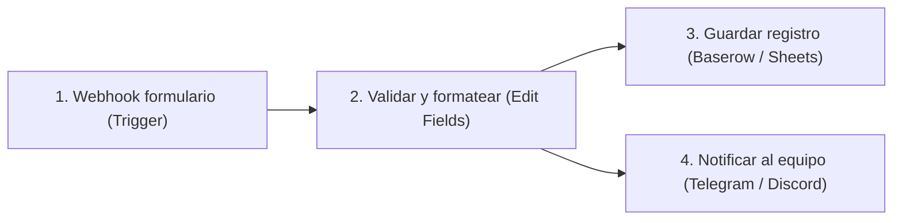
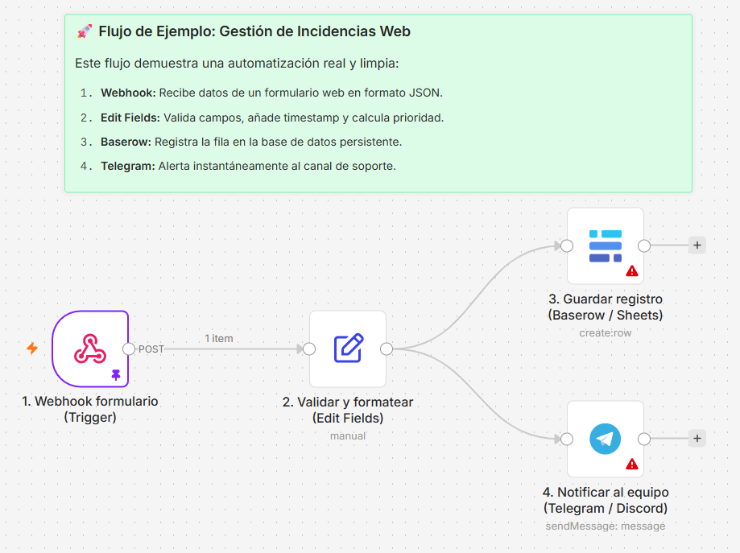
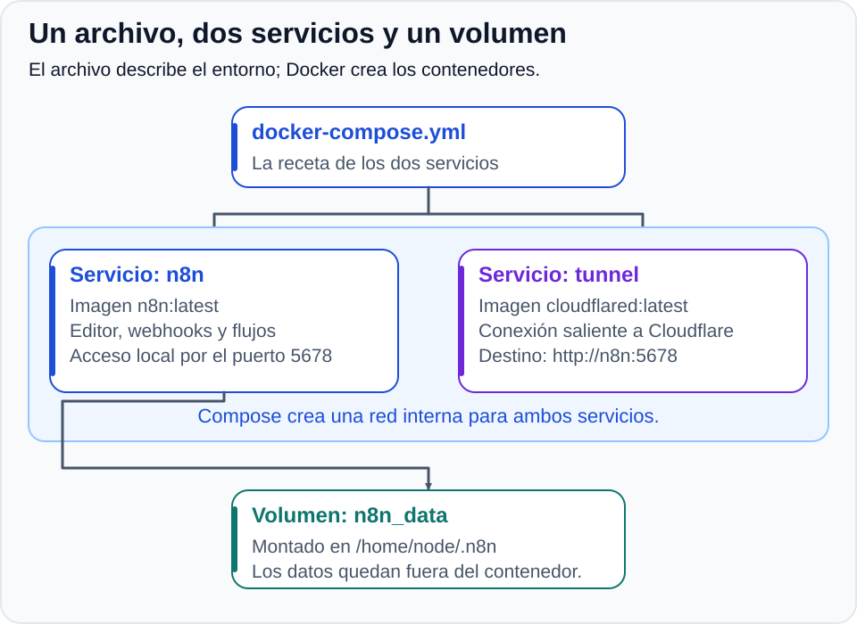
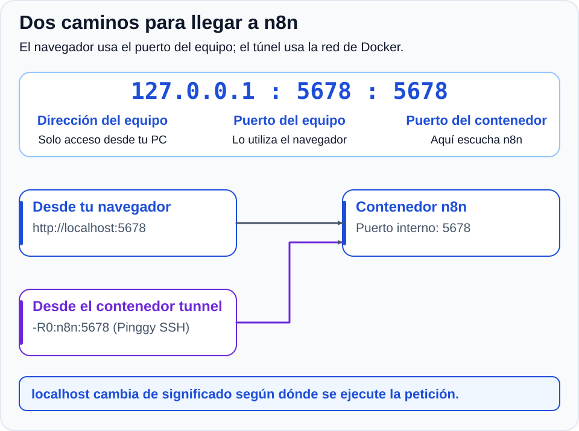
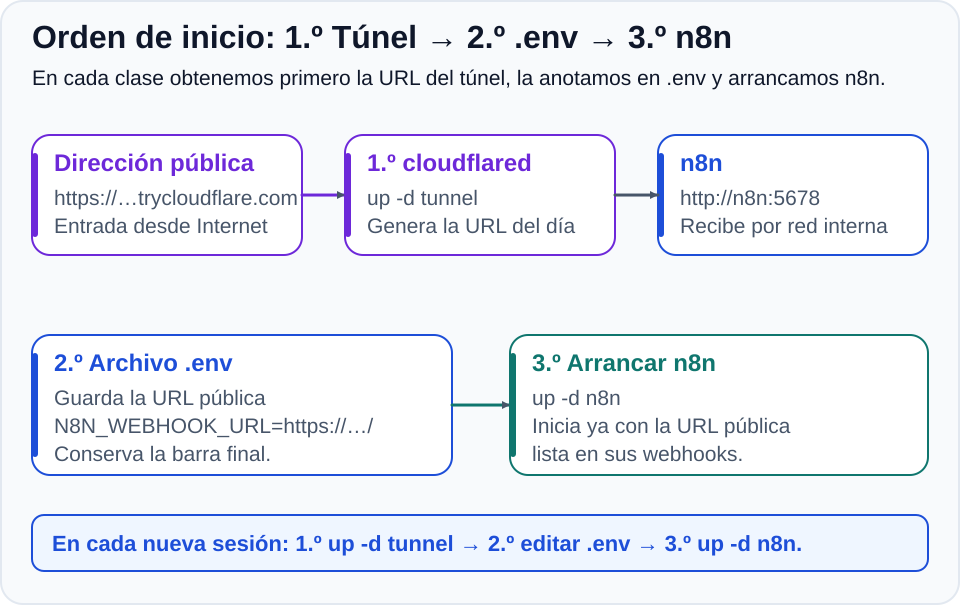
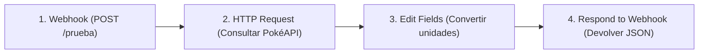
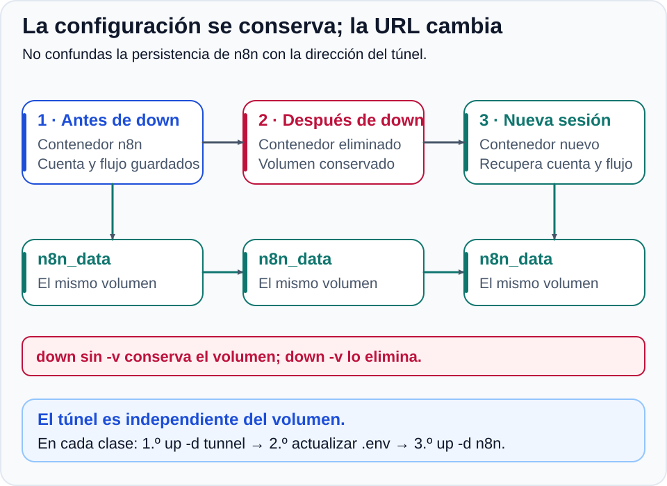



# Actividad 1. Despliegue de n8n y Cloudflare Tunnel con Docker Compose

> [📖 **Apuntes: Introducción a Docker y Contenerización**](../apuntes)
{: .alert-info}

En esta primera actividad desplegarás **n8n Community** junto con **Cloudflare Tunnel (`cloudflared`)** mediante **Docker Compose**. Aprenderás el protocolo de arranque para actualizar la dirección pública temporal del túnel en cada sesión de clase, construirás tu primer flujo con un **Webhook** que consulta una API pública y verificarás la persistencia de datos del volumen **`n8n_data`**. En la **[Actividad 2](../actividad2)** conectaremos esta infraestructura con WordPress, Qdrant y un Agente de IA.

## 🎯 Objetivos

1. Verificar Docker en **LliureX** y distinguir imagen, contenedor, puerto, red interna y volumen.
2. Generar con IA, revisar y validar un `docker-compose.yml` con dos servicios (`n8n` y `tunnel`) y un volumen persistente (`n8n_data`).
3. Aplicar el protocolo de inicio de sesión: arrancar primero el túnel de Cloudflare, registrar su URL temporal en `.env` y levantar después `n8n`.
4. Construir un flujo de prueba en n8n (`Webhook` → `HTTP Request` → `Edit Fields` → `Respond to Webhook`) y probarlo mediante `curl` tanto en local como a través del túnel público de Cloudflare.
5. Comprobar la persistencia del volumen Docker (`n8n_data`) al eliminar los contenedores y simular el cambio de URL del túnel entre una clase y la siguiente.

## 💡 ¿Qué es n8n?

> **n8n** es una plataforma de automatización visual, con código fuente disponible y licencia *fair-code*. Cada nodo representa un disparador, una transformación o una acción. Los datos circulan normalmente en formato **JSON**. Un **webhook** es una dirección que recibe peticiones HTTP y puede iniciar un flujo.
{: .alert-info}

### Ejemplo de flujo real: Gestión de incidencias o consultas web

Para entender cómo opera n8n en entornos reales, veamos un caso habitual de automatización: la recepción y tramitación de un formulario de soporte o contacto desde una web.



En este flujo intervienen los tres tipos esenciales de nodos:

1. **Disparador (*Trigger* — `Webhook`):** Se activa en cuanto un usuario envía el formulario en la web. La página realiza una petición HTTP `POST` a la URL del webhook de n8n entregando los datos en formato **JSON**:
   ```json
   {
     "nombre": "Lucía",
     "email": "lucia@ejemplo.com",
     "asunto": "Incidencia de acceso",
     "mensaje": "No puedo entrar al aula virtual"
   }
   ```
2. **Transformación y lógica (`Edit Fields` / `If`):** n8n recoge los datos, comprueba que los campos obligatorios contengan información, añade una marca de tiempo (`timestamp`) y asigna la prioridad según el asunto.
3. **Acciones (*Actions* en paralelo):**
   * **Persistencia:** Inserta automáticamente una fila en una base de datos (**Baserow** o **Google Sheets**) para conservar el histórico.
   * **Notificación instantánea:** Lanza un mensaje al canal del equipo técnico en **Telegram** o **Discord** avisando del nuevo ticket:  
     *`🔔 Nueva incidencia de Lucía (lucia@ejemplo.com): "No puedo entrar al aula virtual"`*.



## 📌 Paso a paso

### Paso 1: Verificar Docker y preparar la carpeta

1. Abre una terminal en LliureX (`Ctrl + Alt + T`):
   ```bash
   docker --version
   docker compose version
   docker run --rm hello-world
   ```
2. Si falta Docker o aparece un error de permisos con su socket, consulta al profesor. No cambies permisos del sistema por tu cuenta.
3. Prepara la carpeta del proyecto:
   ```bash
   mkdir -p ~/docker-n8n
   cd ~/docker-n8n
   ```
4. Prepara una carpeta en **Bitwarden** donde guardarás la cuenta de propietario de n8n cuando la crees.

**Comprobación:** `hello-world` funciona y estás situado en `~/docker-n8n`.

### Paso 2: Generar y revisar el archivo `docker-compose.yml`

#### A. Qué infraestructura necesitamos y qué le vamos a pedir a la IA

**Docker Compose** lee un archivo escrito en **YAML** (`docker-compose.yml`) que describe qué aplicaciones arrancar, cómo conectarlas en red y qué datos conservar. No instala n8n directamente en el sistema LliureX; define y orquesta sus contenedores.

Antes de acudir a la IA, debemos tener muy claro el diseño de la arquitectura que necesitamos desplegar y cómo la arrancaremos en cada clase:

1. **Servicio de comunicación externa (`tunnel`):**
   * Como en el aula no podemos abrir puertos en el router del centro ni tenemos IP pública fija, utilizaremos **Cloudflare Tunnel** (`cloudflared`).
   * Este contenedor establece un túnel cifrado de salida hacia Cloudflare, obtiene una dirección pública temporal (`https://....trycloudflare.com`) y redirige las peticiones entrantes a n8n **a través de la red interna de Docker** (`http://n8n:5678`).
   * **Importante para el trabajo en varias sesiones:** Como la dirección gratuita de Cloudflare cambia cada vez que se arranca el túnel, **en cada clase levantaremos primero el servicio `tunnel`**, copiaremos su nueva URL en el archivo `.env` y **después arrancaremos `n8n`**. Por tanto, `tunnel` **no debe tener `depends_on: n8n`** (así podemos encenderlo primero de forma independiente) ni debe publicar puertos en el host.

2. **Servicio principal (`n8n`):**
   * Es la plataforma de automatización donde crearemos nuestros flujos y webhooks.
   * **Acceso y seguridad local:** Por seguridad en el aula de informática, su panel debe ser accesible en local **únicamente desde el navegador de tu propio equipo** (`127.0.0.1` en el puerto estándar `5678`). Si se publicara en todas las interfaces de red (`0.0.0.0`), cualquier compañero de clase podría acceder a tu panel.
   * **Persistencia de datos:** Los contenedores son volátiles por diseño. Asociaremos un **volumen de Docker** (`n8n_data`) montado en `/home/node/.n8n` para conservar de forma permanente tu cuenta de usuario, credenciales y flujos.
   * **Configuración del entorno:** Zona horaria `Europe/Madrid` y lectura dinámica de la variable `N8N_WEBHOOK_URL` desde el archivo `.env` (`${N8N_WEBHOOK_URL:-http://localhost:5678/}`).
   * **Política de reinicio:** `unless-stopped`.

3. **Requisitos de buenas prácticas:**
   * Utilizar la especificación actual de Compose (**sin la propiedad obsoleta `version`**).
   * **No incluir secretos ni contraseñas** en el archivo.
   * **No montar el socket de Docker** (`/var/run/docker.sock`).

#### B. Generar el archivo con la IA

Escribe un **prompt claro y descriptivo centrado en los requisitos**:

```text
Actúa como administrador de sistemas Linux y experto en Docker. Necesito un archivo docker-compose.yml para una práctica en clase con dos servicios:

1. Servicio 'n8n':
   - Utiliza la imagen oficial de n8n Community.
   - Por seguridad en la red del aula, debe ser accesible únicamente desde el navegador de este mismo equipo en el puerto estándar 5678 (enlazado a 127.0.0.1).
   - Persistencia: monta un volumen llamado 'n8n_data' en la ruta interna de datos de n8n (/home/node/.n8n) para no perder cuentas, flujos ni credenciales si el contenedor se recrea o actualiza.
   - Configura la zona horaria en Europe/Madrid.
   - Para la variable del webhook (N8N_WEBHOOK_URL), haz que lea el valor de un archivo .env y use por defecto http://localhost:5678/ si no está definida (${N8N_WEBHOOK_URL:-http://localhost:5678/}).
   - Añade N8N_PROXY_HOPS=1 y NODE_ENV=production.
   - Debe reiniciarse automáticamente salvo que lo detengamos manualmente (unless-stopped).

2. Servicio 'tunnel':
   - Utiliza la imagen oficial de cloudflared (Cloudflare Tunnel).
   - Inicia un túnel rápido sin autoactualización que reenvíe el tráfico al servicio n8n a través de la red interna de Docker (http://n8n:5678).
   - No publiques ningún puerto en el host (el túnel crea una conexión de salida).
   - No pongas depends_on hacia n8n y configura restart: "no", porque en cada clase arrancaremos primero el túnel para anotar su URL temporal en .env antes de arrancar n8n.

Requisitos adicionales:
   - Usa la especificación moderna de Docker Compose (sin la directiva obsoleta 'version').
   - Declara el volumen n8n_data en la sección volumes.
   - No incluyas contraseñas en el archivo ni montes el socket de Docker.
   - Añade comentarios breves en español explicando cada sección.
```

Copia la respuesta generada por la IA y guárdala dentro de la carpeta `~/docker-n8n`:

```bash
nano docker-compose.yml
```

*(Pega el contenido en la terminal con `Ctrl + Shift + V`, guarda con `Ctrl + O`, pulsa `Enter` y sal con `Ctrl + X`)*.

#### C. Comprender y revisar el archivo generado (y corregirlo)

**Que lo genere una IA no garantiza que sea seguro ni correcto.** Revisa bloque a bloque lo que ha devuelto la IA:

[](./imagenes/03-compose.svg)

##### 1. Los servicios, las imágenes y el reinicio

| Elemento | Qué significa | Qué comprobar y corregir |
| :--- | :--- | :--- |
| `services` | Agrupa las aplicaciones gestionadas por Compose: `n8n` y `tunnel`. | Comprueba que ambos servicios estén al mismo nivel de indentación. |
| `image` | La plantilla descargable con la que se creará cada contenedor. | Comprueba que utilice las imágenes oficiales con la etiqueta `:latest`: `docker.n8n.io/n8nio/n8n:latest` (o `n8nio/n8n:latest`) para n8n y `cloudflare/cloudflared:latest` para el túnel. |
| `restart: unless-stopped` en n8n | Docker reinicia n8n si cae o al reiniciar el PC, salvo que lo apagues expresamente. | Asegúrate de que n8n lo incluya. |
| `restart: "no"` en tunnel | No se reinicia solo. Las comillas evitan que el parser YAML interprete `no` como un valor booleano (`false`). | Comprueba que tenga `"no"` y que **no incluya `depends_on: n8n`**, para poder levantar el túnel antes que n8n. |

##### 2. Los puertos y los dos significados de localhost

[](./imagenes/04-puertos-red.svg)

La línea de `ports` se lee **dirección IP del equipo : puerto del equipo : puerto del contenedor**:

* **`127.0.0.1`** limita la escucha a la dirección de *loopback* (tu propio ordenador).
  > ⚠️ **Corrección crítica:** Si la IA escribió `ports: - "5678:5678"` o `"0.0.0.0:5678:5678"`, **cámbialo inmediatamente a `"127.0.0.1:5678:5678"`**. Si no especificas `127.0.0.1`, Docker publica el puerto en todas las interfaces de red del equipo y cualquier ordenador del aula podría conectarse a tu n8n.
* El **primer `5678`** es el puerto al que te conectas desde el navegador de tu LliureX; el **segundo `5678`** es el puerto en el que escucha n8n dentro del contenedor.
* **Red interna de Docker:** Compose crea una red interna automática donde los servicios se comunican entre sí usando su propio nombre como nombre de dominio. Por eso cloudflared se conectará a `http://n8n:5678`. Si utilizara `localhost`, buscaría n8n dentro del contenedor del propio túnel y fallaría.

##### 3. Las variables de entorno de n8n

<details markdown="1" style="cursor: pointer;">
<summary style="cursor: pointer;">🔎 <strong>Qué significa cada variable generada</strong></summary>

| Variable y valor | Para qué sirve |
| :--- | :--- |
| `N8N_HOST: localhost` | Nombre de host que utiliza n8n internamente para su configuración de acceso local. |
| `N8N_PORT: 5678` | Puerto interno en el que n8n escucha dentro del contenedor. |
| `N8N_PROTOCOL: http` | Protocolo en el montaje local (HTTP). El túnel público externo usará HTTPS. |
| `NODE_ENV: production` | Modo de ejecución de la aplicación Node.js. |
| `GENERIC_TIMEZONE: Europe/Madrid` | Zona horaria para la ejecución de flujos programados en n8n. |
| `TZ: Europe/Madrid` | Zona horaria del contenedor del sistema operativo. |
| `N8N_WEBHOOK_URL` | Dirección base que n8n muestra al crear webhooks. |
| `N8N_PROXY_HOPS: 1` | Indica a n8n que confíe en un salto de proxy inverso (el túnel de Cloudflare). |

La expresión **`${N8N_WEBHOOK_URL:-http://localhost:5678/}`** utiliza la sintaxis de sustitución por defecto de Compose:

* Si existe un archivo `.env` con la variable `N8N_WEBHOOK_URL`, Compose le pasará a n8n esa URL pública del túnel.
* Si no existe o está vacía, Compose aplica lo que va tras `:-` (`http://localhost:5678/`).

> ⚠️ **Corrección:** Si la IA puso simplemente `N8N_WEBHOOK_URL: http://localhost:5678/` fijo, cámbialo a `${N8N_WEBHOOK_URL:-http://localhost:5678/}` para que lea automáticamente el archivo `.env`.
{: .alert-info}

</details>

##### 4. El volumen y el servicio del túnel

* **`n8n_data:/home/node/.n8n`** y `volumes: n8n_data:` aseguran que la base de datos SQLite de n8n, tu cuenta y tus flujos persistan en el anfitrión aunque destruyas el contenedor.
* **`command: tunnel --no-autoupdate --url http://n8n:5678`:** abre el túnel de Cloudflare apuntando al nombre de servicio `n8n` dentro de la red de Docker.

<details markdown="1" style="cursor: pointer;">
<summary style="cursor: pointer;">👁️ <strong>Archivo de referencia para cotejar y corregir el resultado</strong></summary>

```yaml
services:
  n8n:
    image: docker.n8n.io/n8nio/n8n:latest
    restart: unless-stopped
    ports:
      - "127.0.0.1:5678:5678"
    environment:
      N8N_HOST: localhost
      N8N_PORT: 5678
      N8N_PROTOCOL: http
      NODE_ENV: production
      GENERIC_TIMEZONE: Europe/Madrid
      TZ: Europe/Madrid
      N8N_WEBHOOK_URL: ${N8N_WEBHOOK_URL:-http://localhost:5678/}
      N8N_PROXY_HOPS: 1
    volumes:
      - n8n_data:/home/node/.n8n

  tunnel:
    image: cloudflare/cloudflared:latest
    restart: "no"
    command: tunnel --no-autoupdate --url http://n8n:5678

volumes:
  n8n_data:
```

</details>

Valida que la sintaxis del YAML no tenga ningún error antes de continuar:

```bash
docker compose config --quiet
```

`config --quiet` no muestra nada si el archivo es válido. Corrige cualquier error antes de pasar al Paso 3.

### Paso 3: Orden de arranque en cada clase (1.º Túnel → 2.º `.env` → 3.º n8n)

[](./imagenes/06-tunel.svg)

Los túneles rápidos de Cloudflare (`trycloudflare.com`) son gratuitos y no requieren cuenta, pero **generan un subdominio aleatorio nuevo cada vez que se inicia el contenedor `tunnel`**.

Por eso, **al empezar cada clase seguiremos siempre este orden de tres pasos**: primero levantamos `tunnel`, después anotamos su URL del día en `.env` y por último arrancamos `n8n` para que nazca ya configurado con esa dirección pública.

#### A. Paso 1: Levantar el contenedor del túnel y obtener la URL del día

Desde `~/docker-n8n`, arranca únicamente el servicio `tunnel` y revisa sus registros:

```bash
docker compose up -d tunnel
docker compose ps
docker compose logs --tail=100 tunnel
```

Busca en las líneas del registro el recuadro con la dirección asignada por Cloudflare:
`https://ejemplo-palabras-aleatorias.trycloudflare.com`

*(Si aún no aparece, espera 5 segundos y vuelve a ejecutar `docker compose logs --tail=100 tunnel`).*

> **Uso en la práctica:** El túnel publica tu instancia de n8n en Internet, incluido el acceso al editor cuando `n8n` esté en marcha. HTTPS cifra la comunicación, pero no sustituye una contraseña robusta ni protege un webhook sin autenticación. No difundas la URL y mantén el túnel abierto solo durante las pruebas de clase.
{: .alert-warning}

#### B. Paso 2: Guardar la URL del túnel en el archivo `.env`

Crea o edita el archivo `.env` dentro de `~/docker-n8n`:

```bash
nano .env
```

Escribe la siguiente línea sustituyendo el dominio por el que te acaba de mostrar Cloudflare y **asegurándote de terminar con la barra final `/`**:

```dotenv
N8N_WEBHOOK_URL=https://ejemplo-palabras-aleatorias.trycloudflare.com/
```

*(Guarda con `Ctrl + O`, `Enter` y sal con `Ctrl + X`).*

#### C. Paso 3: Arrancar `n8n` y crear tu cuenta de propietario

Ahora que `.env` ya tiene la URL pública de hoy, arranca `n8n`:

```bash
docker compose up -d n8n
docker compose ps
docker compose logs --tail=30 n8n
```

1. Abre **`http://localhost:5678`** en tu navegador (usando exactamente `localhost`).
2. Crea tu **cuenta de propietario** y guarda inmediatamente el correo y la contraseña robusta en **Bitwarden**.
3. Completa el asistente inicial; las preguntas de perfil son opcionales.

### Paso 4: Construir tu primer flujo en n8n y probarlo por el túnel con `curl`

Vamos a comprobar que tanto `n8n` como el túnel de Cloudflare funcionan construyendo un flujo sencillo que reciba el nombre de un Pokémon mediante `curl`, consulte en tiempo real la API pública de **PokéAPI** (que devuelve la altura en decímetros y el peso en hectogramos), convierta esas unidades al sistema métrico habitual y nos devuelva una ficha limpia con su imagen:



#### A. Construir los 4 nodos del flujo

1. En el panel de n8n, pulsa **Create Workflow** y llámalo **Primera práctica**.
2. **Nodo 1 — Recibir la petición (`Webhook`):**
   * Pulsa **`+`** en el lienzo, busca **Webhook** y selecciónalo.
   * **HTTP Method:** `POST`.
   * **Path:** `prueba`.
   * **Respond:** `Using 'Respond to Webhook' Node`.
   * **Fíjate en las Webhook URLs:** Al desplegar **Webhook URLs**, comprobarás que la **Test URL** y la **Production URL** ya muestran automáticamente tu dominio `https://ejemplo-palabras-aleatorias.trycloudflare.com/webhook-test/prueba` gracias al archivo `.env`.
3. **Nodo 2 — Consultar la API pública (`HTTP Request`):**
   * Vuelve al lienzo, pulsa el **`+`** que sale a la derecha del Webhook y añade el nodo **HTTP Request**.
   * **Method:** `GET`.
   * **URL:** activa el modo **Expression** (`fx`) y escribe:
     ```text
     https://pokeapi.co/api/v2/pokemon/{{ $json.body.pokemon.toLowerCase() }}
     ```
     *(Así n8n tomará el nombre que enviemos por `curl` y lo insertará directamente en la dirección de la API).*
4. **Nodo 3 — Procesar y limpiar los datos (`Edit Fields`):**
   * Pulsa el **`+`** a la derecha de **HTTP Request** y añade el nodo **Edit Fields (Set)**.
   * En **Fields to Set**, pulsa **Add Field** y añade estos cinco campos de tipo **String** activando **Expression** (`fx`) en cada valor:
     * **`ficha`**: `{{ $json.name.toUpperCase() }} (#{{ $json.id }})` *(pone el nombre en mayúsculas junto a su número de Pokédex)*.
     * **`altura`**: `{{ $json.height / 10 }} metros` *(convierte los decímetros de la API a metros)*.
     * **`peso`**: `{{ $json.weight / 10 }} kg` *(convierte los hectogramos de la API a kilogramos)*.
     * **`tipo_principal`**: `{{ $json.types[0].type.name }}` *(extrae el primer tipo del array devuelto por la API)*.
     * **`imagen`**: `{{ $json.sprites.front_default }}` *(extrae la URL del sprite oficial del Pokémon)*.
5. **Nodo 4 — Devolver la respuesta (`Respond to Webhook`):**
   * Pulsa el **`+`** a la derecha de **Edit Fields** y añade el nodo **Respond to Webhook**.
   * Deja **Respond With** en `First Incoming Item` para que devuelva el JSON ya procesado.

#### B. Probar el flujo a través del túnel público de Cloudflare

1. Abre el nodo **Webhook** y pulsa el botón **Listen for test event** (n8n se quedará esperando tu llamada).
2. Abre una terminal en LliureX y lanza esta petición `POST` con `curl` apuntando **a tu URL pública de Cloudflare** (sustituye el dominio de ejemplo por el tuyo; usamos `tee` para ver el resultado en pantalla y guardarlo a la vez en `pokemon.json`):

```bash
curl -s -X POST https://ejemplo-palabras-aleatorias.trycloudflare.com/webhook-test/prueba \
  -H "Content-Type: application/json" \
  -d '{"pokemon": "snorlax"}' | tee pokemon.json
```

3. Tu petición saldrá a Internet, entrará por el túnel de Cloudflare hasta el contenedor `tunnel`, pasará por la red interna de Docker hasta `http://n8n:5678`, consultará la PokéAPI y te devolverá en la terminal el JSON limpio:

```json
{
  "ficha": "SNORLAX (#143)",
  "altura": "2.1 metros",
  "peso": "460 kg",
  "tipo_principal": "normal",
  "imagen": "https://raw.githubusercontent.com/PokeAPI/sprites/master/sprites/pokemon/143.png"
}
```

4. Ahora extrae automáticamente la URL del campo `imagen` desde `pokemon.json`, descarga el PNG y ábrelo en el visor de LliureX con un solo comando:

```bash
curl -sL "$(grep -o 'https://[^"]*' pokemon.json)" -o pokemon.png && xdg-open pokemon.png
```

5. Regresa a la pestaña de n8n: verás los cuatro nodos marcados en verde y podrás hacer clic en **HTTP Request** y **Edit Fields** para comparar el JSON gigante que devolvió la API original con el resumen limpio que has generado. **Guarda el flujo** pulsando **Save**.

### Paso 5: Verificar la persistencia del volumen y simular el cambio de clase

[](./imagenes/11-persistencia.svg)

Para terminar esta actividad, vamos a simular que acaba la clase de hoy, se apagan los contenedores y volvemos el próximo día:

1. En la terminal, dentro de `~/docker-n8n`, detén y elimina los contenedores actuales:
   ```bash
   docker compose down
   ```
   > **¡Atención!** Nunca añadas `-v` a `docker compose down`, porque `-v` borraría el volumen `n8n_data` con tu cuenta y tus flujos.
   {: .alert-warning}

2. Ahora aplica el **protocolo de inicio de clase** como harás al comenzar la siguiente sesión:
   * **1.º Arranca el túnel y obtén la nueva URL:**
     ```bash
     docker compose up -d tunnel
     docker compose logs --tail=100 tunnel
     ```
     Comprueba que Cloudflare te ha asignado un dominio `https://....trycloudflare.com` **distinto** al anterior.
   * **2.º Actualiza `.env` con la nueva URL:**
     ```bash
     nano .env
     ```
     Sustituye el valor de `N8N_WEBHOOK_URL=` por la nueva URL (terminada en `/`) y guarda el archivo.
   * **3.º Arranca `n8n`:**
     ```bash
     docker compose up -d n8n
     ```
     *(Nota: si en algún momento `n8n` ya estuviera encendido y necesitaras cambiarle la URL de `.env` sin apagar el túnel, bastaría con ejecutar `docker compose up -d --no-deps n8n`).*

3. Entra en `http://localhost:5678` y verifica dos cosas:
   * Tu **cuenta de usuario** y el flujo **Primera práctica** siguen intactos gracias al volumen **`n8n_data`**.
   * Al abrir el nodo **Webhook**, la **Test URL** ya muestra el **nuevo dominio de Cloudflare** y responde correctamente si vuelves a probarla con `curl`.

4. Cuando termines las comprobaciones y se lo muestres al profesor, detén el túnel (o ejecuta `docker compose down` sin `-v` si finaliza la sesión):
   ```bash
   docker compose stop tunnel
   ```

## 🛠️ Diagnóstico de problemas

| Síntoma | Qué comprobar |
| :--- | :--- |
| Error de YAML | Indentación con espacios, servicios y variables. Ejecuta `docker compose config --quiet`. |
| Al arrancar `tunnel` también arranca `n8n` | Quita `depends_on: - n8n` del servicio `tunnel` en `docker-compose.yml` para poder levantar primero el túnel en cada clase. |
| n8n no abre | `docker compose ps` y `docker compose logs --tail=50 n8n`. Espera unos segundos al arranque y usa `http://localhost:5678`. |
| Túnel con `502 Bad Gateway` | `n8n` debe estar en ejecución y listo; el destino del comando de `tunnel` debe ser `http://n8n:5678`, nunca `localhost`. |
| Se sigue mostrando `http://localhost:5678` o la URL antigua en el Webhook | Revisa que `.env` tenga `N8N_WEBHOOK_URL=https://.../` con barra final, ejecuta `docker compose up -d --no-deps n8n` y recarga el navegador. |
| Webhook devuelve `404` | Asegúrate de haber pulsado **Listen for test event** antes de lanzar el `curl` contra `/webhook-test/prueba` y de usar `-X POST`. |

## 📤 Entrega y evaluación

Entrega en **Aules**:

1. **Informe PDF** con:
   * `docker compose ps` mostrando los servicios `n8n` y `tunnel` en ejecución.
   * Captura de los logs de `tunnel` mostrando la URL temporal de Cloudflare y del archivo `.env` configurado.
   * Captura del flujo **Primera práctica** en n8n con los 4 nodos en verde y de la terminal mostrando la respuesta JSON del `curl` a través de la URL de Cloudflare junto con la imagen descargada del Pokémon.
   * Demostración del cambio de sesión (`docker compose down` → `up -d tunnel` → nuevo `.env` → `up -d n8n`) verificando que se conserva el flujo en `n8n_data` y se actualiza la URL del Webhook.
   * Respuestas breves:
     1. ¿Por qué `n8n` publica el puerto con `127.0.0.1:5678:5678` mientras que `tunnel` se conecta a `http://n8n:5678` sin publicar puertos?
     2. ¿Por qué en cada clase debemos levantar primero `tunnel`, editar `.env` y después levantar `n8n`?
     3. ¿Qué ocurre si ejecutamos `docker compose down` frente a `docker compose down -v`?
2. **`docker-compose.yml` utilizado** y el flujo **Primera práctica** exportado en formato `.json`.

## 📊 Rúbrica de evaluación (máx. 10 puntos)

| Criterio | Insuficiente | Básico | Adecuado | Excelente |
| :--- | :--- | :--- | :--- | :--- |
| **Docker Compose y seguridad local** (máx. 3 puntos) | **0 puntos:** El YAML no es válido o no arranca los contenedores. | **1 punto:** Arranca los contenedores, pero publica puertos en `0.0.0.0` o no comprende la red interna. | **2 puntos:** Configura `127.0.0.1:5678:5678`, la red interna y las variables, con explicaciones parciales. | **3 puntos:** Valida el YAML sin errores, enlaza puertos a `127.0.0.1`, guarda la cuenta en Bitwarden y explica con precisión puertos y red interna. |
| **Túnel de Cloudflare y protocolo `.env`** (máx. 2,5 puntos) | **0 puntos:** No consigue levantar el túnel o no obtiene URL pública. | **1 punto:** Levanta el túnel, pero n8n sigue mostrando `localhost` en sus webhooks. | **1,75 puntos:** Configura `.env` y el túnel funciona, pero no sigue el orden óptimo al cambiar de sesión. | **2,5 puntos:** Aplica el orden `1.º tunnel → 2.º .env → 3.º n8n`, verifica la URL pública en n8n y cierra el túnel al terminar. |
| **Flujo Webhook + API pública con `curl`** (máx. 2,5 puntos) | **0 puntos:** No construye el flujo o no responde al webhook. | **1 punto:** El webhook responde, pero no consulta la API externa o no transforma los datos. | **1,75 puntos:** Consulta la PokéAPI y transforma los campos, pero solo lo prueba en local o no descarga la imagen. | **2,5 puntos:** Construye los 4 nodos, transforma las unidades con expresiones, prueba el webhook a través de la URL de Cloudflare con `curl` y descarga la imagen. |
| **Persistencia (`n8n_data`)** (máx. 2 puntos) | **0 puntos:** Pierde los datos al recrear contenedores o no configura el volumen. | **0,75 puntos:** Configura `n8n_data`, pero no demuestra la recuperación tras `docker compose down`. | **1,5 puntos:** Demuestra que el flujo persiste tras `down` y `up`, pero no actualiza la nueva URL del túnel. | **2 puntos:** Demuestra la persistencia completa de cuenta y flujo tras `docker compose down` y actualiza la nueva URL del túnel en la nueva sesión. |
| **Entrega en plazo y documentación** (máx. 0 puntos) | **-2 puntos:** No entrega la actividad o realiza una entrega vacía o con retraso injustificado. | **-1,5 puntos:** Entrega con retraso importante o faltan evidencias clave. | **-1 punto:** Entrega con un pequeño retraso o documentación incompleta. | **0 puntos:** Entrega puntual en Aules con informe completo, `docker-compose.yml` y flujo `.json`. |

> La entrega dentro del plazo no resta puntuación. Las entregas con retraso supondrán una penalización de hasta 2 puntos sobre la calificación.
{: .alert-error}

## 📚 Recursos

* [n8n: Webhook](https://docs.n8n.io/integrations/builtin/core-nodes/n8n-nodes-base.webhook/) y [HTTP Request](https://docs.n8n.io/integrations/builtin/core-nodes/n8n-nodes-base.httprequest/).
* [n8n: URL pública detrás de un proxy](https://docs.n8n.io/hosting/configuration/configuration-examples/webhook-url/).
* [Docker Compose](https://docs.docker.com/compose/) y [variables de .env](https://docs.docker.com/compose/how-tos/environment-variables/variable-interpolation/).
* [Cloudflare: Quick Tunnels](https://developers.cloudflare.com/tunnel/get-started/quick-tunnels/).
* [PokéAPI Documentation](https://pokeapi.co/docs/v2).


