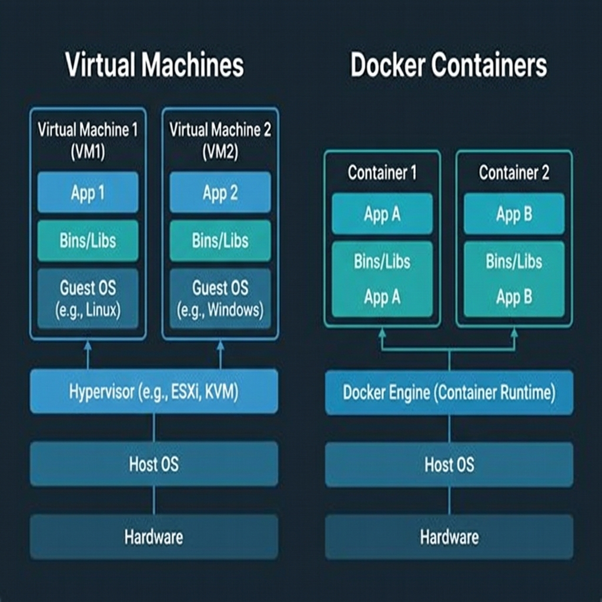
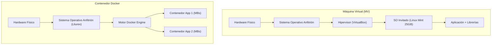
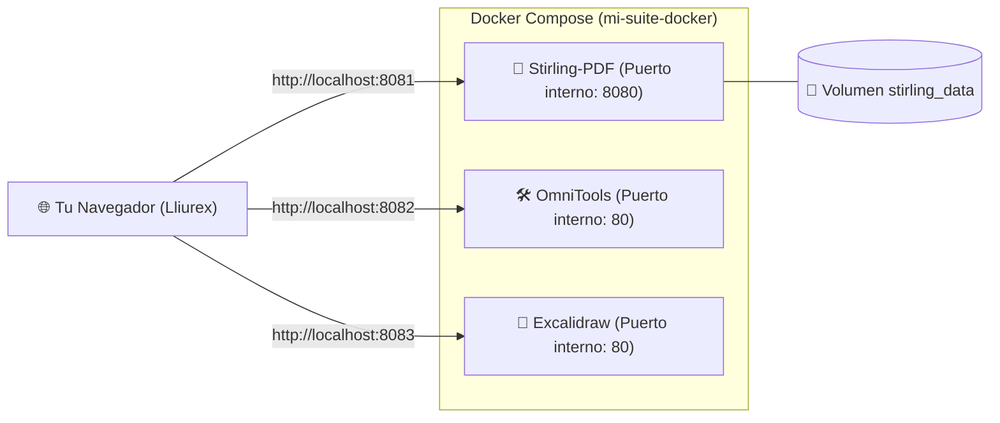

# Tema 2: Contenerización con Docker

## 📖 Apuntes: Introducción a Docker y Contenerización

En este tema daremos un salto fundamental en el diseño y despliegue de infraestructuras informáticas. En el Tema 1 aprendimos a instalar un servidor web instalando un sistema operativo completo en una máquina virtual (VirtualBox + Linux Mint) y sobre él un stack de software (XAMPP). En este tema descubriremos la **contenerización**, la tecnología estándar que utilizan las empresas de desarrollo y administración de sistemas en la actualidad.

---

## 1. ¿Qué es Docker y para qué sirve?

**Docker** es una plataforma de código abierto que permite empaquetar una aplicación y todas sus dependencias (librerías, código, binarios, configuraciones) dentro de una unidad estandarizada llamada **contenedor**.

### El problema histórico: *"En mi ordenador sí funciona"*
Antes de los contenedores, al desplegar software en servidores se producían constantes fallos debido a:
- Diferencias entre las versiones de PHP, Python o bases de datos instaladas en cada equipo.
- Incompatibilidades de librerías del sistema operativo.
- Conflictos de dependencias entre distintas aplicaciones en el mismo servidor.

Docker soluciona esto garantizando que **si una aplicación funciona dentro de un contenedor en tu ordenador de clase, funcionará exactamente igual en cualquier servidor, nube o sistema operativo**.

---

## 2. Comparativa Técnica: Máquina Virtual (MV) vs Contenedores Docker

Ambas tecnologías buscan el aislamiento de entornos, pero lo consiguen de formas completamente diferentes:





### Tabla Comparativa

| Característica | Máquina Virtual (MV) | Contenedor Docker |
| :--- | :--- | :--- |
| **Arquitectura** | Virtualiza el **hardware**. Incluye un Sistema Operativo completo (Guest OS). | Virtualiza el **sistema operativo**. Comparte el Kernel del SO anfitrión. |
| **Tamaño en disco** | **Grande** (varios Gigabytes por MV). | **Muy ligero** (decenas o cientos de Megabytes). |
| **Tiempo de arranque** | **Lento** (de 30 segundos a varios minutos). | **Instantáneo** (milisegundos o pocos segundos). |
| **Uso de RAM y CPU** | **Alto** (reserva recursos fijos aunque esté inactiva). | **Mínimo** (utiliza solo lo que la aplicación necesita en cada instante). |
| **Portabilidad** | Compleja de exportar y mover entre equipos. | **Extrema** (se comparte mediante simples archivos de receta o imágenes). |

---

## 3. Conceptos Clave en Docker

Para dominar Docker es fundamental entender los siguientes términos:

### 📄 1. Imagen (*Docker Image*)
Es una plantilla de solo lectura que contiene el sistema de archivos, el código y las instrucciones necesarias para crear un contenedor. 
- *Analogía:* La imagen es como la **receta de una tarta** o el ejecutable `.installer` de un programa.
- Ejemplos de imágenes oficiales: `nginx`, `mariadb`, `wordpress`, `python`, `ubuntu`.

### 📦 2. Contenedor (*Docker Container*)
Es una instancia ejecutable en tiempo real creada a partir de una imagen. 
- *Analogía:* Si la imagen es la receta, el contenedor es **la tarta ya horneada** y lista para comer.
- Se pueden crear decenas de contenedores idénticos a partir de una sola imagen.

### 🌐 3. Registros e Imágenes de Red (*Docker Hub*)
Es un repositorio o catálogo público en la nube ([hub.docker.com](https://hub.docker.com)) donde desarrolladores y empresas suben y comparten sus imágenes oficiales para que cualquiera pueda descargarlas e usarlas gratis.

### 💾 4. Volúmenes y Persistencia (*Volumes*)
Los contenedores son **efímeros** por defecto (si eliminas un contenedor, los datos generados dentro de él se borran). Los **volúmenes** permiten mapear una carpeta de tu ordenador físico dentro del contenedor para que los datos (como las bases de datos o archivos subidos) no se pierdan nunca.

### 🔌 5. Mapeo de Puertos (*Port Mapping*)
Permite conectar un puerto de tu equipo anfitrión (tu ordenador) con un puerto interno del contenedor.
- Ejemplo: Mapear el puerto `8080` de tu equipo al puerto `80` interno del contenedor de Nginx (`-p 8080:80`).

### 🎼 6. Docker Compose
Herramienta que permite definir y ejecutar aplicaciones compuestas por **múltiples contenedores** (por ejemplo: un contenedor web + un contenedor de base de datos) usando un único archivo YAML estructurado (`docker-compose.yml`).

---

## 🛠️ 4. Guía de Verificación e Instalación en Lliurex (Ubuntu)

En el aula de informática trabajamos sobre **Lliurex** (distribución educativa basada en Ubuntu). Sigue estos pasos para verificar o instalar Docker en tu ordenador de clase.

### Paso A: Comprobar si Docker ya está instalado
Abre una terminal (`Ctrl + Alt + T`) y ejecuta:
```bash
docker --version
docker compose version
```
- Si aparece la versión de Docker (ejemplo: `Docker version 24.x.x` o similar), **¡ya está instalado!** Salta al Paso C.
- Si aparece el mensaje `comando no encontrado` (*command not found*), realiza la instalación.

---

### Paso B: Instalación de Docker en Lliurex (si no está instalado)

**Desde Zero Center (recomendado)**

1. Acceder a Zero Center
2. Instalar Docker

**Desde terminal (no recomendado)**

Ejecuta los siguientes comandos en la terminal:

1. **Actualizar el gestor de paquetes de Lliurex:**
   ```bash
   sudo apt update
   ```

2. **Instalar el motor de Docker y el plugin de Docker Compose:**
   ```bash
   sudo apt install -y docker.io docker-compose-v2
   ```

---

### Paso C: Iniciar el servicio y configurar permisos de usuario *(¡Muy importante!)*
Por defecto en Linux, el comando `docker` requiere permisos de administrador (`sudo`). Para poder trabajar cómodamente sin escribir `sudo` en cada comando:

1. **Arrancar y habilitar el servicio de Docker:**
   ```bash
   sudo systemctl enable --now docker
   ```

2. **Añadir el grupo `docker` (si no existe)**:
   ```bash
   sudo groupadd docker
   ```

3. **Añadir tu usuario de Lliurex al grupo `docker`:**
   ```bash
   sudo usermod -aG docker $USER
   ```

4. **Aplicar los nuevos permisos de grupo:**
   ```bash
   newgrp docker
   ```
   *(También puedes simplemente cerrar sesión en Lliurex y volver a entrar para que se aplique).*

5. **Comprobar que el usuario está en el grupo `docker`:**
   ```bash
   getent group docker
   ```

---

### Paso D: Verificación final (`Hello World`)
Prueba que Docker funciona correctamente ejecutando el contenedor oficial de prueba:

```bash
docker run hello-world
```

Si todo ha ido bien, Docker descargará automáticamente la imagen ligera de prueba y mostrará en la terminal el mensaje:
> `Hello from Docker! This message shows that your installation appears to be working correctly.`

---

## 📜 Cheat Sheet: Comandos Imprescindibles de Docker

| Comando | Descripción |
| :--- | :--- |
| `docker run -d -p 80:80 --name miweb nginx` | Descarga, crea y arranca un contenedor Nginx en segundo plano (`-d`) mapeando puertos. |
| `docker ps` | Muestra los contenedores que están **en ejecución**. |
| `docker ps -a` | Muestra **todos** los contenedores (activos y detenidos). |
| `docker stop <ID_o_Nombre>` | Detiene un contenedor en ejecución. |
| `docker rm <ID_o_Nombre>` | Elimina un contenedor detenido. |
| `docker images` | Lista las imágenes descargadas en tu sistema local. |
| `docker rmi <Nombre_Imagen>` | Elimina una imagen local. |
| `docker compose up -d` | Lee el archivo `docker-compose.yml` y arranca todo el stack multiservicio en segundo plano. |
| `docker compose down` | Detiene y elimina todos los contenedores y redes creados por Docker Compose. |


---

## 🚀 5. Ejemplo Práctico con Docker Compose: Tu Suite de Herramientas Web Privada

¿Cuántas veces has ido a unir dos PDFs, comprimir un trabajo para entregarlo en Aules, convertir una imagen o crear un código QR y te has encontrado con webs llenas de anuncios, que te obligan a registrarte o te bloquean con el mensaje *"Has alcanzado el límite gratuito de 2 archivos hoy"*? Además, al usar esas páginas estás subiendo tus documentos personales a servidores externos.

Para comprobar el verdadero potencial de **Docker Compose**, vamos a desplegar en menos de un minuto nuestra propia **suite de herramientas web gratuitas, sin límites y 100 % privadas** (ningún archivo sale de tu ordenador), combinando tres aplicaciones reales en un solo archivo:

1. 📄 **Stirling-PDF:** Tu propio *"iLovePDF"* privado. Permite unir, dividir, comprimir, rotar, pasar de imágenes/Word a PDF, añadir marcas de agua o proteger PDFs con contraseña sin ningún límite.
2. 🛠️ **OmniTools:** Un panel todoterreno para el día a día: recortar, redimensionar y cambiar el formato de imágenes, generar códigos QR, editar audio/vídeo y manipular textos al instante.
3. 🎨 **Excalidraw:** Una pizarra digital infinita para diseñar esquemas, mapas conceptuales y diagramas técnicos con aspecto de dibujo a mano, lista para exportar tus esquemas en PNG o SVG para los trabajos de clase.



### Paso 1: Crear la carpeta del proyecto

En Docker Compose, cada proyecto suele guardarse en su propia carpeta. Abre la terminal y ejecuta:

```bash
mkdir -p ~/mi-suite-docker
cd ~/mi-suite-docker
```

### Paso 2: Crear el archivo `docker-compose.yml`

Crea el archivo de configuración con el editor `nano`:

```bash
nano docker-compose.yml
```

Copia y pega la siguiente "receta" (en la terminal puedes pegar con `Ctrl + Shift + V`):

```yaml
services:
  # 1. Editor y conversor completo de PDFs
  stirling-pdf:
    image: stirlingtools/stirling-pdf:latest
    container_name: suite-pdf
    ports:
      - "127.0.0.1:8081:8080"
    volumes:
      - stirling_data:/configs
    environment:
      - SYSTEM_DEFAULTLOCALE=es-ES
      - UI_APPNAME=Mi Suite PDF
    restart: unless-stopped

  # 2. Utilidades para imágenes, códigos QR, vídeo y texto
  omnitools:
    image: iib0011/omni-tools:latest
    container_name: suite-omnitools
    ports:
      - "127.0.0.1:8082:80"
    restart: unless-stopped

  # 3. Pizarra para esquemas y diagramas
  excalidraw:
    image: excalidraw/excalidraw:latest
    container_name: suite-pizarra
    ports:
      - "127.0.0.1:8083:80"
    restart: unless-stopped

volumes:
  stirling_data:
```

Guarda los cambios pulsando `Ctrl + O`, confirma con `Enter` y sal de `nano` con `Ctrl + X`.

> 💡 **Fíjate en los puertos (`ports`):** Tanto *OmniTools* como *Excalidraw* utilizan internamente el puerto `80` dentro de su contenedor. Si los instaláramos de forma tradicional en el mismo sistema operativo chocarían entre sí, pero gracias al **mapeo de puertos de Docker**, asignamos a cada uno una puerta distinta en nuestro ordenador (`8081`, `8082` y `8083`). Además, añadir `127.0.0.1:` delante asegura que solo tú puedas abrirlos desde tu equipo.

### Paso 3: ¡Levantar toda la infraestructura con un solo comando!

Asegúrate de estar dentro de `~/mi-suite-docker` y ejecuta:

```bash
docker compose up -d
```

La primera vez tardará unos segundos mientras descarga las imágenes desde *Docker Hub*. Cuando termine y muestre los tres contenedores como `Started`, abre el navegador de tu ordenador y entra en tus nuevos servicios:

- 📄 **Stirling-PDF:** [http://localhost:8081](http://localhost:8081) *(Nota: al ser una aplicación Java muy completa, puede tardar unos 10-15 segundos en terminar de cargar la primera vez).*
- 🛠️ **OmniTools:** [http://localhost:8082](http://localhost:8082)
- 🎨 **Excalidraw:** [http://localhost:8083](http://localhost:8083)

### Paso 4: Trastear y comprobar cómo funciona Docker

Realiza estas pequeñas pruebas para ver en acción los conceptos del tema:

1. **Pruébalas en directo:**
   - Entra en **Stirling-PDF** (`localhost:8081`), busca la herramienta para unir, rotar o añadir marca de agua a un PDF y pruébala con cualquier documento de prueba.
   - Entra en **OmniTools** (`localhost:8082`), genera un código QR con un enlace o convierte una imagen a otro formato.
   - Entra en **Excalidraw** (`localhost:8083`), dibuja un esquema rápido y expórtalo como imagen.
2. **Inspecciona los contenedores activos:**
   Ejecuta en la terminal:
   ```bash
   docker compose ps
   ```
   Verás los tres contenedores corriendo simultáneamente, qué imagen usa cada uno y qué puertos tienen asignados.
3. **Apaga y enciende al instante:**
   Detén y elimina los contenedores ejecutando:
   ```bash
   docker compose down
   ```
   Comprueba que las tres páginas web dejan de funcionar inmediatamente. Ahora vuelve a escribir `docker compose up -d`: como las imágenes ya están descargadas en tu ordenador y el volumen `stirling_data` conserva tus ajustes, **los tres servidores vuelven a estar operativos en apenas 1 segundo**. ¡Compáralo con lo que tardábamos en el Tema 1 en arrancar la máquina virtual e instalar cada programa!
