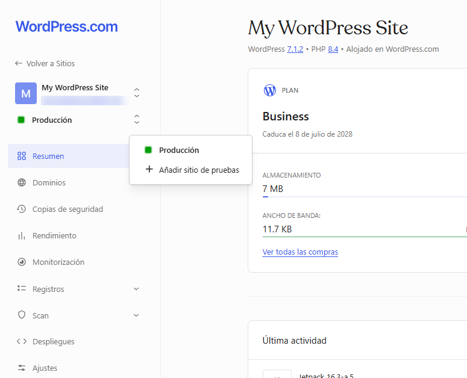
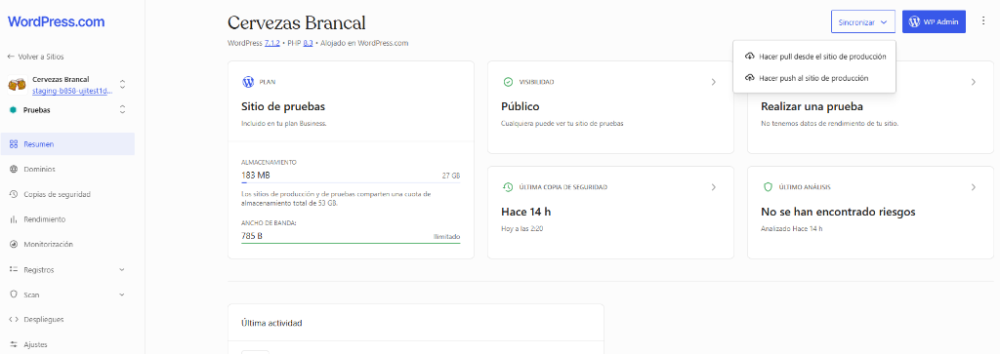
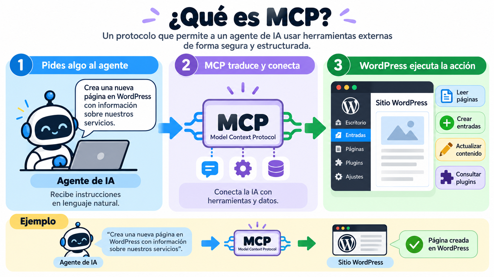
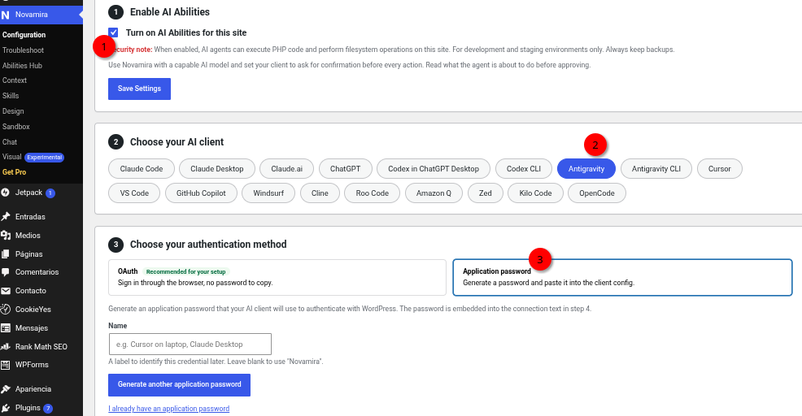
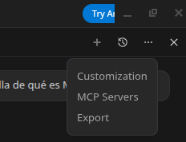
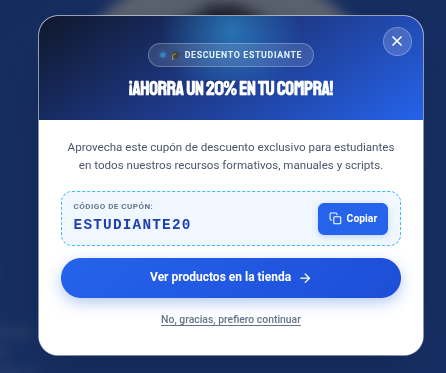

# Actividad 2. Despliegue Cloud en WordPress.com, Entornos Staging y Desarrollo con IA

> **ANTES**: Intentar darnos de alta en [Github Education](https://github.com/education/)
{: .alert-error}

En esta actividad darás el salto del servidor local (montado en la Actividad 1 con XAMPP en Linux Mint) a una infraestructura **Cloud profesional** gracias a las licencias educativas del **Plan Business de WordPress.com**.

Aprenderás la metodología de trabajo empleada en empresas tecnológicas: **nunca modificar una web directamente en producción**. Implementaremos un flujo estricto donde todo el trabajo de migración, la instalación del plugin de comercio electrónico **WooCommerce**, la configuración de una tienda de **infoproductos técnicos descargables (ebooks y recursos)** y la automatización mediante Inteligencia Artificial con **Novamira MCP y Antigravity IDE** se realizarán **íntegramente en un entorno de pruebas aislado (Staging)**. Solo cuando el sistema y el proceso de compra estén plenamente verificados, publicaremos los cambios al sitio público mediante un despliegue controlado (*Push* a Producción).

> [➡️ Página de ejemplo](https://staging-0669-cervezasbrancaltest1.wpcomstaging.com/)
{: .alert-info}

> ⚠️ **Regla de oro profesional:** Todo el trabajo técnico, instalación de plugins, configuración de la tienda, integración con la IA y pruebas de compra se realiza **EXCLUSIVAMENTE en el entorno de Staging (Pruebas)**. La web de Producción no se edita directamente; únicamente recibirá el proyecto final terminado mediante la herramienta de sincronización (*Push*).
{: .alert-warning}

---

## 🎯 Objetivos de la actividad

1. **Gestión de Hosting Cloud Profesional:** Configurar la cuenta bajo el plan **WordPress.com Business**, adaptando el panel a la interfaz clásica de administración (`WP-Admin`) y desbloqueando las funciones avanzadas de desarrollador y alojamiento.
2. **Ciclo de Desarrollo Profesional con Staging:** Comprender y aplicar el ciclo de vida de un servicio web (*Desarrollo local ➔ Staging / Pruebas ➔ Producción pública*), aprovisionando copias aisladas en la nube.
3. **Migración de Servicios Web a la Nube:** Restaurar la copia de seguridad `.wpress` generada en la Actividad 1 en el entorno de pruebas utilizando **All-in-One WP Migration**.
4. **Comercio Electrónico de Infoproductos (WooCommerce):** Desplegar una tienda online en la web personal orientada a la venta de **infoproductos digitales descargables** (ebooks técnicos, guías y recursos de informática), integrando el catálogo y el carrito con el tema **Blocksy** sin necesidad de gestionar envíos físicos.
5. **Desarrollo Web Asistido por Agentes IA (MCP):** Conectar el entorno de Staging con **Antigravity IDE** mediante el protocolo estándar **MCP (Model Context Protocol)** y el plugin **Novamira**, empleando contraseñas de aplicación seguras.
6. **Generación Automatizada del Catálogo con IA:** Guiar al agente de IA mediante prompts en lenguaje natural para estructurar categorías de tienda, redactar fichas de producto persuasivas y generar contenidos técnicos descargables de forma automatizada.
7. **Despliegue y Sincronización a Producción:** Publicar de forma controlada el sitio completo validado en Staging hacia el sitio en vivo mediante operaciones de sincronización (**Push**).
8. **Ciberseguridad y Buenas Prácticas:** Gestionar contraseñas seguras y credenciales de aplicación en **Bitwarden**, auditando registros de actividad y copias de seguridad automáticas en la nube.

## 📌 Paso a paso detallado

### Paso 1: Registro en Wordpress.com con la licencia educativa gratuita

El plan **WordPress.com Business** ofrece un entorno gestionado de alto rendimiento con servidores optimizados, copias de seguridad automáticas y herramientas de desarrollo avanzadas. No obstante, por defecto la plataforma utiliza una interfaz simplificada pensada para usuarios no técnicos. Como administradores de sistemas y servicios web, configuraremos el entorno en modo profesional:

1. **Acceso con licencia educativa y registro en Bitwarden:**
   - Utiliza el enlace [https://wordpress.com/setup/education/es?code=EDUINVIMODlPSI26](https://wordpress.com/setup/education/es?code=EDUINVIMODlPSI26) para registrarte en **Wordpress.com**. 

> Este enlace permite obtener un plan **Business** gratuito durante un año a través de una licencia educativa. Solo podrás gastarlo una vez.
{: .alert-warning}

2. Registra de inmediato en tu bóveda de **Bitwarden** la URL del panel, el usuario/correo y la contraseña asignada.
{:start="2"}

### Paso 2: Ajustes básicos de WordPress.com

1. **Cambiar la interfaz de administración a "Estilo clásico":**
   - En la esquina superior derecha del panel de WordPress.com, haz clic en tu avatar/perfil y entra en **Ajustes de la cuenta** (o dentro de tu sitio en **Ajustes > General**).
   - Localiza la opción **Estilo de la interfaz de administración** (*Admin interface style*).
   - Cambia la opción predeterminada a **Estilo clásico** (*Classic view* / WP-Admin nativo).
   - Guarda los cambios. A partir de este momento dispondrás de la barra superior negra y el menú lateral característico de WordPress, idéntico al que utilizaste en el entorno local con XAMPP.

2. **Activar funciones de desarrollador y alojamiento:**
   - En el menú lateral de tu sitio en WordPress.com, dirígete a **Ajustes > Configuración de alojamiento** (o *Funciones de desarrollador*) y pulsa en el botón **Activar funciones de alojamiento** (*Activate hosting features*).
   - **Ruta alternativa:** Si no te aparece la opción anterior en el menú, dirígete a **Ajustes > Enlaces permanentes** (o *Permalinks*), donde verás un banner informativo con un botón de **Activar**.
   - Esta acción convierte el sitio en una instancia con acceso completo al sistema: habilita la instalación de cualquier plugin o tema externo sin restricciones, el acceso a bases de datos mediante phpMyAdmin, credenciales SFTP/SSH y la capacidad de crear y utilizar entornos de pruebas (*staging*).

> **¿Por qué activar las funciones de alojamiento?** Sin este paso, WordPress.com funciona como una plataforma cerrada (SaaS). Al activar las funciones de alojamiento, dispones de una máquina virtual/contenedor dedicado en la nube con acceso total a nivel de servidor web y base de datos, requisito indispensable para poder desplegar y utilizar posteriormente los entornos de pruebas (*staging*).
{: .alert-info}

---

### Paso 3: Entornos de trabajo profesional: Creación del entorno de Staging y Migración (.wpress)

En el ámbito laboral y empresarial, **nunca se realizan cambios, pruebas de plugins, migraciones ni desarrollo de nuevas secciones directamente en el sitio de producción**, ya que cualquier error provocaría la caída de la web pública (tiempo de inactividad o *downtime*) o la pérdida de pedidos y datos de clientes.

El flujo de trabajo estándar en la industria consta de tres etapas:
1. **Entorno Local (Development):** Tu máquina virtual Linux con XAMPP (Actividad 1), donde diseñaste la estructura base sin riesgo alguno.
2. **Entorno de Pruebas (Staging):** Un clon exacto del servidor en la nube, protegido o en una URL temporal, donde se prueban migraciones, se añaden módulos complejos como tiendas online y se interactúa con agentes de IA.
3. **Entorno de Producción (Production):** La web pública visible para los usuarios finales, clientes y evaluadores.


{: .img .img-500}

#### 1. Creación del entorno de Staging (Panel Cloud de WordPress.com)

1. En el panel de control de tu sitio de WordPress.com ([https://my.wordpress.com/sites](https://my.wordpress.com/sites)), localiza en la barra lateral izquierda el selector de entorno donde actualmente aparece marcado **Producción** con un indicador verde.
2. Haz clic sobre dicho selector y pulsa en la opción **+ Añadir sitio de pruebas**.
3. El sistema iniciará el aprovisionamiento de un clon aislado de tu sitio con una dirección web de pruebas (por ejemplo: `staging-xxxx-tunombre.blog`).
4. Espera a que finalice el proceso de creación. Observarás que ahora puedes alternar cómodamente entre el panel de **Producción** y el de **Pruebas (Staging)**.

> 🛑 **¡ATENCIÓN! A partir de este momento y hasta el Paso 6, trabajarás ÚNICAMENTE en el entorno de Staging (Pruebas).** Asegúrate de que el selector de WordPress.com o el panel de WP-Admin indique siempre el entorno de pruebas.
{: .alert-warning}

#### 2. Importación de la copia de seguridad de la Actividad 1 en Staging

En la Actividad 1 exportaste un archivo `.wpress` con tu sitio web personal (currículum con tema Blocksy, plugins de seguridad y formulario de contacto). Ahora lo migraremos a la nube en el sitio de pruebas.

> 🛑 **ATENCIÓN**: Para que la importación funcione correctamente, **debes asegurarte** de que el correo electrónico de tu usuario administrador del sitio web local sea el mismo que el usuario con el que te has registrado en Wordpress.com. Si no es así, modifícalo antes en el entorno local y vuelve a exportar el archivo .wpress
{: .alert-error}


{: .img}

##### Opción A: Método Manual (Interfaz WP-Admin)

1. En el selector de entornos del panel de WordPress.com, asegúrate de estar situado en **Pruebas (Staging)** (indicador azul/verde).
2. Haz clic en el botón azul **WP Admin** situado en la parte superior derecha para acceder directamente al panel de administración del entorno de pruebas.
3. Ve a **Plugins > Añadir nuevo**, busca el plugin **All-in-One WP Migration** e instálalo y actívalo en el sitio de pruebas.
4. En el menú lateral, dirígete a **All-in-One WP Migration > Importar**.
5. Selecciona **Importar de > Archivo** y sube el archivo `.wpress` de la copia de seguridad que guardaste en la Actividad 1.
6. Confirma la advertencia de sobreescritura de base de datos y archivos. El plugin restaurará tus páginas, imágenes, menús, configuraciones y usuarios de la Actividad 1.
7. Al concluir la importación, ve a **Ajustes > Enlaces permanentes** y haz clic en **Guardar cambios** dos veces seguidas para regenerar las reglas de reescritura de URLs.
8. Abre la URL del sitio de pruebas en una pestaña nueva y comprueba minuciosamente que la web funciona al 100%: portada con Blocksy, secciones de currículum, competencias e imágenes.

##### Opción B: Método Asistido con IA (Auditoría y Verificación con el Agente)

Debido a que el archivo `.wpress` es un volcado binario completo de la base de datos y ficheros del servidor, la importación se realiza de forma manual mediante el plugin. Sin embargo, una vez restaurada la copia, puedes pedirle a tu agente en Antigravity IDE que audite y verifique que la migración ha sido un éxito y que no han quedado enlaces rotos ni plugins desactivados:

<details markdown="1" style="cursor: pointer;">
<summary style="cursor: pointer;">🤖 <strong>Ver prompt para auditar y verificar la migración con IA (clic para desplegar)</strong></summary>

> Copia y envía este prompt al agente en Antigravity IDE tras restaurar la copia de seguridad:
>
> *"Acabo de restaurar la copia de seguridad de mi web personal con All-in-One WP Migration en este sitio de Staging. Por favor, realiza una auditoría del estado del sitio: comprueba que las páginas principales existen y están publicadas, verifica qué tema está activo (debe ser Blocksy), confirma la lista de plugins instalados y activos, y revisa si la estructura de enlaces permanentes está configurada correctamente."*

</details>

---

### Paso 4: Instalación y preparación del motor de tienda WooCommerce (en Staging)

Una de las formas más habituales de monetizar un perfil profesional o marca técnica es la venta de **infoproductos digitales** (conocimiento en formato digital como libros electrónicos, apuntes técnicos, manuales o plantillas de código). 

A diferencia de los productos físicos, los infoproductos se configuran como **productos virtuales y descargables**:
- No requieren definir gastos de envío, pesos ni empresas de paquetería.
- La entrega se realiza de forma inmediata mediante un enlace de descarga seguro tras completar el pedido.

Instalaremos y prepararemos la base del motor de e-commerce en nuestro sitio de **Staging**:

#### Opción A: Método Manual (Interfaz WP-Admin)

1. **Instalación y asistente básico de WooCommerce:**
   - Dentro del **WP Admin del entorno de Staging**, ve a **Plugins > Añadir nuevo**.
   - Busca el plugin oficial **WooCommerce**, instálalo y actívalo.
   - Se iniciará el asistente de configuración de WooCommerce:
     - **Ubicación de la tienda:** Selecciona España y tu provincia.
     - **¿Qué tipo de productos vas a vender?:** Marca **Productos descargables** (o *Digital Products*).
     - **Moneda:** Configura el **Euro (€)**.
     - Si el asistente te ofrece instalar extensiones o servicios adicionales recomendados (como Jetpack adicional, WooCommerce Payments, TikTok, etc.), desmárcalos o pulsa en *Omitir / Continuar sin instalar* para mantener la instalación limpia y ligera.

2. **Configuración de pagos simulados para pruebas:**
   Dado que se trata de un entorno educativo de pruebas, habilitaremos un método de pago que permita simular compras completas sin transferir dinero real:
   - Ve a **WooCommerce > Ajustes > pestaña Pagos**.
   - Activa el método **Transferencia bancaria directa** (BACS) o **Pago contra reembolso / Cheque** (simulación).
   - Haz clic en **Gestionar** en el método seleccionado y añade una breve instrucción ficticia (ej.: *"Pedido de prueba formativo para descarga inmediata"*). Guarda los cambios.

#### Opción B: Método Asistido con IA (Novamira MCP / Agente)

Si ya tienes conectado el agente de IA mediante Novamira (o prefieres delegar la configuración inicial en el agente), puedes indicarle que prepare WooCommerce automáticamente:

<details markdown="1" style="cursor: pointer;">
<summary style="cursor: pointer;">🤖 <strong>Ver prompt para instalar y configurar WooCommerce con IA (clic para desplegar)</strong></summary>

> Copia y envía este prompt al agente en Antigravity IDE:
>
> *"Configura la base de comercio electrónico en mi sitio WordPress de pruebas. Asegúrate de que el plugin WooCommerce esté instalado y activo. Ajusta la configuración de la tienda para la venta de productos digitales descargables, fija la moneda predeterminada en Euros (€) y habilita un método de pago simulado (Transferencia bancaria directa BACS o Cheque) con el mensaje de instrucciones: 'Pedido de prueba formativo para descarga inmediata'."*

</details>

> **Flujo de trabajo:** Con el motor de WooCommerce instalado, en el **Paso 5** conectaremos WordPress con Antigravity IDE mediante el servidor MCP de Novamira (si no lo has hecho ya). A continuación, en el **Paso 6** (el núcleo de la práctica), construiremos y maquetaremos la tienda al completo: organizaremos las categorías, generaremos el catálogo de infoproductos con IA, subiremos imágenes y archivos vinculados, configuraremos el carrito y el menú con Blocksy, y validaremos el flujo de compra integral.
{: .alert-info}

---

### Paso 5: Configuración y conexión del agente MCP de Novamira en Antigravity IDE (en Staging)

En lugar de rellenar tediosos formularios para dar de alta los productos, utilizaremos un **agente de Inteligencia Artificial** conectado directamente a WordPress mediante el protocolo **MCP (Model Context Protocol)** para diseñar y publicar nuestro catálogo de infoproductos técnicos.

> 💡 **¿Qué es el protocolo MCP (Model Context Protocol)?**  
> Imagina a MCP como el **"USB-C de la Inteligencia Artificial"**: es un estándar abierto diseñado para que los modelos de IA puedan conectarse e interactuar de forma segura con aplicaciones, archivos y servicios externos.  
> 
> En lugar de un chat convencional donde la IA solo genera texto y tú debes copiarlo y pegarlo a mano en WordPress, un asistente conectado mediante MCP se convierte en un **agente activo**: el modelo dispone de un catálogo de *herramientas* (*tools*) que le permiten consultar la base de datos de tu web, leer o crear páginas, subir archivos, gestionar usuarios, dar de alta categorías o productos en WooCommerce de manera totalmente automatizada.
{: .alert-info}



#### Opción A: Método Manual (Configuración clásica de servidor MCP en Antigravity IDE)

Si prefieres realizar la configuración paso a paso de forma manual (ideal por si se agotan los tokens gratuitos o para tener control total de cada credencial):

1. **Instalación de Novamira en Staging:**
   - Descarga el archivo `.zip` del plugin oficial de Novamira desde [https://novamira.ai/](https://novamira.ai/).
   - En WP-Admin de Staging, ve a **Plugins > Añadir nuevo > Subir plugin**, selecciona el archivo `.zip` y actívalo.
   - En el menú lateral aparecerá la pestaña **Novamira**.

2. **Configuración de Novamira en WordPress:**


{: .img .img-500}

   - Activa las habilidades IA de Novamira (**Enable AI Abilities**).
   - Elige el cliente: **Antigravity**.
   - Crea una contraseña de aplicación (**Application password**).
   - Elige **Manual configuration for Antigravity** para obtener el bloque de configuración JSON:

```json
{
    "mcpServers": {
        "novamira-tunombre": {
            "command": "npx",
            "args": [
                "-y",
                "@automattic/mcp-wordpress-remote@latest"
            ],
            "env": {
                "WP_API_URL": "<TU-DOMINIO>/wp-json/mcp/novamira",
                "WP_API_USERNAME": "<TU-USUARIO>",
                "WP_API_PASSWORD": "<TU-API-PASSWORD>"
            }
        }
    }
}
```

3. **Conexión en Antigravity IDE:**
   - Si no tienes descargado Antigravity IDE, descárgalo de [https://antigravity.google/product/antigravity-ide](https://antigravity.google/product/antigravity-ide) e instálalo en tu equipo iniciando sesión con tu cuenta de Google.
   - Haz clic en el botón de **MCP Servers** de Antigravity y selecciona **Manage MCP Servers**:


{: .img}

   - Pega el código JSON generado en la configuración de MCP servers de Antigravity.

#### Opción B: Método Asistido con IA (Instalación y conexión automatizada con Novamira CLI)

También puedes pedirle directamente al propio agente en Antigravity IDE que instale el CLI de Novamira, configure la skill de Antigravity e inicie la autorización con tu sitio de WordPress.

<details markdown="1" style="cursor: pointer;">
<summary style="cursor: pointer;">🤖 <strong>Ver prompt para conectar Antigravity con Novamira automáticamente (clic para desplegar)</strong></summary>

> Copia y envía este prompt al agente en Antigravity IDE (sustituyendo `<URL_DE_TU_STAGING>` por la URL real de tu sitio de pruebas, ej.: `https://staging-0669-tunombre.wpcomstaging.com/`):
>
> *"Quiero conectar Antigravity a este sitio de WordPress con Novamira CLI: <URL_DE_TU_STAGING>*
>
> *Inspecciona la terminal actual y ejecuta el instalador correspondiente. En PowerShell ejecuta:*  
> `$env:NOVAMIRA_AGENT = 'antigravity'; irm https://raw.githubusercontent.com/use-novamira/novamira-cli/main/install.ps1 | iex`
>
> *A continuación, autoriza el sitio ejecutando:*  
> `novamira auth login '<URL_DE_TU_STAGING>'`
>
> *Mantén el proceso a la espera mientras apruebo el acceso en el navegador. Si estás en modo headless o no se abre el navegador, ejecuta el login con el flag `--device` para mostrarme la URL de verificación y el código para aprobarlo desde cualquier navegador donde tenga la sesión iniciada en WordPress. Una vez autorizado, ejecuta `novamira doctor --json` y confirma que la conexión es correcta."*

</details>

#### Comprobación inicial de la conexión con el agente de IA

Una vez establecida la conexión entre Antigravity IDE y WordPress (sea por el método manual o mediante CLI), es fundamental comprobar que la comunicación funciona:

<details markdown="1" style="cursor: pointer;">
<summary style="cursor: pointer;">🤖 <strong>Ver prompt para comprobar la conexión y diagnosticar el sitio (clic para desplegar)</strong></summary>

> Copia y envía este prompt al agente en Antigravity IDE:
>
> *"Comprueba la conexión con mi sitio de WordPress a través de Novamira / MCP. Indícame el dominio conectado, la versión de WordPress instalada, el tema que está actualmente activo (debe ser Blocksy) y la lista completa de plugins instalados."*

</details>

El agente ejecutará herramientas de inspección y te devolverá un resumen técnico con la URL de Staging, la versión de WordPress, el tema activo (**Blocksy**) y los plugins instalados (WooCommerce, Novamira, All-in-One WP Migration).

> 📸 **Evidencia de auditoría con IA:** Toma una captura de pantalla clara de **Antigravity IDE** donde se aprecie el prompt de comprobación enviado y el bloque de respuesta generado por el agente con los datos del servidor (versión, tema Blocksy y plugins activos). Esta captura formará parte de tu informe técnico.
{: .alert-info}

---

### Paso 6: Construcción integral de la Tienda de Infoproductos, Catálogo con IA y Flujo de Compra (en Staging)

Este es el **núcleo central de la actividad**. En este bloque conectarás la arquitectura de tu gestor de contenidos, el motor de comercio electrónico **WooCommerce**, el diseño visual del tema **Blocksy** y la automatización mediante el agente de IA en **Antigravity IDE** para construir una tienda online técnica, funcional y profesional.

> 📸 **Obligatorio para la memoria técnica: Documentación de Prompts con Capturas de Pantalla**  
> Durante todo el proceso de interacción con el agente de IA (**diagnóstico de estado, creación de categorías temáticas, generación de fichas de infoproductos, subida de imágenes y vinculación de archivos descargables**), **el alumnado deberá documentar obligatoriamente los prompts que va indicando a la IA mediante capturas de pantalla de Antigravity IDE**.  
> En las capturas debe apreciarse con nitidez tanto el texto exacto del prompt introducido como la respuesta del agente y las herramientas invocadas. Si por agotamiento de tokens gratuitos realizas algún paso de forma manual, indícalo expresamente en la memoria y aporta la captura del panel de WordPress correspondiente.
{: .alert-warning}

---

#### 1. Arquitectura de la tienda: Creación de Categorías Temáticas

Para que un e-commerce ofrezca una excelente experiencia de usuario (UX) y un catálogo estructurado, la tienda debe organizarse en categorías lógicas. Definiremos **al menos 3 categorías temáticas** (puedes crear las 4 si deseas una tienda técnica aún más completa) acordes al perfil profesional de la asignatura (administración de sistemas, desarrollo web, redes y seguridad):

1. 📚 **Ebooks, Manuales y Guías Técnicas** (slug: `ebooks-manuales`):
   - **En qué consiste:** Documentos extensos en formato digital (PDF o EPUB) orientados al aprendizaje guiado, laboratorios paso a paso y manuales de referencia técnica (ej.: guías de hardening en Linux Mint, despliegue LAMP, redes TCP/IP o contenedores Docker).
2. ⚙️ **Scripts y Herramientas de Automatización** (slug: `scripts-automatizacion`):
   - **En qué consiste:** Código ejecutable empaquetado en archivos comprimidos (`.zip` o `.tar.gz`) con scripts listos para usar en producción que solucionan tareas rutinarias de administración de sistemas (ej.: copias de seguridad de MySQL, monitor de servidores con avisos a Telegram o scripts de aprovisionamiento desatendido).
3. 📋 **Chuletarios, Plantillas y Recursos TIC** (slug: `plantillas-recursos`):
   - **En qué consiste:** Material visual de consulta rápida, hojas de referencia (*cheat sheets*) de alta resolución para imprimir o tener en pantalla, esquemas de arquitectura y plantillas técnicas de trabajo (ej.: chuletario de comandos de consola Linux en PDF, póster de puertos de red, plantillas de auditoría o docker-compose optimizados).
4. 🛡️ **Ciberseguridad, Auditoría y Buenas Prácticas** (slug: `ciberseguridad-auditoria`):
   - **En qué consiste:** Listas de verificación (*checklists*), guías de buenas prácticas, políticas de seguridad corporativas y procedimientos de contingencia para servidores web (ej.: checklist de bastionado para WordPress, directivas de contraseñas para PYMEs o guías OWASP Top 10).

##### Opción A: Método Manual (WP-Admin)

1. En el menú lateral del WP-Admin de Staging, ve a **Productos > Categorías**.
2. Rellena el campo **Nombre** (ej.: `Ebooks y Manuales Técnicos`), el **Slug** (`ebooks-manuales`) y añade una breve **Descripción**.
3. Haz clic en **Añadir nueva categoría de producto**.
4. Repite el proceso para las otras categorías del catálogo.

##### Opción B: Asistido con IA (Novamira MCP)

<details markdown="1" style="cursor: pointer;">
<summary style="cursor: pointer;">🤖 <strong>Ver prompt para crear las categorías con IA (clic para desplegar)</strong></summary>

> Copia y envía este prompt al agente en Antigravity IDE:
>
> *"Crea en WooCommerce cuatro categorías de producto: 'Ebooks y Manuales Técnicos' (slug: ebooks-manuales), 'Scripts y Automatización' (slug: scripts-automatizacion), 'Plantillas y Recursos TIC' (slug: plantillas-recursos) y 'Ciberseguridad y Buenas Prácticas' (slug: ciberseguridad-auditoria). Asigna a cada una una descripción profesional y atractiva orientada a la administración de sistemas y servicios web."*

</details>

> 📸 **Captura obligatoria:** Realiza una captura de pantalla del prompt introducido en Antigravity IDE y de la respuesta del agente confirmando la llamada a las herramientas MCP. Comprueba en **Productos > Categorías** de WP-Admin que se han registrado correctamente.
{: .alert-info}

---

#### 2. Generación del Catálogo de Infoproductos (Estructura y Textos)

Crearemos un catálogo variado de **al menos 3 o 4 infoproductos digitales** repartidos en las categorías creadas. Cada producto debe crearse con los atributos técnicos propios de un infoproducto descargable:
- Atributos **Virtual** (desactiva costes y opciones de envío físico) y **Descargable** (habilita la entrega inmediata de archivos).
- **Título comercial atractivo.**
- **Precio fijado:** Precios realistas para infoproductos formativos (ej.: 3.99 €, 4.99 €, 7.99 €) e indispensablemente al menos un producto a **0.00 € (gratuito)** que funcione como recurso de captación (*lead magnet*).
- **Descripción corta:** Gancho comercial de 2 líneas resaltando el beneficio principal.
- **Descripción completa estructurada:** Sinopsis, a quién va dirigido, temario o desglose de archivos incluidos y requisitos técnicos previos.

##### Opción A: Método Manual (WP-Admin)

1. En WP-Admin de Staging, dirígete a **Productos > Añadir nuevo**.
2. Introduce el **Título** del infoproducto y la **Descripción completa** en el editor de contenido.
3. Desplázate a la caja **Datos del producto**:
   - En el desplegable, asegúrate de que está marcado **Producto simple**.
   - Marca las casillas **Virtual** y **Descargable**.
   - En la pestaña **General**, introduce el **Precio habitual** (ej.: `4.99` o `0.00`).
4. En la columna derecha, selecciona la **Categoría de producto** correspondiente.
5. En la caja **Descripción corta del producto**, redacta un gancho comercial de dos líneas.
6. Haz clic en el botón azul **Publicar**. Repite para al menos 4 productos.

##### Opción B: Asistido con IA (Novamira MCP)

<details markdown="1" style="cursor: pointer;">
<summary style="cursor: pointer;">🤖 <strong>Ver prompt para generar el catálogo de infoproductos con IA (clic para desplegar)</strong></summary>

> Copia y envía este prompt al agente en Antigravity IDE (puedes adaptar los títulos y temáticas a tu gusto):
>
> *"Crea en mi tienda WooCommerce los siguientes infoproductos con los atributos 'virtual' y 'descargable' activados:*
>
> *1. 'Guía Práctica de Administración y Hardening en Linux Mint y Ubuntu', asignado a 'Ebooks y Manuales Técnicos', precio 4.99 €. Descripción corta comercial resaltando la seguridad del sistema y el dominio de la terminal. Descripción completa estructurada con: Sinopsis, A quién va dirigido, Temario de 4 módulos (Fundamentos de terminal, Gestión granular de permisos, Configuración del cortafuegos UFW y Hardening de SSH) y Requisitos previos.*  
> *2. 'Pack de Scripts en Bash y Python para Automatización SysAdmin', asignado a 'Scripts y Automatización', precio 7.99 €. Descripción corta atractiva y descripción larga detallando los scripts incluidos en el paquete (copias de seguridad automáticas de MySQL, monitor de recursos con avisos a Telegram y script de comprobación de integridad).*  
> *3. 'Chuletario Visual de Comandos Linux y Mapa de Puertos de Red', asignado a 'Plantillas y Recursos TIC', precio 0.00 € (gratuito - Recurso formativo de captación). Descripción corta y desglose detallado del contenido en formato de lista y tabla resumen de puertos.*  
> *4. 'Checklist de Bastionado y Auditoría de Seguridad para WordPress', asignado a 'Ciberseguridad y Buenas Prácticas', precio 3.99 €. Descripción comercial enfocada en la protección contra ataques web, detallando los 25 puntos de control incluidos."*

</details>

> 🛑 **NOTA:** No utilices este mismo ejemplo literal. Piensa qué productos te gustaría ofrecer acorde a tu perfil técnico. Debes crear al menos 4 productos.
{: .alert-error}

---

#### 3. Generación y Asociación de Imágenes con IA para los Infoproductos

Un catálogo sin imágenes de producto pierde atractivo visual y confianza comercial. En esta actividad, **crearemos una imagen representativa para cada infoproducto generada con IA** dentro de Antigravity IDE (o generador de imágenes de tu elección, guardada en tu proyecto local) y la subiremos a WordPress para asociarla como imagen destacada (*featured image*) del producto.

##### Opción A: Método Manual (WP-Admin)

1. En el WP-Admin de Staging, entra en **Productos > Todos los productos**.
2. Haz clic en **Editar** en el producto correspondiente.
3. En la barra lateral derecha, busca la caja **Imagen del producto** y haz clic en **Establecer imagen del producto**.
4. Pestaña **Subir archivos > Seleccionar archivos**: sube la imagen desde tu ordenador.
5. Haz clic en el botón azul **Establecer imagen del producto** y luego pulsa en **Actualizar**.

##### Opción B: Asistido con IA (Subida y Asociación de Imágenes)

Dependiendo de tu disponibilidad de tokens o cuota gratuita con el modelo de IA, puedes optar por dos vías:

- **Vía 1: Alternativa simple en lenguaje natural (para cuota ilimitada):** Si dispones de tokens suficientes, puedes dejar que el agente de IA se encargue de explorar de forma autónoma el servidor, descubra las herramientas disponibles y resuelva cómo subir los archivos y vincularlos.
- **Vía 2: Alternativa técnica optimizada con PHP y Base64 (recomendada para cuota limitada / ahorro de tokens):** En hostings gestionados como WordPress.com Staging, el núcleo es de solo lectura y `novamira upload` o WP-CLI están restringidos por seguridad. Con esta vía directa le damos al agente la instrucción exacta y probada en un único paso, evitando que entre en bucles de ensayo y error consumiendo tokens innecesarios.

<details markdown="1" style="cursor: pointer;">
<summary style="cursor: pointer;">💬 <strong>Ver prompt simple en lenguaje natural (cuota ilimitada / resolución autónoma)</strong></summary>

> Copia y envía este prompt al agente en Antigravity IDE:
>
> *"Tengo guardada en mi proyecto local la imagen representativa generada con IA para cada infoproducto (por ejemplo: `imagenes/portada-guia-linux.png`). Por favor, sube cada imagen a la biblioteca de medios de mi sitio de WordPress en Staging y asígnala como la imagen destacada ('featured image') del producto WooCommerce correspondiente. Investiga las herramientas y capacidades disponibles en el servidor para completar la subida y confírmame el resultado."*

</details>

<details markdown="1" style="cursor: pointer;">
<summary style="cursor: pointer;">⚡ <strong>Ver prompt técnico optimizado en PHP Base64 (ahorro de tokens / vía directa sin errores)</strong></summary>

> Copia e incluye estas instrucciones en tu prompt al agente de Antigravity IDE:
>
> Para crear productos y asociarles imágenes en WordPress con Novamira:
> 1. Crea primero el producto con la habilidad `woocommerce/product-create`.
> 2. Para subir la imagen local y asociarla al producto, no uses `novamira upload` ni WP-CLI (están restringidos en este hosting). En su lugar, usa la habilidad `novamira/execute-php` codificando la imagen en Base64 y ejecutando el siguiente patrón estándar de WordPress:
>
> ```php
> $data = base64_decode('<BASE64_DE_LA_IMAGEN>');
> $file_info = wp_upload_bits('<NOMBRE_ARCHIVO.png>', null, $data);
> if (!empty($file_info['error'])) { return $file_info; }
> 
> $attach_id = wp_insert_attachment(array(
>     'post_mime_type' => $file_info['type'],
>     'post_title'     => '<TITULO_IMAGEN>',
>     'post_status'    => 'inherit'
> ), $file_info['file'], $product_id);
> 
> require_once(ABSPATH . 'wp-admin/includes/image.php');
> $attach_data = wp_generate_attachment_metadata($attach_id, $file_info['file']);
> wp_update_attachment_metadata($attach_id, $attach_data);
> set_post_thumbnail($product_id, $attach_id);
> 
> return array('success' => true, 'attach_id' => $attach_id, 'product_id' => $product_id);
> ```
>
> Pasa el payload JSON mediante un archivo temporal con `--input @payload.json --yes --json` para evitar límites en la línea de comandos.

</details>

---

#### 4. Asociación de Archivos Descargables Reales (Infoproducto Entregable)

Todo infoproducto requiere un archivo descargable real (PDF con documentación, ZIP con scripts o chuletario) que el comprador reciba de forma automática tras completar el pedido:

##### Opción A: Método Manual (WP-Admin)

1. En el WP-Admin de Staging, entra en **Productos > Todos los productos**.
2. Haz clic en **Editar** en el producto correspondiente.
3. Desplázate a la caja **Datos del producto** (pestaña **General**):
   - Asegúrate de que las casillas **Virtual** y **Descargable** están marcadas.
   - En la sección **Archivos descargables**, haz clic en **Añadir archivo**.
   - Asigna un nombre visible (ej.: `Guia_Linux_Mint_v1.pdf`).
   - Haz clic en **Elegir archivo** y sube a la biblioteca de medios el archivo real (PDF, ZIP, TXT de prueba).
   - *(Opcional)* Define **Límite de descargas** (ej.: `5`) y **Caducidad de la descarga** (ej.: `365`).
4. Haz clic en el botón azul **Actualizar**.

##### Opción B: Asistido con IA (Subida y Vinculación de Archivos Descargables)

Al igual que con las imágenes, dispones de dos vías según tu disponibilidad de cuota:

- **Vía 1: Alternativa simple en lenguaje natural (para cuota ilimitada):** Indícale al agente los archivos descargables locales que deseas asociar y deja que él mismo investigue cómo configurar los productos como virtuales/descargables de WooCommerce y subir los ficheros al servidor.
- **Vía 2: Alternativa técnica optimizada con PHP y Base64 (recomendada para cuota limitada / ahorro de tokens):** Script directo que sube el archivo binario en Base64 y lo asocia mediante la clase estándar `WC_Product_Download` de WooCommerce sin pasar por WP-CLI ni fallar por permisos de rutas.

<details markdown="1" style="cursor: pointer;">
<summary style="cursor: pointer;">💬 <strong>Ver prompt simple en lenguaje natural (cuota ilimitada / resolución autónoma)</strong></summary>

> Copia y envía este prompt al agente en Antigravity IDE:
>
> *"Tengo los archivos locales de los infoproductos en mi entorno de trabajo (por ejemplo `archivos/Guia_Linux_Mint_v1.pdf`, `archivos/scripts-sysadmin.zip`, etc.). Sube estos archivos a mi WordPress de Staging, asegúrate de que los infoproductos correspondientes en WooCommerce tengan activados los atributos 'virtual' y 'descargable' (sin gastos de envío), y vincula cada archivo como la descarga entregable de su producto. Investiga las capacidades del servidor para realizarlo y devuélveme la confirmación de cada producto con su enlace de descarga."*

</details>

<details markdown="1" style="cursor: pointer;">
<summary style="cursor: pointer;">⚡ <strong>Ver prompt técnico optimizado en PHP Base64 (ahorro de tokens / vía directa sin errores)</strong></summary>

> Copia e incluye estas instrucciones en tu prompt al agente de Antigravity IDE:
>
> Para crear o actualizar un producto como virtual/descargable y asociarle un archivo descargable en WordPress con Novamira:
>
> 1. Si el producto no existe, créalo con `woocommerce/product-create` usando `"product_type_alias": "digital"` (esto lo marca automáticamente como virtual y descargable sin costes de envío).
> 2. Para subir el archivo descargable local (PDF, ZIP, etc.) y vincularlo al producto, no uses WP-CLI ni `novamira upload`. Usa la habilidad `novamira/execute-php` pasando el archivo en Base64 mediante el siguiente script estándar de WooCommerce:
>
> ```php
> $file_bytes = base64_decode('<BASE64_DEL_ARCHIVO>');
> $upload = wp_upload_bits('<NOMBRE_DEL_ARCHIVO.pdf>', null, $file_bytes);
> if (!empty($upload['error'])) {
>     return array('error' => $upload['error']);
> }
> 
> $product = wc_get_product(<ID_DEL_PRODUCTO>);
> $product->set_virtual(true);
> $product->set_downloadable(true);
> 
> // Crear el objeto de descarga de WooCommerce
> $download = new WC_Product_Download();
> $download->set_id(md5($upload['url']));
> $download->set_name('<NOMBRE_VISIBLE_DE_LA_DESCARGA>');
> $download->set_file($upload['url']);
> 
> // Opcional: límites y caducidad (-1 = ilimitado)
> $product->set_download_limit(-1);
> $product->set_download_expiry(-1);
> 
> $product->set_downloads(array($download));
> $product->save();
> 
> return array(
>     'success'      => true,
>     'product_id'   => $product->get_id(),
>     'download_url' => $upload['url'],
>     'file_name'    => $download->get_name()
> );
> ```
>
> Pasa el payload mediante un archivo JSON temporal con `--input @payload.json --yes --json`.

</details>

---

#### 5. Estrategia de Promoción: Creación de Cupones de Descuento

En el comercio electrónico es fundamental dominar las herramientas de fidelización y promociones. Crearemos un cupón de descuento educativo para nuestra tienda:

##### Opción A: Método Manual (WP-Admin)

1. En el menú lateral de WP-Admin de Staging, ve a **Marketing > Cupones** (o **WooCommerce > Cupones**).
2. Haz clic en **Añadir cupón**.
3. En el campo "Código de cupón", introduce: `ESTUDIANTE20`.
4. En la pestaña **General** de los datos del cupón:
   - **Tipo de descuento:** Selecciona **Descuento en porcentaje**.
   - **Importe del cupón:** Escribe `20` (aplicará un 20% de descuento en el total del carrito).
   - **Descripción:** *Promoción educativa para alumnos de Informática*.
5. Pulsa en **Publicar** para activar el cupón.

##### Opción B: Asistido con IA (Novamira MCP)

<details markdown="1" style="cursor: pointer;">
<summary style="cursor: pointer;">🤖 <strong>Ver prompt para crear el cupón de descuento con IA (clic para desplegar)</strong></summary>

> Copia y envía este prompt al agente en Antigravity IDE:
>
> *"Crea en WooCommerce un cupón de descuento con el código 'ESTUDIANTE20'. Debe aplicar un descuento del 20% en porcentaje sobre el total del carrito, con la descripción 'Promoción educativa para alumnos de Informática'."*

</details>

> **Añadir Popup para el cupón de descuento**. Prompt: `Añade un popup con un diseño adaptado al diseño de mi web que aparezca al entrar en cualquier página. El cupón debe avisar al cliente que puede utilizar el cupón "ESTUDIANTE20" para obtener un 20% de descuento en su compra. Quiero poder desactivar, activar o cambiar el texto y cupón del popup desde el menú lateral de WP-Admin.`
{: .alert-success}



---

#### 6. Integración Visual y Maquetación con Blocksy (Menú, Cabecera y Escaparate en Portada)

Ahora integraremos la tienda dentro del diseño general de tu web personal/CV maquetada en la Actividad 1:

##### Opción A: Método Manual (WP-Admin y Personalizador de Blocksy)

1. **Añadir la Tienda al Menú Principal de Navegación:**
   - Ve a **Apariencia > Menús** en el WP-Admin de Staging.
   - En la columna izquierda, dentro de **Páginas**, localiza y marca la página **Tienda** (creada automáticamente por WooCommerce).
   - Pulsa en **Añadir al menú**.
   - Arrastra el elemento en la estructura del menú para situarlo en una posición destacada (por ejemplo, entre *Competencias/Proyectos* y *Contacto*).
   - Haz clic en **Guardar menú**.

2. **Configuración de la Cabecera (Carrito y Cuenta de Usuario):**
   - Ve a **Apariencia > Personalizar** en el WP-Admin de Staging.
   - Entra en la sección **Cabecera (Header)**.
   - En el constructor visual de cabeceras de Blocksy (panel inferior):
     - **Elemento Carrito:** Localiza el componente **Carrito (Cart)** y arrástralo a la barra principal de tu cabecera, junto al menú de navegación. Configura sus opciones:
       - **Tipo de icono:** Selecciona tu estilo preferido (bolsa de compras moderna, carrito clásico o cesta).
       - **Insignia del contador (Badge):** Activada para mostrar dinámicamente el número de artículos en el carrito.
       - **Tipo de carrito al hacer clic:** Selecciona **Panel lateral desplegable (*Off-canvas drawer*)** para mostrar el subtotal y los botones de compra sin recargar la página.
     - **Elemento Cuenta de usuario:** Localiza el componente **Cuenta / Mi Cuenta (Account)** y arrástralo a la cabecera (junto al carrito). Esto añade el icono de usuario para que los compradores accedan a su panel personal, revisen sus pedidos anteriores y descarguen sus infoproductos en cualquier momento.

3. **Añadir Escaparate de Infoproductos en la Portada (Página de Inicio / Home):**
   - Ve a **Páginas > Todas las páginas** y haz clic en **Editar** en tu página de **Inicio / Portada**.
   - Utilizando el editor de bloques (Gutenberg), añade una nueva sección con el bloque de WooCommerce **"Productos por categoría"** o **"Todos los productos"** (o el bloque nativo de cuadrícula de productos de Blocksy).
   - Configura el bloque para mostrar una cuadrícula atractiva de 3 o 4 columnas con tus infoproductos destacados, incluyendo la imagen de portada generada con IA, el título comercial, el precio y el botón de añadir al carrito directamente desde la página de inicio.
   - Haz clic en **Actualizar** para publicar los cambios en la portada.

4. **Revisión de la Página de Tienda (`/tienda`):**
   - En el personalizador, dirígete a **WooCommerce > Catálogo de productos / Página de la tienda**.
   - Revisa la maquetación: número de columnas (recomendado 3 o 4 columnas), ordenación predeterminada y comprobación de que las tarjetas muestran el título, la categoría y el botón de compra rápida.
   - Pulsa en el botón azul **Publicar** en la parte superior del personalizador.

##### Opción B: Asistido con IA (Maquetación e Integración con el Agente)

<details markdown="1" style="cursor: pointer;">
<summary style="cursor: pointer;">🤖 <strong>Ver prompt para integrar menú, cabecera y escaparate en portada con IA (clic para desplegar)</strong></summary>

> Copia y envía este prompt al agente en Antigravity IDE:
>
> *"Configura e integra visualmente la tienda en mi sitio web con el tema Blocksy y WordPress:
> 
> 1. Añade el enlace a la página 'Tienda' en el menú de navegación principal.
> 2. En la cabecera del tema Blocksy, integra tanto el icono interactivo del Carrito (con panel lateral desplegable off-canvas drawer y contador dinámico) como el icono/acceso a la Cuenta de usuario (Mi Cuenta), permitiendo a los clientes acceder a su panel de descargas y pedidos anteriores.
> 3. En la página principal (Home / Portada de la web personal), inserta una sección atractiva de escaparate con los infoproductos destacados en una cuadrícula de 3 o 4 columnas con imagen de portada, título, precio y botón de compra directa.
> 4. Verifica que en la página pública `/tienda` el catálogo muestre adecuadamente todos los productos publicados con sus categorías y precios."*

</details>

---

#### 7. Simulación y Auditoría Completa del Proceso de Compra (End-to-End)

Para validar la tienda antes de publicarla en producción, realizaremos una prueba completa de compra actuando como un cliente real:

##### Opción A: Método Manual (Navegador como cliente)

1. **Navegación y selección de producto:**
   - Abre tu navegador web y entra a la dirección pública de tu sitio de pruebas (`https://staging-xxxx-tunombre.blog`).
   - Comprueba que la cabecera muestra el nuevo enlace a **Tienda**, el icono del carrito y la cuenta de usuario.
   - Entra en la sección **Tienda** (o desde el escaparate de la portada), filtra o navega por los infoproductos y haz clic en uno de ellos para inspeccionar su ficha detallada.
2. **Añadir al carrito y experiencia Off-canvas:**
   - Haz clic en el botón **Añadir al carrito**.
   - Observa cómo se despliega el panel lateral (*off-canvas drawer*) de Blocksy con el producto añadido, el subtotal y el contador numérico de la cabecera actualizado.
3. **Página de Carrito y aplicación del Cupón:**
   - Haz clic en **Ver carrito** para acceder a `/carrito`.
   - En el campo "Código de cupón", escribe `ESTUDIANTE20` y pulsa **Aplicar cupón**.
   - Verifica que el subtotal se actualiza inmediatamente aplicando el 20% de descuento sobre el precio original.
4. **Finalizar compra (Checkout):**
   - Pulsa en el botón **Finalizar compra** para acceder a la pasarela `/finalizar-compra`.
   - Rellena los campos de facturación con datos formativos ficticios (Nombre, Apellidos, Centro educativo, Correo electrónico del alumno).
   - Comprueba que el método de pago seleccionado es el pago simulado/transferencia configurado en el Paso 4.
   - Acepta los términos y condiciones y pulsa en **Realizar el pedido**.
5. **Comprobación de la Descarga Directa del Infoproducto:**
   - El sistema te redirigirá a la página de confirmación **Pedido recibido**.
   - Localiza la tabla de descargas del pedido y comprueba que aparece el botón o enlace directo con el nombre del archivo (`Guia_Linux_Mint_v1.pdf`).
   - Haz clic en el enlace y comprueba que el archivo se descarga correctamente en la carpeta de descargas de tu ordenador.
6. **Auditoría como Administrador en WP-Admin:**
   - Regresa al panel de administración de Staging y entra en **WooCommerce > Pedidos**.
   - Verifica que el pedido simulado aparece registrado en la lista con su ID de pedido, el nombre del cliente, el estado del pedido (*Procesando* o *Completado*) y el importe exacto con el cupón aplicado.

##### Opción B: Asistido con IA (Simulación de Compra Autónoma con Navegador y Auditoría)

> 🌐 **¿Cómo realiza el agente de IA la compra autónoma en el navegador?**  
> Para que el agente de IA interactúe con el sitio web simulando las acciones de un usuario humano real (hacer clic en enlaces y botones, rellenar campos de texto en formularios, abrir el carrito y comprobar descargas), necesita disponer de acceso al navegador web:
> - **Herramientas de navegación nativas de Antigravity IDE (Browser Subagent):** Antigravity cuenta con herramientas integradas de navegación y control de browser que le permiten abrir URLs, interactuar con el DOM de la página y tomar capturas de pantalla de cada paso.
> - **Servidores MCP de Automatización Web (Playwright / Puppeteer):** Si tu entorno o perfil de agente requiere un servidor MCP de navegador dedicado, puedes añadir a tu archivo `mcp_config.json` el servidor oficial de Puppeteer (`@modelcontextprotocol/server-puppeteer`) o Playwright (`@executeautomation/playwright-mcp-server`), que permiten al agente manipular una sesión de Chromium.
> - **Extensión de Navegador de Antigravity:** Permite al agente conectarse y controlar directamente la pestaña activa de tu navegador web Chrome/Chromium.
{: .alert-info}

<details markdown="1" style="cursor: pointer;">
<summary style="cursor: pointer;">🤖 <strong>Ver prompt para simulación de compra autónoma y auditoría con IA (clic para desplegar)</strong></summary>

> Copia y envía este prompt al agente en Antigravity IDE (utilizando el subagente de navegador integrado o mediante un servidor MCP de automatización web como Puppeteer/Playwright):
>
> *"Quiero que realices una prueba de compra completa (End-to-End) en mi tienda de WordPress actuando de forma autónoma como un cliente real mediante las herramientas de control de navegador (Browser Subagent o MCP Puppeteer/Playwright):
> 
> 1. Abre el navegador y dirígete a la URL de mi tienda en Staging: https://staging-xxxx-tunombre.wpcomstaging.com/tienda
> 2. Navega por el catálogo (o el escaparate de portada), localiza uno de los infoproductos que hemos dado de alta y haz clic para entrar en su ficha individual.
> 3. Pulsa sobre el botón 'Añadir al carrito' y comprueba que se despliega el panel lateral off-canvas de Blocksy con el producto añadido y el contador de la cabecera actualizado.
> 4. Navega a la página del carrito (/carrito), localiza el campo de cupón de descuento, introduce el código 'ESTUDIANTE20' y haz clic en 'Aplicar cupón'. Verifica visualmente que el subtotal se recalcula descontando el 20% del importe.
> 5. Pulsa en 'Finalizar compra' para avanzar a la pasarela (/finalizar-compra) y rellena todos los campos de facturación obligatorios con datos de prueba ficticios (Nombre, Apellidos, Dirección ficticia, Centro educativo y Correo electrónico).
> 6. Selecciona el método de pago simulado (Transferencia bancaria directa o Cheque) y pulsa en el botón 'Realizar el pedido'.
> 7. En la pantalla de confirmación 'Pedido recibido', localiza la tabla de descargas del pedido y pulsa sobre el botón o enlace del archivo descargable (PDF/ZIP) para verificar que la descarga directa se inicia correctamente.
> 8. Por último, conectándote a WooCommerce (mediante Novamira MCP o API REST), consulta el último pedido registrado en la base de datos para confirmar que su estado es correcto ('Procesando' o 'Completado'), que refleja el cupón 'ESTUDIANTE20' y que tiene los archivos descargables vinculados.
> 
> Toma capturas de pantalla de los pasos clave del navegador como evidencia técnica del proceso."*

</details>

---

### Paso 7: Validación final y Sincronización a Producción (Push)

Una vez que has comprobado que **TODO** funciona a la perfección en el entorno aislado de Staging (web personal + tienda WooCommerce + catálogo de infoproductos creado por la IA + proceso de compra y descarga verificado), realizaremos el paso a producción:

1. Accede al panel principal de **WordPress.com** y sitúate en la pestaña de **Pruebas (Staging)**.
2. En la parte superior, haz clic en el botón **Sincronizar**.
3. Selecciona la opción **Hacer push al sitio de producción** (*Push to production*).
4. El sistema te mostrará una pantalla de resumen advirtiendo que los datos, temas, plugins y la base de datos de Staging reemplazarán los de Producción.
5. Confirma la operación de sincronización y espera a que el proceso concluya con éxito.
6. Abre una nueva ventana de incógnito en tu navegador y accede a la **URL pública de Producción** (ejemplo: `https://tunombre.blog`).
7. Comprueba minuciosamente:
   - Que tu web personal/CV está publicada en Internet bajo tu dominio principal con certificado SSL válido.
   - Que el menú de navegación y la cabecera incluyen el acceso a la tienda y el icono del carrito.
   - Que los infoproductos creados por la IA están visibles y listos para los visitantes.

---

### Paso 8: Monitorización, Copias Automáticas y Auditoría en la Nube

Para completar la gestión profesional de tu servidor cloud, explora las herramientas que el Plan Business ofrece de serie en el panel de WordPress.com:

1. **Copias de seguridad automáticas en tiempo real (Jetpack VaultPress Backup):**
   - Entra en la sección **Copias de seguridad** del panel de WordPress.com.
   - Observa la línea de tiempo (*Rewind*): cada cambio que has realizado (la instalación de WooCommerce, la importación de la copia o la sincronización de Staging a Producción) ha generado un punto de restauración automático en la nube.
2. **Auditoría y Registro de Actividad:**
   - Ve a la sección **Registros / Actividad** para revisar el historial cronológico de todas las operaciones efectuadas en el sitio web (inicios de sesión, cambios en plugins y publicaciones de productos).
3. **Escaneo de Seguridad (Scan):**
   - Entra en **Scan** y verifica que el motor de seguridad de WordPress.com no detecta amenazas, vulnerabilidades en plugins ni archivos sospechosos en tu instalación.

---

## 📽️ Recursos y material de apoyo

👉 [Documentación oficial de WordPress.com sobre entornos de Staging](https://wordpress.com/support/staging-sites/)  
👉 [Guía de inicio de WooCommerce y productos descargables](https://woocommerce.com/document/managing-products/digital-downloadable-product-handling/)  
👉 [Tema Blocksy - Integración con WooCommerce y Cabecera](https://creativethemes.com/blocksy/docs/woocommerce-support/)  
👉 [Repositorio oficial y especificación de Novamira MCP](https://github.com/dynamic-ooo/novamira)  
👉 [Especificación oficial del Model Context Protocol (MCP)](https://modelcontextprotocol.io/)  
👉 [Guía de Contraseñas de Aplicación en WordPress](https://make.wordpress.org/core/2020/11/05/application-passwords-integration-guide/)  

---

## 📤 Entrega y Evaluación

Deberás entregar en **Aules** los siguientes elementos:

1. **Enlace URL público** de tu sitio web de producción en WordPress.com (donde debe apreciarse la web personal y la tienda accesible).
2. **Documento (PDF)** con el informe técnico de la actividad que contenga:
   - **Ajustes iniciales y Staging:** Capturas del panel con la interfaz clásica (`WP-Admin`) y de la pantalla de WordPress.com mostrando los dos entornos activos (**Producción** y **Pruebas/Staging**).
   - **Migración a Staging:** Captura de la importación completada con All-in-One WP Migration en el entorno de pruebas.
   - **Tienda WooCommerce en Staging:** Captura de la configuración de WooCommerce para productos digitales y del icono del carrito integrado en la cabecera con Blocksy.
   - **Automatización con IA (Novamira MCP + Antigravity IDE):**
     - Captura de la contraseña de aplicación generada en Staging para el servidor MCP.
     - **Documentación de los prompts indicados a la IA:** Capturas de pantalla claras y legibles de **todos los prompts introducidos en Antigravity IDE** (diagnóstico inicial de conexión, creación de categorías temáticas, generación de fichas de infoproductos, subida de imágenes y vinculación de archivos descargables), mostrando además las respuestas del agente y las herramientas invocadas *(en caso de agotar tokens gratuitos y realizar algún paso manualmente, indícalo expresamente y aporta las capturas de WP-Admin correspondientes)*.
     - Captura de las categorías temáticas creadas en el panel de WordPress / WooCommerce.
     - Captura de las fichas de los infoproductos generados en la tienda de Staging (tanto en WP-Admin como en la página pública de la tienda), mostrando la imagen destacada generada con IA y el archivo descargable asociado.
   - **Prueba de compra:** Captura de la pantalla de confirmación de pedido recibido en Staging con el enlace de descarga disponible.
   - **Sincronización a Producción:** Captura del momento del *Push* y de la tienda online definitiva funcionando en el dominio público de producción.
   - **Bóveda de Bitwarden:** Captura de las entradas registradas (credenciales de WordPress.com y contraseña de aplicación de Antigravity, con las contraseñas ocultas).

Una vez realizada la entrega en Aules, **realiza una breve demostración en el aula ante el profesor** mostrando la web pública y la interacción realizada con Antigravity IDE.

---

## 📊 Rúbrica de Evaluación (máx. 10 puntos)

| Criterio | Insuficiente | Básico | Adecuado | Excelente |
| :--- | :--- | :--- | :--- | :--- |
| **Hosting Cloud y Gestión de Seguridad (Bitwarden)** (máx. 2 puntos) | **0 puntos:** No accede a la cuenta educativa ni almacena credenciales. | **0,5 puntos:** Accede al sitio pero no activa las funciones de alojamiento ni la vista clásica. | **1 punto:** Activa alojamiento y vista clásica, almacenando claves básicas en Bitwarden con alguna ayuda. | **2 puntos:** Configura con total autonomía WP-Admin clásico, funciones de alojamiento y registra de forma impecable credenciales y contraseñas de aplicación en Bitwarden. |
| **Metodología de Staging y Migración (.wpress)** (máx. 2 puntos) | **0 puntos:** Trabaja directamente sobre producción sin crear ni usar Staging. | **0,5 puntos:** Crea Staging pero comete errores en la importación o no comprende el aislamiento de entornos. | **1 punto:** Restaura la copia `.wpress` en Staging y respeta el flujo de pruebas con pequeñas dificultades. | **2 puntos:** Aplica con rigor profesional la regla de oro: migra y valida en Staging de forma autónoma, justificando técnicamente el ciclo de vida del software. |
| **Tienda WooCommerce de Infoproductos en Staging** (máx. 2 puntos) | **0 puntos:** No instala WooCommerce o lo configura erróneamente para productos físicos. | **0,5 puntos:** Instala el plugin pero no ajusta moneda, pagos simulados ni integra el carrito en la cabecera. | **1 punto:** Configura WooCommerce para productos virtuales/descargables e integra la tienda en el menú y cabecera de Blocksy. | **2 puntos:** Tienda de infoproductos perfectamente configurada en Staging: pagos simulados funcionales, carrito en Blocksy y prueba de compra/descarga completada con éxito. |
| **Automatización con IA (Novamira MCP y Antigravity IDE)** (máx. 2 puntos) | **0 puntos:** No conecta Antigravity ni utiliza el protocolo MCP. | **0,5 puntos:** Instala Novamira pero no logra la autenticación o genera contenido manualmente sin IA ni justificación. | **1 punto:** Conecta Antigravity por MCP en Staging y genera al menos un producto asistido por el agente. | **2 puntos:** Conexión MCP en Staging impecable, orquestando con prompts precisos la creación de categorías, descripciones comerciales, fichas de infoproductos, subida de imágenes con IA y vinculación de archivos descargables. Documenta minuciosamente mediante capturas de pantalla legibles los prompts indicados a la IA o justifica técnicamente las acciones manuales por límite de cuota. |
| **Sincronización a Producción (Push) y Verificación** (máx. 2 puntos) | **0 puntos:** No realiza la sincronización o el sitio público queda inaccesible. | **0,5 puntos:** Sincroniza con errores en recursos o enlaces, o no comprueba el funcionamiento público. | **1 punto:** Sincroniza mediante *Push* a Producción correctamente y comprueba la tienda con pequeñas incidencias resueltas. | **2 puntos:** Sincronización controlada a Producción impecable mediante *Push*, con web pública 100% operativa, certificado SSL y demostración práctica fluida en clase. |
| **Entrega en plazo** (máx. 0 puntos) | **-2 puntos:** No entrega la actividad o realiza una entrega vacía o fuera de plazo injustificada. | **-1,5 puntos:** Entrega con retraso importante o faltan entregables en Aules. | **-1 punto:** Entrega con pequeño retraso o documentación con pequeñas omisiones de formato o verificación. | **0 puntos:** Entrega puntual en Aules con informe técnico riguroso, capturas detalladas de todos los procesos, enlaces funcionales y comprobación en el aula. |

> ⚠️ **Nota sobre la entrega en plazo:** La entrega dentro del plazo establecido no resta puntuación (0 pts). Las entregas con retraso supondrán una penalización de hasta 2 puntos sobre la calificación de la actividad.
{: .alert-error}

---

## 📌 Criterios de Evaluación vinculados (2º Bachillerato - PSIR II)

- **CE 4.2:** Instalar y configurar un servidor web de forma segura.
- **CE 4.3:** Añadir complementos y gestionar gestores de contenidos (CMS WordPress y WooCommerce).
- **CE 4.4:** Instalar y utilizar servidores de bases de datos para dar soporte a servicios web.
- **CE 5.2.1:** Razonar el diseño de sistemas informáticos y evaluar la eficiencia de servicios en la nube.
- **CE 5.2.3:** Administrar aplicaciones y servicios web en entornos de trabajo, pruebas y producción.
- **CE 5.1:** Integrar recursos digitales y herramientas de IA de manera autónoma y responsable en flujos de desarrollo.
- **CE 5.2:** Crear y difundir documentación técnica sobre el despliegue de sistemas y servicios web.
