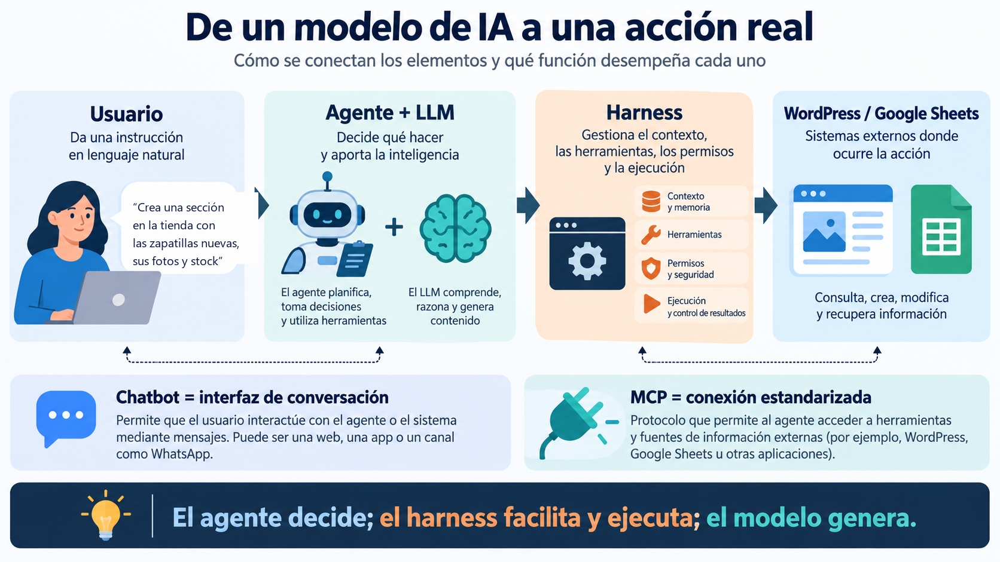
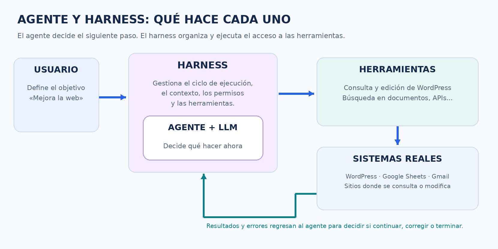
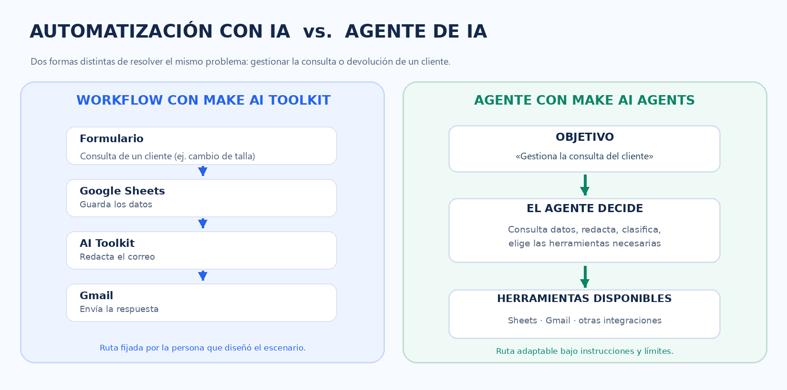
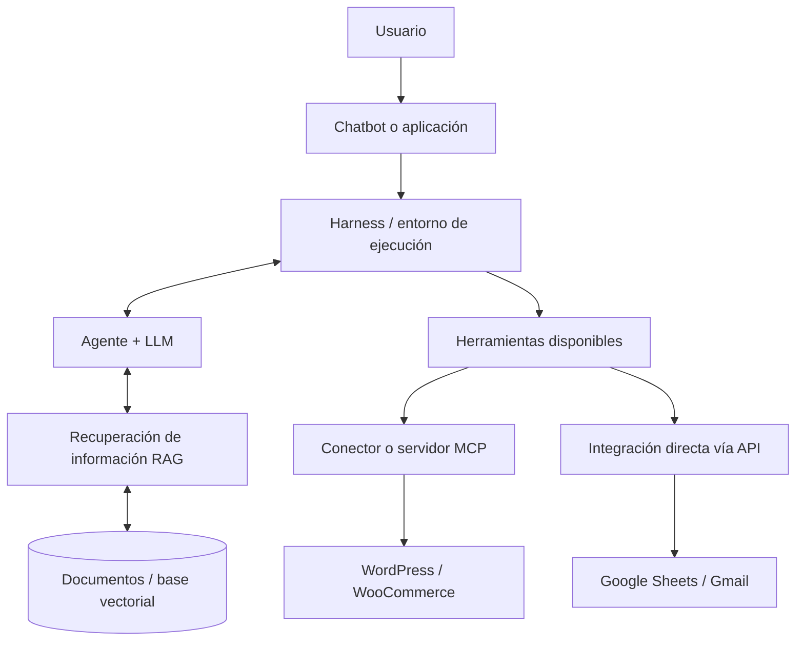

# Conceptos básicos de IA. Modelos, chatbots, agentes, harness y mucho más

**Guía conceptual y comparativa de herramientas**  
**Actualizado:** 12 de octubre de 2026 · **Enfoque:** desarrollo de servicios web, comercio electrónico (WooCommerce) y automatización con IA

> **Idea principal:** no debemos confundir el *modelo* que genera información con la *aplicación* que utilizamos, el *agente* que decide qué hacer, el *harness* que proporciona el entorno de ejecución o el *workflow* que fija una secuencia de tareas.

*Esquema didáctico general. Los elementos no son necesariamente programas independientes ni funcionan siempre en una secuencia lineal.*

## 1. Glosario rápido: qué es cada cosa

| Concepto | Definición sencilla | Lo que lo distingue | Ejemplo |
|---|---|---|---|
| **Modelo de IA / LLM** | Modelo matemático capaz de procesar y generar lenguaje y otros contenidos, según sus capacidades. | Es la capacidad de cómputo e inteligencia, no la aplicación completa. | Un modelo GPT redacta la ficha técnica de unas zapatillas o responde a la duda de un cliente. |
| **Aplicación de IA** | Producto de software que ofrece una interfaz, modelos y servicios al usuario. | Es el producto completo, no un modelo aislado. | ChatGPT, aplicación Claude o aplicación Gemini. |
| **Chatbot** | Interfaz diseñada para conversar mediante mensajes de texto o voz. Puede usar reglas fijas o IA. | Describe **cómo se interactúa**, no cuánto decide el sistema internamente. | Chat de atención al cliente en una tienda online. |
| **Asistente de IA** | Aplicación que ayuda a una persona con tareas concretas respondiendo a sus preguntas. | Es un término funcional amplio; puede o no actuar como agente. | Ayuda a redactar la descripción de un producto o a depurar una función de código CSS/JS. |
| **Agente de IA** | Sistema que utiliza un modelo para elegir pasos y herramientas de forma autónoma con el fin de cumplir un objetivo. | Tiene **capacidad de decisión sobre el proceso**, dentro de ciertos límites. | Comprueba las devoluciones pendientes, revisa el stock de la talla en la tienda, emite una etiqueta de mensajería y avisa al cliente. |
| **Harness de IA / agent harness** | Software que proporciona y gestiona el entorno seguro de ejecución del agente. | Maneja llamadas al modelo, contexto, herramientas, permisos y resultados de ejecución. | Entorno (como Antigravity) que permite al agente leer archivos del proyecto, ejecutar comandos en la terminal y usar herramientas. |
| **Automatización / workflow** | Secuencia de tareas y condiciones predefinidas e invariables. | El recorrido principal lo diseña de antemano una persona. | Make: formulario de soporte → Google Sheets → filtro con IA → aviso por Gmail si es urgente. |
| **Herramienta / tool** | Función u operación concreta que un sistema o agente puede invocar. | Hace **algo específico**; no determina el objetivo general. | Consultar el stock de una talla o actualizar el precio de un producto en la base de datos. |
| **API** | Interfaz programática que permite a dos programas comunicarse e intercambiar datos. | Mecanismo técnico estándar de integración entre aplicaciones. | API REST de WordPress o API de OpenAI. |
| **MCP (Model Context Protocol)** | Protocolo estándar abierto para conectar aplicaciones de IA con herramientas y fuentes externas. | Estandariza cómo se exponen y utilizan esas capacidades para cualquier agente. | Servidor MCP de Novamira para conectar la IA con WordPress. |
| **RAG (Retrieval-Augmented Generation)** | Técnica que busca información en documentos externos antes de que el LLM genere la respuesta. | Aporta conocimiento real y actualizado; **no equivale a un agente**. | Chatbot de la tienda que consulta la tabla oficial de tallas y la política de devoluciones antes de responder. |
| **Embeddings** | Representaciones numéricas (vectores) de textos que permiten buscar por parecido de significado. | Son una forma matemática de representar datos, no el chatbot en sí. | Encontrar productos similares a «zapatillas cómodas de suela plana para skate o vestir». |
| **Base de datos vectorial** | Base de datos especializada en almacenar y buscar vectores a gran velocidad. | Infraestructura de búsqueda semántica, no un modelo conversacional. | Qdrant. |
| **Orquestador** | Software que coordina y encadena eventos, aplicaciones o agentes. | Se centra en la coordinación técnica; puede usar flujos fijos o dinámicos. | Make y n8n. |

**Advertencia terminológica:** en el mercado comercial y publicitario de las empresas tecnológicas, palabras como *agente*, *asistente*, *copilot*, *harness* y *plataforma agéntica* se emplean a menudo como reclamos de ventas. En informática, la categoría técnica depende de la **función concreta y arquitectura** del sistema, no del eslogan comercial.

## 2. Diferencia esencial: GPT vs. ChatGPT, Claude vs. Claude Code y Gemini

### GPT y ChatGPT

- **GPT:** nombre de una familia de modelos de lenguaje de OpenAI (por ejemplo, GPT-4o utilizado mediante API). Aporta capacidades de procesamiento del lenguaje natural, razonamiento y generación de texto o código.
- **ChatGPT:** aplicación web y móvil de OpenAI desde la que los usuarios conversan con esos modelos y acceden a herramientas (navegador web, análisis de datos, generador de imágenes, etc.).
- **Un «GPT personalizado»:** una configuración predefinida dentro de ChatGPT con instrucciones específicas y archivos de conocimiento; **no** es un nuevo modelo entrenado desde cero.

> **Ejemplo:** en una plataforma como Make o mediante un script en Python puedes conectar con un modelo GPT vía API para clasificar opiniones de clientes **sin abrir nunca la web de ChatGPT**. Si en cambio abres tu navegador y escribes una pregunta en el chat, estás utilizando la **aplicación ChatGPT**.
{: .alert-info}

### Claude y Claude Code

- **Claude (familia de modelos):** modelos de Anthropic, como Claude 3.5 Sonnet o Claude 3 Opus.
- **Claude (aplicación):** interfaz web y móvil de Anthropic para conversar y trabajar con su IA.
- **Claude Code:** **herramienta de programación agéntica** que se ejecuta en la terminal o navegador. Puede inspeccionar proyectos de código, editar archivos, ejecutar comandos del sistema y utilizar herramientas externas. Integra tanto la lógica del agente como funciones de harness.

> **Ejemplo:** preguntar en la interfaz web de Claude «¿cómo centro una imagen con CSS?» o «¿qué es una clave primaria?» es una interacción de asistente convencional. En cambio, pedir a **Claude Code** que analice el código de nuestra tienda web, localice un fallo en el carrito de compra, modifique el archivo JavaScript correspondiente y ejecute pruebas en el servidor es una **tarea agéntica**.
{: .alert-info} 

### Gemini, la aplicación Gemini y Google Antigravity

- **Gemini (modelos):** familia de modelos de Google (Gemini 1.5 Pro, Flash, Gemini 2.0).
- **Gemini (aplicación):** interfaz web de Google para interactuar con los modelos Gemini y sus servicios integrados (Drive, Docs, etc.).
- **Google Antigravity:** entorno de desarrollo orientado a agentes que combina editor de código, terminal, navegador y un sistema de control donde los agentes pueden planificar, ejecutar y comprobar tareas complejas. **No es simplemente un modelo, sino una plataforma agéntica completa.**

> **Ejemplo:** un modelo Gemini puede clasificar si la valoración de un cliente sobre unas zapatillas es positiva o negativa; mientras que un agente en **Google Antigravity** puede conectarse a un servidor WordPress mediante MCP, inspeccionar la tienda online, crear nuevas categorías de productos y verificar en el navegador que la interfaz se muestra correctamente.
{: .alert-info}

## 3. La diferencia más importante: agente de IA vs. harness

**El agente es el cerebro lógico que interpreta el objetivo y decide los siguientes pasos. El harness es el software que le proporciona el entorno, los permisos y las herramientas para ejecutar ese ciclo.**

> **Ejemplo con WordPress / WooCommerce:** el usuario pide «revisa el catálogo de zapatillas, comprueba si a algún modelo le falta descripción y añade una ficha técnica para las nuevas deportivas urbanas con sus tallas y stock».
> 
> 1. El **harness** recibe la tarea, prepara el contexto del proyecto y expone las herramientas autorizadas (servidor MCP de WordPress, base de datos de productos, sistema de archivos).
> 2. El **agente, apoyado en el LLM**, razona qué hacer primero: decide llamar a la herramienta para listar los productos actuales de la tienda.
> 3. El **harness** ejecuta la llamada técnica a través del servidor MCP de WordPress y devuelve los datos al agente.
> 4. El **agente** analiza los datos devueltos, detecta qué productos necesitan ficha y redacta el texto adaptado al público joven con sus especificaciones.
> 5. El **harness** tramita las modificaciones autorizadas en la base de datos de WordPress (crear la ficha de producto con sus atributos de talla y precio) y recoge el resultado.
> 6. El **agente** verifica que el producto ha quedado publicado correctamente y concluye la tarea avisando al usuario.
{: .alert-info}

### Lo que no conviene confundir

| Pregunta clave | Agente de IA | Harness de IA |
|---|---|---|
| ¿Cuál es el objetivo? | Lo interpreta y busca la mejor estrategia para cumplirlo. | Lo recibe del usuario y lo traslada a los componentes correspondientes. |
| ¿Qué hago ahora? | Decide el siguiente paso a dar según sus instrucciones y razonamiento. | Proporciona el entorno para ejecutar el paso seleccionado. |
| ¿Qué herramientas existen? | Las selecciona según las necesidades de la tarea. | Las configura, expone de forma segura y gestiona los permisos de acceso. |
| ¿Cómo se aplica un cambio? | Decide qué cambio realizar y solicita su aplicación. | Ejecuta la operación real a través de APIs, terminal o conectores MCP. |
| ¿Qué hago ante un error? | Analiza el fallo recibido y decide un camino alternativo. | Captura los errores del sistema, registra logs y aplica límites de seguridad. |

**Matiz decisivo:** no son necesariamente dos programas independientes. Herramientas como **Claude Code, Codex o Google Antigravity** aúnan la lógica del agente y la infraestructura del harness en un mismo entorno de trabajo.

También existe el concepto de **grado de autonomía**: un agente en un entorno profesional no tiene permisos ilimitados. Por ejemplo, en una tienda online real puede requerir confirmación humana antes de eliminar un producto, publicar un cambio en el sitio de producción o emitir un reembolso de dinero a un cliente.

## 4. Workflow con IA vs. agente de IA

> **Ejemplo de workflow tradicional con IA (Make + Make AI Toolkit):**
> 
> 1. Un cliente envía un formulario consultando por un cambio de talla de zapatillas.
> 2. Make registra la petición en una fila de Google Sheets.
> 3. Make AI Toolkit analiza el mensaje y extrae la talla solicitada y el número de pedido.
> 4. Make evalúa una condición prefijada (*if/else*) y envía un correo automático con Gmail con las instrucciones estándar de devolución.
> 
> *Aquí la IA ejecuta una tarea concreta dentro de una ruta fija diseñada de antemano. No decide por sí misma qué pasos dar a continuación ni puede alterar el camino.*
{: .alert-info}

> **Ejemplo de agente de IA (Make AI Agents):**
> 
> 1. Recibe el objetivo global: «Gestiona la solicitud del cliente sobre el pedido de zapatillas #1042».
> 2. Consulta las herramientas disponibles (consultar stock en WooCommerce, consultar empresa de paquetería, generar cupón de descuento, enviar correo).
> 3. Decide dinámicamente qué hacer: primero comprueba si queda stock de la talla solicitada en la base de datos de la tienda. Si hay stock, reserva el par y crea la etiqueta de cambio; si no hay stock, decide buscar un modelo similar o tramitar el reembolso del dinero.
> 4. Invoca las herramientas adecuadas y reconsidera los siguientes pasos según las respuestas que recibe de cada sistema.
{: .alert-info}

**Por tanto, Make AI Toolkit no es un agente.** Es un conjunto de módulos de IA para tareas puntuales dentro de flujos rígidos. **Make AI Agents** sí permite configurar un comportamiento agéntico donde el sistema elige dinámicamente qué herramientas y conectores MCP usar para alcanzar el objetivo.

La diferencia no radica en «usar IA frente a no usarla», sino en **quién decide el recorrido**: la persona que diseñó el flujo de antemano o el agente de forma autónoma durante su ejecución.

## 5. Tabla de clasificación de nombres y herramientas conocidas

> **Cómo leerla:** aparece la **categoría predominante**, aunque algunos productos combinan varias funciones. «Con agente» no significa que todas sus funciones sean completamente autónomas.

| Nombre | Empresa / proyecto | Clasificación principal | Diferencia o ejemplo claro |
|---|---|---|---|
| **GPT** | OpenAI | **Familia de modelos** | Motor de IA utilizado por aplicaciones o mediante API. |
| **ChatGPT** | OpenAI | **Aplicación de IA / asistente** | Producto para conversar, trabajar con archivos y usar capacidades adicionales. |
| **GPT personalizado** | OpenAI | **Asistente configurado dentro de ChatGPT** | Instrucciones y recursos especializados; no es un nuevo modelo. |
| **Codex** | OpenAI | **Producto de agente de programación + entorno de ejecución** | Trabaja sobre código fuente, realiza modificaciones y ejecuta tareas; dispone de app, web, IDE y CLI. |
| **Codex CLI** | OpenAI | **Interfaz de terminal para el agente Codex** | Permite utilizar Codex directamente desde la consola de comandos. |
| **Claude (modelos)** | Anthropic | **Familia de modelos** | Modelos Sonnet, Opus y Haiku de Anthropic. |
| **Claude (aplicación)** | Anthropic | **Aplicación / asistente de IA** | Interfaz web para conversar y trabajar con la IA de Anthropic. |
| **Claude Code** | Anthropic | **Agente de programación con funciones de harness** | Analiza proyectos de software, edita archivos, ejecuta comandos e integra herramientas. |
| **Gemini (modelos)** | Google | **Familia de modelos** | Motores de IA de Google accesibles por API o integrados en sus productos. |
| **Gemini (aplicación)** | Google | **Aplicación / asistente de IA** | Interfaz web y móvil para interactuar con los modelos Gemini. |
| **Gemini CLI** | Google | **Herramienta / agente de terminal para desarrollo** | Trabaja sobre proyectos informáticos mediante comandos en lenguaje natural. |
| **Google Antigravity** | Google | **Plataforma de desarrollo agéntico / IDE** | Orquesta agentes que trabajan de forma coordinada en editor de código, terminal y navegador. |
| **Google AI Studio** | Google | **Entorno para experimentar con modelos y APIs** | Diseñar prompts, probar parámetros y obtener claves de API para desarrolladores. |
| **Replit** | Replit | **Plataforma de desarrollo en la nube** | Entorno con servidor virtual, editor y ejecución de proyectos web. |
| **Replit Agent** | Replit | **Agente de desarrollo integrado en Replit** | Genera, prueba y despliega aplicaciones web completas a partir de instrucciones en lenguaje natural. |
| **Cursor** | Anysphere | **Editor de código (IDE) con agentes de IA** | Fork de VS Code con funciones avanzadas para editar y refactorizar código con IA. |
| **GitHub Copilot** | GitHub / Microsoft | **Asistente y herramientas agénticas de desarrollo** | Autocompletado de código, chat técnico y automatizaciones en repositorios Git. |
| **Make** | Make | **Automatización y orquestación** | Plataforma para conectar aplicaciones, datos y servicios mediante flujos visuales. |
| **Make AI Toolkit** | Make | **Módulos de IA para workflows** | Clasificar textos, analizar sentimientos o resumir información dentro de una ruta prefijada. |
| **Make AI Agents (New)** | Make | **Entorno de ejecución de agentes** | Agente que elige dinámicamente qué módulos de Make o herramientas MCP usar para lograr un fin. |
| **n8n** | n8n | **Automatización y orquestación (código abierto)** | Similar a Make pero autoalojable en servidores propios, con soporte para nodos agénticos. |
| **Zapier** | Zapier | **Automatización y orquestación** | Conector de aplicaciones en la nube con funciones añadidas de IA. |
| **Novamira MCP (WordPress)** | Novamira | **Servidor / conector MCP** | Expone las funciones de WordPress (páginas, entradas, productos) a los agentes de IA. |
| **WordPress REST API** | WordPress | **API web estándar** | Permite leer y modificar datos de WordPress desde aplicaciones externas mediante peticiones HTTP (JSON). |
| **Qdrant** | Qdrant | **Base de datos vectorial** | Almacena y busca representaciones vectoriales para implementar búsquedas semánticas y RAG. |
| **OpenAI Agents SDK** | OpenAI | **Librería de desarrollo para agentes** | Permite a los programadores crear agentes con código, definir herramientas y gestionar traspasos de tareas. |

### Dos matices esenciales sobre la tabla

1. **Claude, GPT y Gemini son nombres que pueden prestarse a confusión:** según el contexto se refieren a una familia de modelos matemáticos o a la aplicación web de cara al usuario. En informática es imprescindible distinguir entre el **modelo subyacente** y la **aplicación que lo implementa**.
2. **Herramientas como Codex, Claude Code, Antigravity o Replit Agent son sistemas integrados:** la experiencia visible es la de un agente inteligente, pero por debajo cuentan con un harness que gestiona el contexto, ejecuta código real y maneja las herramientas. No son únicamente «un LLM» ni «un harness vacío».

## 6. Dónde encajan API, MCP y RAG

- **API (Application Programming Interface):** interfaz técnica que permite a un software solicitar datos u operaciones a otro sistema. Es un canal de comunicación; por sí misma no contiene inteligencia ni capacidad de decisión.
- **MCP (Model Context Protocol):** estándar abierto que normaliza cómo los agentes de IA descubren y ejecutan herramientas externas. No sustituye a las APIs, sino que las envuelve: un servidor MCP utiliza a menudo APIs internamente para interactuar con sistemas como WordPress o bases de datos.
- **RAG (Retrieval-Augmented Generation):** técnica que consiste en buscar información en fuentes fiables (bases de datos, PDFs, documentación) e inyectarla en el prompt del LLM antes de que este genere la respuesta. Evita que la IA «alucine» o invente datos que no conoce.
- **Embeddings + Base Vectorial (Qdrant):** método matemático para indexar textos por su significado semántico y recuperarlos velozmente en un sistema RAG.

> **Ejemplo clarificador:**  
> Un chatbot en una tienda de ropa y zapatillas puede responder a la duda «¿cómo sé si me quedará bien la talla 42 o si puedo devolverla?» consultando la tabla de medidas y las condiciones de compra mediante **RAG**.  
> 
> Si el cliente a continuación escribe «la talla 42 me queda pequeña, cámbiamela por la 43», y el sistema consulta el stock en tiempo real en la base de datos de WooCommerce, reserva el nuevo par y genera una orden de recogida en la empresa de mensajería usando herramientas conectadas por **MCP**, estamos ante un **sistema agéntico**.  
> 
> La diferencia fundamental no es usar o no RAG, sino **si el sistema solo busca información para responder o si razona y ejecuta cambios reales en el servicio web**.
{: .alert-info}

## 7. Caso práctico completo: una tienda online de ropa urbana y zapatillas (Sneakers & Streetwear)

Para comprender cuándo aplicar cada tecnología en un proyecto real de servicios web, analicemos las necesidades de una tienda de comercio electrónico basada en **WordPress y WooCommerce**:

| Necesidad en la tienda | Solución adecuada | ¿Por qué desde el punto de vista informático? |
|---|---|---|
| Redactar un correo de bienvenida con un cupón de descuento tras el registro | **LLM (generación puntual)** integrado vía API | Es una tarea de generación de texto simple a partir de datos conocidos del usuario. |
| Responder dudas sobre equivalencia de tallas, cuidados del calzado o política de devoluciones | **Chatbot con RAG** | Conversación natural que consulta la documentación oficial de la tienda sin inventar datos ni alucinar. |
| Registrar cada nueva compra en Google Sheets y enviar un aviso al canal de Discord del almacén | **Workflow de automatización** (Make / n8n) | Es una secuencia 100% predecible, repetitiva e idéntica en cada pedido; no requiere que una IA tome decisiones sobre la marcha. |
| Analizar las reseñas de los clientes y alertar al equipo si un modelo de zapatillas recibe quejas por venir defectuoso | **Workflow + módulo de IA** (análisis de sentimiento) | La ruta está prefijada mediante reglas lógicas (*si la puntuación es baja o el sentimiento negativo → enviar alerta*); la IA solo clasifica el texto. |
| Gestionar una incidencia compleja de un pedido (ej. paquete extraviado o zapatillas con tara), consultando la mensajería, el stock y decidiendo de forma autónoma si reenviar el producto o reembolsar el dinero | **Agente de IA** con herramientas (MCP) y supervisión humana | El camino a seguir depende de cada situación concreta; el sistema debe evaluar datos de varias fuentes, tomar decisiones y ejecutar acciones en distintos sistemas. |
| Crear o actualizar el catálogo de WordPress/WooCommerce con una nueva colección a partir de fotos y especificaciones del fabricante | **Agente de desarrollo** + herramientas MCP de WordPress | Debe explorar categorías existentes, crear productos con atributos variables (tallas, colores), subir imágenes y verificar que la web responde correctamente. |
| Mantener sincronizada la base de conocimiento de la tienda (guía de tallas, manuales y fichas técnicas) con el motor de búsqueda vectorial | **Workflow / script programado** (WordPress → Make → Qdrant/RAG) | Proceso automatizado y determinista (ejecutado por un cron job) para recalcular y actualizar los embeddings periódicamente. |

**Criterio práctico de ingeniería:**  
En el desarrollo de servicios web y sistemas informáticos, cuanto más **repetible, estructurado y predecible** sea el proceso, más conveniente es resolverlo mediante un **workflow o algoritmo tradicional**.  
Cuanto más **abierta y variable** sea la situación, y más requiera razonar sobre la marcha y elegir qué herramientas utilizar, mayor valor aportará un **agente de IA**.  
Utilizar un agente de IA para una tarea que se resuelve con un flujo determinista no mejora el sistema: introduce latencia innecesaria, incrementa el coste económico en consumo de tokens y añade incertidumbre en tareas que deberían ser 100% exactas.

## 8. Errores frecuentes que conviene evitar

- **«ChatGPT es GPT».** No: ChatGPT es la aplicación web/móvil con su interfaz; GPT es la familia de modelos matemáticos que procesan el lenguaje.
- **«Si un programa usa IA, ya es un agente».** No: puede tratarse simplemente de una llamada puntual a un modelo para clasificar un texto o traducir una frase dentro de un código convencional.
- **«Un chatbot es siempre un agente».** No: *chatbot* describe el canal de comunicación (un chat de texto o voz). Puede funcionar mediante reglas rígidas de botones, mediante un LLM básico o estar conectado a un agente autónomo.
- **«Un harness y un agente son lo mismo».** No: el agente aporta la capacidad de razonamiento y toma de decisiones; el harness proporciona el entorno seguro de ejecución y los conectores con el mundo real.
- **«El protocolo MCP dota a la IA de autonomía por sí mismo».** No: MCP es un protocolo de conexión técnica estándar para exponer herramientas; es el agente quien debe decidir cuándo y cómo utilizarlas.
- **«RAG es un chatbot».** No: RAG es una técnica de recuperación de datos externos para complementar las respuestas de un modelo; un chatbot es una de las muchas interfaces que pueden beneficiarse de RAG.
- **«Make AI Toolkit es un agente».** No: son módulos individuales de IA que se intercalan dentro de un flujo lineal diseñado previamente por una persona.
- **«Los agentes de IA actúan siempre sin supervisión humana».** No: en entornos profesionales y de producción se establecen políticas de seguridad (*human-in-the-loop*), donde acciones críticas (borrar datos, publicar en vivo o realizar cobros) exigen la confirmación explícita de un administrador.

## 9. Fórmula de repaso para clase

> **Modelo (LLM):** procesa y genera la información (el motor de razonamiento).  
> **Aplicación o chatbot:** proporciona la interfaz para que el usuario interactúe.  
> **Agente:** interpreta un objetivo y decide qué pasos y herramientas utilizar.  
> **Harness:** proporciona el entorno de ejecución, gestiona el contexto y ejecuta las operaciones.  
> **Workflow:** ejecuta una secuencia fija y predeterminada de tareas.  
> **API / MCP:** conecta programas entre sí y estandariza el acceso a herramientas.  
> **RAG:** busca y suministra información verídica de fuentes externas antes de generar la respuesta.

**Frase para recordar:** «El modelo aporta el razonamiento; el agente utiliza ese razonamiento para tomar decisiones; el harness proporciona el entorno de trabajo seguro; las herramientas permiten actuar sobre los sistemas reales; y el chatbot o la aplicación es la puerta de entrada para el usuario».

---

## Fuentes y referencias de consulta

Se han priorizado fuentes oficiales para clasificar los productos. Sus funciones comerciales, modelos disponibles, precios y condiciones de acceso pueden cambiar con el tiempo.

1. [OpenAI — Catálogo de modelos de la API](https://developers.openai.com/api/docs/models).
2. [OpenAI — Codex](https://openai.com/codex/).
3. [OpenAI — GPTs personalizados en ChatGPT](https://help.openai.com/en/articles/8554407-what-are-gpts).
4. [Anthropic — Claude Code: descripción general](https://code.claude.com/docs/en/overview).
5. [Anthropic — Building effective agents](https://www.anthropic.com/engineering/building-effective-agents).
6. [Google — Antigravity como plataforma de desarrollo agéntico](https://developers.googleblog.com/en/build-with-google-antigravity-our-new-agentic-development-platform/).
7. [Google — Modelos de Gemini](https://ai.google.dev/gemini-api/docs/models).
8. [Replit — Replit Agent](https://docs.replit.com/features/agent/overview).
9. [Make — Introducción a Make AI Agents (New)](https://help.make.com/introduction-to-make-ai-agent-new).
10. [Make — Herramientas MCP en Make AI Agents](https://help.make.com/make-ai-agents-new-mcp-tools-are-now-available).
11. [MCP — Documentación oficial](https://modelcontextprotocol.io/introduction).
