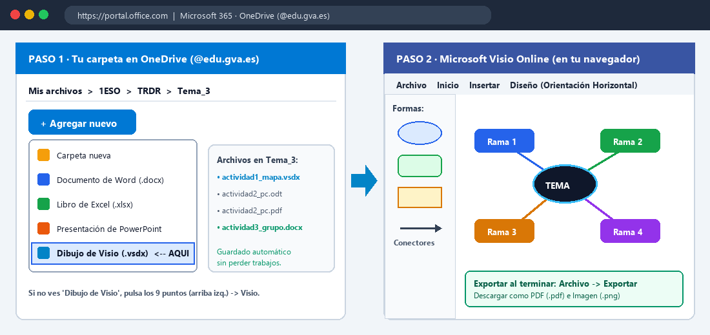
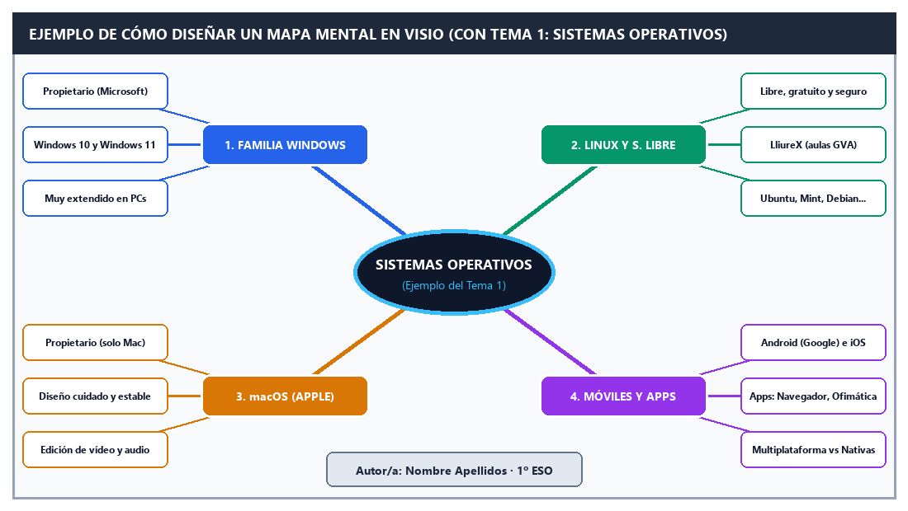

# ➡️ Actividad 1: El cerebro de la máquina en un vistazo · Mapa mental del ordenador (Microsoft Visio Online en OneDrive)

## 🎯 Objetivo de la actividad

Acabas de estudiar en el **[Apartado 1: Introducción](../introduccion)** la diferencia entre Hardware y Software, los bloques principales de un equipo, la clasificación detallada de los periféricos (**Entrada, Salida y Entrada/Salida**) y cómo funciona tu nube corporativa de **Microsoft OneDrive (`@edu.gva.es`)**.

En esta primera actividad vas a estrenar tu espacio en **OneDrive** diseñando directamente desde el navegador, con **Microsoft Visio Online**, un **Mapa Mental jerárquico, coloreado y con conectores inteligentes** que resuma toda la arquitectura del ordenador de un solo vistazo.

> 💡 **¿Dudas con Visio Online?** Consulta paso a paso cómo abrir Visio desde OneDrive, poner el lienzo en horizontal, añadir conectores y exportar tu diagrama en el **[Bloque A de la Guía Práctica de Herramientas](../guia_practica_writer)**.
{: .alert-info}

---

## 🛠️ Pasos de la actividad en OneDrive y Visio Online

### Paso 1. Prepara tu carpeta del Tema 3 en OneDrive (`@edu.gva.es`)

1. Abre el navegador web (Chrome o Firefox), entra en **[portal.office.com](https://portal.office.com){:target="_blank"}** e inicia sesión con tu correo corporativo **`@edu.gva.es`**.
2. Abre la aplicación **OneDrive** (icono de la nube azul en el menú izquierdo) y entra en **Mis archivos**.
3. Crea la estructura de carpetas del curso pulsando en **`+ Agregar nuevo` -> `Carpeta`** (si todavía no la tienes): **`1ESO`** ➔ dentro **`TRDR`** ➔ dentro **`Tema_3`**.
4. *(Además, crea también la carpeta local `Documentos/1ESO/TRDR/Tema_3` en el explorador Dolphin de tu ordenador del aula para guardar las descargas).*

---

### Paso 2. Crea el diagrama en Microsoft Visio Online desde OneDrive

{: .img .img-650}

**Guía visual: cómo crear tu Dibujo de Visio Online dentro de la carpeta `Tema_3` en OneDrive y exportarlo al terminar**
{: .centrado}

1. Entra dentro de tu carpeta **`1ESO/TRDR/Tema_3`** en OneDrive, pulsa el botón **`+ Agregar nuevo`** (o el botón azul **Crear**) y selecciona **`Dibujo de Visio`** *(si no aparece en ese desplegable, abre el menú de los 9 puntitos arriba a la izquierda -> **Todas las aplicaciones** -> **Visio** -> **Nuevo dibujo en blanco**, y luego muévelo a tu carpeta `Tema_3`)*.
2. **Cambia el nombre al archivo** haciendo clic en el título superior (`Dibujo.vsdx`) y ponle:
   **`actividad1_mapa_ordenador_tuapellido_tunombre`** *(todo lo que dibujes se guardará automáticamente como `.vsdx` en tu nube de OneDrive)*.
3. Pon el lienzo en **Horizontal**: ve a la pestaña **`Diseño` -> `Orientación` -> `Horizontal`**.
4. Fíjate en el siguiente **ejemplo hecho con el Tema 1 (Sistemas Operativos)** que ya conoces para ver cómo debe estructurarse un mapa mental de 3 niveles con formas, conectores y colores en Visio *(¡recuerda que el tuyo NO es de sistemas operativos, sino sobre **El Ordenador: Hardware y Software** del Paso 3!)*:

{: .img .img-650}

**Ejemplo orientativo de estructura jerárquica en Visio Online usando el Tema 1 (Sistemas Operativos)**
{: .centrado}

---

### Paso 3. Estructura obligatoria del Mapa Mental (3 niveles jerárquicos)

Construye tu mapa mental desde el centro hacia fuera utilizando **formas geométricas distintas según el nivel** y **4 colores temáticos diferenciados**:

* **🟢 Nivel 0 (Nodo Central):**
  * Arrastra una **Elipse o Círculo grande** al centro del lienzo con el título destacado: **`EL ORDENADOR (Hardware y Software)`**.
* **🔵 Nivel 1 (4 Ramas Principales con Rectángulos Redondeados):**
  Conecta desde el nodo central **4 ramas principales**, cada una con su color propio:
  1. **Rama 1 (Azul) · `1. PROCESAMIENTO Y MEMORIA`**
  2. **Rama 2 (Verde) · `2. PERIFÉRICOS DE ENTRADA (E)`**
  3. **Rama 3 (Naranja) · `3. PERIFÉRICOS DE SALIDA (S) Y MIXTOS (E/S)`**
  4. **Rama 4 (Morado) · `4. SOFTWARE Y NUBE`**
* **🟡 Nivel 2 (Subnodos con los elementos explicados en el Apartado 1):**
  De cada rama principal deben salir **al menos 3 o 4 cajas conectadas** resumiendo los conceptos clave y ejemplos:
  * **En la Rama 1 (Procesamiento y Memoria):**
    * **Placa Base:** conecta todas las piezas internas.
    * **CPU (Procesador):** el cerebro que calcula.
    * **Memoria RAM:** memoria temporal y **volátil** (mesa de trabajo).
    * **Almacenamiento permanente:** unidad **SSD** (rápida), **HDD** (mecánico) y **Nube**.
    * **GPU (Gráfica) y Fuente (PSU).**
  * **En la Rama 2 (Periféricos de Entrada — *Exterior ➔ PC*):**
    * **Teclado y Ratón / Touchpad** (texto y puntero).
    * **Micrófono y Webcam** (voz y vídeo).
    * **Escáner, lector de códigos y tableta digitalizadora.**
  * **En la Rama 3 (Periféricos de Salida y Entrada/Salida):**
    * **Salida (*PC ➔ Exterior*):** Monitor tradicional (no táctil), proyector, altavoces, auriculares simples e impresora básica.
    * **Mixtos E/S (*Exterior ⇄ PC*):** Pantalla táctil (móvil/tablet/pizarra), impresora multifunción y auriculares con micrófono (*headset*).
    * **Mixtos E/S de datos/red:** Casco VR, pendrive USB / disco externo y router.
  * **En la Rama 4 (Software y Nube):**
    * **Sistemas Operativos:** LliureX, Windows, macOS, Android, iOS.
    * **Aplicaciones:** Microsoft Visio Online, LibreOffice Writer, Word Online, Navegador.
    * **Nube educativa:** **OneDrive (`@edu.gva.es`)** y **Aules**.

---

### Paso 4. Requisitos técnicos y estéticos en Visio Online

1. **Conectores automáticos anclados:** Une todas las cajas arrastrando desde los **triángulos azules / puntos de conexión** de cada forma en Visio (de modo que si mueves una caja, la flecha o línea la acompañe automáticamente).
2. **Código de colores y legibilidad:** Cada una de las 4 ramas debe tener su propio color coherente (relleno y bordes) y el texto debe leerse con claridad sin salirse de ninguna forma.
3. **Iconos o formas ilustradas:** Utiliza el buscador de formas de Visio Online (en el panel izquierdo) o inserta al menos **4 iconos/símbolos sencillos** (por ejemplo: nube, pantalla, teclado, engranaje/chip) para hacer el mapa más visual.
4. **Sello de autoría:** Inserta un cuadro de texto en la esquina inferior del lienzo con tu **Nombre, Apellidos, Grupo (`1º ESO`) y Fecha**.

---

## 📤 Exportación desde Visio Online y Entregas en Aules

Una vez finalizado tu mapa mental en **Visio Online** (recuerda que ya queda guardado automáticamente en tu carpeta `1ESO/TRDR/Tema_3` de OneDrive), realiza estas 3 descargas para entregar en Aules:

1. **Descargar PDF:** Ve a **`Archivo` -> `Exportar` -> `Descargar como PDF`** (`actividad1_mapa_ordenador_tuapellido_tunombre.pdf`).
2. **Descargar Imagen PNG:** Ve a **`Archivo` -> `Exportar` -> `Descargar como imagen`** en formato **PNG** (`actividad1_mapa_ordenador_tuapellido_tunombre.png`).
3. **Descargar copia editable de Visio (`.vsdx`) o captura de OneDrive:** Ve a **`Archivo` -> `Guardar como` -> `Descargar una copia`** (`actividad1_mapa_ordenador_tuapellido_tunombre.vsdx`).

> Deberás entregar en la tarea de **Aules** los siguientes **tres archivos**:
- **`actividad1_mapa_ordenador_tuapellido_tunombre.vsdx`** *(copia editable descargada de Microsoft Visio Online)*
- **`actividad1_mapa_ordenador_tuapellido_tunombre.png`** *(imagen exportada del mapa mental)*
- **`actividad1_mapa_ordenador_tuapellido_tunombre.pdf`** *(documento exportado en PDF)*

---

## 📊 Rúbrica de Evaluación (máx. 10 puntos)

| Criterio | Nivel 1 (Insuficiente) | Nivel 2 (Básico) | Nivel 3 (Adecuado) | Nivel 4 (Excelente) |
| :--- | :--- | :--- | :--- | :--- |
| **1. Rigor del contenido técnico (Hardware, Procesamiento, Periféricos E/S/Mixtos y Software)** *(máx. 3 puntos)* | **0 puntos:** El mapa mental está vacío, incompleto o no incluye los conceptos del Apartado 1. | **1 punto:** Incluye solo 1 o 2 de las 4 ramas principales, o clasifica mal periféricos básicos (por ejemplo, confunde entrada con salida o pantalla táctil con monitor normal). | **2 puntos:** Incluye las 4 ramas completas (Procesamiento/Memoria, Entrada, Salida/Mixtos y Software/Nube) con la mayoría de ejemplos, aunque omite algún detalle puntual. | **3 puntos:** Sintetiza con total rigor las 4 ramas completas del Apartado 1: procesamiento/RAM volátil/SSD, periféricos de Entrada, diferenciación exacta entre Salida y Mixtos (E/S) y Software/OneDrive. |
| **2. Uso de Microsoft Visio Online en OneDrive y Conectores anclados** *(máx. 3 puntos)* | **0 puntos:** No utiliza Microsoft Visio Online o entrega cajas sueltas sin estructura ni conexiones. | **1 punto:** Crea el diagrama en Visio pero usa líneas sueltas sin anclar a los puntos de conexión o no configura la orientación horizontal ni los 3 niveles jerárquicos. | **2 puntos:** Trabaja en Visio Online en formato horizontal con 3 niveles jerárquicos y conectores anclados en casi todas las cajas, con algún pequeño desajuste de alineación. | **3 puntos:** Dominio impecable de Microsoft Visio Online en orientación horizontal con 3 niveles claros, formas geométricas diferenciadas por nivel y todas las cajas enlazadas con conectores automáticos anclados. |
| **3. Diseño visual, código de colores, iconos y sello de autoría** *(máx. 2 puntos)* | **0 puntos:** Sin colores diferenciados, texto ilegible que se corta en las cajas, sin iconos ni nombre del autor. | **0,5 puntos:** Aplica colores básicos sin coherencia por ramas, dificultando la lectura, o faltan los iconos y el sello de autoría. | **1 punto:** Aplica un código de colores claro por rama e incluye el sello de autoría, pero añade menos de 4 iconos ilustrativos o algún contraste es mejorable. | **2 puntos:** Acabado visual muy cuidado con paleta de colores coherente para las 4 ramas, tipografía legible, al menos 4 iconos/formas visuales integrados y sello de autoría completo. |
| **4. Organización en OneDrive y entrega multiformato (.vsdx, .png y .pdf)** *(máx. 2 puntos)* | **0 puntos:** No entrega los archivos en los formatos solicitados o entrega un archivo vacío o dañado. | **0,5 puntos:** Entrega únicamente 1 de los 3 formatos requeridos (por ejemplo, solo el PDF sin la copia `.vsdx` ni la imagen `.png`). | **1 punto:** Entrega 2 de los 3 formatos solicitados o los archivos no siguen la nomenclatura indicada. | **2 puntos:** Mantiene el archivo organizado en su carpeta `1ESO/TRDR/Tema_3` de OneDrive y entrega correctamente en Aules los 3 formatos (`.vsdx`, `.png` y `.pdf`) bien nombrados. |
| **5. Entrega en plazo** *(máx. 0 puntos)* | **-2 puntos:** No entrega la actividad o realiza una entrega vacía o con retraso muy grave sin justificación. | **-1,5 puntos:** Entrega con un retraso importante respecto al plazo establecido en Aules. | **-1 punto:** Entrega con un pequeño retraso respecto a la fecha y hora límite de entrega. | **0 puntos:** Entrega puntual de los archivos en Aules dentro del plazo establecido. |

> ⚠️ **Nota sobre la entrega en plazo:** La entrega dentro del plazo establecido no resta puntuación (0 pts). Las entregas con retraso supondrán una penalización de hasta 2 puntos sobre la calificación de la actividad.
{: .alert-error}

---

[👈 Volver al Apartado 1 (Introducción)](../introduccion) | [🏠 Índice del Tema 3](../index) | [👉 Ir al Apartado 2 (Placa Base)](../componentes_y_placa_base)
