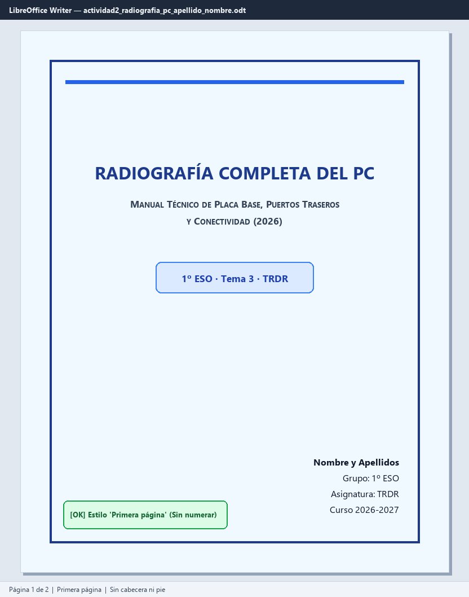
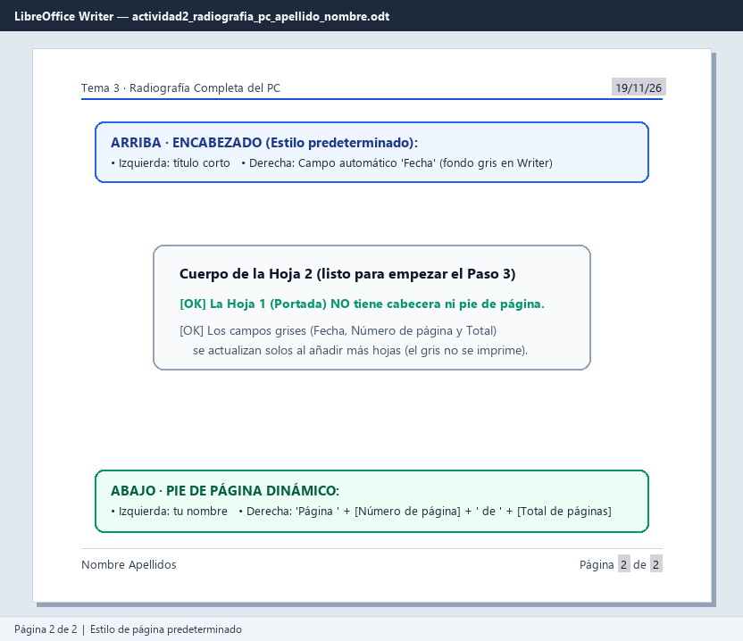
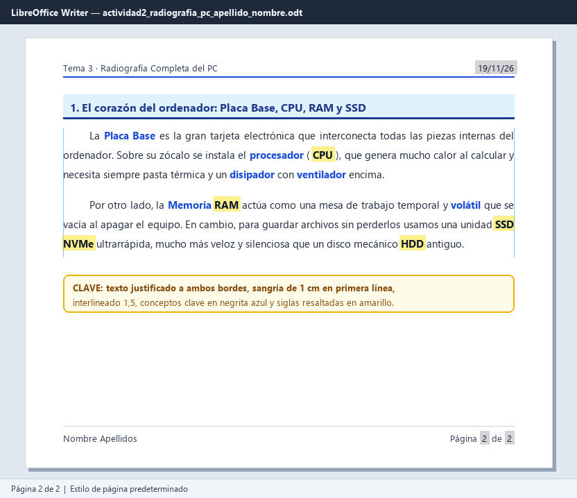
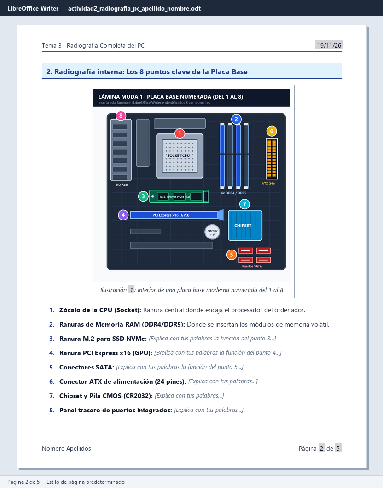
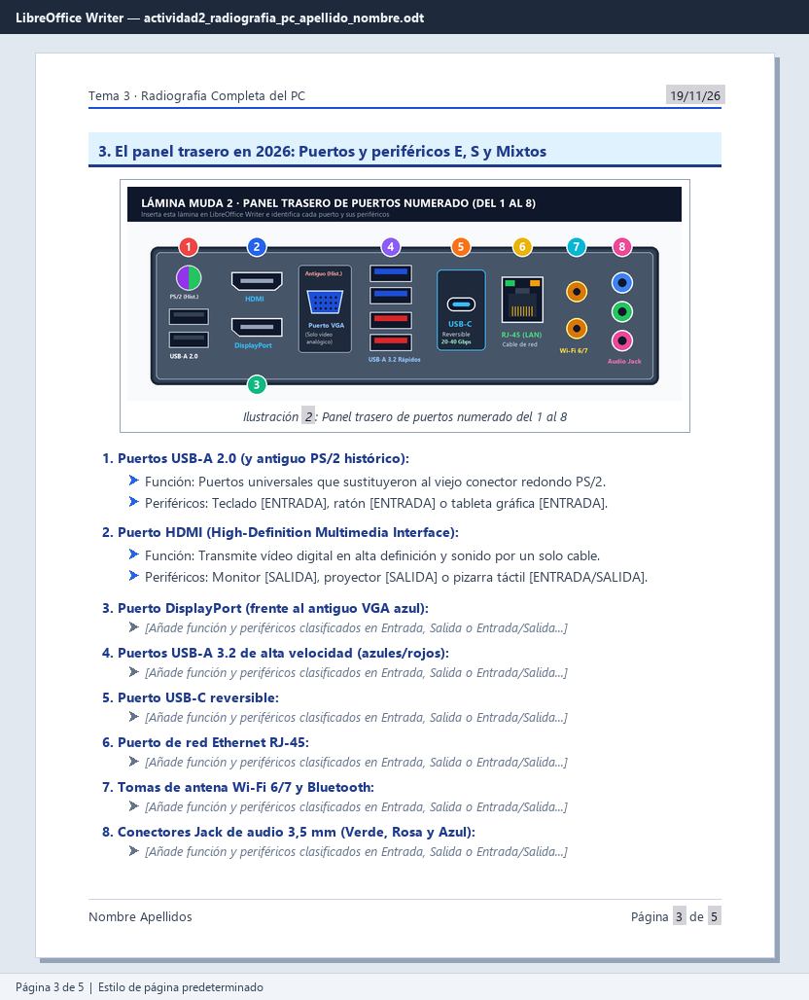
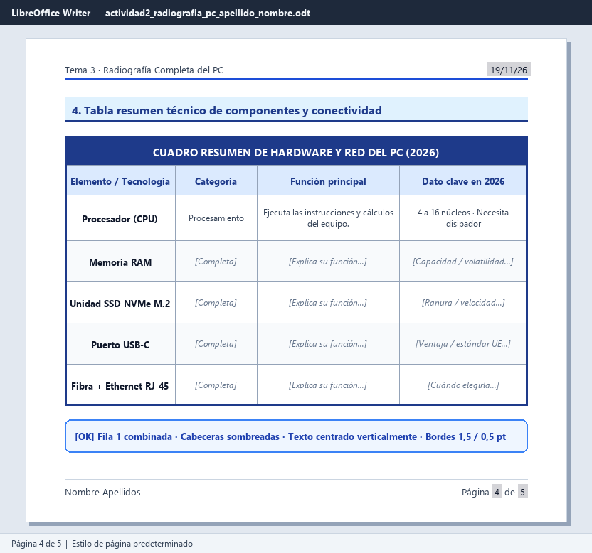
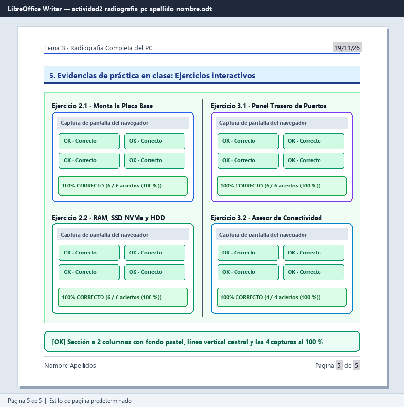

# ➡️ Actividad 2: Radiografía completa del PC · Manual técnico guiado paso a paso (LibreOffice Writer)

## 🎯 Objetivo de la actividad

Has completado los **Apartados 2 y 3** (Placa Base, componentes internos, Panel Trasero 2026, periféricos y redes) junto con sus **4 ejercicios interactivos de clase**. Ahora vas a crear de forma **individual** y **paso a paso** un **Manual Técnico Completo en LibreOffice Writer** que reunirá todas las herramientas fundamentales de maquetación profesional de un procesador de textos:

* ✅ **Portada limpia sin numerar** (estilo *Primera página*, borde decorativo, fondo pastel y subtítulo en **Versalitas**).
* ✅ **Encabezados y pies de página con Campos Dinámicos** (*Fecha automática* y *`Página X de Y`*).
* ✅ **Formato de carácter y párrafo** (justificado, sangría de primera línea, interlineado `1,5`, resaltado de siglas y títulos con borde/sombreado).
* ✅ **Láminas técnicas con Leyenda Automática** (`Ilustración 1` y `Ilustración 2`) y **Listas Multinivel con viñetas personalizadas**.
* ✅ **Tabla avanzada de resumen técnico** (celdas combinadas, colores de cabecera y centrado vertical).
* ✅ **Sección a 2 columnas** para insertar tus **4 capturas de los ejercicios interactivos** resueltos en clase.

> 💡 **¿Te atascaste en algún paso de Writer?** Abre en otra pestaña el **[Bloque B de la Guía Práctica de Herramientas](../guia_practica_writer)** donde tienes todos los menús y atajos resumidos.
{: .alert-info}

---

## 📥 Materiales previos necesarios antes de empezar

Asegúrate de tener ya guardados en tu carpeta `Documentos/1ESO/TRDR/Tema_3/`:

1. 🖼️ **[Descargar Lámina Muda 1: Interior de la Placa Base (del 1 al 8)](../images/placa_base_lamina_muda.png)**
2. 🖼️ **[Descargar Lámina Muda 2: Panel Trasero de Puertos (del 1 al 8)](../images/panel_trasero_lamina_muda.png)**
3. 📸 Tus **4 capturas de pantalla** de los ejercicios interactivos resueltos al 100 % en verde:
   * `ej2_1_placa_base.png` y `ej2_2_memorias.png` (del [Apartado 2](../componentes_y_placa_base)).
   * `ej3_1_puertos.png` y `ej3_2_redes.png` (del [Apartado 3](../puertos_perifericos_y_redes)).

---

## 🛠️ Guía detallada paso a paso en LibreOffice Writer

### Paso 1. Crear el archivo y maquetar la Portada con Estilo *Primera página* (Hoja 1)

1. Abre **LibreOffice Writer** y guarda ya el documento en `Documentos/1ESO/TRDR/Tema_3/` con el nombre exacto:
   **`actividad2_radiografia_pc_tuapellido_tunombre.odt`**
2. **Aplica el estilo de página `Primera página`:**
   * En el panel lateral derecho, haz clic en el icono **Estilos** (una `A` con un pincel, o pulsa `F11`).
   * Arriba, haz clic en el **4º icono: Estilos de página**.
   * Haz **doble clic sobre `Primera página`**. *(Comprueba en la barra inferior de Writer que ahora pone "Primera página").*
3. **Configura los márgenes, el borde y el color de fondo de la portada:**
   * Ve al menú superior: **`Formato` -> `Estilo de página...`**
   * Pestaña **`Página`**: pon los cuatro márgenes (izquierdo, derecho, superior e inferior) en **`2,00 cm`**.
   * Pestaña **`Bordes`**: haz clic en el icono de **4 bordes exteriores**, elige grosor **`1,50 pt`**, color **Azul oscuro** y en *Separación* escribe **`1,00 cm`** en los 4 lados.
   * Pestaña **`Área` -> `Color`**: elige un tono **azul o gris pastel muy claro** para que destaque la portada. Pulsa *Aceptar*.
4. **Escribe el texto de tu portada:**
   * Pulsa `Enter` 4 veces para bajar un poco el título.
   * Escribe centrado, en fuente **Liberation Sans**, tamaño **`26 pt`**, **Negrita**, color **Azul oscuro**:
     **`RADIOGRAFÍA COMPLETA DEL PC`**
   * Justo debajo, escribe el subtítulo:
     **`Manual Técnico de Placa Base, Puertos Traseros y Conectividad (2026)`**
     * Selecciónalo -> ve a **`Formato` -> `Carácter...` -> pestaña `Efectos tipográficos`** -> en *Efectos* elige **`Versalitas`**, tamaño **`14 pt`**, centrado, color gris oscuro.
   * Baja hasta la zona inferior de la página y escribe **alineado a la derecha** (`12 pt`): tu **Nombre y Apellidos**, **`1º ESO`**, **`TRDR`** y **`Curso 2026-2027`**.
5. **Inserta un Salto de Página Manual hacia la Hoja 2:**
   * Ve a **`Insertar` -> `Más saltos` -> `Salto manual...`**
   * Selecciona **Salto de página** y en el desplegable **Estilo** elige **`Estilo de página predeterminado`**. Pulsa *Aceptar*.

> ✅ **Punto de control 1:** Tu Hoja 1 tiene marco azul y fondo suave, y tu cursor ya está en la Hoja 2 blanca. Pulsa <kbd>Ctrl</kbd> + <kbd>S</kbd> para guardar.
{: .alert-success}

**Ejemplo de resultado esperado (Paso 1 · Portada con estilo Primera página):**
{: .centrado}

{: .no-border .img .img-500}

---

### Paso 2. Configurar Encabezado y Pie de página con Campos Dinámicos (Hoja 2 en adelante)

Ahora estás en la **Hoja 2** (que tiene el *Estilo de página predeterminado*):

1. **Añadir Encabezado con Fecha automática:**
   * Haz clic en el margen superior de la Hoja 2 y pulsa el botón azul **`Cabecera (Estilo de página predeterminado) +`**.
   * Escribe a la izquierda (tamaño `10 pt`): **`Tema 3 · Radiografía Completa del PC`**
   * Pulsa la tecla <kbd>Tab</kbd> dos veces para ir al extremo derecho y ve a **`Insertar` -> `Campo` -> `Fecha`**.
   * Con el cursor en el encabezado, ve a **`Formato` -> `Párrafo...` -> pestaña `Bordes`** y añade únicamente un **borde inferior** de **`0,50 pt`** color azul.
2. **Añadir Pie de página con numeración dinámica `Página X de Y`:**
   * Haz clic en el margen inferior de la Hoja 2 y pulsa **`Pie de página (Estilo de página predeterminado) +`**.
   * Escribe a la izquierda (tamaño `10 pt`) tu **Nombre y Apellidos**.
   * Pulsa <kbd>Tab</kbd> dos veces para ir a la derecha y construye los campos dinámicos:
     * Escribe `Página ` -> **`Insertar` -> `Campo` -> `Número de página`** -> escribe ` de ` -> **`Insertar` -> `Campo` -> `Total de páginas`**.
3. **Verificación obligatoria:** Sube la vista a la **Hoja 1 (Portada)** y comprueba que **NO tiene ni encabezado ni pie de página**, mientras que la Hoja 2 muestra correctamente `Página 2 de 2`.

**Ejemplo de resultado esperado (Paso 2 · Encabezado con Fecha y Pie dinámico):**
{: .centrado}

{: .no-border .img .img-500}

---

### Paso 3. Apartado 1 · Introducción al Hardware (Títulos con borde/sombreado y Formato de Párrafo)

1. Haz clic en el cuerpo de la **Hoja 2** y escribe el título del primer apartado:
   **`1. El corazón del ordenador: Placa Base, CPU, RAM y SSD`**
   * Ponle fuente **Liberation Sans**, tamaño **`14 pt`**, **Negrita**, color **Azul oscuro**.
   * Ve a **`Formato` -> `Párrafo...`**:
     * Pestaña **`Bordes`**: activa el **borde inferior** (`1,50 pt`, color azul oscuro).
     * Pestaña **`Área` -> `Color`**: elige un **azul pastel muy claro**.
     * Pestaña **`Sangrías y espaciado`**: `0,35 cm` encima del párrafo y `0,25 cm` debajo del párrafo.
2. Debajo del título, **redacta con tus propias palabras dos párrafos** (4-5 líneas cada uno):
   * **Párrafo 1:** Explica qué función cumple la **Placa Base** y por qué el procesador (**CPU**) necesita pasta térmica y un disipador con ventilador encima.
   * **Párrafo 2:** Explica la diferencia entre la **Memoria RAM** (memoria temporal y volátil) y una unidad **SSD NVMe M.2** (almacenamiento permanente ultrarrápido frente a los antiguos discos mecánicos **HDD**).
3. Selecciona ambos párrafos y aplica exactamente este formato:
   * **`Formato` -> `Párrafo...`**: Alineación **`Justificado`**, Sangría de **`Primera línea: 1,00 cm`**, **`Interlineado: 1,5 líneas`** y espaciado **`Bajo el párrafo: 0,25 cm`**.
   * **Formato de carácter:** Pon en **negrita y color azul** al menos 4 palabras clave y aplica **resaltado amarillo suave** a las siglas **`CPU`**, **`RAM`**, **`SSD NVMe`** y **`HDD`**.

**Ejemplo de resultado esperado (Paso 3 · Título sombreado y formato de párrafo/carácter):**
{: .centrado}

{: .no-border .img .img-500}

---

### Paso 4. Apartado 2 · Lámina Muda de la Placa Base, Leyenda Automática y Lista Numerada (1 al 8)

1. Escribe el título **`2. Radiografía interna: Los 8 puntos clave de la Placa Base`** con el **mismo formato de borde inferior y sombreado azul pastel** del Paso 3 *(puedes usar la herramienta **Clonar formato** —icono de la brocha— de la barra superior para copiar el formato en un segundo)*.
2. **Inserta la Lámina Muda 1** (`placa_base_lamina_muda.png`):
   * **`Insertar` -> `Imagen...`** -> elige `placa_base_lamina_muda.png`.
   * Redimensiónala desde una esquina a unos **`13,5 cm`** de ancho y céntrala horizontalmente.
   * **Añade Leyenda Automática:** Haz clic derecho sobre la imagen -> **`Insertar leyenda...`** -> Categoría **`Ilustración`**, Texto: **`Interior de una placa base moderna numerada del 1 al 8`** -> *Aceptar*.
3. Debajo de la lámina, activa una **Lista Numerada (`1` al `8`)** (`F12`) e identifica los 8 componentes numerados con el nombre en negrita y una breve explicación clara de su función:
   1. **Zócalo de la CPU (*Socket*):** ...
   2. **Ranuras de Memoria RAM (DDR4 / DDR5):** ...
   3. **Ranura M.2 para SSD NVMe:** ...
   4. **Ranura PCI Express x16 (GPU):** ...
   5. **Conectores SATA:** ...
   6. **Conector ATX de alimentación (24 pines):** ...
   7. **Chipset y Pila CMOS (`CR2032`):** ...
   8. **Panel trasero de puertos integrados:** ...

**Ejemplo de resultado esperado (Paso 4 · Lámina Muda 1 con Leyenda Automática y Lista 1..8):**
{: .centrado}

{: .no-border .img .img-500}

---

### Paso 5. Apartado 3 · Panel Trasero 2026 y Lista Multinivel con Viñetas Personalizadas

1. Pulsa <kbd>Ctrl</kbd> + <kbd>Enter</kbd> para pasar limpiamente a una hoja nueva y escribe el título (clonando el formato azul):
   **`3. El panel trasero en 2026: Puertos y periféricos de Entrada, Salida y Mixtos`**
2. Inserta la **Lámina Muda 2** (`panel_trasero_lamina_muda.png`), redimensiónala a **`15 cm`** centrada y añádele su **Leyenda Automática** (`Ilustración 2: Panel trasero de puertos numerado del 1 al 8`).
3. Crea una **Lista Numerada del `1` al `8`** identificando cada bloque de puertos y, **dentro de cada número**, pulsa `Enter` + <kbd>Tab</kbd> para abrir una **sublista con viñetas personalizadas** (*Formato -> Numeración y viñetas -> Viñetas*, eligiendo un símbolo como `➤` o `✔`) que detalle:
   * Qué transmite ese puerto (comentando en los puertos `1` y `3` cómo sustituyeron a los históricos **PS/2** y **VGA**).
   * Qué periféricos se conectan en él, indicando entre corchetes si son **`[ENTRADA]`**, **`[SALIDA]`** o **`[ENTRADA/SALIDA]`**.

**Ejemplo de resultado esperado (Paso 5 · Lámina Muda 2 con Leyenda y Lista Multinivel):**
{: .centrado}

{: .no-border .img .img-500}

---

### Paso 6. Apartado 4 · Tabla Resumen Avanzada de Hardware y Conectividad

1. Escribe el título (clonando el estilo azul): **`4. Tabla resumen técnico de componentes y conectividad`**
2. Ve a **`Tabla` -> `Insertar tabla...`** (`Ctrl + F12`) y crea una tabla de **`4 columnas` y `7 filas`**.
3. **Combina las celdas de la Fila 1 (Supertítulo):**
   * Selecciona las 4 celdas de la primera fila -> clic derecho -> **`Combinar celdas`**.
   * Escribe centrado, en negrita y letra blanca: **`CUADRO RESUMEN DE HARDWARE Y RED DEL PC (2026)`** y pon un **Color de fondo de celda azul oscuro**.
4. En la **Fila 2 (Encabezados)**, pon fondo azul claro, texto en negrita centrado y escribe:
   `Elemento / Tecnología` | `Categoría` | `Función principal` | `Ejemplo o dato clave en 2026`
5. En las **Filas 3 a 7**, completa los datos técnicos de estos **5 elementos**:
   * **Fila 3:** `Procesador (CPU)`
   * **Fila 4:** `Memoria RAM`
   * **Fila 5:** `Unidad SSD NVMe M.2`
   * **Fila 6:** `Puerto USB-C`
   * **Fila 7:** `Fibra óptica + Ethernet (RJ-45)`
6. **Formato obligatorio de la tabla:** Selecciona toda la tabla -> clic derecho -> **`Propiedades de la tabla...`**:
   * Pestaña **`Flujo del texto`**: marca **`Alineación vertical: Centrado`**.
   * Pestaña **`Bordes`**: borde exterior de **`1,50 pt`** (azul oscuro) e interiores de **`0,50 pt`** (gris claro).

**Ejemplo de resultado esperado (Paso 6 · Tabla Avanzada con Fila 1 combinada):**
{: .centrado}

{: .no-border .img .img-500}

---

### Paso 7. Apartado 5 · Sección a 2 Columnas con las 4 Capturas de los Ejercicios Interactivos

1. Pulsa <kbd>Ctrl</kbd> + <kbd>Enter</kbd> para abrir la última página y escribe el título (clonando el estilo azul):
   **`5. Evidencias de práctica en clase: Ejercicios interactivos resueltos`**
2. **Inserta una Sección a 2 Columnas:**
   * Ve a **`Insertar` -> `Sección...`**
   * Pestaña **`Columnas`**: selecciona **`2 columnas`**, pon **Espaciado: `0,60 cm`** y activa la **Línea de separación** (`Sólido`, `0,50 pt`).
   * Pestaña **`Área` -> `Color`**: elige un color gris o verde muy suave. Pulsa *Insertar*.
3. Dentro de esta sección a **2 columnas**, inserta tus **4 capturas de pantalla** de los ejercicios interactivos resueltos al 100 % en verde:
   * **Columna izquierda:** `ej2_1_placa_base.png` y `ej2_2_memorias.png` (con un pequeño título encima de cada captura).
   * **Columna derecha:** `ej3_1_puertos.png` y `ej3_2_redes.png` (con su pequeño título encima).

**Ejemplo de resultado esperado (Paso 7 · Sección a 2 Columnas con las 4 capturas):**
{: .centrado}

{: .no-border .img .img-500}

---

## 📤 Guardado en OneDrive y Entregas en Aules

1. Revisa con la vista previa que todas las páginas están ordenadas y sin huecos vacíos raros.
2. Guarda tu documento editable (**`actividad2_radiografia_pc_tuapellido_tunombre.odt`**) y expórtalo a PDF (**`Archivo` -> `Exportar a` -> `Exportar directamente a PDF`** -> **`actividad2_radiografia_pc_tuapellido_tunombre.pdf`**).
3. Sube ambos archivos a tu carpeta **`1ESO/TRDR/Tema_3`** de **OneDrive (`@edu.gva.es`)** como copia de seguridad.

> Deberás entregar en la tarea de **Aules** los siguientes **dos archivos**:
- **`actividad2_radiografia_pc_tuapellido_tunombre.odt`** *(archivo editable de LibreOffice Writer)*
- **`actividad2_radiografia_pc_tuapellido_tunombre.pdf`** *(documento final exportado en PDF)*

---

## 📊 Rúbrica de Evaluación (máx. 10 puntos)

| Criterio | Nivel 1 (Insuficiente) | Nivel 2 (Básico) | Nivel 3 (Adecuado) | Nivel 4 (Excelente) |
| :--- | :--- | :--- | :--- | :--- |
| **1. Portada (Estilo Primera página + Versalitas) y Encabezado/Pie con Campos Dinámicos** *(máx. 2 puntos)* | **0 puntos:** No crea portada diferenciada ni añade encabezados o pies de página. | **0,5 puntos:** Crea una portada pero sin usar el estilo *Primera página* (aparece numerada), omite las versalitas o escribe el número de página a mano sin campos dinámicos. | **1 punto:** Aplica *Primera página* y añade campos dinámicos (`Fecha` y `Página X de Y`), pero falla en el borde/fondo de la portada, en las versalitas del subtítulo o en la línea del encabezado. | **2 puntos:** Portada impecable con estilo *Primera página* (márgenes 2 cm, borde 1,5 pt, fondo suave, versalitas y salto manual sin numerar) y páginas de contenido con encabezado (`Fecha`) y pie dinámico (`Página X de Y`). |
| **2. Formato de carácter/párrafo y Radiografía de la Placa Base (Lámina 1 + Leyenda + Lista 1..8)** *(máx. 2 puntos)* | **0 puntos:** No redacta los párrafos iniciales, no inserta la lámina de la placa base ni identifica los 8 componentes. | **0,5 puntos:** Texto sin justificar ni sangría/interlineado 1,5, o identifica menos de 5 componentes de la placa base y olvida la leyenda automática. | **1 punto:** Párrafos bien formateados y los 8 componentes identificados en lista numerada, pero omite la leyenda automática (`Ilustración 1`), el resaltado de siglas o algún formato de título. | **2 puntos:** Títulos con borde inferior y sombreado, párrafos justificados (sangría 1 cm, interlineado 1,5, siglas resaltadas), Lámina Muda 1 con leyenda automática (`Ilustración 1`) y los 8 puntos explicados con rigor. |
| **3. Panel Trasero 2026 (Lámina 2 + Leyenda) y Lista Multinivel con Viñetas Personalizadas de Periféricos** *(máx. 2 puntos)* | **0 puntos:** No inserta la lámina del panel trasero ni completa los puertos ni la clasificación de periféricos. | **0,5 puntos:** Enumera algunos puertos pero no utiliza sublistas con viñetas personalizadas ni clasifica los periféricos en Entrada, Salida y E/S. | **1 punto:** Inserta la lámina con los 8 bloques de puertos y periféricos, pero omite la leyenda automática (`Ilustración 2`), las viñetas personalizadas o la mención a PS/2 y VGA. | **2 puntos:** Lámina Muda 2 con leyenda automática (`Ilustración 2`) y lista multinivel impecable (números 1-8 + sublista con viñetas personalizadas) explicando puertos, evolución frente a PS/2-VGA y periféricos `[E]`, `[S]` y `[E/S]`. |
| **4. Tabla Avanzada Resumen (Celdas combinadas, fondos, centrado vertical y bordes)** *(máx. 2 puntos)* | **0 puntos:** No incluye la tabla resumen de hardware y conectividad del Paso 6. | **0,5 puntos:** Inserta una tabla básica sin combinar la fila de supertítulo, sin colores de cabecera ni centrado vertical, o con datos incompletos. | **1 punto:** Completa los 5 elementos en la tabla con colores de fondo, pero olvida combinar las celdas de la Fila 1, el centrado vertical de celdas o los bordes diferenciados. | **2 puntos:** Tabla 4x7 impecable con Fila 1 combinada (fondo azul oscuro y texto blanco), cabeceras sombreadas, texto centrado verticalmente, bordes 1,5/0,5 pt y rigor técnico en los 5 elementos. |
| **5. Sección a 2 Columnas con las 4 Capturas de Ejercicios Interactivos y Entrega Dual (.odt/.pdf)** *(máx. 2 puntos)* | **0 puntos:** No incluye las capturas de los ejercicios interactivos de clase ni entrega los archivos requeridos. | **0,5 puntos:** Pega menos de 3 capturas, no están resueltas al 100 % en verde, no crea la sección a 2 columnas o entrega solo uno de los formatos (`.odt` o `.pdf`). | **1 punto:** Incluye las 4 capturas resueltas al 100 % y entrega `.odt` y `.pdf`, pero no las organiza dentro de una Sección a 2 columnas con línea separadora. | **2 puntos:** Crea una Sección a 2 columnas con línea separadora y fondo pastel integrando las 4 capturas de los ejercicios `2.1`, `2.2`, `3.1` y `3.2` al 100 % en verde, con copia en OneDrive y entrega dual (`.odt` y `.pdf`). |
| **6. Entrega en plazo** *(máx. 0 puntos)* | **-2 puntos:** No entrega la actividad o realiza una entrega vacía o con retraso muy grave sin justificación. | **-1,5 puntos:** Entrega con un retraso importante respecto al plazo establecido en Aules. | **-1 punto:** Entrega con un pequeño retraso respecto a la fecha y hora límite de entrega. | **0 puntos:** Entrega puntual de los archivos en Aules dentro del plazo establecido. |

> ⚠️ **Nota sobre la entrega en plazo:** La entrega dentro del plazo establecido no resta puntuación (0 pts). Las entregas con retraso supondrán una penalización de hasta 2 puntos sobre la calificación de la actividad.
{: .alert-error}

---

[👈 Volver al Apartado 3 (Puertos y redes)](../puertos_perifericos_y_redes) | [🏠 Índice del Tema 3](../index) | [👉 Ir al Apartado 4 (Sostenibilidad y Word Online)](../sostenibilidad_y_obsolescencia)
