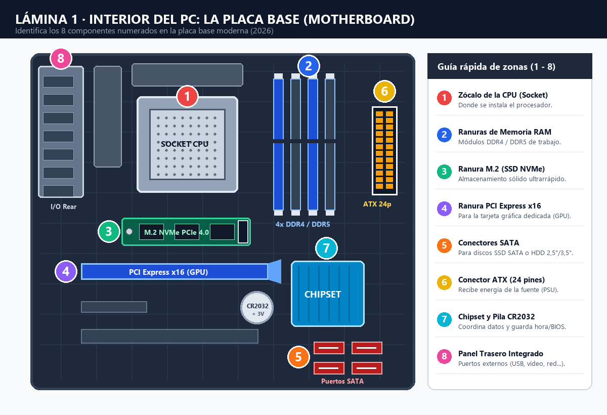
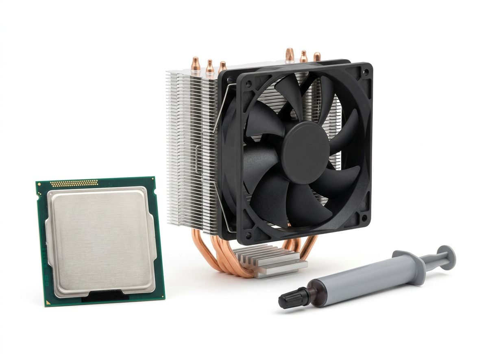
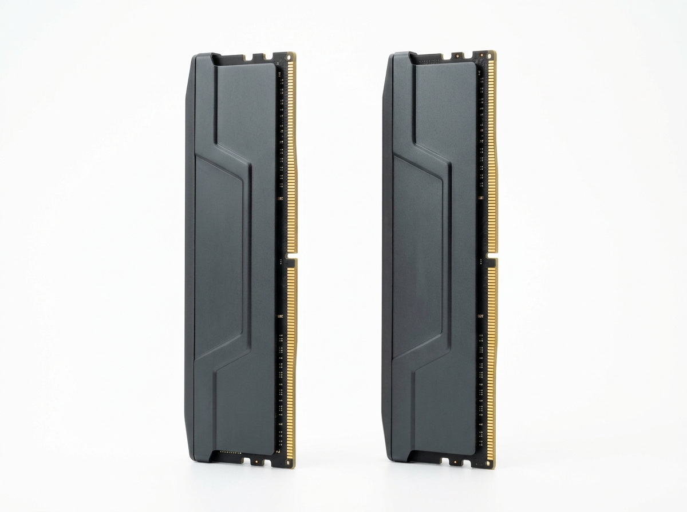
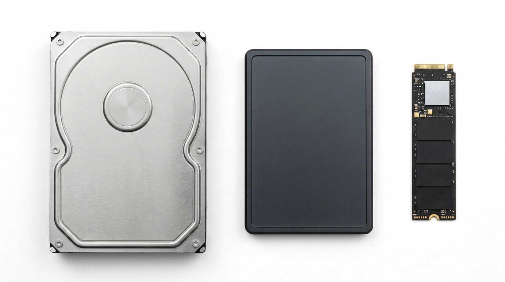
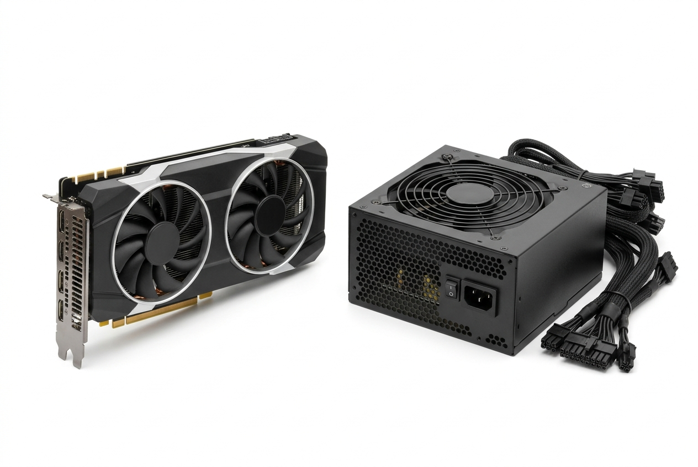

# 2. El interior del PC: Componentes y Placa Base

Cuando miramos un ordenador de sobremesa o un portátil por fuera, solo vemos la carcasa y la pantalla. Pero si abrimos el panel lateral de la torre, nos encontramos con una auténtica ciudad en miniatura donde cada componente electrónico cumple una misión vital.

> 📸 **¡Atención durante la lectura!**  
> A lo largo de este apartado encontrarás **2 ejercicios interactivos de arrastrar y soltar** en medio de las explicaciones. Cuando los resuelvas al **100 % en verde**, deberás **hacer una captura de pantalla** de cada uno y guardarla en tu carpeta `Documentos/1ESO/TRDR/Tema_3/Capturas/` porque **formarán parte de tu entrega de la Actividad 2**.
{: .alert-warning}

---

## 1. Lámina de estudio: La Placa Base (*Motherboard*)

La **Placa Base** (o *placa madre*) es la gran tarjeta de circuito impreso sobre la que se conectan directa o indirectamente **todos** los demás componentes del ordenador. Imagínala como el plano de una ciudad con sus autopistas eléctricas (llamadas **buses de datos**) que permiten que el procesador, la memoria, los discos y los puertos se comuniquen entre sí.

Observa con atención los **8 elementos numerados** en la siguiente lámina de una placa base actual:

{: .img .img-700}

**Lámina 1: Componentes principales y conectores internos de una Placa Base moderna**
{: .centrado}

---

## 2. Procesador (CPU) y Memoria RAM

### ① El Zócalo de la CPU (*Socket*) y el Procesador (CPU)

* **¿Qué es la CPU?** La **CPU** (*Central Processing Unit* o Unidad Central de Procesamiento), también llamada **microprocesador**, es el **cerebro del ordenador**. Se encarga de interpretar las instrucciones de los programas y realizar miles de millones de cálculos por segundo.
* **¿Dónde se coloca?** Se inserta en el **zócalo o *socket*** (**①** en la lámina) de la placa base. Los dos grandes fabricantes de procesadores para PC son **AMD** (gama *Ryzen*) e **Intel** (gama *Core*).
* **Características clave de una CPU:**
  * **Núcleos (*Cores*):** Son como pequeños cerebros independientes dentro del mismo chip. Hoy en día un procesador doméstico suele tener entre **4 y 16 núcleos**, lo que permite hacer varias tareas pesadas a la vez.
  * **Frecuencia de reloj (GHz):** Indica la velocidad a la que trabaja (por ejemplo, `4,5 GHz` significa 4.500 millones de ciclos por segundo).
* **Refrigeración obligatoria:** Como la CPU trabaja a tanta velocidad, genera muchísimo calor. Por eso encima del procesador siempre se coloca **pasta térmica** y un **disipador metálico con ventilador** (o refrigeración líquida) para enfriarlo.

{: .img .img-500}

**Un procesador (CPU), su disipador metálico con ventilador y la jeringa de pasta térmica**
{: .centrado}

---

### ② Las Ranuras de Memoria RAM (*Random Access Memory*)

* **¿Qué es la RAM?** Es la **memoria de trabajo a corto plazo** del ordenador. En ella se cargan temporalmente el Sistema Operativo y las aplicaciones o documentos que tienes abiertos **en ese preciso instante**.
* **¿Dónde se conecta?** Los módulos o tarjetas de RAM (actualmente de tipo **DDR4** o **DDR5**) se encajan en las ranuras verticales (**②** en la lámina) situadas junto al procesador.

{: .img .img-500}

**Dos módulos modernos de Memoria RAM DDR5 con disipador y pines dorados de contacto**
{: .centrado}

* **Su característica más importante: es VOLÁTIL.**
  > ⚠️ **¡No confundas nunca la Memoria RAM con el Disco SSD!**  
  > La memoria **RAM es volátil**: funciona como la **mesa de tu pupitre**. Mientras estudias tienes los libros abiertos encima de la mesa para leerlos rápido, pero **cuando apagas el ordenador, la RAM se vacía por completo**. Si no has pulsado *Guardar* para pasar tu archivo al disco SSD (la estantería), perderás lo que estabas haciendo.
  {: .alert-warning}
* **Capacidad recomendada en 2026:**
  * **8 GB:** Mínimo básico para ofimática, navegar y estudiar.
  * **16 GB:** El estándar ideal hoy en día para trabajar con fluidez, multitarea y diseño.
  * **32 GB o más:** Para edición profesional de vídeo 4K, programación avanzada, IA o videojuegos exigentes.

---

### 🧩 EJERCICIO INTERACTIVO 2.1 (Arrastrar y Soltar): ¡Monta la Placa Base!

> 📸 **Instrucción:** Arrastra cada etiqueta de componente (o haz clic primero en la etiqueta y luego en su casilla) hasta el lugar correcto. Cuando consigas **6 / 6 aciertos**, pulsa **Comprobar** y haz una **captura de pantalla** (`ej2_1_placa_base.png`) para tu entrega de la Actividad 2.
{: .alert-success}

  
📦 Piezas disponibles (arrastra o haz clic para seleccionar):

  

    
Procesador (CPU)

    
Memoria RAM (DDR5)

    
SSD NVMe M.2

    
Tarjeta Gráfica (GPU)

    
Pila CMOS CR2032

    
Fuente (PSU) ATX 24p

  

  

    

      
<strong>① Zócalo (Socket):</strong> El cerebro del PC que realiza miles de millones de cálculos y necesita disipador.

      

    

    

      
<strong>② Ranuras verticales:</strong> Memoria volátil de trabajo temporal que se borra al apagar el equipo.

      

    

    

      
<strong>③ Ranura M.2:</strong> Almacenamiento permanente ultrarrápido del tamaño de un chicle.

      

    

    

      
<strong>④ Ranura PCIe x16:</strong> Procesa gráficos 3D, videojuegos exigentes o edición de vídeo 4K.

      

    

    

      
<strong>⑥ Conector ATX 24 pines:</strong> Transforma 230 V del enchufe en corriente continua segura.

      

    

    

      
<strong>⑦ Junto al Chipset:</strong> Mantiene la fecha, hora y ajustes BIOS aunque desenchufes el PC.

      

    

  

  

    <button onclick="checkDnd('dnd-ej21')" style="background:#059669; color:#fff; border:none; padding:8px 16px; border-radius:6px; font-weight:bold; cursor:pointer;">✅ Comprobar Ejercicio 2.1</button>
    <button onclick="resetDnd('dnd-ej21')" style="background:#64748b; color:#fff; border:none; padding:8px 14px; border-radius:6px; font-weight:bold; cursor:pointer;">🔄 Reiniciar</button>
    
  

---

## 3. Almacenamiento Permanente: HDD vs SSD SATA vs SSD NVMe M.2

Para que el sistema operativo, las aplicaciones y tus trabajos no se borren al apagar el ordenador, necesitamos **unidades de almacenamiento permanente** (no volátil). Observa la evolución física y de tamaño entre las tres tecnologías:

{: .img .img-550}

**De izquierda a derecha: Disco duro mecánico (HDD 3,5"), Unidad Sólida SSD SATA (2,5") y tarjeta SSD NVMe M.2**
{: .centrado}

| Tipo de unidad | Dónde se conecta en la placa | Velocidad aproximada | Características y uso en 2026 |
| :--- | :--- | :---: | :--- |
| **1. Disco Duro Mecánico (HDD)** | Por cable al **Conector SATA (⑤)** | ~150 MB/s *(Lento)* | Usa platos magnéticos que giran y una aguja mecánica. Hace ruido, sufre si recibe golpes y tarda mucho en arrancar. Hoy solo se usa para copias masivas baratas. |
| **2. Unidad Sólida SSD SATA (2,5")** | Por cable al **Conector SATA (⑤)** | ~550 MB/s *(Rápido)* | Usa chips de memoria flash (sin piezas móviles). Es silencioso y 4 veces más rápido que un HDD. Muy usado para revivir ordenadores antiguos. |
| **3. Unidad Sólida SSD NVMe M.2** | Directamente en la **Ranura M.2 (③)** | **3.500 a 7.000 MB/s** *(Ultrarrápido)* | Tiene el tamaño de un chicle y se atornilla directo a la placa base. Es hasta **35 veces más rápido** que un disco mecánico y es el estándar en todos los equipos actuales. |

> 💡 **Truco de experto sostenible:** Si un ordenador de hace unos años tarda varios minutos en encenderse, casi siempre se debe a que todavía lleva un disco mecánico **HDD**. Sustituirlo por un **SSD** cuesta muy poco dinero y hace que el equipo vuelva a encenderse en 10 segundos.
{: .alert-info}

---

## 4. Tarjeta Gráfica (GPU), Fuente de Alimentación (PSU) y Chipset

{: .img .img-550}

**A la izquierda, una Tarjeta Gráfica dedicada (GPU) con doble ventilador; a la derecha, una Fuente de Alimentación (PSU) con sus cables**
{: .centrado}

* **④ Ranura PCI Express x16 y Tarjeta Gráfica (GPU):**
  1. **Gráfica integrada (iGPU):** Viene dentro del propio chip del procesador (CPU). Consume poca energía y es perfecta para ordenadores de aula, ofimática y vídeo HD. El monitor se enchufa a la placa base (**⑧**).
  2. **Tarjeta gráfica dedicada:** Tarjeta independiente con sus propios ventiladores y memoria de vídeo (VRAM) pinchada en la ranura **PCIe x16** (**④**). Imprescindible para videojuegos 3D modernos, diseño arquitectónico o Inteligencia Artificial.
* **⑥ Conector ATX de 24 pines y Fuente de Alimentación (PSU):**
  * La **Fuente de Alimentación** transforma la corriente alterna del enchufe de la pared (`230 V`) en corriente continua de bajo voltaje (`12 V`, `5 V`, `3,3 V`) segura para los chips, entregándola a la placa base a través del conector de 24 pines (**⑥**).
* **⑦ El Chipset y la Pila CMOS (`CR2032`):**
  * El **Chipset** actúa como el "guardia de tráfico" de la placa base, coordinando la comunicación entre discos, puertos USB y procesador.
  * La **pila de botón (`CR2032`)** guarda la **fecha, la hora y la configuración de arranque (BIOS/UEFI)** incluso cuando el PC está desenchufado.

---

### 🧩 EJERCICIO INTERACTIVO 2.2 (Arrastrar y Soltar): ¿RAM, SSD NVMe o HDD?

> 📸 **Instrucción:** Arrastra cada situación real a la columna de memoria correcta. Cuando obtengas el **100 % en verde**, haz tu segunda **captura de pantalla** (`ej2_2_memorias.png`) y guárdala en tu carpeta `Tema_3/Capturas/`.
{: .alert-success}

  
📦 Situaciones reales (arrastra cada tarjeta a su memoria correspondiente):

  

    
Se va la luz y pierdo lo que no guardé

    
Arranca LliureX en 8 s (va en ranura M.2)

    
Tiene platos giratorios y es más lento

    
Mesa de trabajo temporal (16 GB DDR5)

    
Sin piezas móviles, tamaño de un chicle

    
Va por cable SATA y sufre con los golpes

  

  

    

      
⚡ Memoria RAM (Volátil)

      

    

    

      
🚀 Unidad SSD NVMe M.2

      

    

    

      
💿 Disco Mecánico (HDD)

      

    

  

  

    <button onclick="checkBucketDnd('dnd-ej22')" style="background:#059669; color:#fff; border:none; padding:8px 16px; border-radius:6px; font-weight:bold; cursor:pointer;">✅ Comprobar Ejercicio 2.2</button>
    <button onclick="resetDnd('dnd-ej22')" style="background:#64748b; color:#fff; border:none; padding:8px 14px; border-radius:6px; font-weight:bold; cursor:pointer;">🔄 Reiniciar</button>
    
  

---

[👈 Anterior: 1. Introducción](./introduccion) | [🏠 Índice del Tema 3](./index) | [👉 Siguiente: 3. Puertos, periféricos y redes](./puertos_perifericos_y_redes)
