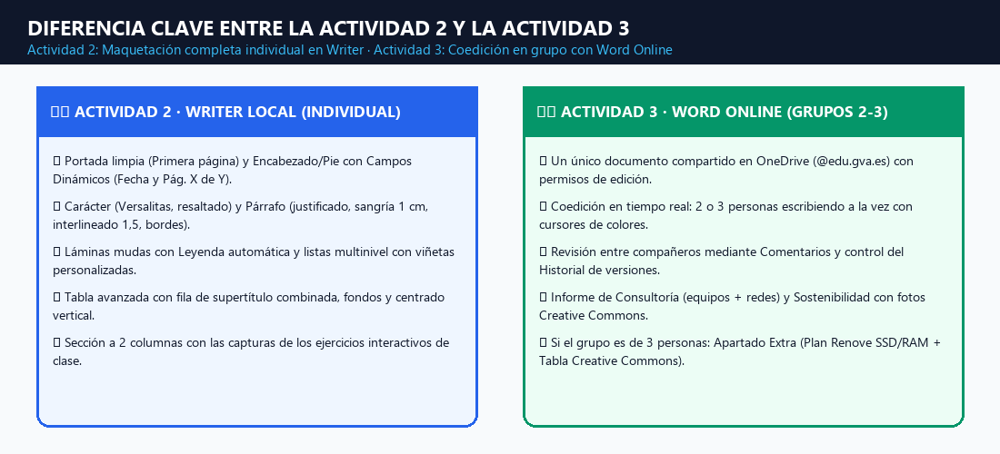

# 5. Guía Práctica: Visio Online, LibreOffice Writer y Word Online

Esta guía es tu **manual técnico de consulta rápida** durante todo el Tema 3. Cada una de las tres actividades prácticas utiliza una herramienta diferente para que aprendas un repertorio completo tanto en local (LliureX) como en la nube corporativa de **Microsoft 365 / OneDrive (`@edu.gva.es`)**:

{: .img .img-650}

**Diferencia clave entre la Actividad 2 (maquetación completa individual en Writer) y la Actividad 3 (coedición en grupo con Word Online)**
{: .centrado}

---

## 📋 Atajos de Teclado Imprescindibles

| Atajo de teclado | Acción que realiza en LibreOffice Writer / Word Online |
| :--- | :--- |
| <kbd>Ctrl</kbd> + <kbd>S</kbd> *(o <kbd>Ctrl</kbd> + <kbd>G</kbd>)* | **Guardar** cambios en LibreOffice Writer *(en Visio y Word Online se guarda solo)*. |
| <kbd>Ctrl</kbd> + <kbd>Z</kbd> / <kbd>Ctrl</kbd> + <kbd>Y</kbd> | **Deshacer** el último cambio si te equivocas / **Rehacer**. |
| <kbd>Ctrl</kbd> + <kbd>Shift</kbd> + <kbd>V</kbd> | **Pegar texto sin formato** (imprescindible para evitar copiar estilos raros de Internet). |
| <kbd>Ctrl</kbd> + <kbd>K</kbd> | Insertar un **Hiperenlace (enlace web clicable)**. |
| <kbd>Ctrl</kbd> + <kbd>Enter</kbd> | Insertar un **Salto de página** limpio. |

---

## ☁️ BLOQUE A · Microsoft Visio Online desde OneDrive (Actividad 1)

**Microsoft Visio para la Web** funciona directamente en el navegador y guarda tus diagramas (`.vsdx`) de forma automática en tu nube **OneDrive (`@edu.gva.es`)**.

### 1. Crear el diagrama y poner la página en Horizontal
1. Entra en [portal.office.com](https://portal.office.com){:target="_blank"} con tu cuenta `@edu.gva.es`, abre **OneDrive** y entra en tu carpeta `1ESO/TRDR/Tema_3`.
2. Pulsa **`+ Agregar nuevo` -> `Dibujo de Visio`** *(o abre Visio desde el menú de los 9 puntos -> `Nuevo dibujo en blanco` y guárdalo en `Tema_3`)*.
3. Haz clic en el nombre superior del archivo para renombrarlo a `actividad1_mapa_ordenador_tuapellido_tunombre`.
4. Ve a la pestaña superior **`Diseño` -> `Orientación` -> `Horizontal`** (un mapa mental siempre se organiza mucho mejor en horizontal).

### 2. Insertar formas geométricas y Conectores automáticos
1. En el panel izquierdo (**Formas básicas**), arrastra formas al lienzo:
   * **Elipse / Círculo** para el tema central (`EL ORDENADOR`).
   * **Rectángulo redondeado** para las 4 ramas principales.
   * **Rectángulos o tarjetas** para los subnodos de detalle.
2. Haz **doble clic sobre cualquier forma** para escribir texto dentro.
3. **Unir cajas con Conectores inteligentes:** Al pasar el ratón por encima de una forma en Visio, verás aparecer **4 pequeños triángulos azules** alrededor de sus lados (o puntos de conexión verdes). Arrastra desde un punto de conexión hacia la siguiente caja y Visio dibujará un **Conector elástico** que se moverá automáticamente cuando muevas las cajas.

### 3. Aplicar colores, temas y exportar a `.pdf` y `.png`
* **Colorear ramas:** Selecciona una caja o conector y usa los botones **Relleno** y **Línea** en la pestaña **`Inicio`**, o aplica una paleta profesional desde la pestaña **`Diseño` -> `Temas`**.
* **Exportar como PDF:** Ve a **`Archivo` -> `Exportar` -> `Descargar como PDF`**.
* **Exportar como imagen PNG:** Ve a **`Archivo` -> `Exportar` -> `Descargar como imagen`** (elige formato `PNG` y alta calidad).
* **Descargar copia editable (`.vsdx`):** **`Archivo` -> `Guardar como` -> `Descargar una copia`**.

---

## 🖥️ BLOQUE B · LibreOffice Writer Completo Paso a Paso (Actividad 2)

En la **Actividad 2** vas a dominar **LibreOffice Writer** (extensión `.odt`) de principio a fin, combinando formato de página, campos dinámicos, textos, listas multinivel, tablas avanzadas y secciones en columnas.

### 1. Portada limpia con Estilo *Primera página* y Salto Manual
1. Abre el panel lateral derecho **Estilos** (`F11` o icono de la `A` con pincel) -> cuarto icono superior (**Estilos de página**) -> doble clic en **`Primera página`**.
2. Ve a **Formato -> Estilo de página...**:
   * **Página:** márgenes de `2,00 cm` en todos los lados.
   * **Bordes:** activa los 4 bordes exteriores (`1,50 pt`, color azul oscuro, separación `1,00 cm`).
   * **Área -> Color:** fondo azul o gris pastel muy claro.
3. Escribe el título grande, el subtítulo en **Versalitas** (*Formato -> Carácter -> Efectos tipográficos -> Efectos: Versalitas*) y tus datos alineados a la derecha abajo.
4. **Salto de página manual:** **Insertar -> Más saltos -> Salto manual...** -> marca **Salto de página** y en **Estilo** elige **`Estilo de página predeterminado`**.

### 2. Encabezado y Pie de página con Campos Dinámicos (Página 2 en adelante)
1. Haz clic arriba en la Página 2 -> **`Cabecera (Estilo de página predeterminado) +`**: escribe el título abreviado a la izquierda, pulsa <kbd>Tab</kbd> dos veces e inserta **Insertar -> Campo -> Fecha**.
2. Haz clic abajo en la Página 2 -> **`Pie de página (Estilo de página predeterminado) +`**: escribe tu nombre a la izquierda, pulsa <kbd>Tab</kbd> dos veces y crea la numeración dinámica escribiendo `Página ` + **Insertar -> Campo -> Número de página** + ` de ` + **Insertar -> Campo -> Total de páginas**.
3. Verifica que la Portada (Página 1) sigue limpia sin cabecera ni número.

### 3. Formato de Carácter, Párrafo y Títulos con Borde/Sombreado
* **Títulos de apartado:** Selecciona el título -> **Formato -> Párrafo...** -> en **Bordes** pon un borde inferior (`1,50 pt` azul), y en **Área -> Color** un fondo azul claro.
* **Párrafos de texto:** Selecciona los párrafos -> **Formato -> Párrafo...**:
  * **Alineación:** `Justificado`.
  * **Sangrías y espaciado:** Primera línea `1,00 cm`, Interlineado `1,5 líneas`, Espaciado bajo el párrafo `0,25 cm`.
* **Resaltado de siglas:** Selecciona siglas como `CPU`, `RAM`, `SSD NVMe`, `HDD` y pulsa el icono de **Color de resaltado** (amarillo suave).

### 4. Imágenes con Leyenda Automática y Listas Multinivel con Viñetas Personalizadas
* **Insertar lámina y Leyenda automática:** **Insertar -> Imagen...** -> ajusta el tamaño desde una esquina manteniendo <kbd>Shift</kbd> -> haz **clic derecho sobre la imagen -> `Insertar leyenda...`** (Categoría `Ilustración`).
* **Listas numeradas + Sublistas con viñetas personalizadas:**
  1. Activa la lista numerada (`F12`) para los puntos `1` al `8`.
  2. Dentro de un punto, pulsa `Enter` y luego <kbd>Tab</kbd> para crear un segundo nivel.
  3. Ve a **Formato -> Numeración y viñetas... -> Viñetas** (o *Personalizar*) para escoger un símbolo (`➤`, `✔`, `◆`).
  4. Para volver al nivel numérico principal, pulsa <kbd>Shift</kbd> + <kbd>Tab</kbd>.

### 5. Tablas Avanzadas (Combinar celdas, fondos y centrado vertical)
1. **Tabla -> Insertar tabla...** (`Ctrl + F12`).
2. **Combinar celdas (Supertítulo):** Selecciona toda la Fila 1 -> clic derecho -> **Combinar celdas**. Ponle color de fondo azul oscuro y letra blanca centrada.
3. **Centrado vertical y bordes:** Selecciona toda la tabla -> clic derecho -> **Propiedades de la tabla...** -> en **Flujo del texto** elige **Alineación vertical: Centrado**, y en **Bordes** configura bordes exteriores de `1,5 pt` e interiores de `0,5 pt`.

### 6. Sección a 2 Columnas (para las capturas de los ejercicios interactivos)
1. **Insertar -> Sección...** -> pestaña **Columnas**: elige **`2 columnas`**, espaciado `0,60 cm` y activa la **Línea de separación** vertical (`0,5 pt`).
2. En la pestaña **Área -> Color**, pon un gris o azul pastel muy suave y pulsa *Insertar*.
3. Pega tus capturas dentro (2 en la columna izquierda y 2 en la derecha) ajustando su ancho para que encajen limpiamente.

---

## 🤝 BLOQUE C · Microsoft Word Online Colaborativo en OneDrive (Actividad 3)

En la **Actividad 3** trabajarás en **grupo de 2 o 3 personas** coeditando el mismo archivo **`.docx`** en tiempo real desde **OneDrive (`@edu.gva.es`)**.

### 1. Crear y Compartir el documento con tu equipo
1. **Solo una persona del grupo** entra en OneDrive -> `1ESO/TRDR/Tema_3` -> **`+ Agregar nuevo` -> `Documento de Word`** y lo renombra como `actividad3_consultoria_grupo_apellidos`.
2. Pulsa el botón **`Compartir`** (arriba a la derecha), escribe los correos **`@edu.gva.es`** de sus compañeros/as de grupo, comprueba que tienen permiso **`Puede editar`** y pulsa **`Enviar`**.
3. Los demás integrantes abren **OneDrive -> `Compartido` (en el menú izquierdo)** y abren el documento. ¡Todos trabajaréis sobre el mismo archivo a la vez!

### 2. Herramientas clave de Word Online para vuestro informe
* **Encabezado y Pie con número de página:** Pestaña **`Insertar` -> `Encabezado y pie de página`** y **`Número de página`** (marca la casilla **`Primera página diferente`** en las opciones de encabezado para que la portada quede limpia).
* **Tablas con colores y celdas combinadas:** Pestaña **`Insertar` -> `Tabla`** -> en la pestaña contextual **`Tabla`** que aparece al hacer clic dentro puedes elegir **Sombreado de celda**, **Alineación vertical centrada** y **Combinar celdas**.
* **Imágenes Creative Commons e Hiperenlaces:** Pestaña **`Insertar` -> `Imagen` -> `Este dispositivo`** para subir tus imágenes descargadas de *Wikimedia Commons / Openverse / Pixabay*. Debajo escribe el pie de foto con la licencia `CC` y selecciona la fuente para pulsar **`Insertar` -> `Vínculo`** (`Ctrl + K`) y pegar la URL original.
* **Comentarios de revisión entre compañeros (OBLIGATORIO):** Selecciona una frase escrita por otro compañero/a -> pestaña **`Revisar` -> `Nuevo comentario`** -> escribe una sugerencia constructiva o validación y pulsa enviar.
* **Descargar para entregar en Aules:**
  * En PDF: **`Archivo` -> `Exportar` -> `Descargar como PDF`**.
  * En Word editable: **`Archivo` -> `Guardar como` -> `Descargar una copia`** (`.docx`).

---

[👈 Anterior: 4. Sostenibilidad y Word Online](./sostenibilidad_y_obsolescencia) | [🏠 Índice del Tema 3](./index) | [👉 Siguiente: 6. Ejercicios de repaso](./ejercicios_de_repaso)
