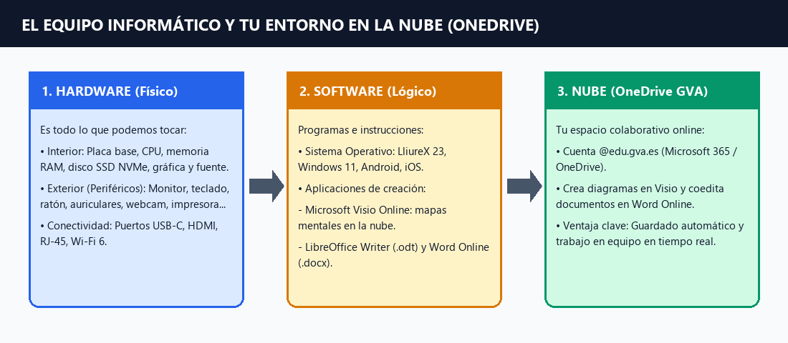
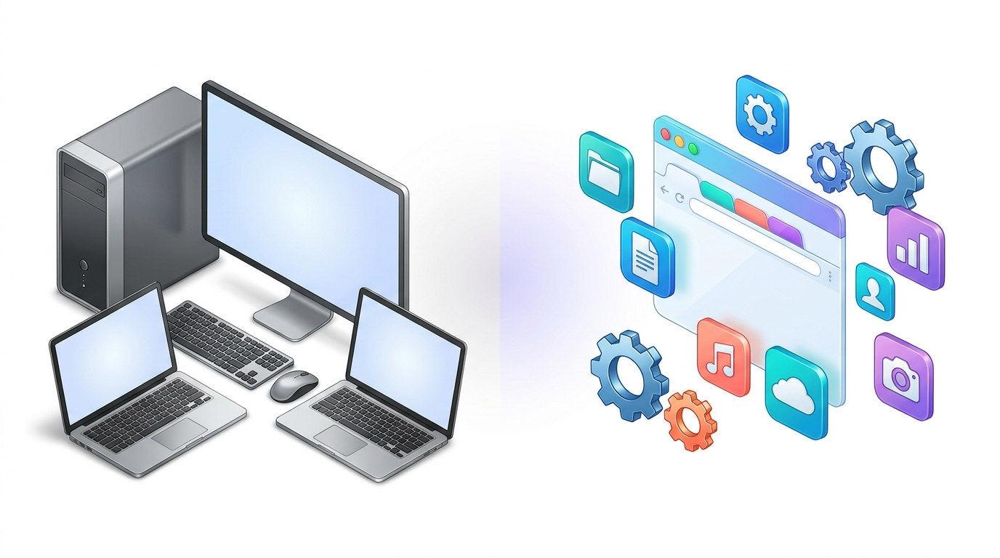
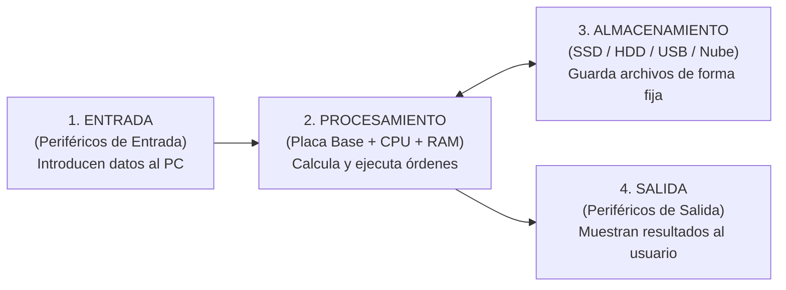
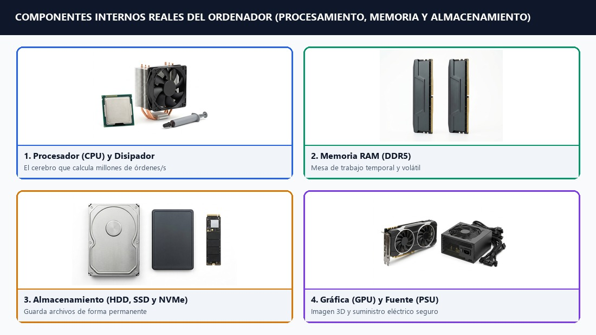
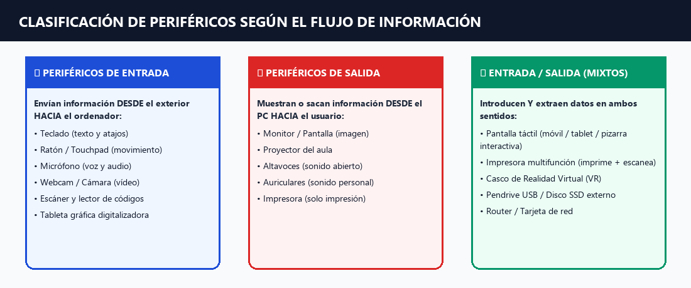
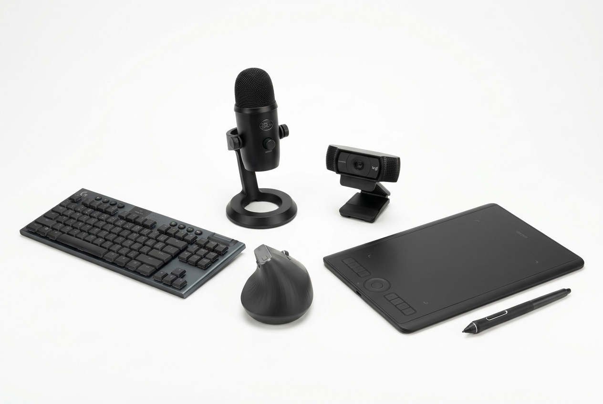
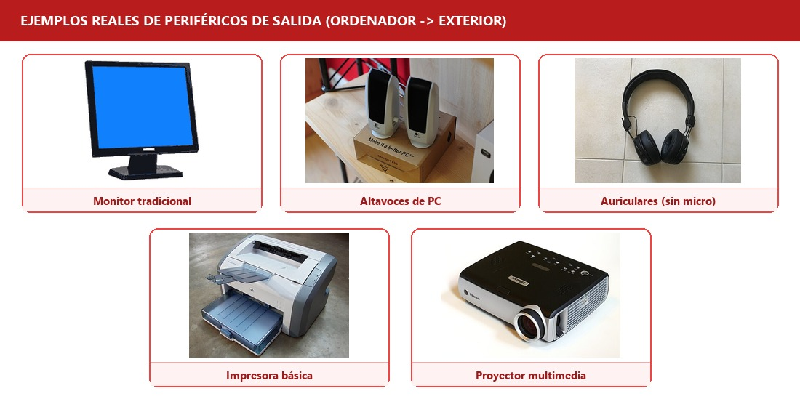
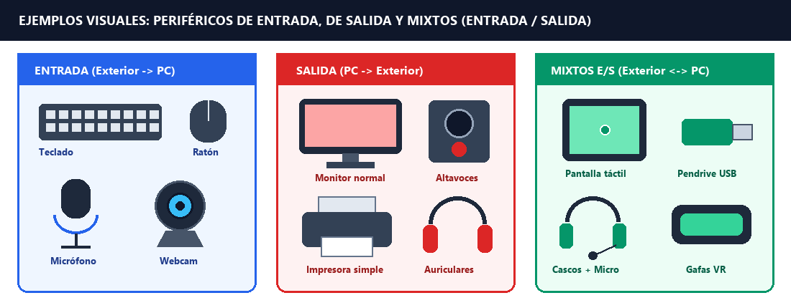

# 1. Introducción: El hardware, los periféricos y tu nube OneDrive

En los temas anteriores aprendiste qué es un **Sistema Operativo** (Tema 1) y cómo organizar tus **archivos y carpetas** en el explorador Dolphin (Tema 2). En este **Tema 3** vamos a descubrir **cómo funciona un ordenador por dentro y por fuera**, qué componentes se encargan de cada tarea, cómo conectamos periféricos y cómo aprovechar la nube corporativa de **Microsoft OneDrive (`@edu.gva.es`)** para crear diagramas en **Visio Online** y colaborar en grupo con **Word Online**.

{: .img .img-650}

**Los tres pilares del Tema 3: Hardware físico, Software de creación y tu espacio en la nube OneDrive**
{: .centrado}

---

## 1. Hardware y Software: Dos mitades inseparables

Todo equipo informático (un PC de sobremesa, un portátil, una tablet o un smartphone) se compone de dos partes que se necesitan mutuamente:

{: .img .img-600}

**Izquierda: Hardware físico (torre, monitor, teclado, ratón, portátiles) · Derecha: Software (ventanas, sistema operativo y aplicaciones)**
{: .centrado}

| Concepto | ¿Qué es? | Ejemplos claros |
| :--- | :--- | :--- |
| **Hardware** *(Parte física)* | Es todo componente físico y tangible que podemos ver y tocar: la carcasa, las piezas electrónicas internas, los cables, los conectores y los periféricos externos. | Placa base, procesador (CPU), memoria RAM, unidad SSD, monitor, teclado, ratón, cable HDMI, auriculares. |
| **Software** *(Parte lógica)* | Son los programas, sistemas operativos e instrucciones intangibles que indican al hardware qué debe hacer y cómo procesar la información. | Sistemas operativos (LliureX 23, Windows 11, Android, iOS) y aplicaciones (Microsoft Visio Online, LibreOffice Writer, Word Online, Firefox). |

> 💡 **La regla fácil para no confundirlos:**  
> El **Hardware** es el cuerpo físico del ordenador (lo que puedes tocar con las manos), mientras que el **Software** son los programas e instrucciones que le dicen cómo pensar y trabajar.
{: .alert-info}

---

## 2. Arquitectura básica: Los 4 grandes bloques del Hardware

Para entender un ordenador de un solo vistazo, dividimos todo su **Hardware** en **cuatro grandes bloques** según la misión que cumplen dentro del ciclo de la información:

### A. Bloque de Procesamiento y Memoria Interna (El núcleo de la torre)
* **Placa Base (*Motherboard*):** Es la gran placa de circuito impreso sobre la que se conectan todos los demás componentes para comunicarse entre sí.
* **Procesador (CPU):** Es el **cerebro del ordenador**; realiza millones de cálculos por segundo e interpreta las órdenes de los programas.
* **Memoria RAM:** Es la **mesa de trabajo temporal (volátil)** donde el ordenador mantiene abiertos el sistema operativo y los programas que estás usando en ese momento. Si apagas el equipo sin guardar, su contenido se borra.
* **Tarjeta Gráfica (GPU) y Fuente de Alimentación (PSU):** La GPU procesa las imágenes y gráficos 3D para enviarlos al monitor, y la fuente convierte la electricidad del enchufe en energía segura para los circuitos.

### B. Bloque de Almacenamiento Permanente (Donde no se borran tus archivos)
* **Unidades internas (SSD NVMe M.2 y HDD):** Guardan de forma permanente (no volátil) el sistema operativo, tus aplicaciones y tus trabajos. Los modernos **SSD** (basados en chips de memoria flash) son mucho más rápidos y silenciosos que los antiguos discos mecánicos **HDD**.
* **Almacenamiento portátil y en la nube:** Memorias USB (*pendrives*), discos SSD externos y servidores en Internet como **OneDrive** o **Aules**.

{: .img .img-650}

**Vista real de los componentes internos del PC que profundizaremos en el Apartado 2 (CPU, RAM, HDD/SSD/NVMe, GPU y Fuente)**
{: .centrado}

---

## 3. Clasificación detallada de Periféricos: Entrada, Salida y Mixtos (E/S)

Llamamos **periférico** a cualquier dispositivo externo que conectamos al ordenador (por cable o de forma inalámbrica) para introducir datos, obtener resultados o comunicarnos con otros equipos.

Según la **dirección en la que viaja la información**, todo periférico pertenece a una de estas **tres categorías**:

{: .img .img-650}

**Clasificación de los periféricos en Entrada (E), Salida (S) y Entrada/Salida o Mixtos (E/S)**
{: .centrado}

### 1. 📥 Periféricos de ENTRADA (E)
Son aquellos que **únicamente introducen datos, órdenes o señales desde el usuario hacia el interior del ordenador**. La información viaja en un solo sentido: **Exterior ➔ Ordenador**.

{: .img .img-550}

**Ejemplos reales de periféricos de entrada: teclado, ratón ergonómico, micrófono USB, webcam y tableta digitalizadora con lápiz**
{: .centrado}

| Periférico de Entrada | ¿Qué tipo de información introduce al PC? |
| :--- | :--- |
| **Teclado** | Letras, números, signos y atajos de teclado (`Ctrl + C`, `F2`...). |
| **Ratón (*Mouse*) / *Touchpad*** | Posición del puntero, clics y desplazamientos en pantalla. |
| **Micrófono** | Voz humana, música o sonidos externos convertidos en audio digital. |
| **Webcam / Cámara digital** | Imagen en movimiento (vídeo) y fotografías hacia el equipo. |
| **Escáner y lector de códigos** | Digitaliza documentos en papel, fotos o códigos de barras/QR. |
| **Tableta digitalizadora (sin pantalla)** | Trazos de dibujo realizados con un lápiz óptico para programas de diseño. |

### 2. 📤 Periféricos de SALIDA (S)
Son aquellos que **únicamente muestran o sacan información procesada desde el ordenador hacia el usuario**. La información viaja en sentido contrario: **Ordenador ➔ Exterior**.

{: .img .img-600}

**Ejemplos reales de periféricos de salida: monitor tradicional, altavoces, auriculares simples, impresora básica y proyector multimedia**
{: .centrado}

| Periférico de Salida | ¿Qué tipo de resultado nos muestra? |
| :--- | :--- |
| **Monitor o pantalla tradicional (no táctil)** | Imágenes, textos, vídeos e interfaz visual del sistema operativo. |
| **Proyector multimedia** | Proyecta la imagen del ordenador en gran tamaño sobre la pizarra o pared del aula. |
| **Altavoces** | Emiten música, alertas y sonido hacia toda la habitación. |
| **Auriculares simples (sin micrófono)** | Reproducen sonido de forma individual directamente en nuestros oídos. |
| **Impresora básica (solo impresión)** | Plasma documentos y fotografías digitales sobre papel físico. |

### 3. 🔄 Periféricos de ENTRADA / SALIDA o MIXTOS (E/S)
Son dispositivos muy completos que **realizan ambas funciones a la vez**: permiten tanto enviar datos al ordenador como recibir información de él (**Exterior ⇄ Ordenador**).

| Periférico Mixto (E/S) | ¿Por qué es de Entrada y de Salida a la vez? |
| :--- | :--- |
| **Pantalla táctil** *(móvil, tablet o pizarra digital)* | Muestra imágenes y vídeo (**Salida**) y a la vez detecta dónde tocamos con el dedo o lápiz (**Entrada**). |
| **Impresora multifunción** | Imprime documentos en papel (**Salida**) y también escanea hojas físicas hacia el ordenador (**Entrada**). |
| **Auriculares con micrófono (*Headset*)** | Escuchamos a nuestros compañeros por los cascos (**Salida**) y les hablamos por el micrófono integrado (**Entrada**). |
| **Casco de Realidad Virtual (VR)** | Proyecta entornos 3D en sus pantallas internas (**Salida**) y detecta los giros de nuestra cabeza y manos (**Entrada**). |
| **Pendrive USB y Disco externo** | Podemos leer archivos guardados en ellos (**Entrada**) y grabar nuevos trabajos dentro (**Salida**). |
| **Router / Tarjeta de red** | Recibe páginas web y archivos desde Internet (**Entrada**) y envía nuestros correos o tareas a Aules (**Salida**). |

> ⚠️ **¡Pregunta típica de examen!**  
> Un **monitor normal de aula** es un periférico de **Salida**, pero la **pantalla de una tablet o smartphone** es de **Entrada/Salida (Mixto)** porque además de mostrar imagen es táctil. Del mismo modo, unos **auriculares sin micro** son de **Salida**, pero unos **auriculares gaming con micrófono** son de **Entrada/Salida**.
{: .alert-warning}

{: .img .img-650}

**Comparativa visual rápida entre periféricos de Entrada, de Salida y Mixtos (Entrada / Salida)**
{: .centrado}

---

## 4. Tu nube corporativa OneDrive y Microsoft Visio Online (`@edu.gva.es`)

Como estudiante de la Generalitat Valenciana dispones de una cuenta oficial de **Microsoft 365 (`@edu.gva.es`)**. Dentro de ella tienes dos herramientas en la nube que vamos a utilizar en este tema:

1. **Microsoft OneDrive:** Es tu **disco duro personal en la nube**. Te permite organizar tus carpetas del curso (`1ESO/TRDR/Tema_3`), guardar copias automáticas sin miedo a perder trabajos si falla un ordenador del aula, y compartir documentos para trabajar en grupo.
2. **Microsoft Visio para la Web (Visio Online):** Es una potente aplicación profesional de **creación de diagramas, organigramas y mapas mentales** que funciona directamente en tu navegador web y guarda los archivos (extensión **`.vsdx`**) de forma automática dentro de tu carpeta de **OneDrive**.

---

> 🛠️ **¡HORA DE PASAR A LA PRÁCTICA! — ACTIVIDAD 1**  
> Con lo que acabas de estudiar en este Apartado 1 (Hardware, Software, Procesamiento, Almacenamiento, Periféricos de Entrada, Salida y Entrada/Salida, y tu nube OneDrive) **ya tienes todo lo necesario para realizar la Actividad 1** *(en ella encontrarás la guía visual paso a paso para crear tu diagrama en Visio Online desde OneDrive)*.  
> 👉 **[Ir ahora a la Actividad 1: El cerebro de la máquina en un vistazo (Mapa mental en Visio Online)](./actividad1/)**
{: .alert-success}

---

[👈 Volver al índice del Tema 3](./index) | [🛠️ Hacer Actividad 1 (Visio Online)](./actividad1/) | [👉 Siguiente: 2. Componentes y Placa Base](./componentes_y_placa_base)
