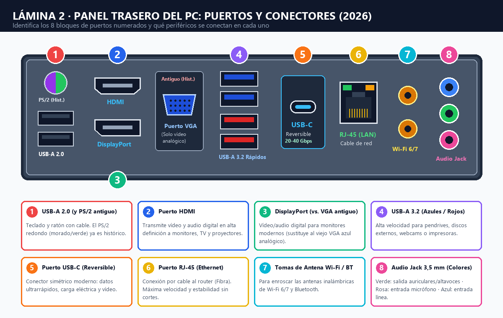
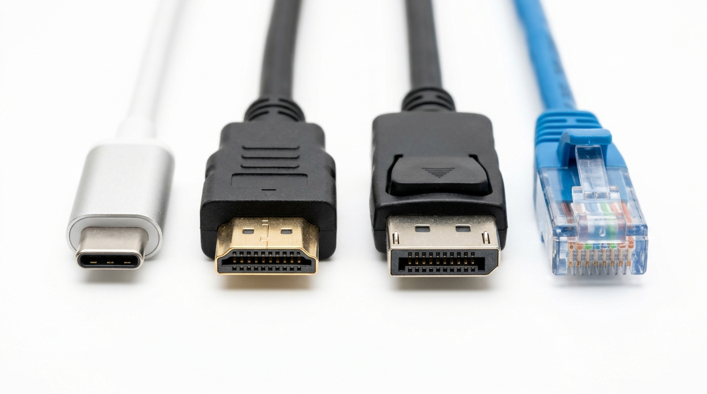
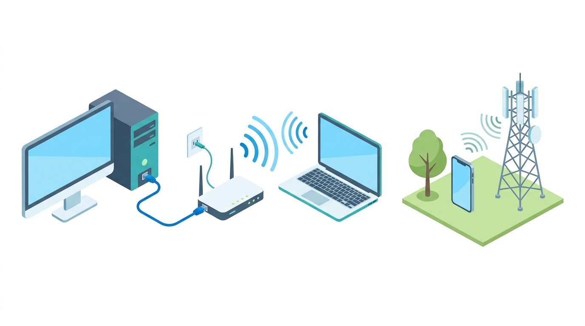

# 3. Puertos, periféricos y conexión a Internet

Ya conocemos las piezas internas que viven dentro de la torre del ordenador. Ahora vamos a ver **por dónde entran y salen los cables** en el panel trasero, qué conectores modernos dominan en 2026 y cómo elegir el **equipo y la conexión a Internet** más adecuados para cada situación.

> 📸 **¡Atención durante la lectura!**  
> En este apartado también encontrarás **2 ejercicios interactivos de arrastrar y soltar**. Cuando los resuelvas al **100 % en verde**, guarda una **captura de pantalla** de cada uno en `Documentos/1ESO/TRDR/Tema_3/Capturas/` para incluirlas junto a las del Apartado 2 en tu entrega de la **Actividad 2**.
{: .alert-warning}

---

## 1. El Panel Trasero del PC actualizado a 2026

En la parte posterior de la torre del ordenador (y en los laterales de los portátiles) encontramos el **panel de puertos y conectores**. Cada puerto tiene una forma física y un código de color diseñados para que solo puedas enchufar el cable correcto.

{: .img .img-700}

**Lámina 2: Panel trasero de puertos de una placa base actual (con comparativa de puertos históricos)**
{: .centrado}

{: .img .img-550}

**Los cuatro conectores estrella de 2026 de izquierda a derecha: USB-C reversible, HDMI, DisplayPort y cable de red Ethernet RJ-45**
{: .centrado}

### Guía detallada de los 8 puertos del panel trasero

| Nº | Puerto / Conector | Función principal y características | ¿Qué conectamos aquí? |
| :-: | :--- | :--- | :--- |
| **①** | **USB-A 2.0** *(negros)* *(y antiguo PS/2 morado/verde)* | Puertos universales de velocidad estándar (`480 Mbps`). Sustituyeron por completo al antiguo puerto redondo **PS/2** (donde el morado era para el teclado y el verde para el ratón). | **Teclado**, **ratón**, receptor inalámbrico o tableta gráfica. |
| **②** | **HDMI** *(High-Definition Multimedia Interface)* | Estándar digital universal de imagen y sonido. Transmite **vídeo en alta definición (Full HD, 4K, 8K) y audio** por un solo cable. | **Monitor**, televisor, **proyector del aula** o pizarra digital. |
| **③** | **DisplayPort** *(frente al histórico VGA azul)* | Conector digital de alto rendimiento para monitores de ordenador (permite altas tasas de refresco como `144 Hz` o `240 Hz` y también lleva audio). Junto con el HDMI, jubiló al viejo puerto **VGA azul** de 15 pines (que solo enviaba vídeo analógico sin sonido y llevaba tornillos laterales). | **Monitores modernos** de PC, pantallas de diseño o gaming. |
| **④** | **USB-A 3.2 de Alta Velocidad** *(azules o rojos)* | Evolución rápida del puerto USB rectangular clásico (`5 Gbps` en los azules y hasta `10 Gbps` en los rojos). | **Pendrives (memorias USB)**, discos SSD externos, **webcams HD**, impresoras o escáneres. |
| **⑤** | **USB-C** *(Reversible y multifunción)* | **El conector estrella en 2026.** Es pequeño, ovalado y **reversible** (entra igual del derecho o del revés). Transmite **datos ultrarrápidos** (`20` a `40 Gbps`), **carga baterías** (*Power Delivery*) y **envía señal de vídeo**. | **Smartphones**, tablets, discos SSD NVMe externos, auriculares modernos, monitores USB-C y cargadores. |
| **⑥** | **RJ-45 (Ethernet / LAN)** | Puerto de red por cable con pestaña de sujeción y dos luces LED que parpadean al transmitir datos. | **Cable de red Ethernet** conectado al router o a la toma de pared del aula. |
| **⑦** | **Tomas de Antena Wi-Fi 6/7 y Bluetooth** | Dos conectores dorados roscados donde se fijan las antenas exteriores de la placa base para mejorar la señal inalámbrica. | **Antenas inalámbricas** para redes **Wi-Fi** y periféricos **Bluetooth**. |
| **⑧** | **Conectores Jack de Audio (`3,5 mm`)** | Conectores redondos analógicos por colores: • **Verde (*Line Out*):** Salida estéreo. • **Rosa (*Mic In*):** Entrada de voz. • **Azul (*Line In*):** Entrada de audio externa. | • **Verde:** Altavoces o auriculares de cable. • **Rosa:** Micrófono. • **Azul:** Instrumento o reproductor externo. |

> 💡 **¿Por qué triunfa el puerto USB-C en 2026?**  
> La Unión Europea estableció el **USB-C como puerto de carga y datos obligatorio** para móviles, tablets, cámaras, auriculares y portátiles, evitando acumular cargadores incompatibles y reduciendo toneladas de basura electrónica.
{: .alert-info}

---

### 🧩 EJERCICIO INTERACTIVO 3.1 (Arrastrar y Soltar): ¡Enchufa cada periférico en su puerto!

> 📸 **Instrucción:** Arrastra cada conector o puerto (o haz clic en la etiqueta y luego en su casilla) hasta el dispositivo que corresponde. Cuando consigas **6 / 6 en verde**, haz una **captura de pantalla** (`ej3_1_puertos.png`) para tu entrega de la Actividad 2.
{: .alert-success}

  
🔌 Puertos del Panel Trasero (arrastra o haz clic para conectar):

  

    
Puerto HDMI

    
Puerto USB-C

    
Puerto RJ-45 (Ethernet)

    
Jack Verde 3,5 mm

    
Jack Rosa 3,5 mm

    
USB-A 3.2 (Azul/Rojo)

  

  

    

      
📽️ <strong>Proyector o TV 4K del aula</strong> (vídeo digital y sonido en un solo cable).

      

    

    

      
📱 <strong>Smartphone moderno / carga y datos</strong> (conector ovalado reversible europeo).

      

    

    

      
🌐 <strong>Cable de red al Router de Fibra</strong> (pestaña con clic y dos luces LED).

      

    

    

      
🎧 <strong>Auriculares de cable o altavoces</strong> (salida de audio analógico).

      

    

    

      
🎙️ <strong>Micrófono externo de sobremesa</strong> (entrada de voz analógica).

      

    

    

      
💾 <strong>Pendrive rápido o Webcam HD</strong> (conector rectangular clásico de alta velocidad).

      

    

  

  

    <button onclick="checkDnd3('dnd-ej31')" style="background:#059669; color:#fff; border:none; padding:8px 16px; border-radius:6px; font-weight:bold; cursor:pointer;">✅ Comprobar Ejercicio 3.1</button>
    <button onclick="resetDnd3('dnd-ej31')" style="background:#64748b; color:#fff; border:none; padding:8px 14px; border-radius:6px; font-weight:bold; cursor:pointer;">🔄 Reiniciar</button>
    
  

---

## 2. Cómo elegir dispositivo y conexión a Internet según cada necesidad (CE 1.2)

No existe un "mejor ordenador universal": el mejor equipo es aquel que **se adapta a lo que realmente necesita hacer la persona** sin gastar dinero ni energía de más. Además, cada situación requiere una **forma de conexión a Internet** diferente.

{: .img .img-600}

**Las tres grandes formas de conectarse a Internet: Fibra + Ethernet por cable en PC fijo, Wi-Fi 6 en portátil y 5G en móvil exterior**
{: .centrado}

### A. ¿Qué dispositivo elegimos para cada perfil de usuario?

| Dispositivo | Ventajas principales | Limitaciones | ¿Para quién es la elección ideal? |
| :--- | :--- | :--- | :--- |
| **🖥️ PC de Sobremesa (Torre + Monitor)** | Máxima potencia por euro, pantalla grande y ergonómica, muy fácil de reparar y ampliar (añadir RAM o SSD) y larga vida útil. | No se puede transportar (ocupa un escritorio fijo y requiere estar enchufado). | Aulas de informática, oficinas fijas, edición de vídeo/diseño 3D, programación o gaming en casa. |
| **💻 Ordenador Portátil (*Laptop*)** | Equilibrio completo: incluye teclado físico, pantalla y batería (`6` a `12 horas`) en ~1,5 kg. Permite usar Writer, Word o Visio en cualquier sitio. | Más difícil de ampliar que una torre; pantalla más pequeña si se usa muchas horas sin monitor externo. | Estudiantes de ESO, Bachillerato o Universidad, docentes y profesionales que trabajan entre casa y el centro. |
| **📱 Tablet / Smartphone** | Ultraligeros, encendido instantáneo, pantalla táctil, cámara integrada y conectividad móvil en el bolsillo. | Incómodos para redactar informes largos o maquetar documentos complejos sin teclado físico; menor potencia bruta. | Lectura, consulta en movilidad, fotografía, mensajería, navegación GPS en ruta o toma de notas rápidas con lápiz óptico. |

### B. ¿Cómo nos conectamos a Internet y a otros dispositivos?

* **1. Fibra Óptica (FTTH) + Cable Ethernet (Puerto RJ-45):**
  * La fibra trae Internet a la velocidad de la luz hasta el router y el cable Ethernet lo lleva directamente al PC fijo. Ofrece la **máxima velocidad (`600 Mbps` - `1 Gbps`), cero interferencias y mínima latencia**.
* **2. Conexión Inalámbrica Wi-Fi (Wi-Fi 6 / Wi-Fi 7):**
  * Ideal para **portátiles, tablets y móviles dentro de casa, de la biblioteca o del instituto** (alcance de `10` a `30 m`). Siempre debemos usar redes protegidas con contraseña (`WPA2` / `WPA3`).
* **3. Redes de Datos Móviles (4G / 5G):**
  * El smartphone o tablet con tarjeta SIM/eSIM se conecta a las antenas de telefonía cuando estamos **en la calle, en ruta o viajando** sin Wi-Fi de confianza.
* **4. Bluetooth (Red Personal de Corto Alcance - PAN):**
  * **¡Ojo!** El Bluetooth **NO es una conexión a Internet**, sino un enlace inalámbrico de corto alcance (menos de `10 m`) para periféricos cercanos: auriculares inalámbricos, ratón, teclado o altavoz portátil.

---

### 🧩 EJERCICIO INTERACTIVO 3.2 (Arrastrar y Soltar): Asesor Exprés de Conectividad

> 📸 **Instrucción:** Arrastra cada necesidad real a la tecnología de conexión correcta. Cuando consigas **4 / 4 en verde**, guarda tu cuarta **captura de pantalla** (`ej3_2_redes.png`) en `Tema_3/Capturas/`. ¡Ya tendrás las 4 capturas listas para insertar en tu Actividad 2!
{: .alert-success}

  
📡 Tecnologías de conexión (arrastra cada etiqueta a su escenario ideal):

  

    
Fibra + Ethernet (RJ-45)

    
Wi-Fi 6 / Wi-Fi 7

    
Datos Móviles 5G

    
Bluetooth (PAN)

  

  

    

      
🖥️ <strong>PC fijo en el aula o estudio:</strong> necesito máxima velocidad y cero cortes al subir vídeos 4K.

      

    

    

      
💻 <strong>Portátil en la biblioteca o salón:</strong> me muevo por el edificio sin depender de cables.

      

    

    

      
🚐 <strong>Repartidora con GPS en carretera:</strong> necesita Internet al aire libre lejos de cualquier router.

      

    

    

      
🎧 <strong>Enlazar auriculares o ratón sin cable</strong> a menos de 5 metros (no da acceso a Internet).

      

    

  

  

    <button onclick="checkDnd3('dnd-ej32')" style="background:#059669; color:#fff; border:none; padding:8px 16px; border-radius:6px; font-weight:bold; cursor:pointer;">✅ Comprobar Ejercicio 3.2</button>
    <button onclick="resetDnd3('dnd-ej32')" style="background:#64748b; color:#fff; border:none; padding:8px 14px; border-radius:6px; font-weight:bold; cursor:pointer;">🔄 Reiniciar</button>
    
  

---

> 🛠️ **¡HORA DE PASAR A LA PRÁCTICA! — ACTIVIDAD 2**  
> Ahora que has completado los **Apartados 2 y 3** y tienes las **4 capturas de pantalla** de los ejercicios interactivos (`2.1`, `2.2`, `3.1` y `3.2`), ya estás listo/a para elaborar tu **Manual Técnico Completo en LibreOffice Writer**.  
> 👉 **[Ir ahora a la Actividad 2: Radiografía completa del PC paso a paso (LibreOffice Writer)](./actividad2/)**
{: .alert-success}

---

[👈 Anterior: 2. Componentes y Placa Base](./componentes_y_placa_base) | [🛠️ Hacer Actividad 2 (Writer)](./actividad2/) | [👉 Siguiente: 4. Sostenibilidad y Word Online](./sostenibilidad_y_obsolescencia)
