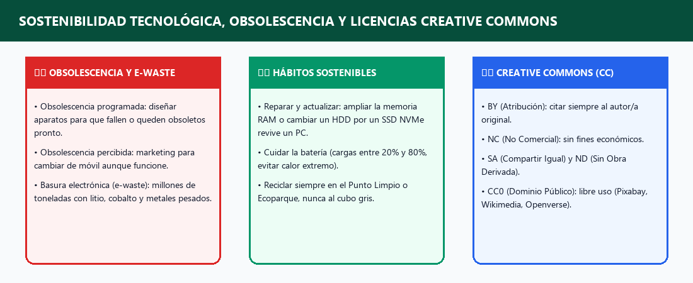
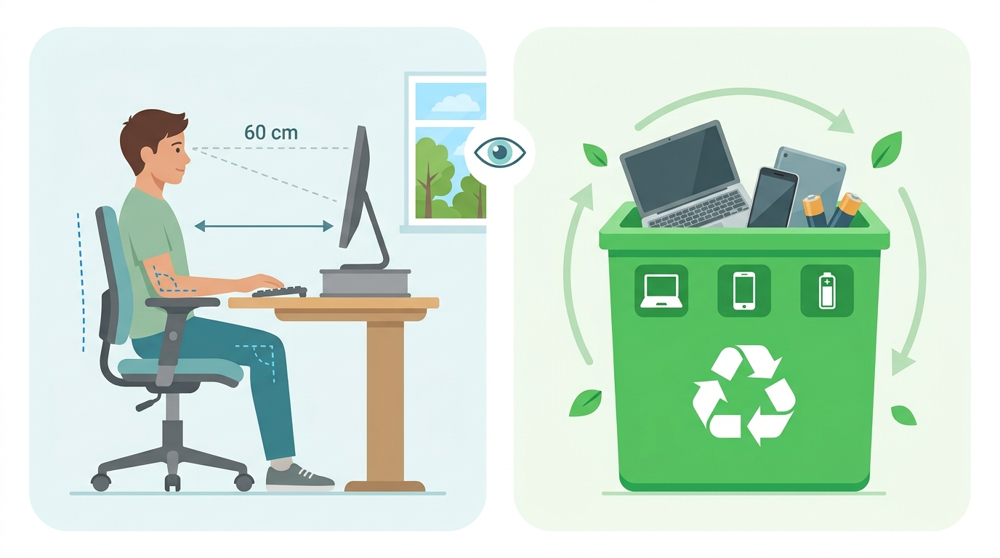
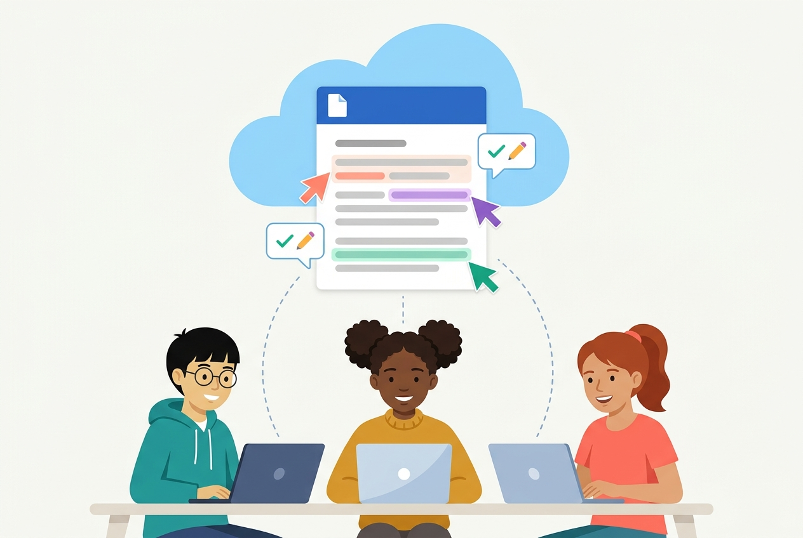

# 4. Sostenibilidad, obsolescencia, licencias Creative Commons y Word Online

Fabricar un smartphone, un portátil o un monitor consume una enorme cantidad de energía, agua potable y minerales escasos. Utilizar la tecnología de forma responsable no solo consiste en conocer las piezas internas del ordenador, sino también en cuidar nuestra **salud**, proteger el **medio ambiente**, respetar la **autoría digital** y saber **colaborar de forma ordenada en la nube**.

{: .img .img-650}

**Los tres ejes de la responsabilidad tecnológica: combatir la obsolescencia, reciclar/reparar y respetar las licencias**
{: .centrado}

---

## 1. Obsolescencia programada y basura electrónica (*e-waste*) (CE 1.4)

¿Alguna vez has notado que una impresora, un móvil o unos auriculares dejan de funcionar justo después de terminar la garantía, o que resulta casi imposible abrirlos para cambiarles la batería?

### Dos tipos de obsolescencia que debes saber detectar

1. **Obsolescencia programada (técnica):** Es la reducción artificial de la vida útil de un aparato por parte del fabricante (baterías pegadas con adhesivo industrial, piezas imposibles de sustituir, o dejar de publicar actualizaciones de seguridad para obligarte a comprar un modelo nuevo).
2. **Obsolescencia percibida (psicológica o por moda):** Ocurre cuando un dispositivo **funciona perfectamente**, pero la publicidad, las redes sociales o el lanzamiento de un nuevo modelo cada año nos hacen sentir que el nuestro ya es "viejo" y debemos cambiarlo.

### El problema mundial de la basura electrónica (*e-waste*)

Cada año la humanidad genera más de **60 millones de toneladas de residuos de aparatos eléctricos y electrónicos (RAEE o *e-waste*)**:

* **Minerales críticos y escasos:** Una sola placa base o batería contiene **litio, cobalto, cobre, oro, plata y tierras raras**, cuya extracción minera provoca deforestación y un gran impacto social y ecológico.
* **Sustancias altamente contaminantes:** También contienen plomo, mercurio o cadmio. Si tiras un móvil, una pila o un ratón viejo al contenedor gris de basura normal, esos metales tóxicos acaban contaminando el suelo y las aguas subterráneas.

> ♻️ **¿Dónde se tiran los aparatos electrónicos estropeados?**  
> **NUNCA** al contenedor de basura orgánica, amarilla o de resto. Deben llevarse siempre al **Ecoparque / Punto Limpio** de tu municipio, o a los puntos de recogida de tiendas de electrónica e institutos, donde recuperan hasta el 90 % de los metales y plásticos para fabricar nuevos dispositivos sin destruir más naturaleza.
{: .alert-warning}

---

## 2. El Derecho a Reparar, 5 hábitos sostenibles y Salud Digital

{: .img .img-650}

**Ergonomía y descanso visual frente al monitor (izquierda) y reciclaje responsable de basura electrónica (derecha)**
{: .centrado}

### 5 hábitos cotidianos para alargar la vida de tus dispositivos

En la Unión Europea se ha impulsado el **Derecho a Reparar**, que obliga a ofrecer piezas de recambio y baterías sustituibles. Además, cualquier usuario puede duplicar la vida útil de sus equipos con estos 5 hábitos:

1. **Actualizar en lugar de tirar:** Un ordenador antiguo de hace 6 u 8 años puede volver a ir como un rayo simplemente **sustituyendo su viejo disco duro HDD por un SSD** o **ampliando la memoria RAM**.
2. **Cuidar la salud de las baterías:** Evita descargar la batería al `0 %` constantemente y no tapes las rejillas de ventilación del portátil sobre mantas o camas.
3. **Limpieza y refrigeración:** El polvo acumulado en los ventiladores sobrecalienta la CPU y la gráfica y acorta su vida.
4. **Proteger el hardware:** Usa funda/protector en dispositivos móviles y extrae con seguridad tus pendrives USB.
5. **Reutilizar, reacondicionar y donar:** Antes de reciclar en el Ecoparque un equipo que todavía enciende, dale una segunda vida para estudio o dónalo.

### Salud postural y visual: La Regla 20-20-20

* **Postura ergonómica:** Coloca el **borde superior del monitor a la altura de tus ojos** y a una distancia de **`50` a `70 cm`** (un brazo extendido), con la espalda apoyada en el respaldo y los pies en el suelo.
* **La Regla 20-20-20 para cuidar la vista:**
  > 👁️ **Regla 20-20-20:** Cada **20 minutos** frente a la pantalla, aparta la vista durante **20 segundos** enfocando algún punto lejano (a unos **20 pies**, es decir, **6 metros**, como mirar por la ventana) y parpadea para evitar la sequedad ocular.
  {: .alert-info}

---

## 3. Propiedad intelectual y Licencias Creative Commons (CE 2.6)

Cuando ilustramos un informe digital, **que una foto aparezca en Google Imágenes NO significa que sea libre de usar**. Toda obra está protegida por los derechos de autor (*Copyright*), salvo que su creador/a publique la obra con una **Licencia Creative Commons (CC)** que nos permite usarla legalmente respetando cuatro condiciones:

| Icono / Sigla | Nombre de la condición | ¿Qué significa al usar una imagen en tu trabajo? |
| :---: | :--- | :--- |
| **👤 `BY`** | **Atribución (*Reconocimiento*)** | **Obligatorio en todas las licencias CC:** debes citar siempre al autor/a original, la fuente y la licencia debajo de la imagen. |
| **💲🚫 `NC`** | **No Comercial (*Non-Commercial*)** | Puedes usarla en trabajos escolares o personales, pero nunca con fines económicos. |
| **🔄 `SA`** | **Compartir Igual (*Share-Alike*)** | Si modificas la obra, debes compartir el resultado con la misma licencia abierta. |
| **🟰 `ND`** | **Sin Obra Derivada (*No Derivatives*)** | Puedes usar la imagen tal cual, pero no puedes recortarla ni modificarla. |
| **🌍 `CC0`** | **Dominio Público (*Cero restricciones*)** | Libre uso total sin restricciones (en trabajos académicos sigue siendo buena práctica citar la fuente). |

**Bancos recomendados para buscar imágenes libres en la Actividad 3:** **[Wikimedia Commons](https://commons.wikimedia.org/){:target="_blank"}**, **[Openverse](https://openverse.org/){:target="_blank"}** y **[Pixabay](https://pixabay.com/es/){:target="_blank"}**.

---

## 4. Colaborar en equipo en tiempo real: Microsoft Word Online (OneDrive)

En la Actividad 2 aprendiste a maquetar un documento individualmente en tu ordenador usando **LibreOffice Writer**. Pero en el instituto y en el mundo profesional muchas veces **2 o 3 personas necesitan redactar un mismo informe a la vez** sin tener que enviarse 15 versiones por correo electrónico (`trabajo_final_v2_definitivo.odt`).

Con tu cuenta corporativa **`@edu.gva.es`** de **OneDrive**, puedes trabajar simultáneamente en **Microsoft Word para la Web (Word Online)**:

{: .img .img-600}

**Trabajo colaborativo simultáneo en la nube: varias personas editan a la vez el mismo archivo con cursores de colores y comentarios**
{: .centrado}

### ¿Cómo funciona la coedición en Word Online paso a paso?

1. **Una única persona del grupo crea el documento en OneDrive:** Entra en su carpeta `1ESO/TRDR/Tema_3` de OneDrive -> **`+ Agregar nuevo` -> `Documento de Word`** y le pone el nombre del grupo (extensión `.docx`).
2. **Compartir con permisos de edición:** Pulsa el botón azul **`Compartir`** arriba a la derecha, escribe los correos **`@edu.gva.es`** de sus 1 o 2 compañeros/as de equipo y se asegura de que el lápiz indique **`Puede editar`**.
3. **Acceso de los demás miembros del equipo:** El resto del grupo entra en su propio OneDrive, hace clic en la sección **`Compartido`** (en el menú lateral izquierdo) y abre el documento. ¡Veréis en pantalla el cursor con el nombre y color de cada miembro del equipo escribiendo en directo!
4. **Comentarios de revisión entre compañeros:** En la pestaña **`Revisar` -> `Nuevo comentario`** (o seleccionando una frase -> clic derecho -> *Nuevo comentario*), puedes dejar sugerencias de mejora o correcciones ortográficas a un compañero/a sin borrar su texto.
5. **Historial de versiones y exportación final:** OneDrive guarda automáticamente quién ha escrito cada parte (en *Archivo -> Información -> Historial de versiones*). Cuando terminéis, podréis descargar la entrega final en **`.pdf`** (*Archivo -> Exportar -> Descargar como PDF*) y en **`.docx`** (*Archivo -> Guardar como -> Descargar una copia*).

---

> 🛠️ **¡HORA DE PASAR A LA PRÁCTICA! — ACTIVIDAD 3 (EN GRUPO DE 2 O 3 CON WORD ONLINE)**  
> Con lo que acabas de aprender sobre sostenibilidad, obsolescencia, licencias Creative Commons y coedición en Word Online, forma un equipo de **2 o 3 personas** y realiza la Actividad 3. *(Si sois 3 personas en el grupo, tendréis que incluir un apartado extra obligatorio).*  
> 👉 **[Ir ahora a la Actividad 3: Asesores tecnológicos sostenibles en grupo (Word Online)](./actividad3/)**
{: .alert-success}

---

[👈 Anterior: 3. Puertos, periféricos y redes](./puertos_perifericos_y_redes) | [🛠️ Hacer Actividad 3 (Word Online)](./actividad3/) | [👉 Siguiente: 5. Guía práctica de herramientas](./guia_practica_writer)
