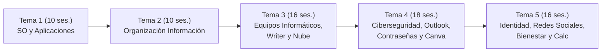

# Propuesta de Nuevos Temas (SdA) para 1º ESO · TRDR (Curso 2026-2027)

## 1. Diagnóstico y aprovechamiento del material de otros cursos

Tras analizar el contenido de los cuatro paquetes en [copias_secciones_aules_otros_cursos](./copias_secciones_aules_otros_cursos/), el currículo oficial en [1eso_trdr_curriculum.pdf](./1eso_trdr_curriculum.pdf) y la estructura de [sistemas-operativos-y-aplicaciones](./sistemas-operativos-y-aplicaciones/index.md) y [organizacion-de-la-informacion](./organizacion-de-la-informacion/index.md), este es el balance de qué materiales podemos reciclar y qué debemos actualizar a **noviembre de 2026**:

| Archivo origen | Qué contiene y qué aprovechamos | Qué descartamos o actualizamos a 2026 |
| :--- | :--- | :--- |
| [UD2. Equipos informáticos.zip](./copias_secciones_aules_otros_cursos/UD2.%20Equipos%20informáticos.zip) | **Aprovechable al 90%:** - Láminas numeradas del panel trasero (`0001_panel-trasero-placa-base_edit.png`) y de la placa base (`0003_panel-principal-placa-base_edit.jpg`). - Guía paso a paso del mapa mental del ordenador en LibreOffice Draw (`0012_Actividad 4 - Mapa mental ordenador.pdf`) y ejemplos visuales. - Dinámica cooperativa (puzzle de expertos) sobre puertos y periféricos de E/S. | **Actualizar a 2026:** - Tratar puertos VGA o PS/2 como históricos y dar protagonismo a **USB-C**, **HDMI / DisplayPort**, unidades **SSD NVMe M.2**, conectividad **Wi-Fi 6/7 y 5G**. - Conectar el hardware con los criterios de TRDR: elección de equipo según necesidades (CE 1.2) y sostenibilidad/obsolescencia (CE 1.4). |
| [UD3. Elaboración de documentos.zip](./copias_secciones_aules_otros_cursos/UD3.%20Elaboración%20de%20documentos.zip) | **Aprovechable como base técnica:** - Los **9 videotutoriales cortos de Writer** (entorno, carácter, párrafo, página, listas, tablas, imágenes) como píldoras de consulta rápida. - La práctica de diseño de tablas (horario/comparativa), uso de cabeceras/pies numerados, listas con iconos, inserción de imágenes con ajuste de contorno y exportación a `.pdf`. | **Descartar / Transformar:** - Eliminar la batería de ~20 micro-tareas mecánicas e inconexas (textos de neandertales, asteroides, etc.). - **Integrar Writer de forma transversal:** aprender formato de carácter, párrafo, tablas, imágenes y página maquetando los informes y guías de Hardware, Ciberseguridad y Bienestar Digital. |
| [copia_habitos_seguridad_1eso.mbz](./copias_secciones_aules_otros_cursos/copia_habitos_seguridad_1eso.mbz) | **El bloque más completo y alineado con TRDR:** - **2 SCORM (eXeLearning) + PDF** sobre Malware, Antivirus, Seguridad Móvil, Contraseñas y Gestores (**KeeWeb** y **Bitwarden**). - Infografía `infografia_fauna_y_flora_de_los_virus.png`, estudio del caso real **WannaCry** y banco de 19 preguntas de test. - Práctica de **correo electrónico formal** (`partes_correo.png`). - Simuladores de **Phishing** (Google Phishing Quiz y Aragón). - Ejemplos reales de infografías en **Canva** sobre herramientas de seguridad y ejemplo de vídeo vertical sobre contraseñas seguras. | **Actualizar a 2026:** - En móviles, eliminar "retirar la batería para ver el IMEI" (hoy ningún móvil tiene batería extraíble; se consulta con `*#06#`, en *Ajustes* o en la bandeja SIM) y apps obsoletas (*Hypatia*), destacando **Google Play Protect**, permisos en Android/iOS, biometría, *Encontrar mi dispositivo* y la línea **017 de INCIBE**. - En contraseñas, pasar de 8 a **12+ caracteres** (frases de paso), incluir **2FA** y *passkeys*, y usar siempre claves ficticias en comprobadores públicos (`Have I Been Pwned`). |
| [copia_2eso_calc.mbz](./copias_secciones_aules_otros_cursos/copia_2eso_calc.mbz) | **Aprovechable adaptando el nivel a 1º ESO:** - Los **6 videotutoriales cortos de Calc** (presentación, formato de celdas, relleno/series, fórmulas y funciones básicas). - Estructura de las prácticas iniciales (formato, series, fórmulas aritméticas, funciones `SUMA`, `PROMEDIO`, `MAX`, `MIN` en `Actividad 5.ods` y creación de gráficos en `Actividad 8.ods`). | **Adaptar y transversalizar:** - Descartar condicionales complejos, referencias absolutas de impuestos o dispersión propios de 2º/4º ESO. - Usar **Calc como herramienta de análisis en TRDR**: presupuestos de equipos informáticos o **análisis estadístico y gráficos de hábitos digitales, redes sociales y tiempo de pantalla**. |

---

## 2. Propuesta de estructura para el resto del curso (3 Temas adicionales)

> [!TIP]
> **¿2 o 3 temas adicionales?**
> Recomiendo estructurar lo que resta de curso en **3 Temas adicionales (Temas 3, 4 y 5)** porque permite separar limpiamente los tres grandes bloques prácticos (**Hardware + Writer**, **Ciberseguridad + Outlook/OneDrive/Canva** e **Identidad/Redes Sociales + Calc/Canva**) sin que ningún tema resulte eterno para alumnado de 12-13 años. Al final del documento incluyo también cómo quedaría fusionado en **2 Temas** si prefieres menos unidades.

---

### 🖥️ TEMA 3 (SdA 3): Equipos informáticos, sostenibilidad y creación de documentos con Writer
- **Temporalización:** 16 sesiones (final del 1º trimestre e inicio del 2º trimestre).
- **Carpeta web propuesta:** `asignaturas/trdr/equipos-y-documentos-digitales/`
- **Competencias y Criterios del currículo:**
  - **CE 1:** `1.1` (características básicas de dispositivos), `1.2` (elección de dispositivo y acceso a Internet), `1.4` (implicaciones en salud, sostenibilidad y obsolescencia).
  - **CE 2:** `2.1` (búsqueda y selección de información técnica), `2.5` (organización del entorno con OneDrive), `2.6` (creación y edición de documentos con sentido estético en Writer y Draw).
- **Enfoque transversal:**
  El alumnado descubre qué hay dentro del ordenador, cómo se conectan los periféricos y cómo elegir equipos de forma sostenible mientras aprende a dominar **Microsoft Visio Online** (en OneDrive), **LibreOffice Writer** (maquetación completa en local) y **Microsoft Word Online** (trabajo colaborativo en equipo en OneDrive) creando documentos técnicos reales.

#### 📖 Estructura de Apuntes (visuales, con fotos de componentes y ejercicios interactivos)
1. **`introduccion.md`**: Hardware vs. Software, bloques del ordenador, **clasificación detallada de periféricos (Entrada, Salida y Entrada/Salida)** y acceso a la nube corporativa (**OneDrive** y **Visio Online**). *Desemboca en la Actividad 1.*
2. **`componentes_y_placa_base.md`**: El interior del PC (Placa base, CPU con disipador, RAM DDR5, SSD NVMe vs HDD, GPU, PSU) con fotografías reales, lámina numerada y **2 ejercicios interactivos de arrastrar y soltar** con captura obligatoria.
3. **`puertos_perifericos_y_redes.md`**: El panel trasero actualizado a 2026 (USB-A/C, HDMI, DisplayPort, RJ-45, audio), cables reales, formas de conexión a Internet (Fibra/Ethernet, Wi-Fi 6/7, 5G, Bluetooth) y **2 ejercicios interactivos de arrastrar y soltar** con captura obligatoria. *Al acabar los apartados 2 y 3 se realiza la Actividad 2.*
4. **`sostenibilidad_y_obsolescencia.md`**: Obsolescencia programada/percibida, basura electrónica (*e-waste*), ergonomía y regla visual 20-20-20, licencias **Creative Commons** y **coedición en tiempo real con Word Online (OneDrive)**. *Desemboca en la Actividad 3.*
5. **`guia_practica_writer.md`**: Chuleta visual paso a paso de **Visio Online** (Act. 1), **LibreOffice Writer completo** (Act. 2) y **Microsoft Word Online colaborativo** (Act. 3).
6. **`ejercicios_de_repaso.md`**: Retos rápidos interactivos de repaso final antes de la Actividad 4.

#### 🛠️ Actividades prácticas evaluables (con rúbrica en cada página)
- **Actividad 1: "El cerebro de la máquina en un vistazo: Mapa mental del ordenador" (Microsoft Visio Online en OneDrive · *4 sesiones*):**
  - **Cuándo se hace:** Justo al terminar el **Apartado 1 (`introduccion.md`)**.
  - **Qué hacen:** Crean su carpeta `1ESO/TRDR/Tema_3` en **OneDrive (`@edu.gva.es`)** y diseñan directamente en la nube con **Microsoft Visio Online** un mapa mental jerárquico en horizontal (3 niveles, formas diferenciadas, conectores automáticos anclados, código de colores e iconos) sintetizando *Procesamiento y Memoria*, *Periféricos de Entrada*, *Periféricos de Salida y Mixtos (E/S)* y *Software y Nube*.
  - **Cierre:** Entregan en Aules la copia editable `.vsdx`, la imagen `.png` y el documento `.pdf`.
- **Actividad 2: "Radiografía completa del PC: Manual técnico guiado paso a paso" (LibreOffice Writer individual completo · *5 sesiones*):**
  - **Cuándo se hace:** Al terminar los **Apartados 2 y 3**.
  - **Qué hacen (pautado en 7 pasos):** Elaboran en **LibreOffice Writer** un manual técnico completo que integra: (1) **Portada limpia** con estilo *Primera página*, borde, fondo suave y subtítulo en **Versalitas**; (2) **Encabezado (`Fecha`) y Pie dinámico (`Página X de Y`)** sin numerar la portada; (3) **Formato de carácter y párrafo** (justificado, sangría `1 cm`, interlineado `1,5`, siglas resaltadas y títulos con borde/sombreado); (4) **Lámina muda de Placa Base** con **Leyenda automática** y lista numerada (`1..8`); (5) **Lámina muda del Panel Trasero** con **Leyenda automática** y **lista multinivel con viñetas personalizadas** clasificando periféricos `[E]`, `[S]` y `[E/S]`; (6) **Tabla avanzada resumen** (`4x7` con supertítulo combinado, fondos y centrado vertical); y (7) **Sección a 2 columnas** con las **4 capturas de pantalla** de los ejercicios interactivos resueltos en los Apartados 2 y 3.
  - **Cierre:** Suben copia a OneDrive y entregan `.odt` y `.pdf` en Aules.
- **Actividad 3: "Asesores tecnológicos sostenibles: Informe colaborativo en grupo de 2 o 3" (Microsoft Word Online en OneDrive · *5 sesiones*):**
  - **Cuándo se hace:** Al terminar el **Apartado 4 (`sostenibilidad_y_obsolescencia.md`)**.
  - **Qué hacen:** En **equipos de 2 o 3 personas**, comparten un único archivo `.docx` en **OneDrive** con permiso *Puede editar* para coeditarlo en tiempo real con **Word Online**, usando **Comentarios cruzados (`Revisar -> Nuevo comentario`)**, tabla de reparto de roles, tablas de asesoramiento a 3 clientes (CE 1.2), reportaje y decálogo destacado de sostenibilidad y regla 20-20-20 (CE 1.4) e imágenes **Creative Commons** con pie de foto e hiperenlace clicable (CE 2.6).
  - **Apartado EXTRA obligatorio para grupos de 3 personas:** *Plan Renove Sostenible* (tabla de presupuesto comparando actualizar un PC antiguo con SSD + RAM frente a comprar uno nuevo) + *Guía propia de los 5 iconos Creative Commons*.
  - **Cierre:** Descargan y entregan en Aules `.docx` (con comentarios visibles) y `.pdf`.
- **Actividad 4: "Cuestionario en Aules: Equipos informáticos y hardware" (*2 sesiones*):** Test de afianzamiento en Aules (`cuestionario_tema3_equipos_informaticos.gift`) y repaso gamificado con Kahoot (`preguntas_kahoot_tema3_equipos_informaticos.xlsx`), centrados mayoritariamente en **equipos informáticos, hardware interno, placa base, puertos, periféricos, conectividad y sostenibilidad** (17-18 de 20 preguntas) junto con 2-3 preguntas sobre **Visio Online, Writer y Word Online en OneDrive**.

---

### 🛡️ TEMA 4 (SdA 4): Ciberseguridad, privacidad en dispositivos y comunicación digital segura
- **Temporalización:** 18 sesiones (2º trimestre).
- **Carpeta web propuesta:** `asignaturas/trdr/ciberseguridad-y-comunicacion/`
- **Competencias y Criterios del currículo:**
  - **CE 1:** `1.3` (conexión segura a Internet), `1.5` (hábitos básicos de seguridad para proteger dispositivos).
  - **CE 2:** `2.5` (gestión de recursos en OneDrive), `2.6` (creación de contenidos visuales en Canva respetando autoría).
  - **CE 3:** `3.4` (conductas básicas que protejan la identidad digital y los datos personales).
  - **CE 4:** `4.2` (conductas respetuosas / netiqueta en el correo), `4.3` (ventajas del trabajo colaborativo en red), `4.4` (identificar y reaccionar ante amenazas y fraudes).
- **Enfoque transversal:**
  Unificamos y modernizamos todo el material de [copia_habitos_seguridad_1eso.mbz](./copias_secciones_aules_otros_cursos/copia_habitos_seguridad_1eso.mbz). El alumnado aprende a usar profesionalmente su **correo corporativo Outlook (`@edu.gva.es`)**, el trabajo compartido en **OneDrive**, los **gestores de contraseñas (KeeWeb)** y el diseño en **Canva** aplicándolos directamente a la ciberseguridad práctica.

#### 📖 Estructura de Apuntes (convertidos y actualizados a 2026 desde los SCORM)
1. **`comunicacion_y_correo_outlook.md`**: El correo electrónico corporativo (**Outlook**): partes de un correo formal (`partes_correo.png`), uso de `Para`, `CC` y `CCO`, adjuntos y netiqueta.
2. **`malware_y_antivirus.md`**: Qué es el malware (virus, gusanos, troyanos, spyware, adware, scareware, ransomware y keyloggers con `infografia_fauna_y_flora_de_los_virus.png`) y cómo funcionan los antivirus y las actualizaciones.
3. **`seguridad_movil_y_redes.md`**: Protección del smartphone y tablet en 2026 (bloqueo biométrico, permisos de apps, Google Play Protect, redes Wi-Fi públicas vs. seguras, código IMEI con `*#06#` y localización remota en caso de pérdida o robo).
4. **`enganyos_phishing_y_fraudes.md`**: Ingeniería social (*phishing*, *smishing*, estafas por WhatsApp/juegos), cómo detectar enlaces o remitentes falsos y cómo actuar (guardar pruebas, denunciar, línea gratuita **017 de INCIBE**).
5. **`contrasenyas_y_gestores.md`**: Creación de contraseñas robustas mediante frases de paso (12+ caracteres), brechas de datos, doble factor de autenticación (**2FA**), *passkeys* y gestores de contraseñas (**KeeWeb / Bitwarden** frente a guardarlas en el navegador).
6. **`ejercicios_de_repaso.md`**: Retos rápidos de autoevaluación.

#### 🛠️ Actividades prácticas evaluables
- **Actividad 1: "Operación Outlook: Tu identidad corporativa y el correo formal" (Outlook + OneDrive · *3 sesiones*):**
  - **Qué hacen:** Acceden a su cuenta corporativa en **Outlook**, configuran su firma digital escolar y realizan el reto práctico de envío de correos formales (con saludo, cuerpo estructurado, despedida, firma, archivo adjunto desde **OneDrive** y puesta en copia `CC`), distinguiendo entre comunicación formal e informal.
- **Actividad 2: "Expediente Malware y Caso WannaCry" (Documento colaborativo en OneDrive / Writer + Envío por Outlook · *5 sesiones*):**
  - **Qué hacen:** En parejas, analizan la infografía `infografia_fauna_y_flora_de_los_virus.png` y el ciberataque mundial de ransomware *WannaCry*. Crean un informe visual compartido en **OneDrive** (con tabla comparativa de tipos de malware: cómo ataca, qué daño causa y cómo prevenirlo, cabeceras con los nombres del equipo y pie numerado), lo exportan a `.pdf` y lo entregan tanto en Aules como enviando un correo formal por **Outlook** poniendo en `CC` al compañero/a.
- **Actividad 3: "El Candado Maestro: Frases de paso, 2FA y bóveda en KeeWeb" (KeeWeb + OneDrive · *4 sesiones*):**
  - **Qué hacen:** Taller práctico de seguridad de acceso (usando siempre contraseñas ficticias por protección de datos de menores, apoyado en [recursos-ficticios-identidad-y-bienestar.md](./recursos-ficticios-identidad-y-bienestar.md)):
    1. Crean frases de paso robustas mediante reglas mnemotécnicas y comprueban en `haveibeenpwned.com/Passwords` cómo las claves típicas (`123456`, `qwerty`, etc.) aparecen filtradas miles de veces.
    2. Crean una bóveda cifrada `.kdbx` de prueba en **KeeWeb** con varias entradas ficticias protegidas por una contraseña maestra y la guardan sincronizada en su carpeta de **OneDrive**.
- **Actividad 4: "Cazadores de Phishing y Campaña de Ciberseguridad en Canva" (Simuladores + Canva · *6 sesiones*):**
  - **Qué hacen:**
    - **Parte 1 (Detección):** Realizan los simuladores prácticos de detección de *phishing* (Google Phishing Quiz y Simulador de Aragón) documentando los indicadores de fraude detectados (remitente falso, urgencia, URL manipulada).
    - **Parte 2 (Creación en Canva):** Diseñan en **Canva** una **infografía vertical** (o un vídeo corto vertical en Canva siguiendo el modelo incluido en el `.mbz`) con consejos visuales para proteger el móvil/ordenador o identificar una estafa online.

---

### 🌐 TEMA 5 (SdA 5): Identidad digital, redes sociales y bienestar digital con Calc y Canva
- **Temporalización:** 16 sesiones (3º trimestre).
- **Carpeta web propuesta:** `asignaturas/trdr/identidad-redes-y-bienestar-calc/`
- **Competencias y Criterios del currículo:**
  - **CE 2:** `2.2` (noticias falsas y desinformación), `2.3` (discursos de odio), `2.4` (estrategias de difusión y consumo en línea), `2.6` (creación de contenidos con Calc y Canva).
  - **CE 3:** `3.1` (identidad en Internet y huella digital), `3.2` (autoconcepto, percepción externa e influencers), `3.3` (implicaciones de publicar datos personales), `3.4` (protección de privacidad).
  - **CE 4:** `4.1` (plataformas de interacción social y juego en red), `4.2`, `4.4` (reacción ante ciberacoso), `4.5` (prevención ante el uso continuado: tecnoadicción, nomofobia), `4.6` (empatía y diálogo).
- **Enfoque transversal:**
  Integramos el aprendizaje práctico de **LibreOffice Calc** (aprovechando los mejores ejercicios y vídeos de [copia_2eso_calc.mbz](./copias_secciones_aules_otros_cursos/copia_2eso_calc.mbz) adaptados a 1º ESO) con el estudio de las **redes sociales, los videojuegos, la huella digital y el bienestar**. El alumnado utiliza las hojas de cálculo y los gráficos estadísticos para investigar cuánto tiempo pasamos frente a las pantallas, cuánto cuestan las microtransacciones (*loot boxes*) y cómo impactan en el sueño y el bienestar.

#### 📖 Estructura de Apuntes
1. **`identidad_digital_y_privacidad.md`**: Alias, avatares, qué es la huella digital, riesgos de exposición (*oversharing*), privacidad en redes sociales y la presión estética de *influencers* y filtros.
2. **`redes_juegos_y_desinformacion.md`**: Cómo nos enganchan las plataformas (algoritmos, *scroll* infinito, cajas de botín y ludopatía en videojuegos), *fake news*, *clickbait* y cómo actuar ante el **ciberacoso** y los discursos de odio.
3. **`bienestar_y_desconexion.md`**: Salud física y mental en la red: tecnoadicción, nomofobia, FOMO y pautas de descanso.
4. **`guia_practica_calc.md`**: Guía visual de **LibreOffice Calc** para 1º ESO: celdas, filas y columnas, formato de tablas y moneda, relleno de series, fórmulas básicas (`+`, `-`, `*`, `/`), funciones esenciales (`SUMA`, `PROMEDIO`, `MAX`, `MIN`) y creación de **gráficos estadísticos**, con los videotutoriales de apoyo.
5. **`ejercicios_de_repaso.md`**: Actividades interactivas de repaso del bloque.

#### 🛠️ Actividades prácticas evaluables
- **Actividad 1: "Entrenamiento en Calc: El coste oculto de las pantallas y los videojuegos" (Calc básico: formato, series y fórmulas · *4 sesiones*):**
  - **Qué hacen:** Adaptando las Actividades 1 a 4 de `copia_2eso_calc.mbz`, aprenden a dar formato a tablas (bordes, colores, alineación, formato moneda y decimales), usar el cuadro de relleno para series (meses, días, tablas) e introducir **fórmulas básicas** calculando en un libro `.ods` el gasto mensual y anual que suponen distintas microtransacciones (*skins*, pases de batalla, cajas de botín) y suscripciones digitales, reflexionando sobre las estrategias de monetización en juegos en línea (Criterios 2.4 y 4.1).
- **Actividad 2: "Analistas del Bienestar Digital: Funciones y Gráficos en Calc" (Calc: `SUMA`, `PROMEDIO`, `MAX`, `MIN` y Gráficos · *5 sesiones*):**
  - **Qué hacen:** Adaptando las Actividades 5 y 8 de `copia_2eso_calc.mbz` y utilizando los datos de [recursos-ficticios-identidad-y-bienestar.md](./recursos-ficticios-identidad-y-bienestar.md) junto con estadísticas de uso de redes y videojuegos en adolescentes:
    1. Calculan mediante funciones (`SUMA()`, `PROMEDIO()`, `MAX()`, `MIN()`) el total y la media semanal de horas de pantalla, horas de sueño y pausas activas de distintos perfiles ficticios.
    2. Generan **2 gráficos estadísticos** en Calc (uno de columnas comparando pantalla vs. sueño y otro circular con el reparto de tiempo en distintas apps/actividades) y escriben en la propia hoja un breve diagnóstico de hábitos saludables (Criterio 4.5).
- **Actividad 3: "Auditoría de Huella Digital y Escudo contra el Ciberacoso" (Casos prácticos en Writer/Canva · *3 sesiones*):**
  - **Qué hacen:** Analizan los 3 perfiles simulados de redes sociales (`PixelAzul`, `RayoNaranja`, `CometaVerde`), dos noticias virales (una real y un bulo/*clickbait*) y un caso de conflicto en un chat/juego online. Elaboran una ficha visual indicando qué datos personales corren peligro, cómo configurar la privacidad del perfil y qué 3 pasos seguir ante una situación de ciberacoso o discurso de odio (Criterios 2.2, 2.3, 3.1, 3.2, 3.3, 4.4).
- **Actividad 4: "Proyecto Final en Canva: Campaña Conectando en Positivo" (Canva + Gráficos de Calc · *4 sesiones*):**
  - **Qué hacen:** En parejas, diseñan en **Canva** un cartel o carrusel informativo para alumnado de 1º ESO sobre **Convivencia, Privacidad y Bienestar Digital**, integrando al menos uno de los gráficos creados en **Calc** en la Actividad 2, imágenes con licencia libre y un decálogo de buenas prácticas en redes sociales.

---

## 3. Cobertura Curricular Completa (70 sesiones)

Con esta propuesta de **5 Situaciones de Aprendizaje (Temas 1 a 5)** se cubren los **21 criterios de evaluación** del currículo de 1º ESO TRDR de forma equilibrada:

| Situación de Aprendizaje (Tema) | Sesiones | Trimestre | Herramientas clave trabajadas | Criterios de Evaluación |
| :--- | :---: | :---: | :--- | :--- |
| **SdA 1 (Tema 1):** Sistemas operativos y aplicaciones *(ya creado)* | 10 | 1º | LliureX/Windows, Navegador, Generador de avatares, Aules | 1.1, 3.1 |
| **SdA 2 (Tema 2):** Organización de la información *(ya creado)* | 10 | 1º | Explorador Dolphin, Compresor, LibreOffice Draw básico | 2.5 |
| **SdA 3 (Tema 3):** Equipos informáticos, sostenibilidad y creación de documentos | 16 | 1º - 2º | **LibreOffice Writer** (completo), **LibreOffice Draw** (mapas mentales), **OneDrive** | 1.1, 1.2, 1.4, 2.1, 2.5, 2.6 |
| **SdA 4 (Tema 4):** Ciberseguridad, privacidad y comunicación digital segura | 18 | 2º | **Outlook** (correo corporativo), **KeeWeb** (gestor contraseñas), **OneDrive** colaborativo, **Canva** (infografía/vídeo) | 1.3, 1.5, 2.5, 2.6, 3.4, 4.2, 4.3, 4.4 |
| **SdA 5 (Tema 5):** Identidad digital, redes sociales y bienestar con Calc | 16 | 3º | **LibreOffice Calc** (tablas, fórmulas, funciones y gráficos), **Canva** (campaña visual) | 2.2, 2.3, 2.4, 2.6, 3.1, 3.2, 3.3, 3.4, 4.1, 4.2, 4.4, 4.5, 4.6 |
| **TOTAL CURSO** | **70** | **1º a 3º** | | **Todos (1.1 a 4.6)** |

---

## 4. Alternativa compacta en 2 Temas adicionales (si prefieres 4 Temas en total)

Si prefieres que el curso tenga únicamente **4 Temas en total** (dejando 1 gran tema para el 2º trimestre y 1 gran tema para el 3º trimestre):

1. **Tema 3 (2º Trimestre · 24 sesiones): *Equipos informáticos, documentos digitales (Writer) y hábitos de seguridad (Outlook, OneDrive y KeeWeb)***
   - Une el hardware básico, la edición de documentos en **Writer**, el uso de **OneDrive** y **Outlook** y la seguridad en dispositivos (malware, antivirus y contraseñas con **KeeWeb**).
2. **Tema 4 (3º Trimestre · 26 sesiones): *Privacidad, redes sociales, bienestar digital y análisis de datos (Calc y Canva)***
   - Une la detección de engaños (*phishing* y *fake news*), la identidad digital y privacidad en redes, la ciberconvivencia y el análisis estadístico del bienestar digital y videojuegos con **LibreOffice Calc** y **Canva**.

